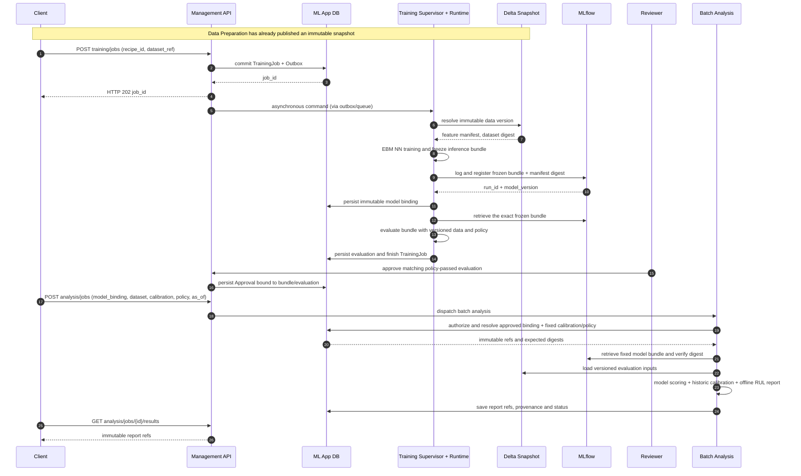

# EBM PoC Notebook 與 PyTorch ML System 架構 Fit–Gap 分析

> 日期：2026-10-29  
> 修訂：依目前程式補正；整合實作仍待完成。  
> 分析基礎：[Notebook](../EBM_final_forline.ipynb)（14 個 Cells）、[HLD v1.1](pytorch-ml-system-hld.md)、[LLD v1.3](pytorch-ml-system-lld.md)、[ADR-014](adr/014-implementation-baseline.md) 與目前程式碼。根目錄 HLD/LLD 為歷史副本。  
> 程式基準：`a88f6ff6d1c19987c7cbf4b1f90280d19f83786a`；Notebook SHA-256：`6559bcd463a79b4b9697a7d3916e110851d02a05ea3bbbb8e96d4d9f0448fba9`。  
> 方法：Notebook JSON / Python AST 靜態檢視、既有儲存輸出摘要、與目前程式及設計契約對照。**未執行** Spark SQL、PyTorch 訓練、MLflow 整合、模型載入、效能測試或 E2E；既有驗收記錄不代表本次重跑。  
> 文件性質：架構相容性審查；本報告不代表 PoC 模型已通過正式驗收或已具備線上推論能力。

對應工作包、修改位置與驗收矩陣見 [EBM 整合計畫](ebm-integration-plan.md)。下文 Cell 從 0 起算；Notebook 的 `#L` 引用為 JSON 檔行號。

## 0. Executive decision

**結論：架構適合承接 PoC，但目前設計／實作並不能直接將這份 Notebook 原封不動作為可部署的 Training + Serving 工作。**

- **已有且可重用**：持久化 Job/Attempt/Outbox、身份與人工核准、獨立 CPU MLP 訓練程序、不可變 JSON Dataset、local/MLflow Adapter、固定版本 Serving、rollout/rollback。實測範圍見 [Implementation Status](implementation-status.md)，遠端服務與目標 Runtime 仍需環境驗證。
- **缺口**：EBM 的 API/Recipe/Dataset schema、Databricks / Delta / CDF 與 Pad CSV 資料交接、Spectrogram Transformer、CNN Trainer/Sampler/Loss、Evaluator/Policy、Serving 輸入輸出與 Loader、歷史校正、Batch Analytics / Report API。現有二特徵二分類契約不能只靠替換 ModelFactory 承接。
- **不能直接宣稱**：Notebook `INFER` 就等於獨立線上推論服務；RUL 圖表就是單筆即時 RUL 預測；目前的 CNN 已實作 Q/K Feedback EBM 的回饋路徑；現有權重檔在乾淨 Serving Runtime 中必然能重建所有輸出。
- **優先落地策略**：先以 Databricks 資料快照 + 固定 PyTorch Training/Batch Scoring + MLflow + 固定版本結果報告，完成可重現的批次 E2E；再對線上 Precomputed Spectrogram Inference 定義專用契約。完整線上 RUL 決策需額外驗證時間資訊與歷史狀態。

## 1. Notebook 可檢驗的事實

| Cell | 實際功能 | 重要依賴或輸出 |
|---|---|---|
| 0–2 | 資料獲取與 Spectrogram | `spark.sql` / `spark.table`、外部 CDF 與 Pad CSV、LOT 與 FDC Delta 表、`scipy.signal.spectrogram`、本地 CSV+NPZ |
| 3–4 | 核心 Runtime、模型與訓練 | `_training_fingerprint`、`prepare_pipeline`、兩個 `nn.Module`、客製 CDF/Ranking/Recon Loss、`.pt` 權重 |
| 5 | Feature 校正與融合 | 歷史/目前 Fold 校正、相關係數、ECDF、特徵選擇、分數及 Energy |
| 6 | 原 Notebook 輸出 16 | Energy/Quadrant 圖與審核資料 |
| 7 | 原 Notebook 輸出 17 | Pad 狀態、RUL 及延長決策、統計／圖表，含後續觀測的離線分析 |
| 8–9 | 分環境執行方法及設定 | Serverless 先跑 SQL/FDC，Server/Cluster 再跑 NN 與報告；`AUTO/INFER/RETRAIN/RESTORE_OUTPUTS` |
| 10 | Serverless Data | `fetch_data_pipeline(config,spark)` |
| 11 | 特定舊資料寫入恢復 | 比對指定 Delta 版本、列數、Signature，改寫 Manifest `READY`；不是一般模型推論 |
| 12–13 | 最終執行入口 | `prepare_pipeline`、`show_cell16`、`show_cell17`，產生 `pipeline_result` 等記憶體物件 |

Notebook 保留已存執行輸出（如資料快照恢復的 `READY`、圖表及彙總），但本輪**沒有重新執行**；不應將它們誤當目前部署環境的端到端驗證。

此版本明確寫入的是 Delta 資料與狀態 receipt；模型結果主要保留於 `pipeline_result`，`_restore_legacy_outputs()` 讀取舊 Delta 成果。這不構成一般化的新結果發佈／Report Store 契約。

### 1.1 重要模型與資料細節

- FDC 訊號：**7 Signals × 4 Pads = 28 Channels**；每個 Lot 的 Spectrogram 維度為 `[7, 4, 9, 31]`，Batch Input 為 `[N, 7, 4, 9, 31]`（依目前 `FIXED_SECONDS=256`、`NFFT=16`、`NOVERLAP=8` 的設定推導）。
- 前處理：依 Lot/Segment 篩選與對齊、每秒插值、截斷或前填到固定長度、Spectrogram magnitude + 可選 log1p、訓練分組 mean/std 標準化。
- 模型：`PerSignalSharedCNNAutoencoder` × 7、`SpectrogramCNNQKFeedbackEBMOptionalAux`，以每 Signal 的 CNN Encoder/Decoder 輸出 Latent；主 `forward` 目前由 Latent 均值／標準差給 `mu/sigma`；Latent 預設 `7×4×4 = 112` 維。
- 訓練：預設 `EPOCHS=100`、`BATCH_SIZE=128`、Adam `lr=0.001`、`weight_decay=1e-5`；按 Recipe/Segment 分組抽取合法 Ranking Batch，Loss 包含 CDF Anchor、Lot CDF Correlation、Wafer Ranking 以及 Reconstruction（RUL Ranking 預設關閉）。
- 裝置：`cuda` 若可用，否則 `cpu`；**目前程式沒有 MPS 選擇分支**。
- Fold：依 Four-Pad Segment 時間切分；真正呼叫 `fit/backward/step` 僅於 **fold 1 且權重未恢復**。後續 Fold 使用模型評估；`ROLLING_EXPANDING_TRAIN` 變數有設定但未在實際迴圈中控制 expanding retraining。
- `.pt` Checkpoint：`state_dict`、當時的 `feedback`、`feedback_mean/std`、`fold_mean/std`、`training_fingerprint`；在首次 Fold 訓練完成後保存，沒有 optimizer、epoch、RNG 或 sampler 狀態，不能當成可中途恢復的訓練 checkpoint。**沒有完整版本化 ModelFactory/FeatureBuilder/Calibration/OutputMapping 的獨立 Serving 契約**。
- 預測粒度：每個 Lot/Recipe 的 Spectrogram 會 join 到多筆 Wafer 標籤；相同 Lot 輸入在 `eval()` 下得到相同 NN 輸出，不能由報告的 Wafer 行數推定具有 Wafer-specific 特徵辨識能力。
- 標籤與報告：CDF 跨檔交集、完整 Four-Pad Segment、有效歷史校正等缺失都會拒絕，而不是自動虛構值。離線 RUL 包含之後才發生的 OOS/重置等觀測資訊。

### 1.2 需要先處理的功能／可重現性問題

1. **`feedback` 目前沒有進入 NN Forward 計算**：Cell 4 `SpectrogramCNNQKFeedbackEBMOptionalAux.forward()` 具有 `feedback` 參數，但 Body 只對 `spectrogram_x` encode，計算 Latent mean/std 後直接返回。外部的 feedback 更新迴圈並不改變模型預測；Q/K 相關設定 `QK_DIM`、`K_PROTO`、`HIDDEN_DIM` 同樣未參與該 Model Class 的運算。需由模型 Owner 確認這是刻意簡化還是缺漏；**不能用名稱推斷 Q/K Feedback 已實作**。
2. **可選 Auxiliary Head 尚未實作完整**：模型建構時 `self.use_aux_head=False`，Forward 固定返回 `None, None`；若將 `USE_AUX_HEAD=True`，現有 Training/Testing 輸出路徑對它們做 `.cpu()`，有執行錯誤風險。應先禁用並驗證，或補完整 Aux Head。
3. **`INFER` 路徑不是獨立 Model Serving**：`prepare_pipeline()` 在非 `RESTORE_OUTPUTS` 模式仍檢查 Delta、建立 Spectrogram 與訓練資料。`fold_mean/std` 雖寫入 checkpoint，恢復函式未載回它們，而是從原始 training Spectrogram 重算後驗 fingerprint。Fingerprint 包含 Torch 版本與裝置，因此原 wrapper 不會直接接受 CUDA 訓練轉 CPU `INFER`。獨立 Runtime 應載入 frozen normalizer，另以 Golden I/O 驗證跨環境相容性。
4. **Notebook Dataset Snapshot 仍有覆寫／競爭風險**：Serverless 覆寫共享表與單筆 `WRITING`／`READY` Manifest；檢查後使用 `spark.table()` 讀取當前表，沒有釘選版本。`_data_signature` 雜湊日期、設定和 `CDF_FILE_NAMES`，未涵蓋所有上游 Delta 版本與 `p1_only.csv`～`p4_only.csv`。必須按任務原子發佈不可變 snapshot，讀取時也固定版本。Cell 11 的指定舊版本恢復不能視為通用 Snapshot Adapter。
5. **完整 Serving Artifact 缺少部分必要資訊**：需額外固定訊號順序、Pad 對應、重採樣／頻譜參數、模型架構 code digest、fold normalization、calibration state、decision rules、Versioned Output Schema 和 Golden IO。
6. **訓練標籤在時間切分前重排 CDF**：Cell 2 對來源 CDF、Cell 4 對完整 `target` 做 Recipe-group percentile rank，之後才切 Training/Testing。若來源含後期資料，早期訓練 labels 會受後期分布影響。時間外推驗收需在訓練窗口內擬合並凍結 CDF reference；不能僅因 Normalizer 是 train-only 就宣稱整條流程無洩漏。
7. **估計 RUL 本身使用回溯資訊**：Cell 7 從所有 completed cycles 選 pooled anchors，亦使用同一 cycle 的後續高能量 Lot，沒有要求 anchor time 早於預測 Lot；結果標為 `OFFLINE_EXTRAPOLATED_ALL_LOTS`。這涉及 `ESTIMATED_RUL_PAD_LIFE`，不只 `actual_RUL`。線上版本需改為只取 `as_of_time` 已可得的歷史狀態，並使用 rolling-origin backtest。
8. **Cell 5 校正應按實際可得時間判斷**：前 N 個 Lot 有從 `pure_testing_lots` 排除，且只把訓練資料、已完成歷史與當前前 N 個 Lot 納入 calibration。這可能具有因果有效性，但需確認預測後續 Lot 時校正 CDF 已到達；不能將所有 history calibration 一概判為洩漏。對整個 testing window 排名的評估 CDF 亦需與即時可用特徵分開。
9. **資源需求尚未知**：Notebook 內有大量 `Spark -> Pandas` 全量傳輸，之後載入 NumPy/Tensor（可能整批上 GPU）。Remote Executor 不會自動消除 driver 記憶體需求。必須量測 Dataframe RSS、CPU/VRAM Peak、Checkpoint Size 和 Run Duration；現有預設訓練期限為 300 秒，不能直接假設符合真實工作。
10. **受控演算法與輸出語意**：`sigma` 是 Latent 維度間的標準差，`mu + RISK_Z*sigma` 是原始 NN score，不是已驗證的不確定度。Cell 5 的 `DIRECT_FUSED_ENERGY` 另依賴特徵選擇、sign/weight、ECDF、median bias、分箱與 policy；RUL 又需 Pad 歷史。三者要有不同契約。模型與前後處理透過受控 recipe 組裝，Notebook 的硬編碼 `_MODEL_SOURCE_HASH` 也不能代替實際 code digest。

### 1.3 關鍵來源索引

| 證據 | Notebook 位置 |
|---|---|
| Spectrogram 參數與 shape | [Cell 2](../EBM_final_forline.ipynb#L560) |
| Forward 不使用 feedback，Aux 回傳 None | [Cell 4](../EBM_final_forline.ipynb#L1242) |
| Split 前 CDF ranking | [Cell 2](../EBM_final_forline.ipynb#L454)、[Cell 4](../EBM_final_forline.ipynb#L1379) |
| Normalizer 重算、第一 Fold 訓練 | [Cell 4](../EBM_final_forline.ipynb#L1579)、[epochs 條件](../EBM_final_forline.ipynb#L1613) |
| Fingerprint、load 與 checkpoint 欄位 | [Cell 4](../EBM_final_forline.ipynb#L828) |
| 校正 Lot 與 pure testing 分離 | [Cell 5](../EBM_final_forline.ipynb#L2226) |
| Direct fused energy | [Cell 5](../EBM_final_forline.ipynb#L2358) |
| Completed-cycle anchors 與離線 RUL | [Cell 7](../EBM_final_forline.ipynb#L3422) |
| 共享快照與 signature | [Cell 4](../EBM_final_forline.ipynb#L903) |

## 2. 對照現有程式與 LLD v1.3

| 邊界 | 目前實作證據 | EBM 所需工作 |
|---|---|---|
| API / Recipe | [Schema](../src/api/ml_schemas.py#L23) 限制 `mlp_v1`、`cross_entropy`、`cpu-small-v1`；[Resolver](../src/infrastructure/datasets/ml_recipes.py#L22) 只批准 `nn_classifier@1.0.0` | 增加 EBM 版本化意圖、參數、資源及 Dataset 相容性；依受控 Recipe 配對元件 |
| Dataset | [DTO](../src/domain/datasets/models.py#L21) 限定兩個特徵與 binary label；[Source](../src/infrastructure/datasets/snapshots.py#L16) 讀本機 JSON 且限制 16 MiB；已有 tenant-scoped content-addressed registration | 增加 Tensor/metadata schema、Delta/CDF/Pad CSV provenance、不可變資料與特徵快照 |
| Trainer | [Child](../bootstrap/ml_training_runner.py#L24) 固定組裝 `FileDatasetSource` 與 `PyTorchTrainer`；[Trainer](../src/plugins/training/pytorch_trainer.py#L54) 固定二特徵 MLP/Cross Entropy | Recipe dispatch、Spectrogram、CNN、group sampler/custom loss、checkpoint/resume、進度 |
| Evaluator / Policy | [Evaluator](../src/infrastructure/serving/evaluation.py#L34) 固定 binary accuracy ≥ 0.75 與 `classifier-v1` | EBM 指標、資料時間界線與版本化 policy；不能用現有 demo accuracy 當 EBM 品質標準 |
| Serving | [Runtime](../src/infrastructure/serving/pytorch_runtime.py#L25) 限制 MLP、兩特徵、Softmax；[Wrapper](../src/infrastructure/serving/bounded_prediction.py#L31) 亦限制二分類輸出 | Tensor input、NN output DTO、Normalizer/Runtime/Loader dispatch，連外層輸出驗證一起擴充 |
| Artifact | [Verifier](../src/infrastructure/serving/artifacts.py#L26) 要求 manifest v2、固定 format/檔案、≤16 files、預設 128 MiB | 定義 EBM bundle 與驗證器，不可把單一 Notebook `.pt` 當作現有可部署 bundle |
| MLflow / Governance | [MLflow Adapter](../src/infrastructure/mlflow/tracking.py#L46) 已有 metrics、bundle registration 與重試對帳；人工核准與部署亦已有實作 | 沿用能力；加入 EBM 的 lineage、policy 與相容性，驗證遠端環境 |
| Jobs / Executor | [TrainingExecutor](../src/application/training/ports.py#L30) 已有 Protocol，實際為 local subprocess；[Worker](../bootstrap/ml_worker.py#L47) 終態後 ACK | 外部提交、遠端結果取得及可重新領取的 reconciliation 尚須實作；Data/Analysis 要有獨立成果契約 |
| Provenance / Error | [Supervisor](../src/application/training/supervisor.py#L98) 固定 `torch-cpu-v1`，evaluation error 固定 `classifier-v1` | 成功及失敗路徑都由已解析的工作契約決定版本，避免錯標 EBM 結果 |
| Batch Reports | 沒有這份 Notebook 的 AnalysisJob / Report 發佈能力 | 版本化歷史校正、離線 RUL、報告保存、授權查詢及重播 |

既有 [CPU MVP 與 Backend 驗收記錄](implementation-status.md) 可作回歸基線；這些證據沒有證明真實 EBM Notebook 已可執行。整合時保留 MLP 契約，新增第二種工作能力，不放寬成任意模型或未驗證資料。

## 3. 建議的整體執行拓樸

```mermaid
flowchart LR
    Client[Web/Client] --> API[FastAPI Management API]
    API --> App[(ML App DB + Outbox)]
    App --> Relay[Outbox Relay]
    Relay --> Broker[RabbitMQ Taskiq]
    Broker --> Supervisor[Training Supervisor]
    API --> DataJob[Data Preparation Job - proposed]
    DataJob --> DataExec[Databricks Data Job Adapter]
    DataExec --> DBX[Databricks Serverless Spark SQL]
    DBX --> Delta[(Versioned Delta Snapshot)]
    Supervisor --> ModelExec[PyTorch Training Executor]
    Delta --> ModelExec
    ModelExec --> Model[EBM Plugin Trainer]
    Model -->|frozen bundle via supervisor| MLflow[MLflow Tracking + Registry]
    MLflow --> Obj[(Artifact Store)]
    MLflow --> Eval[Exact Frozen Bundle Evaluation]
    Eval --> Approval[Manual Approval]
    Approval --> Loader[Verified Model Loader]
    Obj --> Loader
    Loader --> Serve[FastAPI Serving Runtime]
    API --> Batch[Batch Analysis Job]
    Batch --> Delta
    Batch --> Loader
    Batch --> Reports[(Versioned Reports / Figures)]
    Serve --> Predict[Online Feature-based Predict]
```



**要點**：`Databricks Data Job` 和 `PyTorch Training Executor` 可以部署在不同的 compute；資料傳遞必須使用不可變的 DatasetVersion / Delta Version / Manifest，不應依賴可覆寫共用表。原始 FDC 若不可移出 Databricks，採 `DatabricksJobsExecutor` 讓模型訓練留在授權環境；如果允許資料出口，預先轉成受控的 Parquet/NPZ Snapshot 再交給獨立 Training Runtime。

這是整合後的目標拓樸，Data/Analysis 能力尚未實作。兩種策略取決於資料搬移限制、規模與維運環境，不能只因 Notebook 分兩個 compute 就認定 Remote Executor 優先。CPU 第一階段可先消費已匯出的合法固定 fixture。

`DataPreparationJob` 成功代表 Dataset 原子發佈，`AnalysisJob` 成功代表 Report 原子發佈；現有 [TrainingRepository.finish](../src/infrastructure/persistence/ml_training.py#L279) 要求 ModelBinding 與同一 manifest 的 Evaluation，不能原封不動用來完成這兩種工作。可重用身份、冪等、Outbox、Attempt、取消與 fencing 模式，但需各自定義成果及復原契約。

## 4. Training 與 Serving 必須分成兩條獨立的契約

### 4.1 訓練與批次推論的初版



**注意**：序列圖 `A -> J` / `A -> B` 是經 Outbox/Queue 的非同步指令語意。現有 Worker 等 Job 終態及 transport snapshot 持久化後才 ACK；LLD §6.3 的 `External Submitted` 為 PHASE-2+，必須另完成 stable submission key、遠端 execution ref、同交易的可重新領取 reconciliation work、cancel/unknown 狀態、結果 materialization 和重啟復原，才能採取提交後 ACK。

TrainingJob `SUCCEEDED` 代表工作與評估結果已持久完成，並不保證 Evaluation 為 `APPROVED_BY_POLICY`。圖中人工核准只對政策通過且綁定一致的結果成立；被拒絕的評估不能繼續部署。本圖將 Batch 設為使用已核准模型，且固定 calibration/policy，核准權威為 App DB 而非 MLflow。若未來要支援研究用途的未核准離線分析，須另定權限及結果標記。圖示 `/analysis/jobs` 是待實作契約；實際 route prefix 需於 API 實作時固定。

### 4.2 即時／低延遲 Serving 的限制

先以明確的 `PrecomputedSpectrogramInput` 試驗純 NN Inference：固定 `model_version`、`[N,7,4,9,31]`，經指定 normalization 使用 `torch.inference_mode()` 取得 Latent + `mu/sigma`，再套用明確界定的 Output Mapping。

把 `Raw FDC -> Spectrogram` 擴展到 On-demand Serving，需要另定義資料取得 SLA、Lot 是否已完成、四 Pad 的 28 訊號是否完整、外部資料遲到、資料快照／時間戳，以及 `as_of_time`。將「NN 直接輸出」和「CDF/歷史校正後 Energy / RUL 決策」分開輸出；後者需要版本化且當時可得的 Calibration State，可能更適合批次或 Micro-batch。

純 NN 契約應清楚標出 `mu/sigma/latent/raw_nn_score`；Cell 5 的 `DIRECT_FUSED_ENERGY` 需固定校正版本，Cell 7 的 RUL 需因果有效的歷史 anchors。現有 estimated RUL 與 ground truth RUL 都有回溯時間依賴，需由模型 Owner 定義線上預測目標、觀測時點、資料可得時間與回測方法。

## 5. EBM Model Serving Artifact Bundle（增補 LLD §8.3）

沿用 LLD v1.3 與現有 manifest v2 的 digest、producer、lineage、model、runtime、contract 概念，另外定義版本化的 EBM artifact profile。以下是**待實作的內容配置**，不是目前 Loader 可接受的現成產物：

```text
ebm-neural-bundle/
  manifest.json             # format/profile、檔案 bytes/hash、code/runtime、lineage
  weights.pt                # 純 state_dict
  model_config.json         # 每 Signal CNN、Pad count、latent 與建構參數
  feature_schema.json       # [N,7,4,9,31]、float32、signal/pad order、Lot 粒度
  spectrogram_config.json   # 插值、padding、Hann、nfft/noverlap、log1p 等
  preprocessing.json        # frozen normalizer 參照、fit dataset/split digest
  normalization.npz         # train-only mean/std；目前形狀 [1,7,4,9,1]
  output_mapping.json       # mu/sigma/latent/raw_nn_score 的定義與維度
  golden_io.json            # 固定輸入輸出及有依據的浮點容差

calibration-bundle/
  manifest.json             # model binding、calibration version、有效時間與來源
  calibration_state.json    # selected features、sign/weights、ECDF、bias、history
  decision_policy.json      # 分箱、閾值、RUL anchors 的取得規則
  golden_analysis.json      # 固定歷史輸入下的 energy/report 驗證
```

現有 Verifier 要求固定五個檔名與格式，Runtime 仍強制 MLP；新增檔案不會自動使其支援 EBM。應以受控 profile 選擇檔案及欄位驗證，保留 MLP 的原契約；拒絕未知 architecture、缺漏／被改寫的 normalizer 和不相容的輸出。

Neural bundle 凍結後不能因 Registry 指派版本而重寫 manifest；ModelVersion 綁定存在外部。會隨歷史資料更新的 calibration 應產生新版本，以 `model_binding + feature_version + calibration_version + decision_policy_version + as_of_time` 追溯，不在 Serving 中偷偷重新 fit，也不把當下可更新狀態覆寫回既有模型。

NN 模型的核准不自動涵蓋新增的 calibration／decision policy。Calibrated Energy 或 RUL 的評估、核准與部署參照須綁定 model、calibration、policy 的版本與 digests；若替換任一成員，必須有對應組合的有效評估證據。這項組合治理也是待實作的擴充，現有 neural manifest 核准不能代替它。

Calibration 必須記錄 event time 與 available time，保存 feature selection、correlation sign/weights、ECDF knots、fold median bias、binning、例外規則與必要的歷史 anchors；只有 metadata 上寫 `as_of_time` 而沒有實際時間過濾不算通過。NN-only Serving 不必依賴 calibration bundle。

Training Checkpoint 另存 optimizer、epoch、RNG、sampler、必要的 scheduler、recipe/dataset/split digest；checkpoint resume 與 Serving load 是不同契約。乾淨 Serving Runtime 須在無 Spark、原始 CSV、訓練資料與 Notebook globals 的情況下通過 NN Golden I/O。

## 6. 建議新增的 Module／Adapter

```text
src/
  application/
    data_preparation/          ports.py, service.py, contracts.py
    training/                  ports.py, service.py (既定架構下擴充)
    analysis/                  ports.py, service.py, contracts.py
    prediction/                ports.py, service.py (既定架構下擴充)
  domain/
    datasets/                  ebm.py
    analysis/                  models.py, policy.py
  infrastructure/
    data_sources/              databricks_sql.py, delta_snapshot.py, cdf_files.py, pad_files.py
    datasets/                  ebm_snapshots.py
    execution/                 databricks_jobs.py, local_process.py
    storage/                   versioned_feature_snapshot.py, report_store.py
    serving/                   ebm_runtime.py
  plugins/
    features/                  fdc_spectrogram_v1.py
    models/                    ebm_cnn_v1.py
    training/                  ebm_trainer_v1.py, grouped_rank_sampler.py
    evaluation/                ebm_v1.py
    analysis/                  rolling_cdf_calibrator_v1.py, pad_rul_report_v1.py
```

這些是建議位置：`application/training`、`application/prediction`、`execution/local_process.py` 等已存在，需擴充；其餘 EBM/DataPreparation/Analysis 元件待新增。沿用既有 `src` 分層，Domain/Application 不直接 import `torch`、`spark`、`mlflow`；由 Bootstrap 依受控 Recipe 組裝 Dataset、Feature、Trainer、Evaluator 與 Runtime。具體檔案修改對照見整合計畫。

## 7. PoC 移植實作順序

| 順序 | 工作包 | 驗收門檻 |
|---|---|---|
| 0 | 模型語意審核 | `feedback`、Q/K、Aux Head、Fold 行為及 RUL 可得性與模型 Owner 確認；保留 PoC 原始輸出作 Golden Baseline |
| 1 | Baseline Unit + Fixture | 從 PoC 取得脫敏小型合法 Fixture：完整 Four Pad x 七 Signals、CDF、標籤、歷史校正；不得使用未授權資料 |
| 2 | Dataset / Snapshot Contract | 先消費固定 fixture；SQL/FDC/CDF/四份 Pad CSV 產出不可變 DataSnapshot，包含上游 Delta Versions、所有 CSV Digests、完整性與時間資料；遠端入口可後續接上 |
| 3 | Spectrogram + EBM Model Plugin | 固定 Input/Output Contract、Group Sampler/Custom Loss、CPU 端到端訓練及與 PoC 結果比對 |
| 4 | EBM Artifact + Evaluator | Freeze → Register → exact-bundle Evaluate；Save/Reload Golden I/O 通過；成功／ERROR 都記正確版本；模型品質門檻由獨立 policy 決定 |
| 5 | Batch Analysis Job | 能用固定模型版本 + 固定歷史輸入產生 CDF/Energy/RUL Reports、可重播與拒絕不完整資料 |
| 6 | Approval + Deployment | EvaluationResult 綁定 Artifact Manifest/Policy；固定版本的 Serving Runtime Ready 且可 Rollback |
| 7 | Online NN-only Serving | 對預計算 Spectrogram 成功推論；Thread/GPU capacity、timeout、in-flight/worker 不互相干擾 |
| 8 | Online Decision/RUL Qualification | 真正遵守 `as_of_time` 的特徵、校正與決策可重現；影子流量、offline online parity、符合資安與 SLO 才開通 |

既有 CPU MLP 與工作可靠性實作作為回歸基線，仍保留其尚未完成的目標環境驗收。本表是 EBM 遷移工作包，不重定義 M0–M7，也不將既有本機 smoke 當成 EBM 或遠端環境證據。

驗收分成兩條版本軌道：**PoC replay** 固定目前資料、Fold、模型與回溯分析語意，證明移植結果一致；**causal revision** 凍結 training-only CDF、限制 calibration/anchors 的可得時間，以新的 recipe/algorithm version 做獨立時序驗證。補上 Q/K 或 Aux Head 也屬新演算法版本，不能同時要求它與舊 PoC 數值完全相同。

## 8. 必要的測試清單

- **Dataset Snapshot**：CDF 與任一 Pad CSV 改變、Delta 版本改變、讀取缺失、併發工作、原子發佈、版本不可變、跨租戶權限；歷史 snapshot 不得跟隨最新表變動。
- **Feature Builder**：28 個指定 Signal/Pad 的順序、時間對齊、缺值策略、256s→9×31、浮點容差、標準化只能 fit 於 Training Slice、Golden I/O。
- **NN**：`train/eval`、當前 replay 對 feedback 不敏感、新 Q/K 版本的預期敏感性、Aux 選項有效性、Batch Rank Group 邊界、Lot/Wafer 粒度、CPU save/load parity、NaN Loss 與梯度；GPU 另行資格驗證。
- **Training/Retry**：時限、取消/硬停止、Checkpoint Recovery、Retry 無重複 fit、Stale worker 不可覆寫最新 Attempt、只有完整成果 Commit 才報成功。
- **MLflow + Artifacts**：Data/Code/Recipe/Weights/Normalizer/Calibration/Policy 追溯、完整載入、Digest 校驗、Golden I/O、經允許的序列化格式。
- **Batch/Serving**：無原始訓練資料仍可 NN load/predict；as-of-time 防護、沒有 CDF/歷史時拒絕或回明確不可用、Feature/Output Schema、黑箱重現報告、跨版本 rollback。
- **Causal Regression**：只改截止時間之後的 CDF、Pad reset 或 anchor 觀測，不得改變已固定的 training labels、前處理與該時點預測；label arrival time 晚於預測時點須排除。這些是新因果版本的條件，不是假稱目前 Notebook 已符合。
- **既有契約回歸**：MLP API、Evaluator、Loader、輸出驗證與治理仍按舊版本運作；EBM evaluation ERROR 不得標為 `classifier-v1`。
- **Performance**：Spark→Pandas 轉換峰值、Input Tensor VRAM、CPU/OOM Admission、Notebook 實測同等資料量之 Training Runtime、Rendering CPU/RAM、Cold Start/P95。
- **Security**：Databricks identity、Delta/Filestore access scope、模型權重與輸出敏感資料掃描、Object Store 最小權限。

## 9. 建議新增的 SDD Specs

- **ML-SPEC-009 Databricks Versioned Data Ingestion**：多執行環境、不可變 DatasetVersion、Delta/CSV digest、失敗／併發隔離。
- **ML-SPEC-010 FDC Spectrogram Pipeline**：固定訊號、完整性、過濾及輸入 Tensor Contract。
- **ML-SPEC-011 EBM CNN Training Plugin**：模型、Loss、Batch Group、Checkpoint、CPU/GPU 契約、Regression Baseline。
- **ML-SPEC-012 Batch Calibration / RUL Analytics**：校正歷史狀態、as-of-time、報告、圖、Ground Truth 的區分。
- **ML-SPEC-013 EBM Inference Artifact and Serving**：模型與前後處理完整重建、固定版本、Golden I/O、純 NN 及後處理能力矩陣。

文件 ID 僅為提案，本次未註冊或宣稱實作完成；本輪具體工作拆解與可驗收產物集中於 [EBM 整合計畫](ebm-integration-plan.md)，後續再依既有 Spec Catalog 決定拆分。

## 10. 最終建議

架構不需要推翻。但**「支援 PyTorch 模型」不等於「支援這份 Notebook 的整個生產管線」**。第一條可交付路徑應是 Versioned Data Ingestion → Frozen Spectrogram → EBM Training → MLflow Artifact → Fixed-version Batch Analysis → Report，而非直接宣告 HTTP 線上 RUL 推論可用。待模型語意、Leakage、Artifact/Calibration 完整重建、安全及容量的測試證據到位後，再增加 Online Model Serving。

**需要模型／產品方確認的邊界**：PoC 的 feedback/Aux/Fold 是否為預期語意、輸出是 Lot 或 Wafer 層級、需要 raw NN score、calibrated energy 還是即時 RUL，以及校正標籤的實際可得時間。這些決策各自影響後續算法／服務驗收；可以先進行契約設計、固定 fixture 與 CPU 元件實作，不必等待所有線上 RUL 決策才開始。
