# ADR-016: Approved Databricks SQL Warehouse Batch Ingestion

Date: 2026-11-08

Status: **Proposed — implementation and qualification in progress**
Scope: Data Ingress extension; existing Training, Serving and Dataset contracts remain separate.

This ADR records the selected implementation for the current feature branch. It
does not mark ADR-015 accepted, authorize production deployment or replace the
final Tech Lead review. External acceptance remains a merge gate.

## Context

The platform already provides `BatchSourceAdapter.acquire(extraction, control)`,
approved source registration, tenant-scoped SQL jobs, fenced publication intents
and immutable JSONL Raw Snapshots. Databricks must reuse those contracts without
provider-specific branches in `IngestionService` or `IngestionSupervisor`.

The first Databricks source is a Unity Catalog Delta table queried through a SQL
Warehouse. The official Python SQL Connector supports OAuth M2M authentication
and bounded `fetchmany()` result retrieval. See the [official connector reference](https://docs.databricks.com/aws/en/dev-tools/python-sql-connector).

## Decision

Use an explicitly registered `databricks-sql@1` Infrastructure adapter with the
official SQL Connector and an OAuth service-principal credentials provider.
Separate approved connection/template configuration from each ingestion request.
SDK imports, connection/cursor objects and authentication state remain inside
Infrastructure. Bootstrap owns construction and registration.

```mermaid
flowchart LR
  Request[Source ID + Version] --> Service[Existing IngestionService]
  Service --> Job[Durable SQL Job]
  Job --> Registry[Approved Source Registry]
  Registry --> Adapter[DatabricksSQLBatchAdapter]
  Adapter --> SQL[Approved SQL Warehouse / Fixed Delta Version]
  SQL --> Codec[fetchmany / dbx-jsonl-v1]
  Codec --> Stage[Existing Private Stager]
  Stage --> Intent[Durable Publication Intent]
  Intent --> Raw[Immutable Raw Snapshot + SQL Metadata]
  Raw -. future .-> Builder[Versioned Dataset Builder]
  Builder -.-> Dataset[Existing Dataset Catalog / Training]
```

Kafka, Spark/Databricks Jobs orchestration, Parquet publication, remote snapshot
pointers and model-specific Dataset Builders are outside this decision.

## Approved source identity and version

A Source Definition keeps the existing raw format fields `jsonl` and
`raw-json-object-v1`. Its `configuration_json` contains exactly:

- `template_ref`: approved server-side template identifier;
- `template_digest`: SHA-256 of the effective public template/connection contract;
- `serialization_version`: `dbx-jsonl-v1`.

The template selects a connection reference, three-part catalog/schema/table,
nonnegative fixed `delta_version`, explicit typed projection and structured
predicates. HTTP callers cannot submit SQL, tables, endpoints, credential values,
Python import paths or replacement template parameters. Existing request bounds
may only narrow the approved Source Definition's extraction limits.

The template fingerprint binds the connection hostname, Warehouse HTTP path,
service-principal client ID, table, Delta version, ordered column names/types,
predicates and serialization version. Changing these requires a new source
approval/version. Credential-file paths and secret contents are excluded so that
secret rotation does not silently alter query identity. Worker validation compares
the approved fingerprint again before acquisition; changed deployment templates
fail closed instead of changing an accepted source's meaning.

Identifier components use an ASCII allowlist and are quoted independently.
Projection is explicit, nonempty, unique ignoring SQL name case and limited to
128 columns; at most 32 structured predicates reference projected columns. The
supported operators are `eq`, `ge`, `gt`, `le`, `lt` and `is_null`. Values are
bounded primitives and use driver parameter binding. Noncanonical Unicode
predicate strings are rejected to keep fingerprint and query semantics aligned.

## Query and source revision

Each query uses a validated integer literal in `VERSION AS OF`, bound predicate
values, deterministic ordering by the entire projection, and a bound
`LIMIT = max_records + 1`. An extra returned row makes extraction fail rather than
quietly truncating the approved result. Retries keep the exact Delta version.

Databricks documents fixed-version Delta reads in the [table-reference syntax](https://docs.databricks.com/aws/en/sql/language-manual/sql-ref-syntax-qry-select-table-reference).
Pinned history can become unavailable because of retention; this adapter must
report failure and must never fall back to the latest table. Version availability
requires an operational retention policy; [table history is not a backup](https://docs.databricks.com/gcp/en/tables/history).

Provenance binds the fixed revision and effective template digest. It contains no
secret, credential file path, query result, Spark object or SDK client. Raw data
and Source Definition metadata remain separate from approved ML Dataset Versions.

## SQL-to-JSONL contract: `dbx-jsonl-v1`

Each row is one UTF-8 JSON object in projection order, followed by a newline.
Column names and declared kinds are approved schema, not inferred from arbitrary
Python objects. Null is allowed for each declared kind.

| Approved kind | Accepted value and JSON representation |
| --- | --- |
| `boolean` | Python boolean → JSON boolean |
| `integer` | Signed 64-bit integer; booleans are rejected → JSON integer |
| `float` | Finite float only → JSON number; NaN and infinities rejected |
| `decimal` | Finite Decimal with at most 38 coefficient digits and exponent magnitude 38 → exact fixed-point JSON string, preserving scale without float conversion |
| `string` | Valid UTF-8 string → JSON string; no model-specific normalization |
| `date` | Date, excluding datetime → ISO calendar-date string |
| `timestamp` | Datetime → UTC ISO string with six fractional digits and `Z`; a naive value is explicitly interpreted as UTC |
| `binary` | Bytes/bytearray/contiguous memoryview → base64 ASCII string |

The SQL session timezone is UTC. An operator must verify that the approved
timestamp column semantics match the explicit naive-as-UTC policy, including any
TIMESTAMP_NTZ columns. A different interpretation requires a new codec/template
version. Unknown types, mismatched row widths, nonfinite numbers and invalid UTF-8
fail extraction; there is no `default=str` fallback.

Serialization accounts for keys, escaping, base64 expansion and the final newline.
It accumulates each field under the remaining line budget instead of building an
unbounded multi-column JSON object. The existing stager additionally enforces
record/byte/line budgets and rejects empty or partial data before publication.

## Authentication, resources and failure handling

OAuth M2M uses a least-privilege service principal with approved Warehouse access
and read-only Unity Catalog grants for the selected table. Server-side connection
configuration allows official Databricks hostnames and Warehouse paths only.
Secrets are read from a private mounted credential file by Infrastructure, not
stored in Source Catalog, Job metadata, manifests or API requests.

The concrete client must stream `fetchmany()` batches with finite batch budgets,
close cursors/connections in `finally`, and keep the existing cooperative control
checks active. Because connect/OAuth/SDK calls may block, acquisition uses a bounded
isolated runtime with a parent-enforced deadline and lease-loss/cancellation stop.
Stopping a local process is not proof that a remote SQL operation was cancelled;
remote cancellation is best effort and Warehouse-side timeout/resource policies
remain required. Query ordering and LIMIT constrain returned data, not all remote
scan/sort work.

Authentication revocation, invalid schema/values and unavailable pinned versions
fail safely; transient transport failures follow bounded retry policy. No retry
changes the source version. SDK exception strings and bound values must not reach
public error metadata/logs. Before intent persistence, failure/timeout/cancellation
may discard private staging. After durable intent, existing publication recovery
reconciles that same candidate and does not fetch Databricks again.

## Validation and acceptance

Required automated evidence includes strict source/connection/template validation,
fingerprint drift, SQL injection rejection, actual parameter binding, all codec
kinds/boundaries, bounded fetch/overflow, timeout/cancel/lease-loss, handle cleanup,
error redaction, Registry integration and existing File/ML regression tests.
Neither a mock client nor an installed connector proves a live integration works.

Before merge, run a real OAuth M2M extraction against an approved fixed Delta
version and PostgreSQL metadata store. Verify `PUBLISHED`, payload digest/count,
revision/fingerprint provenance and no ML Dataset registration. Qualify the worker
container, feature ON/OFF, deployment credentials and production Bootstrap.

If approved Databricks access/test data or the target integration environment is
missing, record **NOT VERIFIED**, keep the single PR **Draft/Blocked**, and leave
production sign-off and final acceptance to the Tech Lead. Preserve separate
atomic implementation/test commits; do not infer acceptance from source completion.
