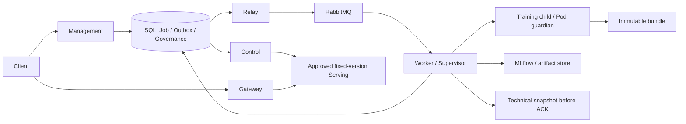
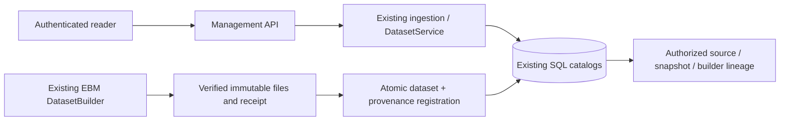

# ML System 架構導讀

本專案以既有 Python Backend substrate 承載受治理的 CPU MLP／EBM 生命週期。
程式碼與 [實作狀態](implementation-status.md) 描述已存在能力；
[HLD](pytorch-ml-system-hld.md)、[LLD](pytorch-ml-system-lld.md) 保留設計契約，
後續 K8s 決策由 [ADR-017～021](adr/README.md) 補充。

## 角色與流程

Management 負責身份、意圖、授權與治理 API，不能執行 fit。Worker／Supervisor
擁有新訓練 dispatch；Control 接管 stale ownership、對帳同一個 fit 並協調部署。
Control／Gateway 共用 Pod／network，使用各自的 role 設定；K8s Serving 是獨立、
固定 source／image／spec 的 runtime。預測不逐次向 MLflow 下載模型。

## 資料與權威

| 資料 | Owner／完成條件 |
| --- | --- |
| Source／Raw Snapshot | Ingestion；固定來源 revision、驗證 bytes／manifest 並完整發布 |
| DatasetVersion | Dataset Catalog／明確 DatasetBuilder；不可變 snapshot、split 與 digest |
| Training Job／Attempt／Outbox | SQL；原子 admission／idempotency、owner fencing、可對帳 execution |
| Model／Evaluation／Approval | 固定 Bundle 與精確評估；明確核准綁定同一組 digest |
| Deployment／Route | SQL generation 與 route revision；runtime readiness 不自行授權切流 |
| Redis snapshot／RabbitMQ delivery | 技術證據與傳輸；不能替代 SQL 業務結果 |

訓練成功不等於品質通過。Serving 必須取得匹配的 Approval；rollback 建立新 generation。
兩個全域 Serving reservations 包括 ACTIVE、pending 與未確認退役的資源。
SQL lease 失效、缺少 Pod 或 PID 不明不能釋放實體 slot 或啟動第二個 fit。

## 程式邊界與擴充

- `src/domain`／`src/application`：純 DTO、政策與窄 Protocol；不依賴 SDK／Torch／K8s。
- `src/plugins`：核准的 feature／model／trainer／evaluation 計算實作。
- `src/infrastructure`：SQL、來源、broker、MLflow、執行器與 Serving adapters。
- `src/api`：驗證與 transport adaptation；`bootstrap` 明確組裝各角色。
- `src/services`、`src/config`、`src/shared_models`、`src/utils`：沿用 substrate 支援能力。

[模組規範](module-spec.md) 與 [boundary checker](../scripts/check_boundaries.py)
約束 import；[Workload Contract](workload-extension-contract.md) 約束 Recipe／handler
靜態註冊。通用 `ModuleCatalog`、kernel plugin 與 ML workload registry 是不同契約。
DatasetBuilder、取得來源、模型計算、執行位置與 Serving 不互相承接對方治理生命週期。

### WP3 metadata discovery and lineage

Management exposes bounded, tenant-scoped ingestion job/snapshot and dataset family/version
collections through existing application services. SQL remains the metadata authority; HTTP
does not read raw payloads or filesystem receipts. New EBM builds verify the existing receipt
and atomically bind it to DatasetVersion in SQL. Complete lineage also enforces input job
owner/operate visibility. Legacy missing evidence and restricted inputs are explicit states.

No Gateway registry or new service is introduced. Training continues resolving the same immutable
dataset identity. See [ADR-024](adr/024-dataset-discovery-lineage.md) and the
[operator workflow](ml-runbook.md#dataset-discovery-and-lineage-wp3).

## 部署與驗收

local／Compose／外部服務 VM profile 保留既有執行方式。K8s profile 注入原生 Serving
及 Pod-aware Training，保留同一套 SQL、品質與路由治理。各 profile 的啟動與故障
驗收以 [部署索引](README.md#部署回歸與維運) 為準。

K8s 的 C4 Container／Deployment 視圖、Pods／Services／Volumes／NetworkPolicy
與有日期的 Minikube 運行快照見 [Kubernetes 架構導覽](deployment/kubernetes-architecture.md)。

底層 Backend 的通用契約另見 [substrate 設計](software-design.md)、
[通用擴充教學](developer-guide.md) 與 [術語](glossary.md)。原始範本設計不再用來
宣稱 ML／K8s 尚未實作；企業環境、模型品質與 production 核准仍須獨立證據。

## Runtime source management

Databricks initialization supports connection-only setup. Authorized operators
register immutable, policy-governed source versions through the Management API.
Workers resolve exact SQL catalog definitions at execution. Legacy templates
and worker-only credentials retain their existing contracts.
See [runtime source management](adr/022-runtime-data-source-management.md) for permissions,
lifecycle behavior and separate external qualification requirements.

## Governed metadata discovery

Opt-in Management discovery uses a dedicated Databricks identity and independent
ml:catalog:read grants. Ingestion clients can browse currently eligible registered
sources through available-sources. See [configuration, APIs and limits](runtime-source-management.md#governed-runtime-metadata-discovery).
External Databricks qualification and production approval remain separate.
