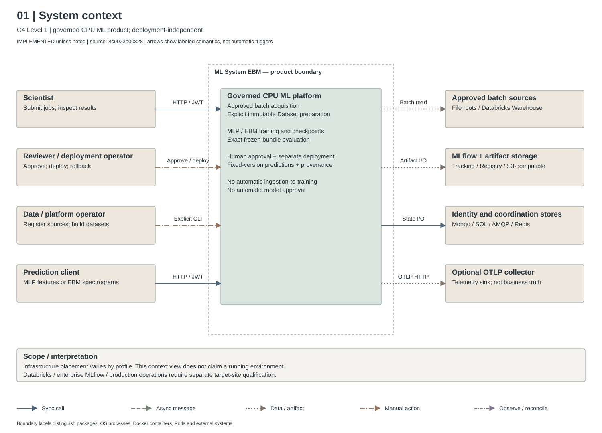
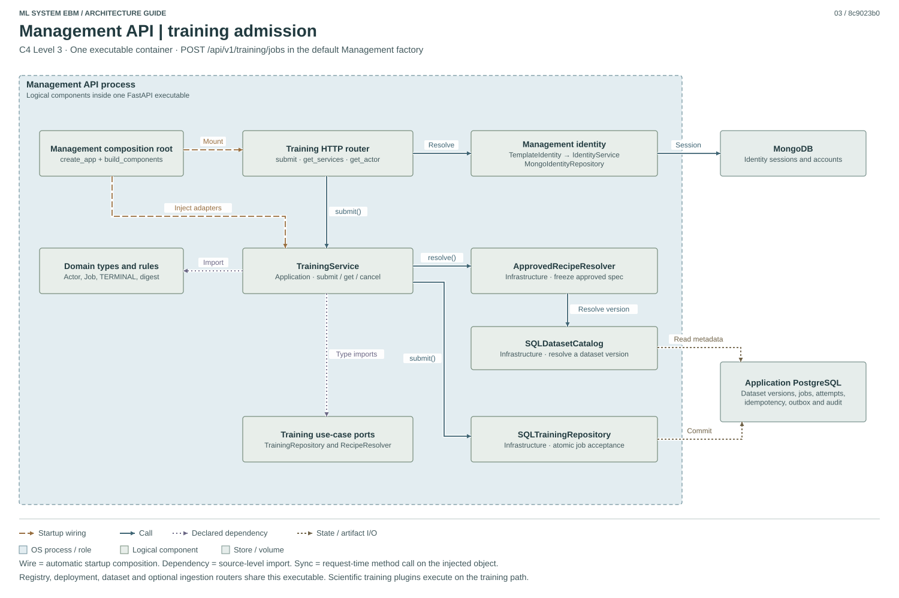
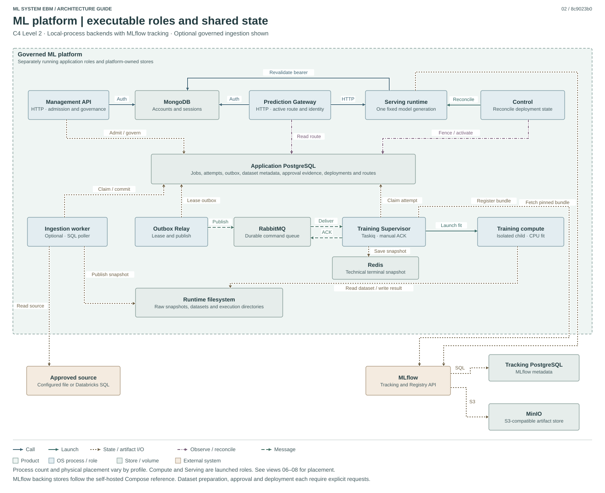
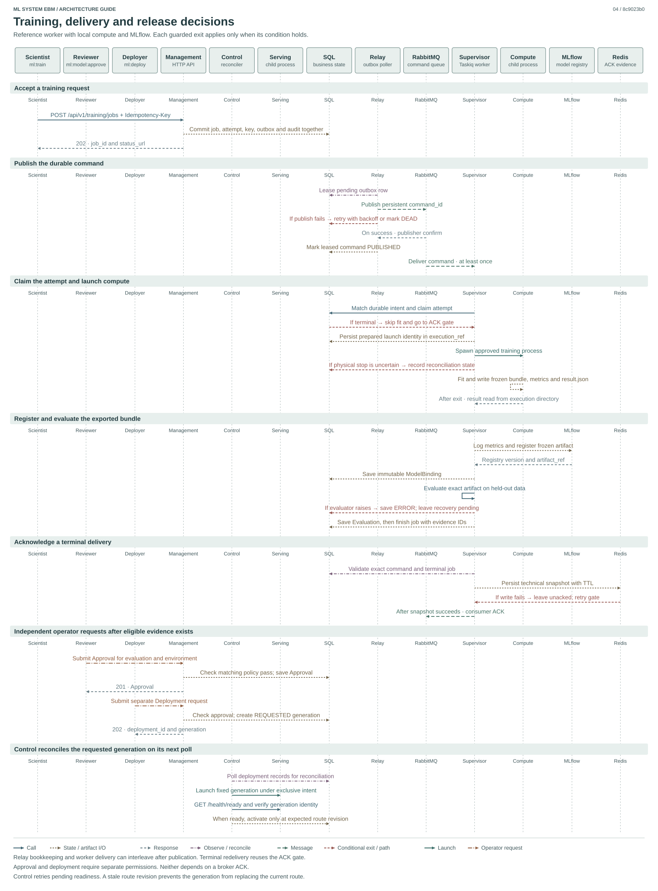
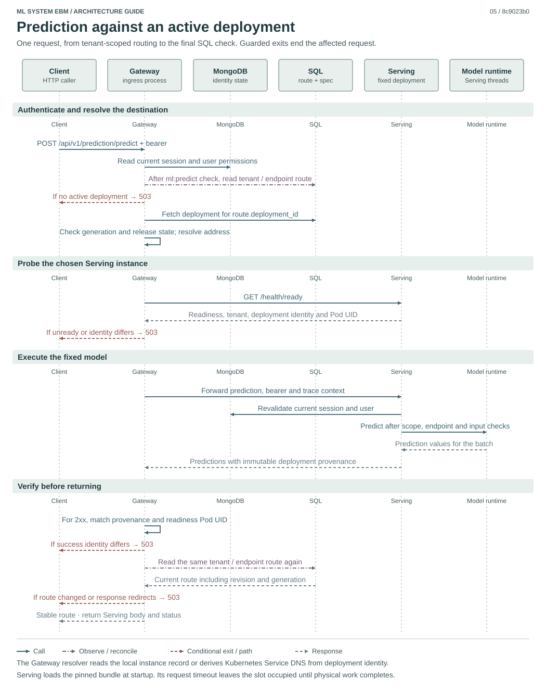
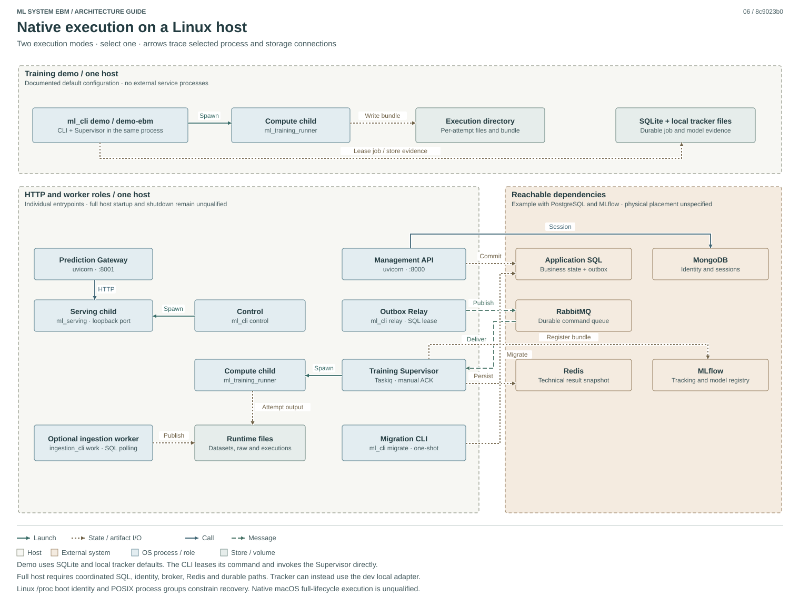
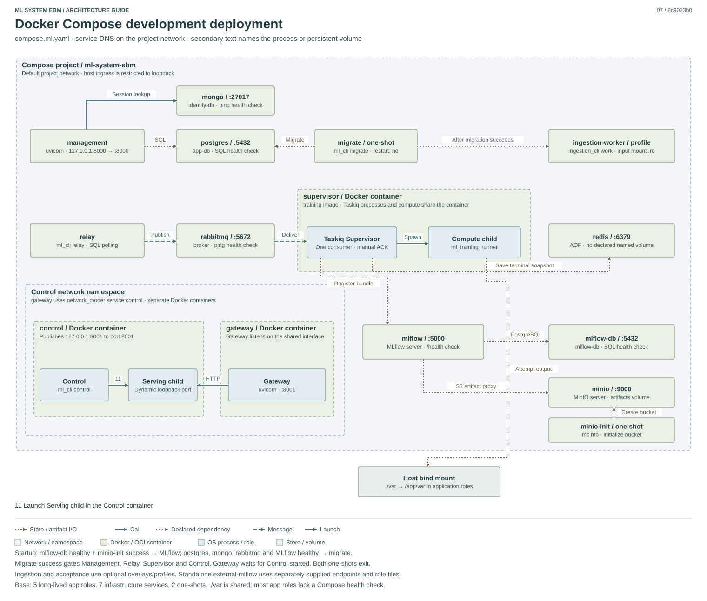
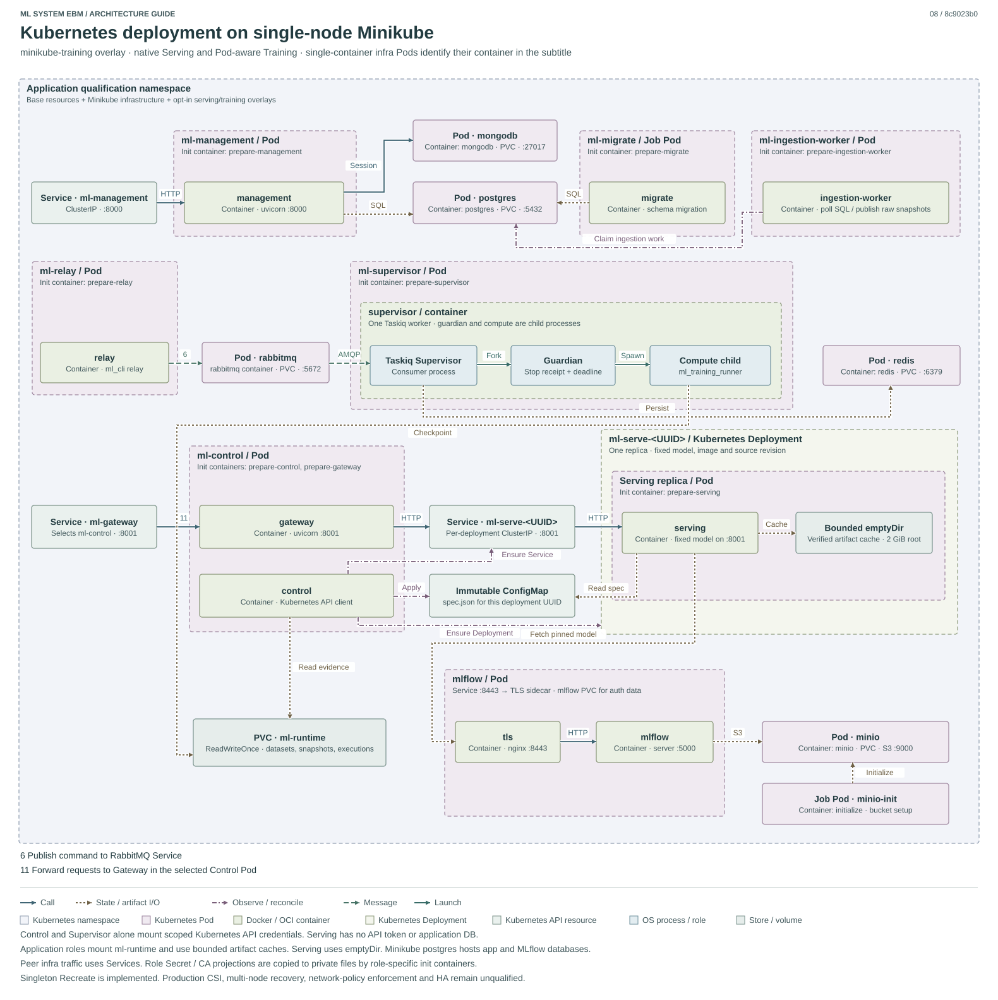

# Software Architecture Guidebook

> 讀者：software engineers、architects、code reviewers 與新進開發者。本文先說明現行能力，再解釋執行與治理邊界；不是新的部署核准或架構改寫提案。

## 文件基準與閱讀方式

- 調查日期：2026-11-24。
- Source branch：`master`。
- Source commit：`8c9023b00828000287e169ac760afe57102d7353`。
- 本次重新核對 entrypoints、application services、SQL／messaging、Docker／Compose、Kubernetes manifests、ADRs、Git merge records 與既有驗證入口。
- 原有入口：[架構導讀](../architecture.md)、[文件索引](../README.md)。本書補充完整的工程閱讀路徑，不取代各 profile 的操作契約。

| 標記 | 本書含義 |
| --- | --- |
| IMPLEMENTED | 目前 source／runtime declaration 支持此行為；不等於已在本機執行成功 |
| DOCUMENTED | ADR／runbook 記錄的意圖、限制或歷史驗收宣告 |
| PROPOSED | 尚未實作或未交付的未來設計／工作項目 |
| UNKNOWN | 證據不足，不能建立結論 |

除明確標記外，當前程式結構與流程描述均為 IMPLEMENTED。對設計動機的推論會標記「推論」。`E01`～`E15` 是可追溯來源索引，包含 exact path、line 與 symbol，見 [Evidence mapping](diagram-evidence.md)。圖 02 的每一種共享基礎設施各有一個節點。沿箭頭可追到實際呼叫或讀寫的對象；圖 04、05 則沿固定的 lifeline 由上往下讀。圖 06 至 08 的外框分別標示 host、container、network namespace 或 Pod，線型與顏色見各圖圖例。

## 1. Executive Overview：產品目的與限制

本系統提供受治理的 CPU ML lifecycle：核准來源的 batch acquisition、不可變 DatasetVersion、核准 Recipe 的 MLP／EBM 訓練、精確 frozen Bundle 評估、人工 Approval、固定版本 Deployment 與帶 provenance 的 prediction。工程目標是讓模型結果、資料、執行身份與部署授權可追溯，並在部分故障時保留真實狀態。[E01](diagram-evidence.md#e01)、[E04](diagram-evidence.md#e04)、[E06](diagram-evidence.md#e06)



系統入口是 HTTP API 與 CLI；本次 source inventory 未發現產品前端。Scientist 提交 Job；Reviewer 核准匹配的 Evaluation；Deployment operator 另行要求部署；Prediction client 呼叫 Gateway。Source／dataset operator 透過 trusted CLI 註冊來源與準備資料。[E01](diagram-evidence.md#e01)、[E05](diagram-evidence.md#e05)

**WHY — DOCUMENTED：** ADR-014 選擇在 pinned backend template 上擴充，保留 generic `server.py` 與既有分層；ML 由 `bootstrap/ml_*` 明確選入。Management 不建立 Torch model。這保留通用平台，同時把長時間 compute 與 HTTP admission 分離。[E13](diagram-evidence.md#e13)

限制：CPU-only；不包含 GPU、DDP、HPO。企業資料品質、真實 Warehouse／MLflow 資格、多節點 storage／fencing、production capacity／restore／SLO 尚需獨立證據。工程驗收不是 production sign-off。[E15](diagram-evidence.md#e15)

## 2. Functional Architecture：能力與使用流程

| 能力 | 狀態 | 介面／責任 |
| --- | --- | --- |
| Identity／tenant／permission | IMPLEMENTED | `/api/v1/identity/login`、bearer、Mongo sessions；操作另受 tenant／owner 限制 |
| Training Job | IMPLEMENTED | `POST /api/v1/training/jobs`；GET Job／attempts；POST cancel；`Idempotency-Key` |
| MLP／EBM | IMPLEMENTED | 靜態核准 Recipe／Workload Contract；不能由 request 選 Python import path |
| DatasetVersion | IMPLEMENTED | operator import；GET `/api/v1/datasets/versions/{dataset_id}@{version}` |
| File／Databricks batch | IMPLEMENTED | approved SourceDefinition；POST `/api/v1/ingestion/jobs`；query／cancel／result |
| EBM DatasetBuilder | IMPLEMENTED | operator 明確指定 RawSnapshot identities，產生既有 DatasetVersion |
| Model／Evaluation／Approval | IMPLEMENTED | Registry 查詢與 `/bindings/{id}/approvals`；必須匹配 policy-passing evidence |
| Deployment／rollback | IMPLEMENTED | POST `/api/v1/deployments`；Controller 非同步執行；rollback 新建 generation |
| Prediction | IMPLEMENTED | Gateway `/api/v1/prediction/predict`；MLP features 或預先計算 EBM spectrogram |
| Interactive setup | IMPLEMENTED | `ml-system init` 產生既有 Compose profiles／private configuration |
| Kernel／generic Job／export framework | IMPLEMENTED substrate | 需 feature flag／明確註冊；不代表附帶特定產品的 kernel／export source |
| 自動 ingestion → build → train | PROPOSED | 未提供自動 orchestration |
| Calibration／Temporal／Energy／RUL／Batch reports | PROPOSED | EBM 後續工作，不能由目前 neural outputs 推定已有能力 |

API 依據 [E01](diagram-evidence.md#e01)；來源與 builder 依據 [E05](diagram-evidence.md#e05)；workload、setup 與 deferred scope 依據 [E09](diagram-evidence.md#e09)、[E14](diagram-evidence.md#e14)、[E15](diagram-evidence.md#e15)。

**HOW：** 使用者提交的是 intent；系統在受信任 registry／catalog 中解析成固定 spec。相同 idempotency key 與相同 intent 回傳原 Job；衝突 intent 拒絕。訓練完成不自動產生 Approval，Approval 不自動啟動 Deployment。[E03](diagram-evidence.md#e03)、[E06](diagram-evidence.md#e06)

**WHY — DOCUMENTED：** 不可變 Bundle 與 evidence binding 避免「評估的是一個模型，部署的是另一個版本」。來源模板與 workload registry 讓 provider SDK／component pairing 由 bootstrap 控制，不把任意執行能力開放給 HTTP request。[E13](diagram-evidence.md#e13)、[E14](diagram-evidence.md#e14)

## 3. Software Architecture：分層、組裝與依賴

圖 03 放大 Management API 接收 `POST /api/v1/training/jobs` 的路徑。啟動時，factory 建立 `TrainingService` 並注入 repository 與 recipe resolver。處理請求時，router 先取得 actor，再呼叫 service；service 透過注入的 adapter 查詢或提交。圖中的 type import 指向原始碼使用的型別。下表另列 repository 全貌，包含在其他 executable 執行的 Plugins。[Management factory](../../bootstrap/ml_api.py#L1) · [E02](diagram-evidence.md#e02)



| 層／package | 擁有的責任 | 不應承擔的責任 |
| --- | --- | --- |
| `bootstrap/` | Factory、settings、adapter selection、lifespan、CLI | request-time 業務政策 |
| `src/api/` | HTTP schema、auth dependencies、DTO rendering、safe errors | 直接選 SQL／SDK implementation |
| `src/application/` | Training／Registry／Deployment／Ingestion／Dataset use cases；Protocol ports | 匯入具體 infrastructure／Torch／Kubernetes SDK |
| `src/domain/` | Actor、Job、Attempt、Claim、WorkloadContract、Dataset、Evaluation、Approval、Deployment、policy | 外層 framework／storage dependency |
| `src/plugins/` | feature transforms、models、trainers、losses、evaluation 計算 | DB／transport orchestration |
| `src/infrastructure/` | SQL／Mongo／AMQP／Redis／MLflow／files／process／K8s adapters | 選擇產品 workflow |
| `src/services/` | 通用 concurrency、resource、health、lifecycle 支援 | 所有 request 必經的額外 service hop |
| `src/config/` | 通用設定 schema／validation | 建立 live resources |
| `src/shared_models/`、`src/utils/` | context／shared types／小型純工具 | 繞過層級的共用業務容器 |

`build_components()` 建立 SQL repositories、approved recipe resolver 與 application services；`Components.supervisor()` 才連接 tracker、evaluator 與 execution adapter。`ml_training_wiring.training_executor()`、`ml_serving_wiring.serving_executor()`／`endpoint_resolver()` 選 local 或 opt-in K8s implementation。[E02](diagram-evidence.md#e02)

依賴方向：API → Application → Domain／contracts；Infrastructure 與 Plugins 指向內層；Bootstrap 組裝外層。Port 不全部集中於 Domain，例如 `application/training/ports.py` 由 use case 擁有。靜態 checker 依實體層驗證 imports；它不是 Python plugin sandbox。[E02](diagram-evidence.md#e02)、[E12](diagram-evidence.md#e12)

`ModuleDefinition`／`ModuleCatalog` 是跨層 feature initialization 描述；不是部署單位。每個 API／Worker process 分別建立資源，依 requires 排序並由 exit stack 管理關閉。Generic kernel registry、ModuleCatalog 與 ML Workload Registry 是不同契約。[E02](diagram-evidence.md#e02)

**WHY — DOCUMENTED：** ADR-008 依要求的 SVG 採實體分層，取代早期 feature package。代價是同一能力分散在多層；一致 capability naming 與 import checks 維持可追溯性。ADR-010 保留通用 substrate，不把特定組織階層或診斷 pipeline 寫進預設核心。[E13](diagram-evidence.md#e13)

## 4. Services and Runtime Boundaries

圖 02 選用 local process executor 與 MLflow，並列出選用的 ingestion worker。沿 SQL 節點可以追到 admission、outbox lease、claim 與 route 查詢；沿 RabbitMQ 則可看到 command delivery 和反向的 consumer ACK。MLflow 使用的 PostgreSQL 保管 tracking metadata，application PostgreSQL 保管治理狀態。[E03](diagram-evidence.md#e03)、[E08](diagram-evidence.md#e08)



C4 Container 表示 executable responsibility；不等同 Docker container。以下是現行 ML roles；process 數量還包含 receiver／compute children，不能只以 role 數代替 OS process count。

| Role／entrypoint | Boundary／communication | State／failure ownership |
| --- | --- | --- |
| Management：`bootstrap.ml_api:create_app` | FastAPI process；HTTP、SQL、Mongo | admission／governance；不執行 fit |
| Relay：`bootstrap.ml_cli relay` | polling process；SQL → AMQP | Outbox lease／confirmed publication；失敗保留 retry |
| Supervisor：`bootstrap.ml_worker:broker` | Taskiq receiver；SQL／Redis／tracker／files | 新 command claim／dispatch；manual ACK |
| Compute：`bootstrap.ml_training_runner` | child process group；files | checkpoint／progress／bundle；restricted environment |
| Control：`bootstrap.ml_cli control` | polling process；SQL／runtime observation | deployment reconciliation、queue expiry、stale training recovery |
| Gateway：`bootstrap.ml_gateway:create_app` | HTTP process；SQL／Mongo／Serving HTTP | authoritative route／response identity verification |
| Serving：`bootstrap.ml_serving` | fixed model process；bounded inference threads | verified startup；不逐次查 App DB／MLflow alias |
| Ingestion：`bootstrap.ingestion_cli work` | SQL polling process；source／files | Source revalidation、lease、publication intent／recovery |
| Databricks acquisition | spawned child；byte pipe／HTTPS SQL Connector | parent deadline／stop；remote cancel 只能 best effort |
| Pod guardian | Pod-profile supervisor child | physical process group／wall deadline／exact stop receipt |
| Migration／operator | one-shot CLI／Job | 明確資料準備／schema migration，不是 background daemon |

程式與 role declaration： [E04](diagram-evidence.md#e04)、[E05](diagram-evidence.md#e05)、[E07](diagram-evidence.md#e07)、[E08](diagram-evidence.md#e08)、[E11](diagram-evidence.md#e11)。

### State authority

| 狀態 | Authority／persistence |
| --- | --- |
| Job／Attempt／Outbox／Dataset metadata／Evaluation／Approval／Route | Application SQL；non-dev 使用 PostgreSQL |
| Accounts／sessions | MongoDB；JWT 是身份憑證，仍檢查 session／permission |
| Command delivery | RabbitMQ；不是 Job business truth |
| Technical ACK snapshot | Redis；不是 model／job authority |
| Experiment／Registry version | MLflow；dev 可用 LocalExperimentTracker |
| Bundle bytes | Local tracker files 或 MLflow／object store |
| RawSnapshot／Dataset bytes／execution evidence | 受控 filesystem；需保留 immutable identity 與 publication semantics |

[E03](diagram-evidence.md#e03)、[E04](diagram-evidence.md#e04)、[E05](diagram-evidence.md#e05)、[E13](diagram-evidence.md#e13)。

**WHY — DOCUMENTED：** SQL transaction 不能包住 AMQP／MLflow／filesystem 的所有副作用，因此保留 Outbox、phase evidence、owner fencing 與 reconciliation。Redis error 不授權 ACK；UNKNOWN 不能當作 STOPPED，也不能藉由 lease 到期推定舊 compute 已死亡。[E03](diagram-evidence.md#e03)、[E11](diagram-evidence.md#e11)

## 5. Data and Control Flows

### 5.1 Ingestion 與 Dataset preparation

`POST /api/v1/ingestion/jobs` 只做授權、idempotency、approved source resolution 與 SQL admission。Worker `claim_next()` 後再次驗證 source／grant／limits；File adapter 或隔離的 Databricks child 取得 bounded data，先寫 private staging，再持久化 publication intent，最後發布 immutable payload 與 SQL RawSnapshot metadata。[E05](diagram-evidence.md#e05)

沒有 durable intent 的失敗可清除 private staging；已有 intent 的失敗必須對帳同一候選 snapshot，不重新 fetch。Operator 另外呼叫 `EBMDatasetPreparationService.build()`，驗證 fdc／wafer RawSnapshot digest／tenant，做 alignment、Lot-aware split、spectrogram transform，才 publish DatasetVersion。該資料依賴不代表事件觸發。[E05](diagram-evidence.md#e05)

**WHY — DOCUMENTED：** provider-specific SQL／credentials 留在 Infrastructure；來源 request 只引用 approved identity。Raw acquisition 與模型特徵契約分開，使來源重送／publication recovery 不偷偷改變訓練資料。[E14](diagram-evidence.md#e14)

### 5.2 Training、registration、evaluation

圖中的 Scientist、Reviewer 與 Deployer 分別代表三個授權角色。最後一段由 Control 輪詢已存在的 deployment request；Approval 的完成與 broker ACK 各自有獨立條件。[E03](diagram-evidence.md#e03)、[E06](diagram-evidence.md#e06)



1. API canonicalizes intent；`TrainingService.submit()` 先查 replay，再解析 approved Recipe／Dataset spec。
2. SQL transaction 原子寫 Job、Attempt、idempotency key、Outbox 與 audit。
3. Relay lease → confirmed publication；RabbitMQ at-least-once delivery → Supervisor。
4. Supervisor 驗證 durable command／runtime identity，claim owner token；呼叫 `prepare_execution()` 把 launch identity 寫入 SQL 的 `execution_ref`，成功後才交給 executor 啟動子程序。[Supervisor.execute](../../src/application/training/supervisor.py#L59)
5. Child 產生 metrics／checkpoint／frozen Bundle；Supervisor register 至 tracker，取得 version，存 ModelBinding。
6. Evaluator 載入該精確 Bundle；保存 Evaluation／report digest，再提交 Job completion。
7. terminal SQL evidence → Redis technical snapshot → RabbitMQ ACK。

[E01](diagram-evidence.md#e01)、[E03](diagram-evidence.md#e03)、[E04](diagram-evidence.md#e04)。

失敗路徑：publication error 回到 Outbox retry；terminal redelivery 不 refit；owner loss 拒絕 stale commit；physical stop 未確認保留 reconciliation。MLflow／evaluation I/O 失敗保留同一 execution 的 phase evidence，finalization 期間續租。EBM checkpoint resume 不等於跨 Job 自動 checkpoint 選取。[E04](diagram-evidence.md#e04)、[E11](diagram-evidence.md#e11)、[E15](diagram-evidence.md#e15)

**WHY — DOCUMENTED：** register 前先 freeze，之後以 external binding 保存 Registry version；Evaluation 必須針對相同 manifest。這個順序避免登錄後內容漂移與 approval evidence 錯配。[E13](diagram-evidence.md#e13)

### 5.3 Approval 與 Deployment

Reviewer 明確提交 `evaluation_id`／environment；`ModelRegistryService.approve()` 必須看到 matching binding、manifest 與 `APPROVED_BY_POLICY`。Training Job 可 SUCCEEDED，但 Evaluation 是 REJECTED_BY_POLICY；未配置 qualified EBM policy 時不能因此取得 Approval。[E06](diagram-evidence.md#e06)、[E15](diagram-evidence.md#e15)

Deployment operator 另行 POST endpoint／binding／approval。SQL 驗證 tenant／environment／binding／report digests，分配 generation 並凍結 runtime code／image／spec。Controller prepare → ready → conditional activate；失敗先 fence，再 retire；實體退役確認前不釋放 reservation。Rollback 新建 generation，不回寫舊 deployment。ACTIVE recovery 重建同一核准 runtime，不重新核准或增加 platform generation。[E06](diagram-evidence.md#e06)、[E11](diagram-evidence.md#e11)

**WHY — DOCUMENTED：** route revision 與 model generation 分離；即使保留原健康模型，也需 fencing stale activation。兩個全域 serving reservations 包含未確認 retirement 的資源，安全性會限制可用容量。[E13](diagram-evidence.md#e13)

### 5.4 Inference



Gateway 驗證 bearer／tenant／`ml:predict`，讀 SQL active route 與 deployment，透過 controller-owned resolver 取得目的地。先查 Serving readiness identity，再轉送 request／auth／trace。成功 response 必須匹配 provenance 與同一 Pod UID（K8s）；最後重讀 route revision／id／generation，變更則失敗。[E07](diagram-evidence.md#e07)

Serving 啟動時驗證 spec digest、runtime source／image、bundle manifest，建立固定 model；request 只執行 bounded inference，回傳 model／deployment provenance。查無 endpoint row 時 SQL repository 回報 `NotFound`。已有 route 但未指派 deployment、identity mismatch 或處理期間切換 route／收到 redirect 時，Gateway 回應 unavailable。schema mismatch、permission、capacity／deadline 有獨立 errors。Timeout 不代表 Torch thread 已停止，slot 直到實際 future 完成才釋放。[E07](diagram-evidence.md#e07)

**WHY — DOCUMENTED／推論：** ADR-019 明定 routed-response identity 與 route reread；推論是系統優先保證回傳結果屬於授權版本，寧可在切流競爭時回 503。[E11](diagram-evidence.md#e11)

## 6. Local Development Runtime



### 最小與完整環境

| 目的 | 最小 process／依賴 | 保證範圍 |
| --- | --- | --- |
| `demo` | CLI／Supervisor parent + compute child；SQLite + local tracker files | 訓練／exact-bundle evaluation；不驗證 broker／HTTP |
| `demo-ebm` | 同上；EBM extras／synthetic data | 不自動 approve／deploy |
| Full HTTP host | Management／Relay／Supervisor／Control／Gateway；Mongo／Rabbit／Redis／SQL／tracker | entrypoints IMPLEMENTED；完整 host launch qualification UNKNOWN |
| Generic backend | `server.py`；預設 memory tasks／single worker | 不等於 ML factory |

[E09](diagram-evidence.md#e09)。

**支援的入口命令**（僅文件示例，本次未執行；先完成下列設定）：

```sh
python -m bootstrap.ml_cli demo
python -m bootstrap.ml_cli demo-ebm
python -m bootstrap.ml_cli migrate
uvicorn bootstrap.ml_api:create_app --factory --host 127.0.0.1 --port 8000
ML_DEPLOYMENT_ROLE=relay python -m bootstrap.ml_cli relay
ML_DEPLOYMENT_ROLE=supervisor taskiq worker bootstrap.ml_worker:broker --workers 1 --max-async-tasks 1 --ack-type manual --wait-tasks-timeout 330
ML_DEPLOYMENT_ROLE=control python -m bootstrap.ml_cli control
ML_DEPLOYMENT_ROLE=gateway uvicorn bootstrap.ml_gateway:create_app --factory --host 127.0.0.1 --port 8001
python -m bootstrap.ingestion_cli work
```

長駐命令須各自執行，不是依序在同一 shell 等待前一程序退出。Local default executor 需 Linux `/proc`、POSIX process groups；原生 macOS／Windows full lifecycle 未建立支援證據。Python `>=3.11` packaging 宣告不等於所有 OS／Python 組合均受驗證。[E09](diagram-evidence.md#e09)

### Configuration 與 startup

- `ML_DATABASE_URL`：所有角色指向同一 SQL；dev default `sqlite:///./var/ml.db`。Non-dev PostgreSQL。
- `ML_ARTIFACT_ROOT`、`ML_DATASET_ROOT`、`ML_EXECUTION_ROOT`：所有角色需一致；使用相同絕對路徑可避免 CWD 歧義。
- Identity：`APP_IDENTITY_ENABLED=true`、`APP_MONGO_ENABLED=true`、Mongo URI／database、至少 32-byte JWT secret；Gateway／Serving 配置須一致。
- Reference ML 使用 `APP_TASK_BACKEND=disabled`，ML training queue 另由 `ML_RABBITMQ_URL`／`ML_QUEUE_NAME` 管理；Supervisor 的 `ML_REDIS_URL` 不屬於 MLSettings dataclass。
- Tracker：dev 可 local；MLflow mode 需 URI 與 artifact access；Serving 需 reader identity。
- `ML_DEPLOYMENT_ROLE` 決定 composition role；production `ML_RUNTIME_ROLE` 由 private loader 映射，不可混為一談。
- `APP_*` 可經 Pydantic `.env`；`MLSettings.from_env()` 直接讀 process environment。Compose `--env-file` 不會自動設定 host CLI。

[E09](diagram-evidence.md#e09)、[E10](diagram-evidence.md#e10)。

啟動順序：dependencies reachable → 明確 migration → roles → provision accounts／datasets → train／review／deploy。Demo 自己明確呼叫 migrate，但 API startup 不遷移 schema。Host applications 需可連線的服務 endpoint；不能直接使用 Compose service DNS 或假設 ML Compose 已 publish DB ports。[E08](diagram-evidence.md#e08)、[E09](diagram-evidence.md#e09)

Shutdown：先停止新工作 admission，保留 SQL／execution／artifact evidence，讓 in-flight work 在實際 budget 內 drain。這是操作原則，不代表已有統一 host shutdown orchestrator。FastAPI lifespan 會關閉資源；CLI loops 的 cleanup blocks 不等於所有 SIGTERM 路徑都有 graceful handler。恢復前以 durable state 與 physical observation 判定，不能因 heartbeat stale 就重新 fit。[E04](diagram-evidence.md#e04)、[E09](diagram-evidence.md#e09)

**WHY — DOCUMENTED：** Local adapters 降低演算法開發門檻；SQLite WAL／BEGIN IMMEDIATE 提供 development transaction semantics，不能取代 PostgreSQL integration qualification。Local tracker 也不代表企業 Registry 權限已通過。[E03](diagram-evidence.md#e03)、[E13](diagram-evidence.md#e13)

## 7. Docker Compose Runtime



### Profiles 與映像

| 宣告 | 用途 |
| --- | --- |
| `Dockerfile`／`compose.yaml` | Generic substrate API／worker + Rabbit／Redis／Mongo；不是 ML startup |
| `Dockerfile.ml:api` | Python 3.12；base + observability；Management default |
| `:training` | CPU Torch／MLflow client／NumPy；Supervisor 與 Control |
| `:ingestion` | Databricks connector dependencies |
| `:ebm`／`:production` | SciPy；unified production image 再加 connector 與 strict entrypoint |
| `:serving` | Standalone Serving target；需 controller-delivered spec 與 expected digest |
| `:acceptance`／`:k8s-acceptance` | 專用 tools／tests；不是部署模型的角色 |
| `compose.ml.yaml` | Reference dev stack；內建 MLflow／MinIO／infrastructure |
| `compose.ml.ingestion.yaml` | 新增 `ingestion` profile 與 File roots |
| `compose.ml.databricks.yaml`／`-token.yaml` | OAuth secret 或 access-token alternative overlays |
| `compose.ml.external-mlflow.yaml` | Standalone production candidate；不能與 dev base merge |
| `compose.ml.acceptance.yaml` | Disposable runtime paths 與 engineering-only policy |

[E08](diagram-evidence.md#e08)、[E10](diagram-evidence.md#e10)。

### Reference startup

在已安裝相依套件／Docker 的開發環境，既有流程如下。本次沒有執行或產生 credential：

```sh
ml-system init
# 或使用既有 reference credential generator；拒絕覆寫既有檔案
python scripts/create_ml_env.py
docker compose --env-file .env.ml -f compose.ml.yaml config --quiet
docker compose --env-file .env.ml -f compose.ml.yaml up --build -d
```

`init` 與 generator 是替代設定入口，不需要兩者都跑。Ingestion 須另備 approved input／configuration，加入 overlays 並指定 `--profile ingestion`；詳細命令見 [Databricks runbook](../databricks-ingestion-runbook.md)。Production 使用已發佈 digest、private role JSON／CA 與 [Day-1 runbook](../deployment/day1-deployment-runbook.md)，不是在 production `up --build`。[E08](diagram-evidence.md#e08)、[E10](diagram-evidence.md#e10)、[E14](diagram-evidence.md#e14)

Reference base 宣告 5 個 persistent application containers + 7 個 infrastructure containers + 2 個 one-shot services（`migrate`／`minio-init`）。Training compute 在 Supervisor container 內；local Serving generations 在 Control container 內。Gateway 與 Control 分屬 container，但 `network_mode: service:control` 共用 network namespace；沒有因此共用 PID namespace。[E08](diagram-evidence.md#e08)

### Network、storage、health

- Management：`127.0.0.1:8000:8000`；prediction：Control publish `127.0.0.1:8001:8001`，實際 Gateway listener 在共享 namespace。
- Infrastructure 以 service DNS 通訊：`postgres`、`rabbitmq`、`redis`、`mongo`、`mlflow`。Reference base 未 publish 這些 ports 至 host。
- Application roles：`./var:/app/var`。Named volumes：`app-db`、`mlflow-db`、`identity-db`、`broker`、`artifacts`。Redis AOF 有開啟，但未宣告 explicit named volume。
- Health gates：PostgreSQL／Mongo／Rabbit／MLflow healthy → migrate；MinIO init success + MLflow DB healthy → MLflow；migrate success → roles；Control started → Gateway。
- Application anchor 有 `init: true`、`restart: unless-stopped`、capability drop／no-new-privileges；migrate restart `no`。不能把這些設定推及全部 infrastructure。
- 多數 application containers 沒有 Compose healthcheck；Ingestion overlay 有 `health`。Management／Gateway ready 只證明 SQL／Mongo，不證明可完成 train 或已有 active model。

[E08](diagram-evidence.md#e08)、[E01](diagram-evidence.md#e01)、[E07](diagram-evidence.md#e07)。

Supervisor 的 Taskiq wait=330s 與 container grace=40s 是需測量的 operational budget；不能聲稱已保證所有長任務 graceful completion。跨 container 的 hostname／PID observation 與單一 host process 不同；共享 filesystem 不解決實體身份可見性。[E04](diagram-evidence.md#e04)、[E08](diagram-evidence.md#e08)、[E09](diagram-evidence.md#e09)

**WHY — DOCUMENTED：** Local/VM Serving 使用 loopback child endpoints，因此 Gateway 共用 Control network。MLflow 與 App SQL metadata 分離避免 migration ownership 混淆。Private production loader 要求 regular owned `0400`／`0600` role file、allowlisted keys、source／image pin、verified HTTPS 與不同 reader／writer identities。[E10](diagram-evidence.md#e10)、[E13](diagram-evidence.md#e13)

Troubleshooting：先看 migration 成功與各依賴；API ready 不等於 broker／tracker 正常。Prediction 503 應查 route／generation／readiness／provenance；不要繞過 approval 或直接寫 SQL route。`docker compose exec` 不繼承 PID 1 啟動後載入的 secret environment，production maintenance 必須重新經 role entrypoint。[E07](diagram-evidence.md#e07)、[E10](diagram-evidence.md#e10)

## 8. Kubernetes Runtime



Kubernetes 在目前 source 已實作，不能標為全部未來架構。`deploy/k8s/base` 包含 singleton Recreate Deployments、Services、migration Job、PVC、ServiceAccounts、NetworkPolicy；Minikube infrastructure 與 serving／training／acceptance overlays 另列。[E11](diagram-evidence.md#e11)

| 邊界 | 當前實作 |
| --- | --- |
| `ml-management` Pod | Management container + private-file／schema preparation init；Service :8000 |
| `ml-relay` Pod | Relay；獨立 role configuration |
| `ml-supervisor` Pod | Taskiq Supervisor；Pod profile guardian／compute 是 processes，不是獨立 Pods／Jobs |
| `ml-control` Pod | Control + Gateway containers；`ml-gateway` Service :8001 選取此 Pod |
| Native Serving | 每個 platform deployment UUID 對應 Deployment／Service／immutable ConfigMap；Pod-local verified cache |
| `ml-ingestion-worker` Pod | 依 profile 啟用來源；與 Training orchestration 分開 |
| Infrastructure | 可由外部提供；local Minikube overlay 有 PostgreSQL／Mongo／Rabbit／Redis／MLflow／MinIO，另有 TLS sidecar |

[E11](diagram-evidence.md#e11)。

Control 透過 scoped API 管理 native Serving；Gateway 用 Service DNS，不讀 Pod IP。ACTIVE recovery 保留 SQL deployment generation／approval。Serving 無 App DB／API token／shared runtime PVC，使用 MLflow reader 與 Mongo identity；cache／home／tmp 為 bounded emptyDir。只有選定 Control／Supervisor containers 掛 API credentials。[E11](diagram-evidence.md#e11)

Pod-aware Training 凍結 Pod UID／container ID／execution envelope／launch token。Worker 擁有新 dispatch；Control 接管 stale SQL claim，但不能 relaunch。Guardian 以 durable request／exact stop receipt 證明 process group 停止；Pod 消失、lease 到期、container 換代都不是 STOPPED 證據。[E11](diagram-evidence.md#e11)

Storage：RawSnapshot／Dataset／execution evidence 在 shared `ml-runtime` RWO PVC；cache 可重建。Rename-no-replace／hard-link／fsync semantics 已有 local storage qualification，但 RWO 不是 RWX、多節點 fencing 或 power-loss durability 認證。NetworkPolicy 的 enforcement 需要 CNI；不能由宣告推定已隔離。[E11](diagram-evidence.md#e11)

**WHY — DOCUMENTED：** ADR-017 將 migration 分成 Foundation、Storage、Serving、Training、Acceptance、Production Operations，保留演算法與治理契約。ADR-019／020 解決原 local address／host PID 假設，SDK 留在 Infrastructure。這不是通用 HPA／arbitrary workload admission 平台。[E11](diagram-evidence.md#e11)

DOCUMENTED retained acceptance：PR #11 final source `43b6606` 的 Compose 報告 1169 passed／zero skip 與 governed Minikube acceptance 留存於既有 status／evidence。這不是本次 HEAD runtime 重跑；企業 cluster／CSI、多節點 recovery、TLS／IAM、backup／restore／SLO 與 production approval 仍 UNKNOWN／未完成。[E15](diagram-evidence.md#e15)

## 9. Architecture Decisions and Rationale

| 決策／歷史 | DOCUMENTED rationale／取捨 |
| --- | --- |
| ADR-008／009／010 | 實體分層、明確組裝、通用 substrate；代價是 capability 跨層分散 |
| ADR-014 | CPU MVP、SQL authority、freeze Bundle、exact evaluation、manual ACK、route fencing |
| ADR-016 | Databricks 實作 approved batch adapter；不讓 Application 出現 provider branches |
| ADR-017／018 | K8s staged qualification；保留既有 paths 與 POSIX publication contracts |
| ADR-019 | Native Serving／endpoint resolver；不改 Evaluation／Approval／routing authority |
| ADR-020 | Pod identity／guardian／stop proof／Control recovery；uncertainty 保留 capacity |
| ADR-021 | Governed HTTP lifecycle + 真故障驗收；獨立 Compose regression 不能省略 |

詳細 ADR pointers：[E13](diagram-evidence.md#e13)、[E14](diagram-evidence.md#e14)、[E11](diagram-evidence.md#e11)。

### Git timeline（本機可查 merge records）

| Commit | 日期 | 變化 |
| --- | --- | --- |
| `a88f6ff` | 2026-10-29 | Initial import 已含 CPU baseline／template；早期 backend 決策不是此 repo 的逐次開發紀錄 |
| `edc1400` | 2026-10-31 | EBM training／serving |
| `122c468`／PR #1 | 2026-11-10 | Governed ingress／external-service baseline；不授權 production |
| `72dc1c3`／PR #2 | 2026-11-11 | Access token alternative；保留 OAuth M2M |
| `97301cf`／PR #3 | 2026-11-13 | Deterministic DatasetBuilder／Lot-aware split |
| `06ddc3a`／PR #4 | 2026-11-14 | EBM end-to-end lifecycle verification |
| `ce81327`／PR #5 | 2026-11-14 | Approved workload registry／trusted dispatch |
| `f2040ed`、`3150c04`、`a5c3847` | 2026-11-17 | K8s Foundation／Storage／Serving |
| `336615e`、`55dd226` | 2026-11-18～19 | Pod Training／K8s governed acceptance |
| `6b536ea`、`8c9023b` | 2026-11-19～20 | Documentation consolidation／interactive setup |

**推論：** 整體優先順序是 traceability 與 partial-failure correctness；immutable identity、phase evidence、owner／route fencing 重複出現。代價是運作需 reconciliation、外部服務與保守 capacity accounting。這是根據程式與 ADR 的分析，不是作者直接引文。

**UNKNOWN：** 未讀遠端 PR discussion；本書 PR 證據來自 Git merge message。早期 template history 在此 repo import 之前，不能虛構其原始討論。ADR-015 是未納 Git 的早期提案編號，不代表額外已採用契約。[ADR index](../adr/README.md)

## 10. Engineering and Operational Guide

### 依問題導航

| 問題 | 第一個閱讀點 |
| --- | --- |
| HTTP request 如何接受？ | `src/api/ml_http.py` → `application/training/service.py` |
| 如何避免 duplicate／lost command？ | `persistence/ml_training.py` → `training/outbox.py` → `messaging/ml_rabbitmq.py` |
| Compute 在哪裡執行？ | `bootstrap/ml_training_wiring.py` → local／pod executor → runner／guardian |
| 模型如何核准？ | `training/supervisor.py` → `model_registry/service.py` |
| 為何 prediction 503？ | `bootstrap/ml_gateway.py` → route／identity／resolver → Serving readiness |
| 哪裡修改演算法？ | Approved `plugins/features`／`models`／`training`／`evaluation`；搭配 workload contract |
| 來源 provider 放哪？ | Infrastructure adapter；Application port；Bootstrap registration |
| 新 HTTP／use case 放哪？ | `api/<capability>`／`application/<capability>`；Domain schema／policy；明確選入 bootstrap |

這些是現行 ownership 導航，不是本次新增 feature 的授權。擴充應遵循 [module spec](../module-spec.md) 與 [workload extension contract](../workload-extension-contract.md)。

### 既有驗證入口

以下為供開發者日後執行的既有 commands；會需要已準備的 dependencies／isolated resources，本次沒有執行 runtime tests。

```sh
python scripts/check_boundaries.py
python -m pytest tests/ml tests/test_boundaries.py -q
python scripts/check_ingestion.py
python scripts/check_deployment.py
python scripts/check_serving_runtime.py
python scripts/check_training_runtime.py
python scripts/check_k8s_acceptance.py
python scripts/verify_ml_acceptance.py --output-dir var/acceptance/local
```

Focused tests：`tests/ml/test_training_contracts.py`（idempotency／claims）、`test_model_governance.py`（approval／routing）、`test_pod_training_runtime.py`（stop／ACK）、`tests/ml/ingestion/`、`tests/ml/dataset_builder/`、`tests/ml/ebm/`、`tests/ml/integration/`。`ML_TEST_DATABASE_URL` 使用專用 PostgreSQL；`ML_TEST_AMQP_URL`／`ML_TEST_REDIS_URL` 啟用真 receiver 路徑。完整 acceptance 需要 real stack 與 `--require-stack`，不是單看 unit pass。[E12](diagram-evidence.md#e12)

| 現象 | 檢查順序／禁止推論 |
| --- | --- |
| Job 停在 accepted／queued | Outbox、Relay publish、queue／consumer；HTTP 202 不證明 fit 已開始 |
| NEEDS_RECONCILIATION | execution identity／owner／physical observation；不能刪 marker 釋放 slot |
| Job success 但無法 approve | Evaluation decision／manifest／policy；不能把 success 當品質核准 |
| Deployment 不 active | Approval／environment／spec、readiness、route revision、reservation |
| Prediction 503 | route、Serving identity／health、response provenance、route race |
| Ingestion published 不完整 | publication intent／payload／fsync／SQL metadata；不可重新抓來源掩蓋不確定性 |
| Production CLI 無 credentials | 重新經 role entrypoint；不要以 bare exec 推定會繼承 PID 1 secrets |

[E03](diagram-evidence.md#e03)～[E07](diagram-evidence.md#e07)、[E10](diagram-evidence.md#e10)。

**WHY：** 驗證依資料與物理 side effect 的邊界分層。Static import check、unit contract、real broker／DB integration、完整治理 lifecycle 是不同證據，不能互相替代。[E12](diagram-evidence.md#e12)、[E15](diagram-evidence.md#e15)

## 11. Known Gaps and Future Considerations

| 項目 | 分類／可建立的結論 |
| --- | --- |
| Full native host launch／shutdown／dependency contract | UNKNOWN：完整 profile 未在本次執行；entrypoints 不等於接受驗收 |
| macOS／Windows supervised runtime | UNKNOWN：Linux `/proc`／POSIX 假設限制 portability |
| Compose跨 container physical recovery | IMPLEMENTED 的保守 observation；shared files 不提供跨 PID namespace 的死亡證據 |
| Container stop grace／Taskiq wait | UNKNOWN qualification；40s／330s 需以真 drain tests 判定 |
| Enterprise MLflow／Databricks | source IMPLEMENTED；target qualification 未完成 |
| K8s company cluster／CSI／partition fencing | PROPOSED／未驗收 Production Operations |
| HPA／HA／arbitrary workloads | 未實作為通用承諾；不能從 Kubernetes support 推定 |
| Ingestion-to-build／train automation | PROPOSED；目前仍需 explicit operator／HTTP actions |
| Calibration／Energy／RUL／Temporal／Batch reports | PROPOSED；現有 neural serving 不等於 calibrated product outputs |
| Production release locks／capacity／RPO／RTO | 需 release／site evidence；不能從 inherited locks 或 CI green 推定 |

[E08](diagram-evidence.md#e08)、[E09](diagram-evidence.md#e09)、[E11](diagram-evidence.md#e11)、[E15](diagram-evidence.md#e15)。

**WHY — DOCUMENTED：** 既有 roadmap 刻意把 implementation、engineering qualification 與 production approval 分開。接下來應由產品／平台 owner 決定支援環境、quality policy、storage／security／SLO 接受條件。本書不建立新的 deployment files，也不提出已實作的替代架構。

## 12. Evidence and References

- [Diagram-to-source mapping](diagram-evidence.md)：八張圖的 node／relationship groups、exact path／line／symbol、ADR 與歷史來源。
- [Validation report](validation.md)：實際執行的文件檢查、結果、visual inspection 與未執行範圍。
- [Machine-readable diagram model](diagram-model.json)：各圖 parent boundary、node identity、箭頭端點、時序 phase、lifeline 與 evidence group。
- [Evidence index](evidence-index.json) 以圖名與 relationship ID 查詢直接來源、起點、終點及延伸證據。
- [Diagram generator](tools/build_diagrams.py)：Python standard library，產生真正 standalone SVG，無外部 font／script／image。
- [Documentation validator](tools/validate_docs.py)：XML／namespace、geometry、links／source symbols、修改範圍；不啟動 app。
- Maintained references：[configuration](../configuration-reference.md)、[operations](../ml-runbook.md)、[EBM](../ebm-implementation-status.md)、[Day-1](../deployment/day1-deployment-runbook.md)、[K8s index](../../deploy/k8s/README.md)。

來源 line numbers 對應本書 baseline；後續修改須同時更新 symbol／line evidence 與 SVG。變更優先核對 source／runtime declaration，不能只讓圖與文字互相吻合。所有驗證結果均限定文件 artifact，不宣稱 app runtime 或 production verification。
