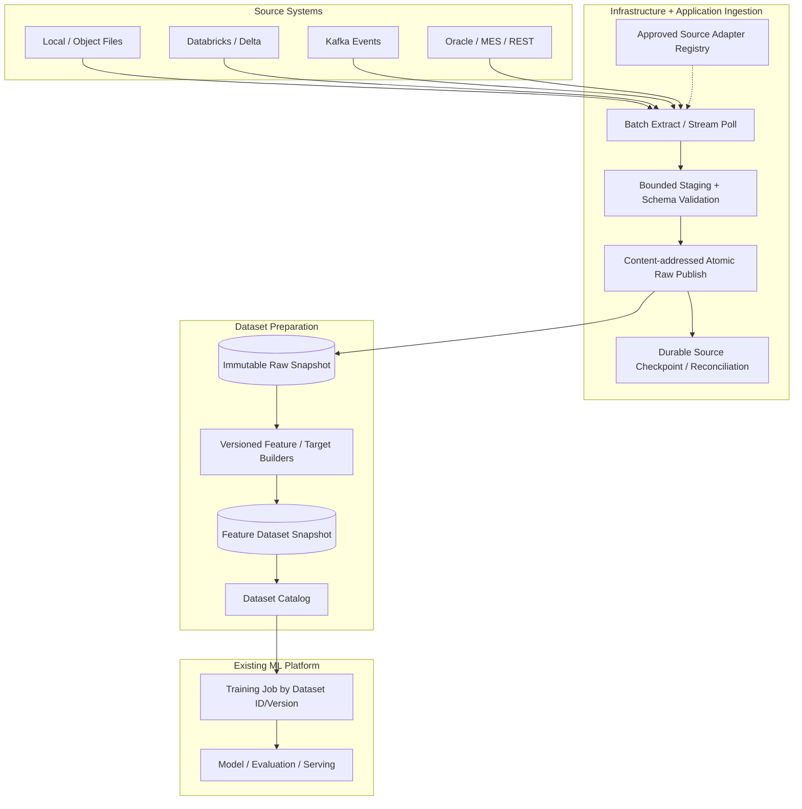
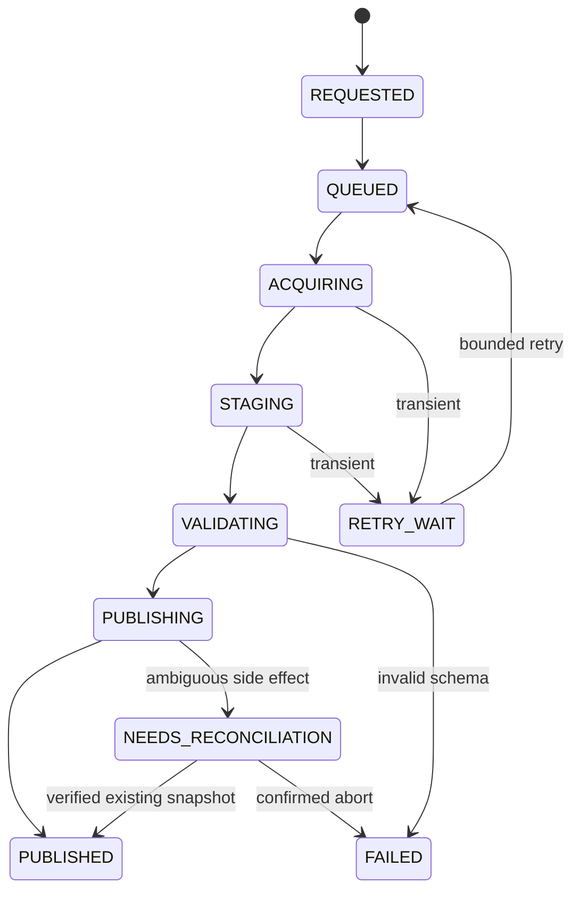

# 通用 Data Ingress Adapter、Immutable Snapshot 與 Dataset Builder 設計

| 文件屬性 | 內容 |
| --- | --- |
| 文件編號／版本 | ML-EXT-INGRESS-001／1.0.0 |
| 狀態 | Proposed — 通用擴充架構，**尚未實作** |
| 基準 Commit | `edc140061f7cac7d0b6881f35dded4a2a92a8d6c` |
| 適用來源 | Local File、Object Storage、Databricks/Delta、Kafka、Oracle、MES、REST |
| 參考規範 | `docs/modularity-and-ocp-guidelines.md`（本機提案，未納入本次提交）、`module-spec.md`、`microservice-contracts.md` |

## 1. 目的與現況區分

Data Ingress 的目的是**與模型無關**地取得與保存資料，不是幫 EBM 做 Spectrogram，也不是訓練任何模型。ML System 目前具備：

- `src/application/datasets/ports.py` 的 `DatasetCatalog` Protocol；
- `src/infrastructure/persistence/ml_datasets.py` 的 tenant-scoped SQL Catalog；
- `src/infrastructure/datasets/snapshots.py` 的 MLP immutable JSON Reader；
- `src/infrastructure/datasets/ebm_snapshots.py` 的 EBM NPZ / Metadata Reader/Publisher；
- `bootstrap/ml_cli.py` 的 operator-driven `register-dataset`、`register-ebm-dataset`；
- 訓練工作使用 Dataset ID + Version（而不是每次直接連來源系統）。

**目前沒有**通用的 Source Adapter Port／Registry、Databricks Reader、Kafka Business Event Consumer、持久的 IngestionJob 或 Raw Snapshot Catalog。`ExportSource` 是 HTTP Egress，不可直接當 Ingress；Taskiq/RabbitMQ Training Command 與 Kafka 業務事件也不可混為一談。

## 2. 五段式資料流程



**Raw Snapshot 發布**是 Ingestion 的成功條件；**Feature Dataset 發布**是 Dataset Builder 的成功條件；**Model Bundle + Evaluation 持久化**才是 Training 的成功條件。三者不可共用同一個 `finish(binding_id, evaluation_id)` 契約。

## 3. Adapter Pattern 的正確拆法

不強制 Kafka Consumer 與 SQL Batch Client 都實作 `fetch()`。因為 Batch 是有限的資料擷取；Streaming 是可持續的消費與 Checkpoint。

### 3.1 Pure Port DTO（設計提案）

```python
from dataclasses import dataclass
from typing import Protocol, Iterator

@dataclass(frozen=True, slots=True)
class SourceRequest:
    tenant_id: str
    source_id: str
    ingestion_id: str
    source_contract_version: str
    requested_boundary: str | None  # 由受控 Descriptor 驗證，非任意 SQL

@dataclass(frozen=True, slots=True)
class StagedChunk:
    staging_ref: str
    schema_version: str
    row_count: int
    source_position: str | None

class BatchSourceAdapter(Protocol):
    def extract(self, request: SourceRequest) -> Iterator[StagedChunk]: ...

class StreamSourceAdapter(Protocol):
    def poll(self, request: SourceRequest, limit: int) -> Iterator[StagedChunk]: ...

    def checkpoint(self, source_position: str) -> None: ...
```

上面是**簡化示意**，`staging_ref` 是受控暫存空間 Reference，而不是任意外部 URL。正式版應使用具型別的 Partition/Offset/Cursor、來源 Ownership、Source Auth、Deadline、Close/Cancel 等契約。Source Adapter 回傳的資料先進入 Raw Snapshot Writer；不可讓 Provider 直接修改已核准的 DatasetVersion。

### 3.2 Source Adapter Responsibility

| Adapter | 提供 | 不提供 |
| --- | --- | --- |
| File Batch | 安全檔案枚舉、格式讀取、Digest、bounded upload | EBM CDF Label、Train/Test Split |
| Databricks Batch | 固定 Delta Version/Time Travel Reference、Query/Export | LSTM Window 或 Spectrogram |
| Kafka Stream | Partition Offset、Consumer Group、Replay、Backpressure | Training Artifact 或 MLflow Approval |
| REST Polling | Cursor、Page、Rate Limit、ETag（若有） | 模型 Input Schema 決策 |
| Oracle / MES | Snapshot Isolation 或 CDC Position、Schema/Time Mapping | 模型 Loss |

## 4. 不可變的 Source Definition 和資格

Source Descriptor 至少記錄：

- `source_id`、`tenant_id`、`source_type`、`adapter_contract_version`、`approved_connector_key`。
- 可讀的 dataset/topic/table/path Allowlist 及必要的 source schema version。
- Secret **Reference**，不可在 HTTP Body/Job/Logs 寫入真實 Secret。
- 批次最大資料量、行數、大小、Time Window、Rate Limit、Retry Policy、Allowed Compute Profile。
- 資料權限、Tenant/Owner Scope、資料保留政策及敏感欄位處理責任。
- 來源所支援的 Snapshot Consistency、Replay、Checkpoint 能力。

外部請求可以選**已核准的 `source_id`** 與受控時間窗，不能提供任意 Databricks SQL、Kafka Topic 名稱、檔案系統路徑或 Driver Import Class。未經審核的 Query Template 不可作為任意 SQL 計算入口。

## 5. Raw Snapshot Manifest（目標 Schema v1）

```json
{
  "schema_version": "raw-snapshot-manifest-v1",
  "snapshot_id": "source-snapshot-001",
  "tenant_id": "tenant-a",
  "source": {
    "source_id": "approved-fdc-source",
    "adapter_type": "databricks-batch",
    "source_contract_version": "1.0.0",
    "source_revision": "delta-version-12345"
  },
  "data_schema_version": "fdc-raw-v1",
  "parts": [{"relative_path": "part-000.parquet", "sha256": "<sha256>", "size_bytes": 10240}],
  "lineage": {"query_template_version": "fdc_extract_v1", "time_window_utc": "<controlled-range>"},
  "created_at": "2026-10-31T00:00:00Z"
}
```

此 JSON **不代表目前已存在 Raw Snapshot API**。正式 Schema 要補明確的資料格式與分區、Encoding、Schema Digest、缺失值政策、來源時間範圍及安全標籤。`parts[].relative_path` 只能指向已批准的 Snapshot Store 內檔案，必須防止 Path Traversal 與 Symlink Redirect。

### 5.1 發布安全

1. 獲取來源一致性 Boundary：例如 Delta Version、檔案內容 SHA256、Kafka Offset Range。
2. 將 Chunk 寫入私有 Staging Prefix，資料大小與解壓比例受限。
3. 驗證 Row Schema、字段型別、必備欄位、時間戳、NaN、內容 Digest。
4. 產生 Canonical Manifest、整體 Digest 與 Tenant/Source Provenance。
5. 只在全部 Part 完成後原子發布／可見；Object Store 可透過 Manifest-Last / Conditional Put / CAS 模式實現。
6. SQL Catalog 記錄 `PUBLISHED` 及 `manifest_digest`；若 SQL 與 Object Store 異步，使用持久 Reconciliation。
7. 消費者以固定 Snapshot ID+Digest 讀取，不能讀取 mutable `latest`。

### 5.2 原子性不是跨系統 2PC

物件存放成功但 SQL 失敗時，產生可能孤立的 Snapshot。應以同一 `ingestion_id + manifest_digest` 對帳並補寫 SQL，或有明確 TTL / GC；不可為了恢復而重新查詢不同的來源版本。

SQL 先宣稱發布成功、Object Store 尚未有完整 Manifest，則造成不可讀的假成功；因此 Reader 仍必須驗證 Snapshot Manifest／Digest，而不是只看 SQL 狀態。

## 6. Batch 與 Streaming 的不同生命週期

### 6.1 Batch IngestionJob



`PUBLISHED` 代表完整 Raw Snapshot 可讀。`FAILED` 不能代表遠端 Source Execution 肯定已終止，除非外部副作用已對帳。`NEEDS_RECONCILIATION` 需要 Alert、Retry Budget 與人工升級路徑，不能無限迴圈且默默占用 Consumer。

### 6.2 Streaming Source Subscription

Kafka 使用持續的 Source Subscription 及多個有限的 Offset-Range Snapshot Commit，不建議讓單一 IngestionJob 永遠 RUNNING。Subscription 另有 Start/Stop、Partition Assignment、Lag、Backpressure 與 Consumer Group 的生命週期。

**安全提交順序：**

```
Kafka poll offsets [100..199]
    -> stage raw events
    -> publish immutable snapshot + digest
    -> commit durable platform checkpoint [100..199]
    -> broker offset commit / acknowledge
```

上述順序提供「在持久發布之後才確認來源消費」的保障。Kafka Broker Commit 和 SQL/Object Store 並非單一原子交易，因此仍可能 Redelivery；須以 `(topic, partition, offset-range)`／Event ID 的唯一性做到**有效資料冪等**，不宣稱 Exactly-once End-to-end。

## 7. Source-Specific Runbooks

### 7.1 Databricks / Delta Batch

- 使用**固定的 Delta Table Version、Snapshot Timestamp 或經批准的 Export Manifest**；僅保存 Table Name 不足以重現。
- SQL Query 使用受控 Template+參數；不要將 User Input 接成任意 `SELECT`。
- 大型資料採用 Export/Partitioned Parquet、bounded streaming／pagination，避免 `.toPandas()` 將全量資料載入 API Process。
- 需要紀錄 Workspace、Catalog/Schema/Table Identifier、Query/Template Version、Delta Version、時區與抽取條件。
- 429、短暫 Service Unavailable 使用有界 Retry；執行成功但回應遺失以 External Run/Statement Ref 對帳。
- **Databricks Data Reader** 與 **Databricks Jobs Training Executor** 是不同 Adapter，不應因都使用 Databricks SDK 就共享 Training Command 狀態。

### 7.2 Kafka Stream

- Commit Offset 之前必須完成受控資料持久化／Checkpoint。
- 每個 Partition 的位移與關聯 Snapshot Digest 要可對帳，不能把 Offset 當作全 Topic 的單一遞增序列。
- Consumer Rebalance/Crash 應能重讀未確認 Offset 並去重。
- Poison Message 要有 Quarantine/DLQ 的治理流程；不得將不合法資料隨意跳過且前移 Offset。
- Late Event / Out-of-order Event 的 Watermark、Allowed Lateness、Reprocessing Policy 由 Dataset/Domain Contract 決定；Kafka Adapter 只保留可靠 Event Time 與 Ingestion Time。
- 監測 Partition Lag、Consumer Throughput、Snapshot Latency、Redelivery、Invalid Event Rate。

### 7.3 File / Object Store

- 防止 Traversal/Symlink、檔案大小與解壓炸彈；禁止 Pickle。
- 讀取方式不應依賴使用者可指定任意 Host Path。
- CSV / Parquet / JSON 使用各自受控 schema / encoding / dtype；失敗回明確 DataError，不靜默補欄位。
- 大檔先 Staging，再 Digest/Publish；相同邏輯版本不覆寫不同內容。

## 8. Dataset Builder 與 Feature Processing 是獨立 Plugin

Raw Snapshot 對所有模型一樣具有 Manifest + Digest，但 EBM/LSTM 所需 Feature 完全不同：

| Dataset Builder | 輸入 | 輸出 | 版本與防洩漏條件 |
| --- | --- | --- | --- |
| EBM FDC（既有演算法） | FDC/MES/CDF/Pad Raw Snapshot | `[N,7,4,9,31]` Feature/Target/Split | Spectrogram、CDF、Normalizer、Lot Group、Replay/Temporal Track 分開 |
| LSTM Time-Series（未來） | Event/Tabular Time Series | Sequence Window + Forecast Target | Window、Horizon、Temporal Split、As-of 可得時間 |
| Generic Tabular Classification（示例） | Tabular Raw Snapshot | Numeric Feature Matrix、Binary Labels | Train-only Transform、固定類別映射 |

**模型專用 Feature Builder 不應被 Databricks/Kafka SDK 直接呼叫**，而應由 Dataset Preparation Job 釘選 `raw_snapshot_id` + `builder_version` + `feature_config_digest` 後執行。

PoC EBM Replay 保留原既有 CDF/Pad/Normalizer 語意；Temporal Model 的 CDF Reference/As-of 應使用**新版本**且有真實的時間外推驗收。Source Adapter 不可自行決定 Train/Test Split，以免資料外洩。

## 9. Integration Interface：Dataset Catalog 與 Training

建議新增三種識別：

- `source_id`：受控來源描述；不是可任意查的 URL。
- `raw_snapshot_id + digest`：資料取得完整證據。
- `dataset_id + dataset_version + digest`：供 Model/Training 使用的不可變特徵與標籤。

Data Ingress 不直接呼叫 `EBMTrainerV1.train()`，也不直接更新 `TrainingJob`。訓練提交仍以**已發布 Dataset ID/Version** 為入口，維持現有 Training 的可重現性與使用者授權。

### 9.1 API 提案（尚未實作）

```text
POST /api/v1/ingestion/jobs
GET  /api/v1/ingestion/jobs/{job_id}
POST /api/v1/ingestion/jobs/{job_id}/cancel
GET  /api/v1/ingestion/sources
POST /api/v1/dataset-preparation/jobs
GET  /api/v1/dataset-preparation/jobs/{job_id}
```

Request 提供 `approved_source_id`、`time_range`／`cursor_policy`、`idempotency_key`，不得提供完整 SQL、任意 Folder Path、Kafka Broker Credentials。API 返回 202 + Job ID，成功標準為 Published RawSnapshot，而不是「外部系統已回應」。

## 10. Persistence Logical Entities（建議）

| Entity | 唯一身份 / FK | 不變條件 |
| --- | --- | --- |
| `SourceDefinition` | `(tenant_id, source_id, version)` | 安全 Allowlist / Connector Config Ref |
| `IngestionJob` | job_id, tenant_id, source_id, idempotency | Durable State / Owner Fencing |
| `IngestionAttempt` | job_id, attempt_id, owner_token | 單有效 owner，受控 Retry |
| `RawSnapshot` | snapshot_id, manifest_digest, source_revision | PUBLISHED 後內容不可替換 |
| `SourceCheckpoint` | source_id, partition_id, offset/cursor, revision | CAS 單調遞增／可重播對帳 |
| `DatasetPreparationJob` | dataset_job_id, raw_snapshot_refs, builder_version | 固定 Builder 與輸入版本 |
| `FeatureSnapshot / DatasetVersion` | dataset_id, version, content_digest | 已存在 Catalog 的通用版本治理延伸 |

Source Snapshot 與 DatasetVersion 的資料保存策略必須依資料合規需求定義；不要把工廠 MES/FDC 敏感 Raw Records 放在 Metadata Log。

## 11. Failure Matrix、Observability 與驗收

| Fault Injection | 預期證據 |
| --- | --- |
| Databricks Query Timeout / Retry | 同一 Source Version、無重複 Dataset |
| Data Download Completed, Worker Killed | 透過 Staging/Manifest 對帳，不重查新版本 |
| Object Store Published, SQL Failed | Reconcile 同 Digest 到 PUBLISHED |
| SQL Claimed Published, Manifest Missing | Reader 拒絕，Reconciler 調查 |
| Kafka Redelivery After Snapshot Before Offset Commit | Dedup，同內容產生一次有效發布 |
| Kafka Partition Rebalance | 正確交接 Cursor、無已確認區間遺失 |
| Schema Drift / Bad Payload | 受控拒絕，隔離 Source Data，錯誤不含 Secret |
| Source Secret Revoked | Authentication Failure，不能無限快速重試 |
| Parallel Source Snapshot Jobs | 以來源版本及 tenant 隔離，並避免發布覆寫 |
| Feature Builder Failed | Raw Snapshot 保留；不宣稱 Dataset Published |

建議 Metrics：`ingestion_jobs_inflight`、`source_retry_total`、`published_snapshot_bytes`、`schema_reject_total`、`source_checkpoint_lag`、`reconcile_pending_seconds`、`dataset_build_duration_seconds`。

## 12. 漸進實作計畫

1. **P0**：RawSnapshot／Source Definition／BatchSourcePort／Atomic Publisher、純資料 Contract Tests。
2. **P1**：FileBatchAdapter + Generic Ingestion Job；完成一個完全在本機的 E2E。
3. **P1**：DatabricksBatchAdapter + Delta Fixed-Version／Query Template／Export Qualification。
4. **P1**：Dataset Builder Plugin Registry；將 EBM FDC Feature Builder 包裝為經批准的版本，不改 Trainer。
5. **P2**：KafkaStreamAdapter + Partition Checkpoint／Replay／DLQ／Lag。
6. **P2**：Target Runtime 的大規模資料量、Retention/Security、Source Auth、Disaster Recovery 驗收。

每階段保留既有 `SQLDatasetCatalog.register()` / `register_ebm()`，不直接刪除 API/CLI；通用 Import 完成並獲相容性驗收後才逐步替換模型特例。

## 13. Definition of Done

- 新增來源不需修改 EBM／MLP Trainer，新增模型不需修改 Databricks/Kafka Adapter。
- Batch 與 Stream Source 具不同明確可靠性語意，不靠單一 `fetch()` 假裝相同。
- 所有 Dataset 均能追溯 Source/RawSnapshot/Builder/FeatureVersion/Digests。
- 同一 `dataset_id + version` 不會被不同內容覆寫。
- Duplicate Source Event / HTTP Retries / Worker Crash 不會造成第二次**有效** Snapshot 發布。
- Permission、Tenant、Secrets、Source Resource Limits、Error Translation 與 Quarantine 都有測試。
- 至少包含 File Adapter 的真實 Process Recovery 測試，與 Databricks/Kafka 的外部環境資格分開記錄。

## 14. 來源與提案說明

現有 Source of Truth：`src/application/datasets/ports.py`、`src/infrastructure/persistence/ml_datasets.py`、`src/infrastructure/datasets/{snapshots,ebm_snapshots}.py`、`docs/ebm-integration-plan.md`、`docs/microservice-contracts.md`。本文件所有 `SourceAdapterRegistry`、`IngestionJob`、RawSnapshot Manifest、Kafka Consumer 等都是**新設計提案**。

## 2026-10-31 實作補充：File Batch vertical slice

以上章節保留原始提案與基準描述，不因本輪程式落地而將整份設計／ADR-015 改為 Accepted。目前已實作的子集及實際欄位、命令與限制，集中於 [Data Ingress 實作指南](data-ingress-implementation.md)；本輪驗證結果由 [實作報告](reviews/data-ingress-implementation-report.md) 記錄。

已存在的程式包含 `src/domain/ingestion/` DTO／狀態、`src/application/ingestion/` 消費者擁有的 Protocol／唯讀 Registry／Service／Supervisor、`FileBatchAdapter`、`LocalRawSnapshotStore`、獨立 Source／Job／Raw Snapshot SQL persistence、Ingestion API，以及 Bootstrap／CLI。HTTP 202 只提交 durable SQL 工作，另一個 SQL polling worker 擷取真實 JSONL 檔案；沒有新增 ingestion broker consumer 或 ACK 流程。

本輪與上文概念草案的差異如下：

| 概念草案 | 本輪已交付契約 |
| --- | --- |
| `BatchSourceAdapter.extract(...)` 示意 | `acquire(BatchExtraction, AcquisitionControl) -> StagedBatch`；可串流 bytes 到 `BatchStager` |
| Source type／instance／execution | Approved `(adapter_type, adapter_version)`、immutable `(tenant, source_id, version)`、獨立 Job／Attempt／owner token |
| Manifest 示意 JSON | 實際 `manifest_version=raw-snapshot-v1`，單一 `data.jsonl` part；以 Job ID／timestamp 綁定穩定 producer |
| `REQUESTED`／`STAGING` 額外狀態 | 接受交易直接建立 `QUEUED`，私有 staging 在 `ACQUIRING` 中執行 |
| `NEEDS_RECONCILIATION -> FAILED` 可能性 | 本輪不在未知發布結果下自動宣告 FAILED；保留 intent，重試 budget 耗盡仍需人工對帳 |
| 通用 AMQP／Streaming lifecycle | 第一版使用獨立 SQL queue，不引入 Kafka 或 ingestion AMQP receiver |

Publication Intent 必須先在 SQL owner fence 下持久保存，再做原子 no-overwrite filesystem 發布。若發布成功但 SQL terminal commit 失敗，重啟 owner 以同一 Snapshot ID／Manifest Digest 對帳，不能重讀來源或替換候選。取消只在 intent 前接受；intent 已保存後回 409。

File Source 的 root map 僅由 `bootstrap/ingestion_wiring.py` 建構，HTTP 不接受絕對路徑、SQL、URI、credentials 或 import path。Runtime 用 directory FD／`O_NOFOLLOW` 防止路徑與 symlink races，按檔案／單行／筆數／期限預算驗證原始 UTF-8 JSON objects，不建立任何模型特徵。

Databricks Batch、Kafka Streaming、多格式／multipart Raw Snapshot 及 Dataset Builder 仍是下一階段設計，沒有出貨假的 Adapter。Raw Snapshot 發布不會登錄 MLP／EBM DatasetVersion，也不改變既有 Trainer 或科學語意。File、獨立 Memory、獨立 Generated 來源經相同測試側 Registry 註冊，驗證在不修改 `IngestionService` 的情況下使用相同 Job workflow；不因此宣稱現有模型 Workload dispatch 已全面完成 OCP 重構。
