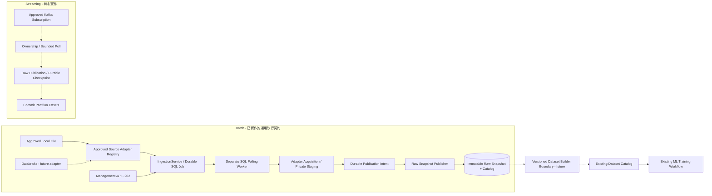
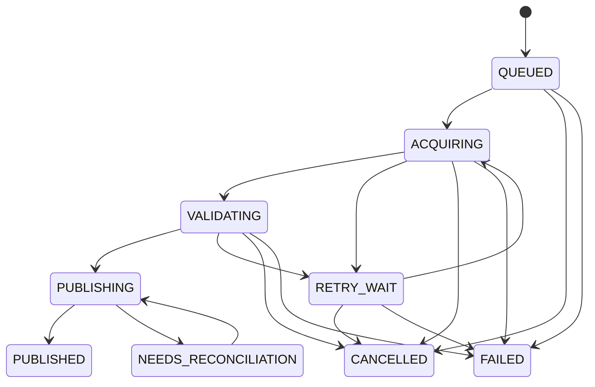

# Data Ingress 實作與操作指南

更新日期：2026-10-31。本指南描述已交付的 File Batch Ingestion vertical slice。既有 [Data Ingress 設計提案](data-ingress-adapter-design.md) 與 `docs/adr/015-approved-extensions-proposal.md`（本機提案，未納入本次提交）保持提案狀態；本輪實作沒有將整份提案靜默改為 Accepted。實際驗證結果與環境限制以 [實作報告](reviews/data-ingress-implementation-report.md) 為準。

## 1. 範圍與邊界

本輪提供：核准的 File Source Definition → 有界 JSONL 擷取 → 私有 Staging → 不可變 Raw Snapshot → SQL metadata／可恢復的 Ingestion Job。HTTP 接受工作後回覆 202，實體檔案讀取由另一個 SQL polling worker 程序執行。

Raw Snapshot 是來源資料的取得證據，**不是** MLP Dataset、EBM FeatureSnapshot 或模型訓練成果。成功發布不會建立 Dataset Catalog version，也不會啟動 Trainer。後續 Raw-to-Feature 必須由獨立、版本化且經核准的 Dataset Builder 處理。

原有 `DatasetCatalog`、`FileDatasetSource`、`EBMFileDatasetSource` 與 MLP／EBM 匯入契約保持既有職責。`ModuleExports.datasets`／`ExportSource` 是 Data Egress，不作為 Ingress 註冊介面。新增來源也不修改 `TrainingService`、`TrainingSupervisor`、Trainer、Serving 或 MLflow 治理流程。



Registry 只負責核准實作、版本與能力的 lookup；實際資料讀取發生在已選定的 Adapter。圖中 Databricks、Kafka 與 Dataset Builder 虛線皆為擴充目標，沒有宣稱可運作的 Adapter。

## 2. 程式位置與 Port ownership

| 位置 | 已實作責任 |
| --- | --- |
| `src/domain/ingestion/{models,errors,states}.py` | Immutable DTO、Source／Job／Snapshot identity、有界資源、不變量、安全錯誤與合法狀態轉移 |
| `src/application/ingestion/ports.py` | 使用案例消費的 `BatchSourceAdapter`、`BatchStager`、`SourceResolver`、`SourceAdapterResolver`、`RawSnapshotPublisher`、`IngestionJobRepository` Protocol |
| `src/application/ingestion/registry.py` | `ApprovedSourceAdapterRegistry`；重複、未知版本或未支援能力一律拒絕，初始化後為唯讀 Mapping |
| `src/application/ingestion/service.py` | 授權、Source resolution、凍結有效預算、Idempotency、查詢／取消／結果 metadata |
| `src/application/ingestion/supervisor.py` | Worker orchestration、合作式期限／取消檢查、Publication Intent、重試與對帳 |
| `src/infrastructure/ingestion/adapters/file_batch.py` | `FileBatchAdapter`；approved root／relative file 的 FD 擷取、變動檢查及來源 digest |
| `src/infrastructure/ingestion/storage/{jsonl,raw_snapshot_writer}.py` | JSONL 驗證、串流 Staging、Digest、Linux 原子 no-replace 發布、Reader／metadata 驗證與保守 cleanup |
| `src/infrastructure/ingestion/persistence/` | Source Definitions、獨立 Ingestion SQL queue／Attempts／Idempotency／Raw Snapshot catalog |
| `src/api/ingestion/{schemas,routers}.py` | 嚴格 HTTP envelope、安全 metadata 回應；不執行擷取 |
| `bootstrap/ingestion_wiring.py` | 建構 approved roots、File Adapter／Validator、Registry、儲存與使用案例；接受顯式額外 registrations |
| `bootstrap/ingestion_cli.py` | 明確的 Source 管理、SQL worker 與 cleanup 操作入口 |
| `migrations/versions/0006_ingestion.py` | 獨立 Ingestion tables；由 migration 明確套用，不在 API startup 自動建表 |

Application 擁有其消費的 Port。Infrastructure 以 structural typing 滿足 Protocol，不 import Application workflow implementation；跨層傳遞純 DTO，不回傳 DataFrame、cursor、SDK client 或其他 vendor object。

核心 Batch 方法為 `acquire(extraction, control) -> StagedBatch`。`BatchExtraction` 包含 server-approved `SourceDefinition`、固定 execution identity 與有效 `ExtractionLimits`。Adapter 可以將有界 `Iterable[bytes]` 傳給 `BatchStager.stage()`，不必將整個來源載入記憶體。

## 3. 啟用與初始設定

以下範例使用既有開發環境；正式 DB／Filesystem／程序權限須另行資格驗證。

```sh
export ML_INGESTION_ENABLED=true
export ML_DATABASE_URL=sqlite:///./var/ml.db
export ML_INGESTION_FILE_ROOTS_JSON='{"inbox":"/srv/approved-ingress"}'
export ML_RAW_SNAPSHOT_ROOT=/srv/raw-snapshots

python -m bootstrap.ml_cli migrate
```

`ML_INGESTION_ENABLED` 控制 Management API 是否選入 Ingestion capability。預設不啟用；通用 `server.py` 的預設能力不會因此改變。明確執行 `bootstrap.ingestion_cli` 不會啟動 HTTP server。

| 設定 | 預設 | 用途 |
| --- | --- | --- |
| `ML_DATABASE_URL` | `sqlite:///./var/ml.db` | 既有 Database convention；開發 SQLite／目標 PostgreSQL |
| `ML_RAW_SNAPSHOT_ROOT` | `var/raw-snapshots` | 核准的私有 staging／published store |
| `ML_INGESTION_FILE_ROOTS_JSON` | `{}` | server-side `root_key -> approved directory` Mapping |
| `ML_INGESTION_LEASE_SECONDS` | `30` | SQL attempt ownership lease |
| `ML_INGESTION_RETRY_DELAY` | `1` | 有界次數重試的 exponential backoff 基數，秒 |
| `ML_INGESTION_MAX_ATTEMPTS` | `3` | 總 acquisition attempts 上限，包含第一次 |
| `ML_INGESTION_RECONCILE_LIMIT` | `10` | 自動 publication reconciliation takeover 上限 |
| `ML_INGESTION_QUEUE_TIMEOUT` | `600` | Queue deadline 預算，秒 |
| `ML_INGESTION_MAX_PENDING` | `100` | 每租戶非終態 backlog 上限 |
| `ML_INGESTION_POLL_SECONDS` | `1` | Worker polling interval |

Worker 與管理程序必須使用同一 SQL DB、相容 Registry、同一 `root_key` 定義及同一 Raw Snapshot store。變更 `root_key` 的實體目錄是部署治理變更，不能用於偷偷改變既有 Source version 的語意。重現性要求較高的 File Source 應釘選 `expected_sha256`，並保留可讀的來源版本。

## 4. Source Definition 的生命週期

Adapter type（例如 `file@1`）、Source Definition（例如 `tenant-a/events@v1`）與 execution attempt 是不同 identity。HTTP 只選已核准的 Source ID／Version，不提供檔案路徑或連線資訊。

準備完整的 operator-owned JSON，例如：

```json
{
  "source_id": "events",
  "version": "v1",
  "tenant_id": "tenant-a",
  "adapter_type": "file",
  "adapter_version": "1",
  "configuration_json": "{\"root_key\":\"inbox\",\"relative_path\":\"events.jsonl\"}",
  "limits": {
    "max_bytes": 16777216,
    "max_records": 100000,
    "max_line_bytes": 1048576,
    "timeout_seconds": 30
  },
  "data_format": "jsonl",
  "schema_version": "raw-json-object-v1",
  "allowed_actor_ids": ["scientist"]
}
```

`configuration_json` 是包含 JSON object 的字串；File v1 只允許 `root_key`、`relative_path` 與可選的 `expected_sha256`（64 位 lowercase hex）。實體根目錄來自 Bootstrap Mapping，不寫進 HTTP 請求或結果 Manifest。`allowed_actor_ids` 為空 tuple／list 時允許該租戶具備操作權限的 actor；有值時逐一核對 actor ID。

```sh
python -m bootstrap.ingestion_cli register-source \
  --definition-path /path/to/approved-source.json --tenant-id tenant-a

python -m bootstrap.ingestion_cli disable-source \
  --tenant-id tenant-a --source-id events --source-version v1

python -m bootstrap.ingestion_cli enable-source \
  --tenant-id tenant-a --source-id events --source-version v1
```

這是受信任的部署／operator 操作，不是公開 Source creation API。註冊要求 `ml:source:manage`；同 tenant／ID／version 的內容不可替換，identical re-registration 才可冪等返回。來源設定、limits 與 actor grants 的變更須用新 version；`enabled` 可明確停用／恢復，但重複註冊不會自動重新啟用。

Worker 在實際 acquisition 前重新驗證 tenant、enabled、current immutable configuration digest 與 actor grant。停用會阻止尚未取得資料的工作；已保存 Publication Intent 的工作只對帳既有取得證據，不會重新存取來源，也不以後來的來源變更取代已凍結候選。

## 5. HTTP 使用與授權

使用既有登入／Bearer Token 流程取得 actor，並在提交時提供 `Idempotency-Key`：

```http
POST /api/v1/ingestion/jobs
Authorization: Bearer <token>
Idempotency-Key: events-extraction-001
Content-Type: application/json

{"source_id":"events","source_version":"v1","max_bytes":1048576,"max_records":1000}
```

請求可縮小 `max_bytes`、`max_records`、`timeout_seconds`，不能放大核准預算；`max_line_bytes` 只由 Source Definition 決定。額外的 URI、path、SQL、adapter type、Python import、credentials、schema 欄位會被拒絕。

| 操作 | Endpoint | 授權／結果 |
| --- | --- | --- |
| 提交 | `POST /api/v1/ingestion/jobs` | `ml:ingest`；202、固定 Job ID／status URL／result URL |
| 工作 metadata | `GET /api/v1/ingestion/jobs/{job_id}` | `ml:ingest`、`ml:ingestion:read` 或 `ml:ingestion:operate`；同 tenant，owner 或 operator |
| 取消 | `POST /api/v1/ingestion/jobs/{job_id}/cancel` | `ml:ingestion:cancel` 或 `ml:ingestion:operate`；同 tenant，owner 或 operator |
| 工作結果 | `GET /api/v1/ingestion/jobs/{job_id}/result` | 只有 SQL 已提交 `PUBLISHED` 才返回 metadata；未完成為 409 |
| Snapshot metadata | `GET /api/v1/ingestion/snapshots/{snapshot_id}` | 同樣的 read／tenant／owner 規則 |

`ml:ingestion:operate` 不授權跨租戶操作。Source 管理權限也不隱含讀取別人 Job 的權限。公開結果不包含 `snapshot_ref`、私有 filesystem paths、`configuration_json`、owner tokens、credentials 或原始 rows；Dataset Builder 在應用邊界透過內部 Catalog／Snapshot Reader 取得並驗證內容。

Idempotency scope 為 tenant + actor + ingestion operation + key。相同 key、相同 normalized request 返回原 Job；不同 request 為 409。紀錄沒有短期自動過期機制：API 會先查 durable replay，再解析來源，因此已接受的相同請求不會因 Source 後來停用而建立另一個工作。不同 key 對同 Source/version 是不同 extraction，具有不同 Job／Snapshot identity。

## 6. Worker、狀態與完成條件

```sh
# 一次 claim／處理一個到期工作
python -m bootstrap.ingestion_cli work --once

# 處理指定工作；若尚未到 retry 時間或已有 owner，會返回 idle
python -m bootstrap.ingestion_cli work --once --job-id <job_id>

# 持續 polling；正式部署使用獨立受監督程序
python -m bootstrap.ingestion_cli work
```

SQL Job 本身就是本輪的 durable queue。提交交易保存 Job 與 Idempotency evidence；worker 以 row lock／CAS claim，SQLite 使用既有 `BEGIN IMMEDIATE`，PostgreSQL 路徑使用 row locking。沒有新增 RabbitMQ ingestion consumer、outbox relay 或 broker ACK；原有 Training 的 manual-ACK 流程保持不變。若後續接 AMQP，必須另定義 durable handoff／ACK 契約，不能從本輪測試推論已支援。

| 狀態 | 語意 |
| --- | --- |
| `QUEUED` | Durable acceptance，尚未開始 acquisition |
| `ACQUIRING` | 私有、可合作式取消的 Adapter 擷取及 staging |
| `VALIDATING` | 已保存 staged evidence，檢查及準備確切 Manifest |
| `PUBLISHING` | SQL 已持久保存不可替換的 Publication Intent |
| `PUBLISHED` | 已驗證 Raw Snapshot metadata、Job 終態及 Audit 在同一 SQL 交易完成 |
| `RETRY_WAIT` | 可重試 acquisition failure，等待 backoff |
| `NEEDS_RECONCILIATION` | 保留原 intent／staging／snapshot identity，尚待確定發布結果 |
| `FAILED`／`CANCELLED` | 發布前已確定的終態 |

只有 `PUBLISHED`、`FAILED`、`CANCELLED` 是 terminal。實作沒有額外 `REQUESTED`／`STAGING` Job state：前者併入接受交易，後者是 `ACQUIRING` 的私有取得階段。



一旦 publication intent 的 SQL 交易成功，取消 API 回覆 409；它不刪除已發布資料，也不將不確定結果改成 `CANCELLED`。在這之前，queued/retry 工作可直接取消，active acquisition 由 control checks 觀察取消旗標並停止。取消與 intent commit 的競爭由 SQL row ownership／transaction 決定。

## 7. Publication、對帳與清理

穩定的 Snapshot ID 與 Job timestamp 在接受時建立。每次 claim 使用新 Attempt ID／owner token，所有後續 state writes 需核對目前 owner／attempt／lease。失效 owner 不能覆寫新 owner 的 state、intent 或結果。

發布順序：

1. Adapter 只寫私有 attempt staging，封存原始 bytes、SHA-256、size、record count 與 source revision。
2. Publisher 重新驗證 staging 並產生 exact canonical Manifest。
3. Repository 在 owner fence 下先保存完整 `PublicationIntent`，再允許 filesystem 發布。
4. Publisher 將完整候選寫入同 filesystem 的 private publication directory，fsync files／directory，使用 Linux `renameat2(RENAME_NOREPLACE)` 發布。
5. Reader 重新驗證 Manifest 與 data digest。Repository 在單一 SQL 交易提交 Raw Snapshot catalog row、`PUBLISHED` 和 Audit。
6. Durable terminal commit 成功後才清除 acquisition staging。

同一 identity 的 identical republication 返回已驗證的 Snapshot；不同內容或不同 Manifest 不能覆寫現有版本，即使目標是空目錄也不會 replace。SQL 與 filesystem 不是同一原子交易，也沒有跨系統 exactly-once 宣告。

**關鍵故障情境：檔案已發布，但 SQL finish 失敗。** Job 保留 exact intent，後續 owner 先 `lookup(tenant, snapshot_id, manifest_digest)`。既有資料通過驗證時補寫同一份 metadata／terminal state；若尚未發布則重用原 staged candidate。它不重新讀取 Source，不建立衝突的 Snapshot，也不依賴當前 Source 已啟用。即使 acquisition deadline 已過，publication reconciliation 仍需完成或升級人工處理。

Acquisition 預設最多三次 attempts，只有分類為 retryable 的安全錯誤才重試；來源變動、schema／digest 不合法等錯誤不假裝成功。自動 reconciliation 預設最多十次 takeovers；耗盡後保持 `NEEDS_RECONCILIATION` 與 evidence，不能因為停止自動重試就改成已確認 `FAILED`。此時需要 operator 檢查儲存健康度與既有 Snapshot；目前沒有公開 API 可重設這個 budget。

```sh
python -m bootstrap.ingestion_cli cleanup --minimum-age-seconds 86400
```

Cleanup 取得所有租戶的非終態 Job IDs（包含 lease 過期與 reconciliation budget 耗盡者），只清理超過保留時間、未被這些 IDs 保護的 `.staging` attempt directories。它不掃描／刪除 published snapshots、不跟隨 symlink，也不進行任意 recursive delete。仍屬非終態 Job 的舊 attempts 會保守保留；可能遺留的 private `.publish-*` crash directories 位於 published tree，尚未包含在這個 maintenance sweep 中，應納入後續 GC／容量治理。

## 8. Raw 格式、Manifest 與安全限制

File v1 與本機 Raw Store 支援 UTF-8 JSONL，每筆是 JSON object。檔案及記錄不可為空；拒絕空白行、non-object、duplicate keys、invalid UTF-8、NaN／Infinity／overflow、超出檔案／單行／筆數上限的資料。最後一筆不強制 newline。驗證後保留輸入原始 bytes，不做數值正規化、補值、欄位抽取、train/test split、Spectrogram 或 CDF 計算。

本輪實際 Manifest 使用 `manifest_version: raw-snapshot-v1`，與歷史提案中的示意 JSON 分開。欄位包含 snapshot／tenant、source ID／version／configuration digest、adapter type／version、source revision、data format／schema、content digest、size／count、Job timestamp／ID，以及 `part: {path: data.jsonl, sha256, size_bytes}`。Attempt identity 與 owner fencing 另存 SQL history／staging evidence；Job ID 是 Manifest 的穩定 producer／execution identity。Manifest 不包含 Source 配置或 secrets。

內部儲存布局為 `.staging/<tenant-digest>/<job-id>/<attempt-id>-<random>` 與 `published/<tenant-digest>/<snapshot-id>/`。路徑以 directory file descriptors 逐層開啟，拒絕 `..`、absolute/ambiguous relative paths、symlink components、FIFO 及其他 non-regular files。File Adapter 以開啟的 FD 比較讀取前後 device／inode／size／mtime／ctime，並可核對釘選 SHA-256；來源被截斷、增長或改寫會失敗，檔案 handles 可靠關閉。

本機 Publisher 的 no-overwrite 契約目前依賴 Linux `renameat2` 與同一 filesystem 的 rename／fsync 語意。不支援這個 primitive 時 fail closed；Object Storage、跨 filesystem 搬移、NFS／共享檔案系統 durability、power-loss 行為及 capacity/SLO 尚須獨立資格驗證。

期限與取消是逐 chunk／control check 的合作式機制，不能強制打斷已阻塞在 kernel／filesystem 的單一 read。需要嚴格 wall-clock kill、慢速遠端 mount 或 SDK 呼叫時，下一個 Adapter 必須使用可停止的獨立執行器或具明確 timeout 的 SDK，不能宣稱現有 File worker 已完成這類資格驗證。

## 9. 新增 Batch Adapter，不修改核心使用案例

1. 在 `src/infrastructure/ingestion/adapters/` 實作其 source-specific acquisition 與純 Source validator；不繼承 File Adapter，不加入 model-specific transformation。
2. 接收 Bootstrap 配置的連線／secret references／stager，實作 `BatchSourceAdapter.acquire()`，回傳具正確 tenant／execution／format／digest 的 `StagedBatch`。
3. 在 Bootstrap 用 `AdapterRegistration = (AdapterDescriptor, adapter, validator)` 明確註冊。`build_ingestion(..., additional_registrations=...)` 是已提供的 composition 接點，不接受 HTTP import strings。
4. 只有確實實作的 capability 才列入 descriptor；Registry 會拒絕未知 key、duplicate key、未知版本與未支援的 `incremental_extract`／`stream_consume`，不 fallback 到 File。
5. 加入同一個 Adapter Contract Suite，再跑模型無關的 Service／Recovery／API 與既有 ML regression。不要改 `IngestionService` 或 Job state machine 以辨識新 source type。

現有 `tests/ml/ingestion/test_ocp.py` 使用 File、獨立 Memory、獨立 Generated 三種來源，透過 test-side registration 跑相同的 staging、取消及完整 Job workflow。Memory／Generated 只存在測試，不是假裝已實作的外部整合。

## 10. 下一階段來源與 Dataset Builder 契約

### Databricks Batch：設計完成範圍，未實作／未驗證

新增實作應沿用同一 Batch Port、Registry、Job 與 Raw Publisher，並具備：

- Source Definition 只保存核准 connection／workspace reference、table 或 query-template ID／version；secret 由部署的 credentials provider 注入，禁止 caller SQL 或 endpoint。
- 每次 bounded extraction 先釘選 Delta table version 或 immutable export reference；多表來源需保存各自版本。Query 參數、partition／time window 必須有 server-approved schema 與上限。
- 以有界 partition／Arrow／JSONL export stream 寫入 staging，不將 Spark／pandas／SDK objects 傳入 Application。
- 記錄不含 credentials 的 revision（例如 `delta:approved-table:123`）與 query-template version；外部 export 的識別及狀態必須 durable，不能在 worker 回應遺失後盲目建立另一個 remote run。
- 明確的 SDK timeout、rate limit、retry categories、incremental watermark／late-arrival 語意、source revocation 及 cancel／unknown-result 對帳測試。

初版 Store 的資料格式仍是 JSONL；若要 Parquet、多 parts 或不同 schema，須另行版本化 Raw Snapshot format／validator／publisher contract，不能僅改 adapter metadata。

### Kafka Streaming：獨立生命週期提案，未實作／未驗證

Kafka 不實作成一次性的 `FileBatchAdapter.acquire()`。後續使用獨立 Application streaming capability／Port，例如受控 `poll(subscription, ownership, positions, bounds)`，回傳純 staged event-batch DTO；Bootstrap 另建 Consumer lifecycle，不在既有 batch service 加 `if source_type == kafka`。

| 未來契約 | 必備內容 |
| --- | --- |
| Approved subscription | topic allowlist、connection／schema／consumer-group identity、server-owned credentials |
| Ownership | 每個 topic/partition 的 lease、generation／fencing，rebalance 後舊 owner 不可提交 |
| Bounded polling | max records／bytes／poll duration、in-flight budgets、backpressure、lag metrics |
| Durable position | 各 partition 的起始／結束／next offsets 與 compare-and-swap checkpoint，不能用一個全域 offset |
| Dedup／replay | 穩定 event identity、跨 batch dedup 範圍／保留期，crash 後從 durable checkpoint 重播 |
| Commit ordering | 先發布可驗證 Raw Snapshot，再提交 SQL checkpoint／evidence，最後確認相應 Kafka offsets；較早 commit 會有資料遺失窗口 |
| Error policy | poison-message quarantine 與明確是否前進 offset、schema evolution、late/out-of-order event／watermark 規則 |
| Shutdown | 停止接新 records、排空或保留未完成批次、durable checkpoint、close consumer，不能提前 commit |

Kafka broker offsets 只是來源進度，不代替 Raw Snapshot／SQL 業務成果。批次發布與 checkpoint 的不確定結果仍需 stable batch identity、fencing 及 reconciliation，不宣稱跨 Kafka／SQL／storage exactly once。

### Dataset Builder：版本化邊界，未實作

未來 Builder 只接收已發布 `raw_snapshot_id + manifest_digest`、固定 `builder_id + version` 與受控 feature config，輸出另一份不可變 Dataset／FeatureSnapshot。它透過 Raw Reader Port 驗證輸入，不 import Databricks／Kafka SDK。EBM resampling／Spectrogram／CDF、sequence windowing、tabular typing 及 image decoding 應分別有自己的 Builder 版本與 Golden tests；成功後才登錄既有 Dataset Catalog，後續 Training 照原契約使用 Dataset ID／Version。

## 11. 驗證與操作交付

```sh
python scripts/check_boundaries.py
python scripts/check_ingestion.py
python -m pytest tests/ml/ingestion -q
python -m pytest tests/ml tests/test_boundaries.py -q
ruff check .
ruff format --check .
```

新增測試涵蓋 registry／DTO／permissions、real File FD／JSONL、原子發布與 collision、SQL ownership、失敗後恢復、獨立 worker subprocess／HTTP、三種 Adapter 的 OCP Contract。具體命令、版本、結果及 baseline failures 由實作報告記錄，不在本指南預先宣稱固定數量或所有 checks 已成功。

PostgreSQL、RabbitMQ、Databricks、Kafka、真實 credentials、目標 image／filesystem 若不可用，須標示 NOT VERIFIED。本輪 SQL polling 不依賴 RabbitMQ；既有 Training broker 路徑的資格不因此自動提升。正式使用前仍需 retention／GC、resource profile、吞吐／延遲、migration／backup-restore、multi-host clock／lease 及故障注入的部署級驗證。
