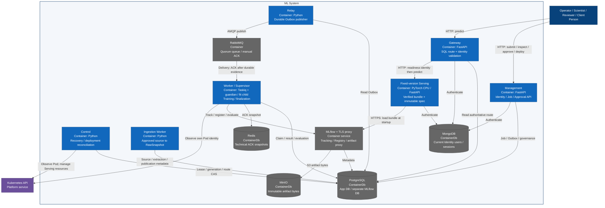
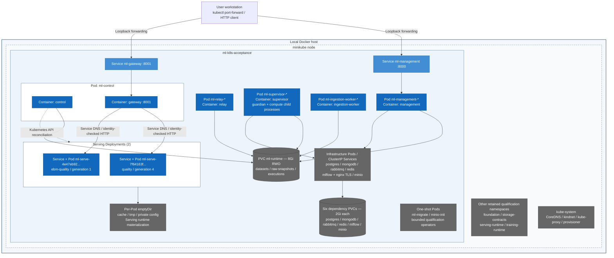

# Kubernetes 架構與 Minikube 運行現況

本頁供部署及維運使用者閱讀，整合 PR #11 完成後的角色、Pods、Services、儲存與
網路。**宣告基準是 PR #11 合併後的 master `55dd226`；現況是 2026-11-19 的本地
Minikube 快照，並非已將該叢集升級到最終 release。**

Acceptance 資源名稱／Ready 狀態於 **2026-11-19 02:18 UTC（Asia/Taipei 10:18）** 查詢；
其他 namespace、source hash、SQL／Serving 身份與資源限制取自同日稍早的唯讀稽核。
Pod suffix、IP、數量與瞬間用量會變動；後續查詢方式見[現況查詢](#現況查詢)。
完整驗收、原始證據與未完成事項統一見[實作狀態](../implementation-status.md)。

## 版本與宣告入口

| 範圍 | 基準／位置 |
| --- | --- |
| PR #11 最後通過完整 CI 的 source | `43b660626dd01cb365a9c5864a509487bb9a619f`；合併 master 為 `55dd2266395801b0dbeea40d34f4f92276fb6ac3` |
| 固定角色、migration、Service、PVC、NetworkPolicy | [base](../../deploy/k8s/base/) |
| 單節點開發用基礎服務 | [infrastructure/minikube](../../deploy/k8s/infrastructure/minikube/) |
| 原生 Serving → Pod Training → 整合 Acceptance | [Serving overlay](../../deploy/k8s/overlays/minikube-serving/)、[Training overlay](../../deploy/k8s/overlays/minikube-training/)、[Acceptance overlay](../../deploy/k8s/overlays/minikube-acceptance/) |
| 動態 Serving Deployment／Service／不可變 Spec ConfigMap | [KubernetesServingExecutor](../../src/infrastructure/deployment/kubernetes_serving.py)，由已核准的 SQL DeploymentSpec 產生 |
| 目前本地 Acceptance source | `61b5d51396e2a3301d126be32e77416dc0ca9173` |
| 目前本地 application image | `docker.io/library/ml-k8s-acceptance@sha256:2024f057ef71adad1a4db7ef74aa7b8b84df336f74d5e010a10de2ccbdb76a14` |

本地映像的 238 個 `src/`／`bootstrap/` Python 檔案與 `55dd226` 完全相同，公開
overlay 的 43 個資源經 namespace、release placeholders 及 API defaults 正規化後
沒有宣告欄位差異。16 個 application init／main containers 的實際 imageID 亦符合
本地設定 digest。PR #11 後續修正集中在 verifier／tests 與文件證據，**code／image
identity 仍不同**；不能把本地 namespace 當成最後完整 CI 使用的新叢集。

各 profile 使用自己的 fresh namespace，不是依序原地升級。公開 YAML 含 placeholder
及外部 Secret references；實際部署須依 [Foundation](kubernetes-staging-runbook.md)
產生私有、固定 source／manifest digest 的 overlay。各 profile 選擇見
[部署宣告索引](../../deploy/k8s/README.md)，全部環境鍵見[設定參考](../configuration-reference.md)。

## C4 Container 視圖：角色與資料流

下圖採 C4 的 Person、System boundary、Container／ContainerDb 與具名關係。
C4 Container 表示可執行角色或資料服務，不直接等於 Kubernetes Pod；實體分組見下一圖。
藍色為本系統角色，灰色為資料服務，紫色為 Kubernetes 平台。



Management 不執行 fit。Worker 擁有新訓練 dispatch；Control 接管 stale SQL ownership，
根據同一 execution 的 guardian／Pod／stop receipts 對帳，不能另起一個 fit。
Pod Training 使用 Supervisor 容器內的 compute child，**不是每個 Training Job 建一個
Kubernetes Job**。跨 Pod 觀察／停止證據契約見 [Training Runtime](kubernetes-training-runtime.md)。

SQL 是業務結果、人工核准及路由權威。Redis／RabbitMQ 不取代 SQL。Ingestion 的
RawSnapshot 必須經明確 operator DatasetBuilder 才成為 DatasetVersion；圖中沒有
自動 ingestion→training 邊。Serving 啟動時驗證固定 bundle，預測不逐次下載模型。

## C4 Deployment 視圖：目前 Acceptance 實體分組



圖中依賴及掛載關係為閱讀用摘要；每個角色的完整 volumes／resources 由 manifests
決定。Gateway 與 Control 是兩個 container、同一 Pod；Gateway 沒有獨立 Deployment。
`mlflow` Pod 同時有 MLflow server 與 nginx TLS container。六個依賴 PVC 與 runtime
PVC 均屬同一 namespace；Serving 不掛載 durable runtime PVC。

## Pods 與啟動方式

以下是 `ml-k8s-acceptance` 快照。常駐 Deployment 都是單副本；共有 13 個 Running
Pods，全部 Ready。欄位中的 Pod 名稱是觀測值，操作時優先使用 Deployment／Service。

| Deployment／用途 | 目前 Pod | Ready | 執行方式 |
| --- | --- | --- | --- |
| `ml-management` | `ml-management-85488544c5-zzkn7` | 1/1 | production entrypoint → Uvicorn Management :8000 |
| `ml-relay` | `ml-relay-86d5f6d87b-28hzp` | 1/1 | entrypoint → `bootstrap.ml_cli relay` |
| `ml-supervisor` | `ml-supervisor-69f7c4c5b7-qpf42` | 1/1 | entrypoint → Taskiq worker；guardian／fit 子程序 |
| `ml-control` | `ml-control-8bb669744-59vhm` | 2/2 | control loop + Gateway Uvicorn :8001 |
| `ml-ingestion-worker` | `ml-ingestion-worker-567944d68c-hdgwd` | 1/1 | entrypoint → `bootstrap.ingestion_cli work` |
| MLP Serving | `ml-serve-7f64163fab694e41a8500e3f8232e4d0-b79f97485-nk9v8` | 1/1 | 固定 DeploymentSpec → `bootstrap.ml_serving` |
| EBM Serving | `ml-serve-4e47eb92aeaa45d0a63d79fa54661f47-db964c694-428t9` | 1/1 | 同上，EBM neural runtime |
| `postgres` | `postgres-6df8c44c57-r7kn2` | 1/1 | App DB `ml` 與獨立 MLflow metadata DB `mlflow` |
| `mongodb` | `mongodb-5bcb4bb5b5-fpdt8` | 1/1 | 目前 Identity users／sessions |
| `rabbitmq` | `rabbitmq-74c9596b6d-62h49` | 1/1 | Quorum queue；manual ACK delivery |
| `redis` | `redis-854cdc6866-z78qk` | 1/1 | Technical ACK snapshots，非業務權威 |
| `mlflow` | `mlflow-59654dfb77-mrldc` | 2/2 | MLflow :5000 + nginx TLS :8443 |
| `minio` | `minio-5cdd89dc5c-d68tf` | 1/1 | S3-compatible artifact store |

一次性／驗收 Pods 另有：

| Pod | 快照狀態 | 說明 |
| --- | --- | --- |
| `ml-migrate-vbxwq` | Completed | 明確 Alembic migration；不是應用啟動時自動建表 |
| `minio-init-qdl46` | Completed | 初始化隔離環境 bucket |
| `governed-acceptance-operator` | Failed／DeadlineExceeded | 受限驗收 operator，`activeDeadlineSeconds=7200` |
| `training-qualification-operator` | Failed／DeadlineExceeded | 同上；不是常駐 Training Worker |

Foundation helper 依序啟動依賴、完成 MinIO init／migration，再啟動角色。
Migration Job 的 `backoffLimit=0`；init 會驗證 private config／CA 與所需 schema。
驗收 operator 的逾期狀態是保留觀測，不能拿來代表完整 harness 成功或應用 CrashLoop。

## Services、DNS 與網路

下列全部為 **ClusterIP**，沒有對外 LoadBalancer／NodePort／Ingress。IP 只供快照對照，
client／controller 使用 Service DNS；同 namespace 可用短名，完整形式為
`<service>.ml-k8s-acceptance.svc.cluster.local`。

| Service | 快照 ClusterIP | TCP port | 指向／協定 |
| --- | --- | ---: | --- |
| `ml-management` | `10.102.61.139` | 8000 | Management Pod，HTTP Management／Identity APIs |
| `ml-gateway` | `10.101.1.212` | 8001 | `ml-control` Pod 的 gateway container，HTTP prediction ingress |
| `ml-serve-7f64163fab694e41a8500e3f8232e4d0` | `10.97.230.195` | 8001 | ACTIVE MLP 固定 generation |
| `ml-serve-4e47eb92aeaa45d0a63d79fa54661f47` | `10.102.188.30` | 8001 | ACTIVE EBM 固定 generation |
| `postgres` | `10.104.227.113` | 5432 | PostgreSQL |
| `mongodb` | `10.105.239.190` | 27017 | Mongo Identity |
| `rabbitmq` | `10.108.3.79` | 5672 | AMQP；`ml.training.v1` quorum queue |
| `redis` | `10.106.105.102` | 6379 | Redis |
| `mlflow` | `10.100.113.54` | 8443 | HTTPS TLS proxy；內部轉送 MLflow :5000 |
| `minio` | `10.99.238.81` | 9000 | 內部 S3 API，由 MLflow artifact proxy 使用 |

Gateway 先讀 SQL route，再檢查 Serving readiness 的 deployment／generation／spec／
model／Pod 身份，才轉送預測；不能把任意 Pod IP 或 model URI 寫入 client request。
Service DNS 本身不代表獲准切流；SQL Approval／generation／route fencing 仍是權威。

| NetworkPolicy | 宣告允許的流量 |
| --- | --- |
| `namespace-boundary` | namespace 內 Pods 互通；向 kube-system UDP／TCP 53 查 DNS；未列出的 ingress／egress 不由此 policy 允許 |
| `serving-controller-api` | `ml-control` Pod 額外允許 TCP 443／8443 egress，供 Kubernetes API |
| `training-supervisor-api` | `ml-supervisor` Pod 額外允許 TCP 443／8443 egress，供 Pod 觀察 |

Policy 的允許規則為聯集；API egress policy 只有 port 條件，沒有目的位址限制，不能
視為 production 精細網路隔離。現在 kube-system 有 CoreDNS、kindnet、kube-proxy
及 hostpath provisioner。**Policy 存在不代表 CNI enforcement 已取得資格**；跨 namespace
拒絕、企業服務 egress、對外 TLS ingress 仍須 Production Operations 的實測與配置。

本地存取使用 loopback port-forward，依需要在兩個 terminal 分別執行：

```sh
kubectl --context=minikube -n ml-k8s-acceptance port-forward --address=127.0.0.1 service/ml-management 8000:8000
kubectl --context=minikube -n ml-k8s-acceptance port-forward --address=127.0.0.1 service/ml-gateway 8001:8001
```

Management／Gateway 分別位於 `http://127.0.0.1:8000`、`http://127.0.0.1:8001`。
業務 APIs 仍需有效 Bearer 身份與權限；port-forward 不代替 production ingress。

## Volumes、資料持久性與設定

Acceptance 的 7 個 PVC 均 Bound，StorageClass 為 `standard`，provisioner 為
`k8s.io/minikube-hostpath`，access mode 為 ReadWriteOnce，reclaim policy 為 Delete。

| PVC | 容量請求 | 掛載／資料 |
| --- | ---: | --- |
| `ml-runtime` | 8Gi | 固定 application roles 的 `/app/var`；datasets、raw-snapshots、executions／checkpoint／stop receipts |
| `postgres` | 2Gi | `/var/lib/postgresql/data`；App DB 與 MLflow metadata DB |
| `mongodb` | 2Gi | `/data/db`；Identity state |
| `rabbitmq` | 2Gi | `/var/lib/rabbitmq`；broker 持久狀態 |
| `redis` | 2Gi | `/data`；Redis persistence，仍非 Job authority |
| `mlflow` | 2Gi | `/auth-data`；MLflow auth 狀態，metadata 另在 PostgreSQL |
| `minio` | 2Gi | `/data`；模型 artifact bytes |

PVC 的容量請求不代表 Minikube hostpath 已做實際容量／fsync／跨節點資格驗證。
刪除 PVC 可能連動刪除資料；保留 namespace 的清理須先核對資料與 receipts。

| Volume 類型 | 位置／上限 | 行為 |
| --- | --- | --- |
| Application artifact cache | `/app/var/artifacts`，每 Pod `emptyDir` 1Gi | 覆蓋 durable runtime mount 的此子路徑；模型權威 bytes 在 MLflow／MinIO |
| Application temporary files | `/tmp`，每 Pod `emptyDir` 256Mi | Pod 消失可丟棄 |
| Role private copies | `/run/private`，memory `emptyDir`，每 role 2Mi | init 複製 Secret／CA，main container 唯讀；Control／Gateway 分開 copies |
| Serving runtime materialization | `/app/var` 2Gi、`/tmp` 256Mi、private memory 1Mi，全部 `emptyDir` | Serving 不依賴 `ml-runtime` PVC；重建時重新驗證下載模型 |
| Serving spec | `/run/model/spec.json`，immutable ConfigMap 唯讀掛載 | 與 SQL DeploymentSpec／digest 匹配 |
| Kubernetes API identity | `/run/kubernetes`，明確 projected token／CA | 僅 Control／Supervisor mount；不是一般自動 ServiceAccount token |

Public 設定來自 `ml-runtime` ConfigMap；init helper 來自 `ml-foundation-files`，信任
CA 來自 `mlflow-ca`。每個 application role 使用 `ml-runtime-<role>` Secret reference，
由 init 建立 UID-owned regular private JSON，再經 production entrypoint 載入。
此頁不保存 Secret values、tokens、私有 rendered YAML 或真實資料。

既有 Pod 使用私有副本，**更新 Secret 不會自動改變該 Pod 的 credentials**。
CA／Secret rotation 需要協調 replacement 與重新驗證。Storage 詳細契約見
[Storage Contracts](kubernetes-storage-contracts.md)，角色欄位與載入規則見[設定參考](../configuration-reference.md)。

## 權限、資源與停止行為

Application／Serving Pods 使用非 root UID／GID／fsGroup 10001、RuntimeDefault
seccomp；main containers 使用 read-only root filesystem、drop ALL capabilities、
禁止 privilege escalation。依賴映像有自己的 UID／掛載規則，見 infrastructure manifests。

| Role／ServiceAccount | Kubernetes 權限 |
| --- | --- |
| `ml-control` | namespace Role `ml-serving-controller`：get/create/delete deployments、configmaps、services；get replicasets；get/list pods；另有 Training observer 的 get pods |
| `ml-supervisor` | namespace Role `ml-training-observer`：get pods；無 Pod exec/delete 或 Secret read |
| `ml-management`、`ml-relay`、`ml-ingestion-worker`、`ml-migrate` | 不授予上述 runtime API Roles；關閉自動 token mount |
| `ml-serving`／qualification operators | 關閉自動 token mount；operators 不取得 Control 的 API token |
| Gateway container | 共用 Control 的 ServiceAccount 身份，但未掛載 projected API token；使用自己的 role private config |

快照未發現直接授予 Acceptance ServiceAccounts 的 ClusterRoleBinding。
Namespace Roles 不構成對同 Pod 內可信程式碼的 tenant sandbox。

下表為 steady-state application container requests／limits；不是整個 Pod 的總數，
init resources 及依賴服務另計。Control／Gateway 共享 Pod，兩列須合計。

| Container | CPU request／limit | Memory request／limit |
| --- | --- | --- |
| management／relay／ingestion-worker，各自 | 50m／1 | 128Mi／512Mi |
| supervisor | 100m／1 | 384Mi／1536Mi |
| control | 100m／1 | 384Mi／1536Mi |
| gateway | 50m／1 | 128Mi／512Mi |
| 每個 serving | 50m／1 | 256Mi／1536Mi |

固定 application Pod grace 為 360 秒；Taskiq 使用 1 worker、1 async task、manual ACK，
wait-tasks=60 秒、shutdown=90 秒。Serving 是 Recreate／單副本、progress deadline
180 秒、Pod grace 40 秒。只有確認實體停止才釋放 reservation／完成取消；未知 execution
仍待 reconciliation。Management／Gateway 的 HTTP health probes 與 Serving 的
identity readiness 各有範圍，詳見[維運手冊](../ml-runbook.md#observability)。

## 本地現況與最終版本的差異

| Namespace | Running／Succeeded／Failed Pods | 保留用途／source |
| --- | --- | --- |
| `ml-k8s-foundation` | 11／2／0 | Foundation／local adapters；`ce81327` |
| `ml-k8s-storage-contracts` | 0／1／0 | 獨立 synthetic storage PVC；reader 完成 |
| `ml-k8s-serving-runtime` | 10／2／1 | Native Serving；`d6cf9ac`；Relay／Supervisor replicas=0 |
| `ml-k8s-training-runtime` | 11／2／1 | Pod Training；`9c422b7` |
| `ml-k8s-acceptance` | 13／2／2 | 組合架構；`61b5d51` |

合計 45 Running、9 Succeeded、4 Failed Pods，29 個 PVC 皆 Bound。舊 namespace
保留自己的資料與 dependency instances，不是共用同一套正式服務；四個 Failed Pods
都是有限時的 qualification operators。另有 kube-system 平台 Pods，不包含在此合計。

Acceptance 的 SQL 唯讀觀測：11 個 Training Jobs 全為終態，8 SUCCEEDED／2 FAILED／
1 CANCELLED；Outbox 11 筆皆 PUBLISHED，沒有待對帳的非終態 Job。兩個未釋放的
Serving reservations 對應以下 ACTIVE endpoints，GET-only native readiness／identity 均通過：

| Endpoint | Generation／route revision | Model version | 狀態 |
| --- | --- | --- | --- |
| `quality` | 4／4 | 1 | ACTIVE MLP |
| `ebm-quality` | 1／1 | 4 | ACTIVE EBM |

RabbitMQ `ml.training.v1` 為 quorum，consumer timeout=1800000ms，1 consumer、
messages_ready=0／messages_unacknowledged=0；dead-letter queue 亦為 0／0。
兩個全域 Serving slots 已用滿，新的 reservation 仍受現有容量規則限制。

本地既有完整 harness receipts 仍為 INCOMPLETE，continuation 到 9 個 checks。
後續補充 probes 與最終完整 CI 是不同證據，詳見
[PR #11 review](../reviews/k8s-acceptance-2026-11-18.md#local-executed-evidence-and-corrections)。
本頁的 readiness／組態觀測不等於在此 namespace 重跑完整 12 項驗收。

目前本地的主要 public 設定如下；完整欄位及限制見[設定參考](../configuration-reference.md)：

| 組態 | 本地 Acceptance 值 |
| --- | --- |
| Serving backend／namespace | `kubernetes`／`ml-k8s-acceptance` |
| Training backend／namespace | `pod`／`ml-k8s-acceptance` |
| Tracking | `mlflow`；`https://mlflow:8443`，TLS 驗證啟用 |
| Training／queue／cancel grace | 60／10／1 秒，只是驗收 fault budgets |
| EBM policy version | `engineering-test-only-k8s-acceptance-v1`，synthetic engineering policy |
| Ingestion／Databricks | `ML_INGESTION_ENABLED=true`／`ML_DATABRICKS_ENABLED=false` |

共用 base 的 training／queue／cancel grace 為 300／600／5 秒；Acceptance overlay
明確覆寫成上述 fault budgets，不能直接作為 production 容量或 deadline 核准值。
`ML_MODEL_ENVIRONMENT=prod`、production entrypoint／TLS 驗證是 runtime 契約，
不是企業資料／模型品質／Go-Live 核准。

### Node 資源限制待校正

單節點為 Docker driver、Kubernetes v1.37.0、containerd 2.3.4。
Saved Minikube profile 記錄 2 CPU／9900 MiB，但實際 Docker CPU quota 未設定，
memory limit 為 10380902400 bytes（約 9.67 GiB）。Kubernetes Node 卻回報 16 CPU／
40703844 KiB（約 38.82 GiB）memory allocatable；排程不能直接採信較大的 memory 數值。

同日先前一次 Docker stats 為 8.1 GiB／9.668 GiB、83.78%；是瞬間值，不是目前即時
儀表板或容量測試。Node 當時 Ready=True、無 Memory／Disk／PID pressure；
metrics.k8s.io API 未提供，沒有 Pod CPU／memory 用量。整理舊驗收環境與校正
Node 資源宣告，應納入下一次容量規劃。

## 現況查詢

以下查詢固定 `--context=minikube`；不必下載 Secret 或完整 ConfigMap 內容：

```sh
kubectl --context=minikube get nodes -o wide
kubectl --context=minikube get pods --all-namespaces -o wide
kubectl --context=minikube -n ml-k8s-acceptance get deployments,pods,services,endpointslices,pvc
kubectl --context=minikube -n ml-k8s-acceptance get networkpolicies,serviceaccounts,roles,rolebindings
kubectl --context=minikube get storageclass
kubectl --context=minikube -n ml-k8s-acceptance get configmap ml-runtime -o 'jsonpath={.data.ML_CODE_REVISION}{"\n"}{.data.ML_IMAGE_DIGEST}{"\n"}{.data.ML_SERVING_BACKEND}{"\n"}{.data.ML_TRAINING_BACKEND}{"\n"}'
kubectl --context=minikube -n ml-k8s-acceptance get deployments -o 'custom-columns=NAME:.metadata.name,WANT:.spec.replicas,READY:.status.readyReplicas,IMAGE:.spec.template.spec.containers[*].image'
```

本地連線後可 GET Management／Gateway `/health/ready`。API 業務狀態與權限見
[ML 操作契約](../ml-runbook.md#api-與-client-契約)。需要 secrets 的 CLI 不能假設
`kubectl exec` 繼承 PID 1 載入的 private environment，應使用手冊的 role entrypoint。

更新本頁快照時，記錄查詢時間、context、source／image 與差異；不要覆寫原始驗收
receipts，也不要提交 private overlays／tokens／source rows。完整重跑依
[Acceptance 手冊](kubernetes-acceptance.md)，舊環境的資料保留與清理須另行安排。
公司 CSI／跨節點 fencing、CNI enforcement、企業服務、Secrets rotation、告警／SLO／
容量及 backup／restore 仍是第六包 Production Operations，`production_accepted=false`。
