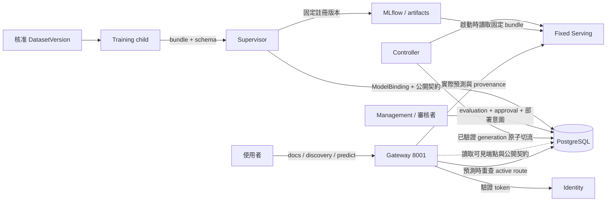

# 從 8001 找到可使用的預測模型

**交付界線。** 基準為 master `a5b1767`。本次補齊現有 Gateway 的 Swagger、ReDoc 與 OpenAPI 說明，並將 Gateway 首頁導向 Swagger。以下兩個 GET 是後續開發提案。今天的使用者可以開啟 `/docs`，依指引登入，並對部署負責人提供的端點發出預測。

## Current implementation

WP1 is committed on feature/prediction-api-guide at 5091465. It supplies English Gateway
documentation, auth instructions and strict successful upstream response validation.
WP2 is implemented on feature/prediction-endpoint-discovery, stacked on that WP1 commit.
The user authorized WP2 and sequential local commits, then requested a stop for review.

Both GET endpoints below are registered in the existing Gateway. EndpointDiscoveryService
queries the existing authority through SQLPredictionCatalog, and contract publication extends
SQLRegistryRepository. Additive migration 0007 adds public technical contracts and append-only
reviewed usage descriptions. Human publication/backfill uses the authenticated operator CLI.
The architecture and acceptance discussion below remains the design reference. Actual response
shape and operator commands are specified in the implementation section at the end.
WP3–WP7 await their own authorized sessions.

## 使用者從哪裡開始

第一次整合時，使用者想回答三個問題：「哪個端點能解決我的問題？我手上的資料能不能送？這次結果是哪一版算的？」理想流程是從同一個公開 Gateway 網址打開 `/docs`，取得部署指定的 Identity 登入位置，以 Bearer token 授權，瀏覽自己可使用的端點，照該端點的範例發出預測，最後保留 `request_id` 與回應中的模型版本。

建議以**邏輯端點為每筆清單的主鍵**。一個已註冊的版本可以尚未部署，同一個版本也可以服務不同端點。端點有穩定名稱，模型更新時，用戶端可繼續呼叫相容的輸入契約。建議文件頁標題使用「可用模型與預測端點」，讓搜尋「list models」的使用者也能找到入口。

| 使用者要做的事 | 現行入口與邊界 | 提案 |
| --- | --- | --- |
| 找可呼叫的模型 | 部署負責人提供端點 ID | 8001 清單列出該租戶獲授權且已切流的端點 |
| 了解功能、欄位與限制 | Gateway 文件描述 MLP 和 EBM 兩種契約，使用者須自行對應端點 | 端點明細提供用途、適用條件、schema、範例、上限及分數含義 |
| 核對這次實際版本 | 成功預測的 `provenance.registered_model`、`model_version`、`generation` | 明細顯示查詢時的固定版本，預測回應保留執行時的證據 |
| 查已登錄但尚未上線的版本 | 8000 `GET /api/v1/model_registry/models/{name}/versions`，需要 `ml:model:read` | 管理端提供本平台已綁定的版本歷史。MLflow 中由其他系統建立或已被外部刪除的版本需由具權限的 Registry 操作者另外確認 |

**正式入口的登入路徑。** 正式部署應從受信任的部署設定產生文件中的 Identity HTTPS 網址，並說明如何取得預測帳號。如果使用者的網路只允許連到 Gateway 的公開 origin，建議由既有 ingress 在同一 origin 下只轉送必要的 Identity 登入／session 操作到 Management，將其餘管理操作保留在管理網路。Swagger 的 Authorize 使用回傳的短效 token。驗收時從實際使用者網段測試登入、到期與撤銷，包含無法連到內部 8000 或 CDN 的瀏覽器。

## 五張架構圖對應的改動

提供的五張圖以 `e1dc423` 的 reference Compose 為底圖，下表對照 `a5b1767` 的實作。圖中的 `instance.json` 適用於本機 serving，Kubernetes 使用現有的部署解析器。

| 架構圖 | 現行責任 | 建議整合位置 |
| --- | --- | --- |
| 01 System overview | 8000 管理生命週期，8001 服務外部預測 client，SQL 保存路由、Mongo 保存 Identity | 在既有 Gateway 增加唯讀探索 use case。OpenAPI 保持靜態，租戶資料由登入後的 GET 提供 |
| 05 Model training | 訓練子程序輸出 bundle、manifest、feature schema、output mapping | Supervisor 在取得並驗證 bundle 時擷取可公開的輸入、輸出契約與 digest。新 workload 須提供與 runtime 一致的 shape、順序、版本和合成範例 |
| 06 Model registry / evaluation | MLflow 提供固定註冊版本，MinIO 保存 artifact，SQL 綁定模型與精確評估 | 依 ModelBinding、manifest digest 保存公開契約，附上經審核的用途、輸入單位、限制與輸出解釋。保留 evaluation 及環境 approval 關聯。未知單位明示未知，不從欄名猜測 |
| 07 Model deployment | Controller 驗證固定 bundle 和 readiness，以 route revision 原子切流，rollback 建立新 generation | 在 activation 前核對可公開契約與 serving 實際 profile。SQL route 與 deployment 的同一次一致讀決定哪一筆進入目錄，切流與回滾沿用原有交易 |
| 08 Online inference | Gateway 驗證身分、解析租戶路由與 readiness、轉送請求，再核對 provenance 與 route | 清單和明細共用預測的租戶／授權規則。保留真正預測時的實例及路由複查，並回傳當次身份 |



## 建議 API 契約

| 方法與路徑（8001） | 權限 | 給使用者的 description |
| --- | --- | --- |
| `GET /api/v1/prediction/endpoints` | Bearer，`ml:predict` | 列出你目前獲授權且已指派模型的預測端點。可依用途、模型名稱與固定版本選擇端點，再用明細取得輸入範例。 |
| `GET /api/v1/prediction/endpoints/{endpoint_id}` | 同上 | 取得此端點目前的模型版本、輸入與輸出契約、限制及合成範例。範例內的 endpoint ID 可直接用於預測。 |
| 既有 `POST /api/v1/prediction/predict` | 同上，Serving 再驗證 | 使用邏輯端點的有效版本處理一批資料。回應記錄這一次使用的模型版本、部署世代與請求 ID。 |

建議清單依 `endpoint_id` 穩定排序，預設 25 筆、每頁最多 100 筆，以不透明的 keyset cursor 續頁。Cursor 綁定租戶與查詢範圍，設效期、檢查完整性，每頁重新授權。依頁讀取當時的有效路由，翻頁期間資料可能更新。回傳身分相關資料時設 `Cache-Control: private, no-store`。有效查詢沒有結果時回 `200` 與空陣列，文件提供確認租戶及聯絡部署擁有者的指引。

以下是提案中的合成清單回應。時間為 UTC。每筆代表一個已切流的邏輯端點。

```json
{
  "observed_at": "2026-11-26T04:00:00Z",
  "items": [{
    "endpoint_id": "quality",
    "display_name": "雙感測器品質分類",
    "purpose": "依兩個感測值分類合成品質樣本",
    "registered_model": "demo-quality",
    "model_version": "7",
    "generation": 3,
    "route_revision": 5,
    "route_state": "active",
    "contract_status": "complete",
    "input_schema_version": "1",
    "detail_url": "/api/v1/prediction/endpoints/quality"
  }],
  "next_cursor": null
}
```

明細包含清單身份欄位，另附 `deployment_id`、`manifest_digest`、`contract_digest`、`output_schema_version`、`input_schema`、`output_schema`、`limits`、`usage_notes`、`request_example` 及 `predict_url`。Schema 應為可機器解析的 JSON Schema。業務資訊由模型擁有者撰寫並審核，schema、範例與版本在發布前交叉驗證。MLP 明列兩個具名欄位、有限值範圍、批次上限與未校準分類分數。EBM 明列預先計算的 spectrogram、四個軸的形狀、完整 signal/pad 順序、前處理版本與批次上限，解釋 `sigma` 是 latent feature 的標準差、`raw_nn_score` 未校準。範例僅使用合成數值。

例如使用者在清單選了 `quality`，明細的 `request_example` 應可直接送出。以下流程假設已依 8001 文件取得 token，並使用提案完成後的 API：

```sh
curl -fsS -H "Authorization: Bearer $TOKEN" "$GATEWAY/api/v1/prediction/endpoints"
curl -fsS -H "Authorization: Bearer $TOKEN" "$GATEWAY/api/v1/prediction/endpoints/quality" |
  jq -e '.request_example' > request.json
curl -fsS -H "Authorization: Bearer $TOKEN" -H 'Content-Type: application/json' \
  --data-binary @request.json "$GATEWAY/api/v1/prediction/predict"
```

**如何判斷模型是否適用。** 端點明細應有面向使用者的用途、適用資料範圍、輸出解讀、已知限制與支援窗口。若產品允許公開品質摘要，從與該 binding、manifest 和環境核准相符的 evaluation 取出經審核的指標、單位、評估日期與政策版本。指標旁註明評估資料範圍，缺值標示未知。詳細報告沿用 8000 的 `ml:model:read` 與租戶檢查，預測帳號不需為了試用模型取得管理權限。呈現版本時明列來源是 MLflow 或本機開發 tracker；模型版本、部署世代與 API schema 版本各有獨立欄位。

**版本與可用性。** `route_state=active` 表示在 `observed_at` 的 SQL 路由已指派該 generation。清單不逐一探測所有 runtime。若產品要呈現最近一次健康觀測，應另列 `readiness`、`checked_at`、有效期，以及 `unknown/stale` 的語意。Gateway 在預測時繼續檢查對應實例。若查詢與預測之間發生相容更新，回應 provenance 決定實際版本。若處理中路由改變，沿用現行 503；client 應重讀明細。會改變欄位、順序、分數意義或必要前處理的更新，使用新的契約版本與可並行的新版邏輯端點，提供停用日期與替代端點。

**錯誤契約。** 清單與明細統一使用既有公開錯誤格式。401 提示重新登入，403 表示身分缺少預測權限，未知或不可見的個別端點統一 404。格式錯誤或失效的 cursor 回 422 並提示從第一頁重查。SQL／Identity 暫時失效回 503，可在退避後重試。預測另有 413、422、429、504 等既有結果。OpenAPI 提供每種結果的說明；用戶端可用 request ID 向維運追蹤。

## 實作與相容方案

1. **保存公開契約。** 先查現有 bundle manifest 及其中被 digest 保護的 `feature_schema.json`、`output_mapping.json`。在受信任的 bundle 讀取邊界驗證後，以 allowlist 擷取名稱、型別、順序、限制、公開輸出說明，限制大小並驗證範例。建議新增 additive SQL 表，以租戶、binding ID、manifest digest 及契約版本綁定不可變描述。相同內容可重試，衝突拒絕。部署前由有權的 operator 以相同驗證流程回填既有 bindings。記錄不齊時舊端點可繼續預測，清單標示 `contract_status=incomplete`，個別未知欄位為 null；省略無法驗證的範例。受管端點達到完整覆蓋後才對新發布強制契約驗證。
2. **供應目錄與授權。** 以 application query port 與 SQL repository 一次讀取登入租戶的 routes、deployments、bindings、公開契約。只選已指派且世代相符、資源未釋放的有效部署。明細檢查同一身分及 immutable spec digest。共用既有 `ml:predict` 與 tenant 規則。日後若導入端點級 grant，list、detail、predict 同時採用，不允許清單擴大權限。Gateway 使用唯讀 SQL、既有 Identity 和公開欄位。回應排除 artifact URI、內部位址、憑證、客戶資料與未審核的自由文字。列表查詢不逐筆連 MLflow、物件儲存或 Serving。
3. **發布與運維。** Control 仍是有效路由的寫入者。切流前比對已驗證 bundle 的輸入／輸出契約與部署契約，新世代準備好才更新路由。啟用探索可先限制於測試租戶，再擴大開放。回退時可停用兩個唯讀 GET，保留既有 POST 與舊版本資料。正式環境以實際公開 HTTPS base URL 提供 Identity 指引、同源 Swagger 靜態資產與 `/docs` 入口，測試反向代理路徑及受限網路。由操作方提供各環境的支援窗口與模型用途審核責任人。
4. **可觀測性。** 記錄 discovery 延遲、錯誤率、契約缺漏數、route mismatch、容量拒絕與 deadline，按服務／結果彙整。Trace 用 request ID 關聯到 deployment generation 與核准記錄。監控資料排除 Bearer token、模型輸入及預測值。容量目標應以目標環境的端點數、查詢流量、p95 延遲及 Gateway 資源預算進行負載驗收後訂定。

## 驗收與發布門檻

| 驗收 | 應有證據 |
| --- | --- |
| 第一次使用，只提供 Gateway URL 和一般預測帳號 | 可從文件登入、列出端點、選擇範例並完成 MLP / EBM 預測，不需 registry 或 deployment 管理權限。驗證 Swagger Try it out、ReDoc、機器產生的 SDK 與空清單流程 |
| Registry、治理與實際上線狀態 | 已登錄／僅評估／已核准但未部署／warming／failed／retired 版本均不出現在可呼叫清單。只有 active route 對應的版本出現。MLflow 停機時，既有已載入模型的探索不依賴即時 registry 搜尋 |
| 租戶與撤權 | 兩個租戶共用端點名稱仍只見各自版本；跨租戶明細與陌生 ID 均為 404。過期或遭撤銷的 session 在三個 API 皆遭拒絕。游標不可跨租戶重用 |
| 併發／回滾 | 正在預熱的 v2 不遮蓋服務中的 v1。成功切流後清單與明細不混用不同 generation 欄位；rollback 後版本回到 v1，generation 增加。預測期間切流沿用既有拒絕語意 |
| 契約與舊資料 | 讓每一筆 request example 通過對應 DTO 和測試部署的實際推論。錯誤順序、超限、過期 metadata、被修改的 digest 均有明確結果。檢查舊 serving 在回填前／後與回退時皆可使用 |
| 全段部署驗證 | 隔離 Compose 啟動 SQL、Identity、MLflow、物件儲存、訓練與 Controller。從訓練、註冊、評估、環境核准到啟用，再由另一個 read/predict client 只走 8001，核對版本與 digest。先後測試既有 MLP／EBM、更新與回滾，再於目標 K8s／企業依賴驗證 TLS、權限、健康時效與故障恢復 |
| 交付證據 | 對每個待發布 revision 保存 OpenAPI 差異、授權與合約測試、端對端結果、壓測分布及未通過項目。上述是後續 API 的驗收條件 |

實作位置可由 [Gateway](../../bootstrap/ml_gateway.py)、[Registry 路由](../../src/api/ml_http.py)、[Deployment SQL](../../src/infrastructure/persistence/ml_deployments.py)、[Serving](../../bootstrap/ml_serving.py) 與[目前操作手冊](../ml-runbook.md)追溯。


## WP2 delivered contract and operator walkthrough

### Public endpoints

`GET /api/v1/prediction/endpoints?limit=25&cursor=...` returns `observed_at` as UTC Unix
seconds, `items` and nullable `next_cursor`. The maximum limit is 100. Sorting is ascending
endpoint ID. Cursors are HMAC-authenticated, expire after 15 minutes and are bound to tenant,
account and page limit. Each request re-resolves current Identity permissions. Invalid, expired
or mismatched cursors return sanitized 422. Concurrent updates can change later pages.

Each summary includes endpoint ID, reviewed display name/purpose, registered model/version,
generation, route revision, active route state, `readiness=unknown`, contract completeness,
input schema version and `detail_url`. No live health timestamp is invented.

`GET /api/v1/prediction/endpoints/{endpoint_id}` adds `observed_at`, deployment and binding
IDs, manifest/contract digest, reviewed usage/revision, `contract`, `request_example` and
`predict_url`. The nested contract contains input/output JSON Schema, limits, preprocessing,
output semantics, nullable units, registry backend and a synthetic request template. Use the
**top-level request_example** to invoke the deployed endpoint. Its endpoint ID is rendered
for that route, while the stored nested contract is preserved for digest verification.

The digest is the existing ml-json-v1 `digest([contract_version, binding_id, manifest_digest,
contract_document])`. The version discriminator is `prediction-contract-v1`.
Technical content is immutable per binding. Identical publication is idempotent; different
technical content conflicts. Business descriptions have a separate append-only revision,
reviewer and audit record. Repeating the current review is idempotent; changed descriptions
create a revision without changing model/technical digests.

Both operations require only `ml:predict` and current tenant access. The collection returns
200/empty items when appropriate; an unknown, inactive or invisible individual endpoint is 404.
Missing/invalid session is 401, absent permission is 403, validation is 422 and unavailable
Identity/storage or inconsistent deployment identity is 503. Successful and handled-error
discovery responses use `Cache-Control: private, no-store`.
SQL joins routes, active unreleased deployments, tenant bindings and contract metadata in one
bounded statement. Retrieval does not invoke MLflow, artifact storage or Serving.
Current prediction-time readiness, route fencing and fixed-version provenance checks remain active.

### Deployment and publication

1. Apply migration 0007 through the existing explicitly approved deployment migration step.
   It creates two empty additive tables and preserves existing model/source/history records.
   No startup code runs migrations. Test migration is qualified only against disposable resources.
2. Train/evaluate and inspect the resulting binding through existing Management APIs.
3. A reviewer with `ml:model:read` and `ml:model:approve` writes a plain-text reviewed JSON
   document containing exactly the five fields shown below. Obtain a current Identity token
   and keep its file private (0600) outside the repository.
4. Run the CLI under the existing approved operator role/secret-loading entrypoint:

```sh
python -m bootstrap.prediction_contract_cli \
  --binding-id "$BINDING_ID" \
  --review-file "$APPROVED_REVIEW_FILE" \
  --token-file "$PRIVATE_REVIEWER_TOKEN_FILE"
```

```json
{
  "display_name": "Synthetic quality model",
  "purpose": "Classify synthetic engineering samples.",
  "applicable_conditions": "Use the qualified sensor/preprocessing contract.",
  "usage_notes": "Scores are uncalibrated; units may be unspecified.",
  "support_info": "Contact the model owner through the approved support channel."
}
```

The CLI resolves the token through current Mongo Identity sessions. It derives tenant/actor from
that session, verifies the exact model bundle/member hashes and approved runtime/golden contract,
then stores allowlisted technical metadata and the reviewed description atomically. Reviewer
text is bounded plain text and must be appropriate for public prediction clients. Technical
extraction uses the actual request/response DTOs, preserves unknown physical units as null,
and publishes no artifact URI, normalization state or internal runtime address.
The same CLI backfills **same-code-revision** bindings and adds reviewed descriptions.
Unsupported contracts, bad digests, unauthorized reviewers and conflicting technical records fail closed.

5. Perform existing environment approval and deployment. Controller owns activation.
   Metadata publication alone does not make a version appear in discovery.
6. A prediction-only account opens 8001/docs, authorizes, lists endpoints, opens detail and sends
   its top-level request_example to predict_url. Keep returned provenance/request ID.
7. Updating/rolling back the active generation immediately changes discovery through SQL.
   Loaded inference and discovery continue without list-time artifact/MLflow access.

### Legacy, rollback and remaining qualification

#### Backfill compatibility across code upgrades

Publication uses the qualified operator release's `ML_CODE_REVISION` as an independent trust
input. Both MLP and EBM runtime loaders compare it with the immutable manifest's
`model.trusted_code_digest`, and keep their existing artifact, architecture, preprocessing,
golden-inference and runtime checks. The extractor requires an explicit, nonempty trusted revision;
it never infers this value from the bundle. The CLI has no historical-revision override.

**In-place cross-revision backfill is not supported.** A model trained under qualified revision H
cannot be published by a WP2 operator release at C when H differs from C, even if the architecture
and schema version strings match. This restriction applies to both model profiles and usage
updates that reverify the old bundle. A same-revision legacy binding can be backfilled after the
schema is installed, using the CLI above, provided all runtime verification succeeds.

For a historical bundle rejected after an upgrade:

1. Keep its immutable binding, bundle, manifest, evaluations and approvals unchanged. Metadata
   stays incomplete. Existing inference depends on retaining its original qualified, pinned
   Serving runtime; WP2 does not qualify loading H bundles into a C runtime.
2. Do not rewrite manifest digests, relabel images, set `ML_CODE_REVISION=H` on C code, remove
   trusted-revision checks, or treat contract publication as runtime compatibility evidence.
3. To obtain a complete contract on release C, use the approved C training/runtime environment
   to train a new model version/binding from an approved immutable dataset. Run its normal quality
   evaluation; review results and obtain fresh environment approval. Retraining is a new candidate,
   not a guarantee of equivalent behavior or permission to reuse H's approval.
4. Publish the new binding with the authenticated C CLI, then use the existing authorized
   deployment/controller process and verify actual inference/provenance. Keep H until normal
   rollback/retirement policy permits its release. No existing resource is automatically migrated.

Future cross-revision reuse requires separate runtime compatibility qualification and review;
no compatibility platform or automatic Supervisor publication is introduced here.

#### Reverse proxy paths

`detail_url` and `predict_url` remain origin-relative strings, now rendered by Gateway routes
from the ASGI request. With configured `root_path=/inference`, they begin with
`/inference/api/v1/prediction/`; with an empty root path their existing `/api/v1/...` values
are unchanged. Follow these URLs directly; do not prepend the prefix a second time. Configure
the ASGI server's root path to match the trusted proxy prefix. Arbitrary `X-Forwarded-Prefix`
headers are not used as configuration. Serving's private upstream paths remain unchanged.

Legacy active endpoints stay discoverable with `contract_status=incomplete` and null contract/
example fields until compatible verified publication. Continued inference requires their
original qualified runtime to remain available. Corrupt technical metadata is also incomplete.
There is no automatic backfill, automatic Supervisor extraction or mandatory metadata enforcement
on deployment in this release. The operator publication step is explicit and reviewable.
Original model bindings, digests, serving specifications and existing POST requests are retained.

Rollback the application image first if reverting this feature. Then, only through an approved
maintenance operation, migration downgrade removes the two new metadata tables. Historical
model/approval/deployment/source tables remain. Export reviewed metadata before downgrade if
it must be retained. New Gateway readiness requires the additive schema.

Technical schema generation changes that alter stored content require compatibility review
instead of rewriting historical records. Production K8s, enterprise MLflow, TLS, policy distribution,
single-origin Identity routing, self-hosted docs assets and operational SLO qualification remain
separate work. `production_accepted=false`.
