# PyTorch ML System — High-Level Design (HLD)

> **文件編號**：ML-HLD-001  
> **版本**：1.1（Architecture Proposal，跨文件一致性修訂）
> **修訂日期**：2026-10-29  
> **日期**：2026-10-28（Asia/Taipei）  
> **狀態**：**目標設計，非既有實作聲明；尚未完成 Production 驗收**  
> **基礎 Repository**：[python-backend-server-template](https://github.com/PenHsuanWang/python-backend-server-template)  
> **詳細設計**：[PyTorch ML System — Low-Level Design](pytorch-ml-system-lld.md)  
> **設計參考**：Repository 的 [`docs/ml-system-design.md`](https://github.com/PenHsuanWang/python-backend-server-template/blob/main/docs/ml-system-design.md)、[`docs/module-spec.md`](https://github.com/PenHsuanWang/python-backend-server-template/blob/main/docs/module-spec.md)、[`docs/ml-runtime-compatibility.md`](https://github.com/PenHsuanWang/python-backend-server-template/blob/main/docs/ml-runtime-compatibility.md)

> **2026-10-29 implementation note**：CPU MVP 原始碼已依 [LLD v1.3](pytorch-ml-system-lld.md) 與 [ADR-014](adr/014-implementation-baseline.md) 實作；已執行與未執行的驗收見 [implementation status](implementation-status.md)。本文件的 TARGET 代表目標契約，不能代替實作驗收證據。

---

## 0. Executive Summary

本系統以 FastAPI 為 HTTP 控制介面、PyTorch 為 Neural Network 訓練／推論引擎、MLflow 為 Experiment Tracking／Model Registry／Artifact 管理服務，支援從資料版本固定、模型訓練、評估與核准，到固定模型版本部署、線上預測及回滾的完整生命週期。

採用 **Modular Monolith Control Plane + Isolated Training & Serving Runtimes**：同一個程式碼倉庫維持 Clean Architecture 和可替換 Ports／Adapters，但執行程序、運算資源與部署單位彼此分開。這是**同一產品內的模組化單體與多角色部署**，不自動宣稱已具備完整自治 Microservices。

核心設計承諾：

1. `Training API` **只接受／查詢工作**，不在 Uvicorn event loop 執行 PyTorch training loop。
2. `TrainingJob`、冪等鍵、Outbox、Approval、Deployment 由**應用 PostgreSQL** 持久保存；Redis 僅用於快取、短期技術狀態或協調。
3. Taskiq／RabbitMQ 採 **at-least-once** 思維：藉由 Outbox、原子 Claim、穩定命令 ID、結果對帳及 ACK Barrier 保證業務層不重複訓練／覆寫終態，**不聲稱 exactly-once delivery**。
4. PyTorch Trainer 於**受控獨立 Process／Container** 執行，支援停止、逾時、Checkpoint、資源限制及故障收斂。
5. MLflow 管理 Experiment／Run／Model Version，**不**直接決定 Job 狀態、Approval 或流量切換。
6. Serving 依**不可變 DeploymentSpec** 取得固定 ModelVersion，驗證模型格式／Digest／Runtime Compatibility 後才進入 Ready；每次預測不重新查 Registry 或下載權重。
7. 第一個驗收目標是 **CPU PyTorch NN 的完整 End-to-End Path**；CUDA／MPS 與 Kubernetes 依獨立 Compatibility Profile 增量導入。

### 0.1 設計狀態與術語

| 標記 | 定義 |
|---|---|
| `BASELINE` | Repository 已有的通用工程能力，仍以指定 Commit／實際測試結果為準 |
| `TARGET` | 本文件新增的 ML 能力或必要重構，尚未實作／驗收 |
| `PHASE-2+` | 需求出現且有容量／運維依據後再實作 |
| `MUST` | 進入首個受控環境前的必要條件 |
| `SHOULD` | 預設方案；若替代，需有 ADR 與驗證證據 |

**版本基線注意**：原 Repository 既有 ML 設計 v0.2 以 CPU／scikit-learn 為第一個示範 workload；**本方案改以 PyTorch CPU Neural Network 為 MVP**，其餘隔離、Outbox、Registry、固定版本 Serving 等原則延續。Template 本身尚未包含完整的 ML API／PyTorch Runtime／MLflow Adapter。

## 1. Problem Statement & Business Context

### 1.1 問題

傳統單一 FastAPI 服務若同時處理 HTTP、長時間 GPU／CPU 訓練、模型載入及推論，將造成事件迴圈阻塞、無法硬停止的訓練、資源互相競爭、失敗後任務狀態遺失，以及無法追溯模型版本。直接把 MLflow 當成所有任務／部署的業務資料庫，也無法正確表達審核、取消與實際流量。

### 1.2 目標使用者與角色

| 角色 | 需求／操作 |
|---|---|
| Data Scientist | 登記資料與 Recipe、提交 NN 訓練、檢視 Metrics／Artifacts |
| ML Engineer | 維護 Trainer／Model Plugins、評估策略與 Serving Compatibility |
| Backend Engineer | 維護 APIs、Use Cases、Job State、Event／契約 |
| Platform / SRE | 管理環境、GPU／CPU 容量、憑證、部署、回滾、告警 |
| Reviewer / Model Approver | 查看 Evaluation，核准／拒絕特定 Model Version |
| Application Client | 透過已授權的 Prediction API 取得固定版本的推論 |

## 2. Scope, Assumptions & Non-goals

### 2.1 MVP 範圍

- 單一 PyTorch CPU Trainer；受控模型架構白名單，至少一個簡單 NN fixture（例如 MLP），並保留 LSTM／CNN 擴充位置。
- 版本化 Dataset 與 Feature Schema、固定 Train／Validation／Test 切分與可重現 Seed。
- REST API：提交／查詢／取消訓練、查詢模型／評估、核准、部署、查詢 Deployment、預測。
- 持久 TrainingJob／Attempt／Outbox，Taskiq／RabbitMQ、Process Executor、Reconciler。
- MLflow Tracking、Model Registry、Artifact Store（開發可使用 MinIO）。
- 單一 Serving Endpoint 綁定單一固定 Model Version；Rolling Deployment／Rollback。
- JWT／Tenant Scope、日誌／Metrics／Trace、合約／整合／端到端測試。

### 2.2 非 MVP 範圍

| 非目標 | 重新評估時機 |
|---|---|
| HPO / NAS、複雜 DAG、Ray／Argo | 多步驟 Pipeline／大規模搜尋需求具體化 |
| DDP／Multi-node Training | 單機容量與 GPU 利用率數據證明不足 |
| 動態批次、Triton／KServe、Streaming Inference | Serving 吞吐／延遲 SLO 需要 |
| 自動重訓／自動 Promotion／Canary | Governance 與觀測成熟後 |
| Feature Store、Online/Offline Feature Join | Point-in-time correctness 出現實際需求 |
| 每個 capability 拆成獨立 Microservice | 團隊、部署、資料所有權確有分離需要 |

### 2.3 初版假設

- 同一 Git Repository、同一 ML 產品所有者；多個角色以**不同 Process／Image** 部署。
- FastAPI 仍採現有 Application Factory、ModuleDefinition／ModuleCatalog／Bootstrap Composition Root。
- Identity 暫沿用 MongoDB／JWT；ML 應用資料新增 PostgreSQL；MLflow 使用**獨立 Database**。
- 管理 API 與 Serving API 分開部署；Training Worker 為 Supervisor，真正 PyTorch 運算在子程序或專用容器。
- MLflow Artifact Proxy 與 S3-compatible Storage 為初版選擇之一；最終採 Proxy／Direct 模式須經權限及吞吐驗證。
- `mps` 僅視作 macOS 開發 Profile；Linux Production 的 GPU Profile 以 CUDA 與驅動相容矩陣管理。

## 3. Requirements & Success Criteria

### 3.1 Functional Requirements

| ID | 需求 | 優先度 | 驗證 |
|---|---|---|---|
| FR-01 | 授權使用者建立、查詢、取消 TrainingJob | P0 | API contract + auth tests |
| FR-02 | 同一 tenant + actor + operation + Idempotency-Key 的相同使用者意圖，在有效期限內不重複建立工作 | P0 | Retry + DB unique tests |
| FR-03 | Worker Crash／Message Redelivery 不產生第二次有效 TrainingAttempt | P0 | Two-worker race / kill tests |
| FR-04 | Dataset／Recipe／Code／Image／Feature Schema 可追溯 | P0 | Provenance E2E |
| FR-05 | PyTorch 逐 Epoch 記錄 Training／Validation Metrics | P0 | MLflow integration |
| FR-06 | 保存 Checkpoint、Serving Artifact、Evaluation Result | P0 | Resume/load tests |
| FR-07 | 註冊固定 MLflow Model Version | P0 | Registry tests |
| FR-08 | 只有受核准模型可部署到指定環境 | P0 | Auth + approval tests |
| FR-09 | Prediction 可回傳模型版本與 Deployment ID | P0 | Serving contract tests |
| FR-10 | Warm-up 失敗不影響既有健康部署 | P0 | Rollout failure tests |
| FR-11 | 取消訓練可確認底層 Execution 真正停止 | P0 | Process lifecycle tests |
| FR-12 | 支援 CPU／GPU Trainer 與不同 NN Model Plugin | P1 | Compatibility/profile tests |

### 3.2 Non-functional Requirements

以下為**候選驗收目標**，不是實測結果；正式 SLO 必須依輸入大小、模型、硬體、負載與產品 SLA 批准。

| 類型 | 候選要求與量測邊界 |
|---|---|
| API latency | 非推論管理 API P95 ≤ 300 ms（不包含外部模型下載及實際訓練）；以目標環境測量 |
| Prediction latency | 首個固定 CPU MLP fixture，warm P95 ≤ 150 ms；限定 batch=1、指定硬體與負載，待基準測試確認 |
| Availability | 受控 Pilot 目標 99.5%，正式目標另外議定；不把本地 Compose 視為 HA |
| Recovery | 已 ACK 的 Job 必有可恢復的 DB/Execution Evidence；故障恢復以測試證明 |
| Backpressure | 每租戶 Pending 上限、每 Runtime In-flight 上限；拒絕時回 429/503 與 retry 語意 |
| Security | 最小權限、TLS、Tenant Isolation、Artifact Verification、Secret Rotation |
| Reproducibility | Dataset Hash、Recipe Version、Code／Image Digest、Dependency Lock 與 Seed 全部入冊 |
| Resource control | Training／Serving 配額分開；GPU／RAM 不超過核准 Profile 的 hard limit（由部署平台實施） |
| Operability | 存在 Health、Readiness、Job Heartbeat、Latency、Error、Saturation、Audit Trail |

## 4. Architecture Drivers & Principles

1. **Separation of concerns**：Control Plane 管理決策；Data Plane 執行計算；MLflow 管理模型相關中繼資料與 Artifact。
2. **Dependency Inversion**：Domain／Application 不 import `torch`、`mlflow`、DB SDK 或 FastAPI；Ports 由使用它的 Use Case 擁有。
3. **Process isolation**：耗 CPU／GPU／可能無法 cooperative cancel 的訓練必須離開 Uvicorn。
4. **Version immutability**：任何 Deployment 都固定 Model、Schema、Artifact、Code／Runtime Digest。
5. **Durable business truth**：Job／Approval／Deployment 真相在 App DB；Broker、Redis 與 Registry Alias 都是投影或外部狀態。
6. **At-least-once with idempotency**：沒有真正可跨 PostgreSQL、RabbitMQ、MLflow 的分散式原子交易；依 Outbox、Claim、Reconciliation 收斂。
7. **Fail closed / default deny**：未知 Artifact、權限、Runtime Compatibility 或 Signature 一律拒絕執行／服務。
8. **Backward-compatible template**：ML 由明確 Bootstrap 選入，Template 預設保持可啟動且不引入 PyTorch 強制依賴。

## 5. C4-inspired Architecture Views

### 5.1 Level 1 — System Context

> **C4-style SVG view** — 可在 GitHub Markdown 中直接檢視，也可開啟 SVG 編輯元件與連線。圖為目標架構設計，非已部署證明。

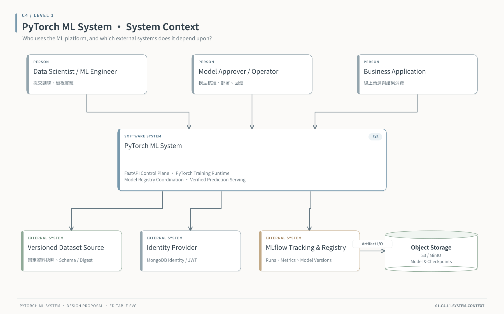

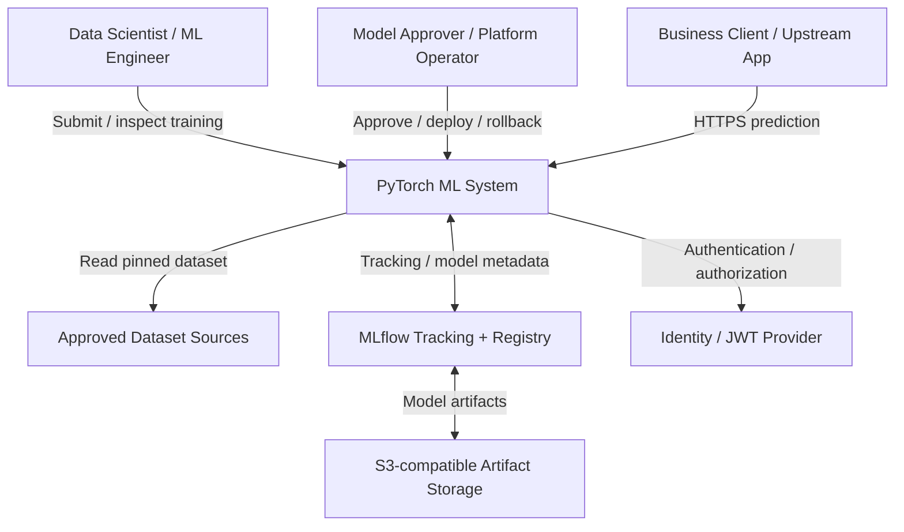

### 5.2 Level 2 — Runtime Containers and Data Ownership

> **C4-style SVG view** — 可在 GitHub Markdown 中直接檢視，也可開啟 SVG 編輯元件與連線。圖為目標架構設計，非已部署證明。

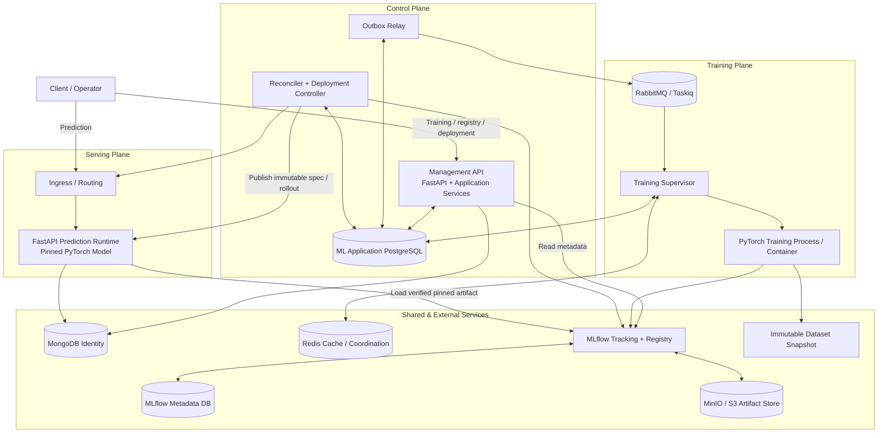

**容器的 DB Ownership**：`APPDB` 與 `MFDB` 不直接共用 Tables、Migrations、Repository 或寫入權限。MongoDB 僅為現有 Identity Adapter 的初始選擇，不代表未來身份一定綁定 MongoDB。

### 5.3 Level 3 — Module / Clean Architecture Dependencies

> **C4-style SVG view** — 可在 GitHub Markdown 中直接檢視，也可開啟 SVG 編輯元件與連線。圖為目標架構設計，非已部署證明。

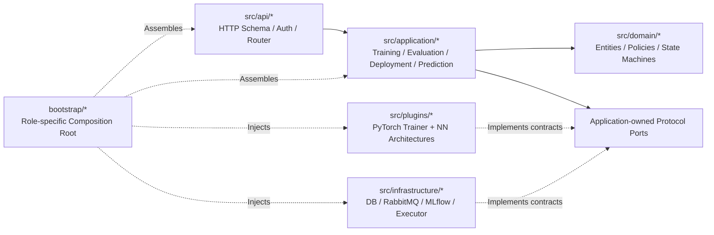

說明：箭頭表示架構依賴與組裝關係，不表示 Application 可以直接 import Infrastructure。現有 `SolutionKernel` 可做 Prediction wrapper，但 Training 不應依附通用 Kernel 執行契約。

### 5.4 Level 4 — Training Component Design

> **C4-style SVG view** — 可在 GitHub Markdown 中直接檢視，也可開啟 SVG 編輯元件與連線。圖為目標架構設計，非已部署證明。

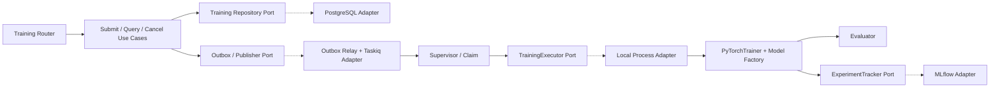

## 6. Key Business Flows

### 6.1 Training submission and execution

> **C4-style SVG view** — 可在 GitHub Markdown 中直接檢視，也可開啟 SVG 編輯元件與連線。圖為目標架構設計，非已部署證明。

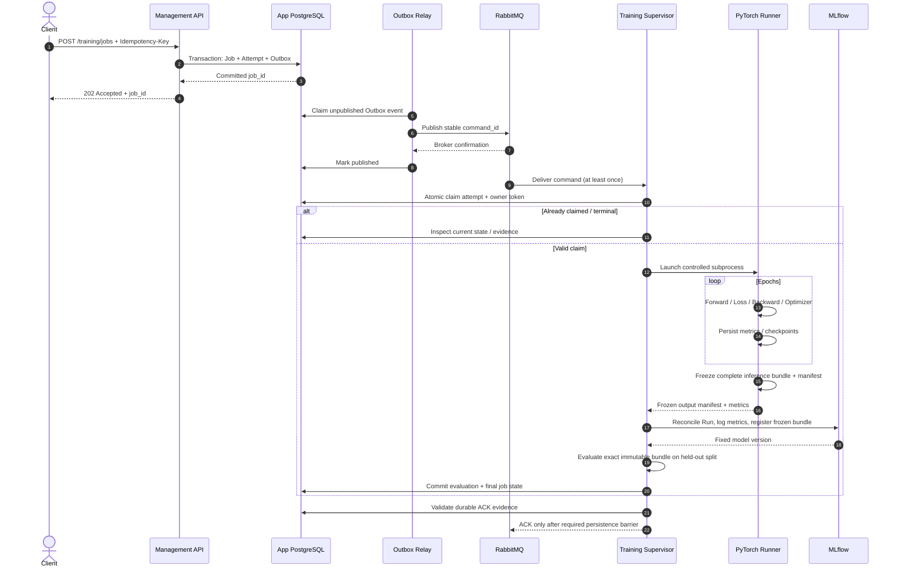

### 6.2 Model approval, promotion and deployment

> **C4-style SVG view** — 可在 GitHub Markdown 中直接檢視，也可開啟 SVG 編輯元件與連線。圖為目標架構設計，非已部署證明。

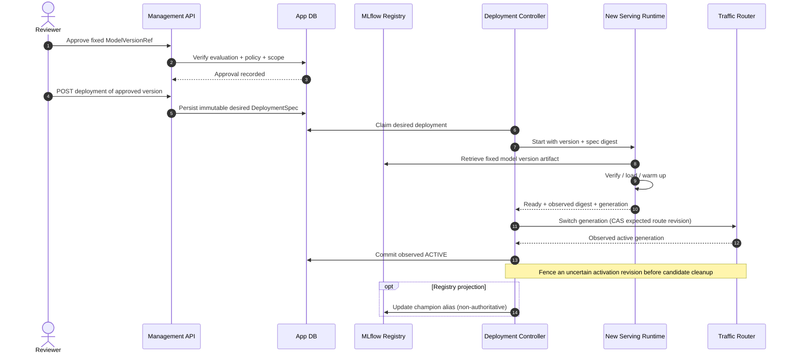

### 6.3 Online prediction

> **C4-style SVG view** — 可在 GitHub Markdown 中直接檢視，也可開啟 SVG 編輯元件與連線。圖為目標架構設計，非已部署證明。

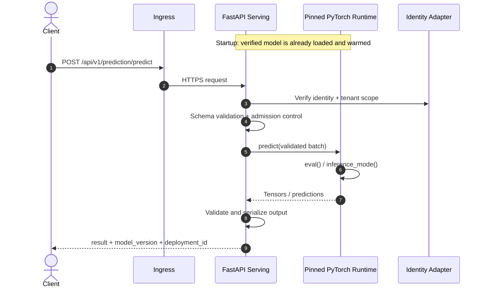

### 6.4 Failure and rollback

> **C4-style SVG view** — 可在 GitHub Markdown 中直接檢視，也可開啟 SVG 編輯元件與連線。圖為目標架構設計，非已部署證明。

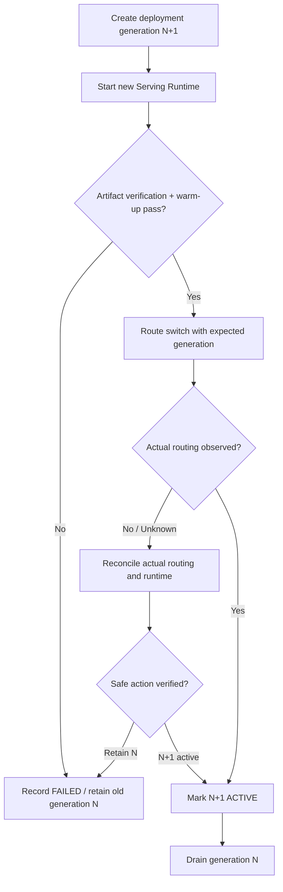

## 7. Data & Ownership Architecture

| Entity / Data | Authoritative Owner | Secondary representation |
|---|---|---|
| TrainingJob、Attempt、Cancellation、Idempotency、Outbox | **ML App PostgreSQL** | Redis Job Snapshot 可重建，不作業務真相 |
| DatasetVersion、FeatureSchema、Recipe | **ML App PostgreSQL** + Immutable Snapshot | MLflow tags 保存 lineage references |
| Run、Experiment、Metrics、Registered Model Version | **MLflow** | App DB 保存強型別 refs、校驗結果和必要摘要 |
| Checkpoint／Serving Artifact bytes | **Object Storage**（透過 MLflow Artifact API／受控 path） | App DB 只存 manifest digest / URI／版本參照 |
| Evaluation Policy Decision、Approval | **ML App PostgreSQL** | MLflow tags 可作顯示投影，無決策效力 |
| Desired Deployment、Routing Intent | **ML App PostgreSQL** | Controller／Ingress 暴露實際觀測值 |
| Actual Serving readiness、loaded generation | **Serving Runtime / Router observation** | DB 持久保存 observation 以對帳 |
| Authentication／User Account | **MongoDB Identity Adapter**（初期） | JWT Bearer token / request context |

### 7.1 Data lineage

> **C4-style SVG view** — 可在 GitHub Markdown 中直接檢視，也可開啟 SVG 編輯元件與連線。圖為目標架構設計，非已部署證明。

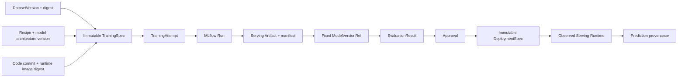

## 8. Deployment Topologies

### 8.1 Local Development / E2E

> **C4-style SVG view** — 可在 GitHub Markdown 中直接檢視，也可開啟 SVG 編輯元件與連線。圖為目標架構設計，非已部署證明。

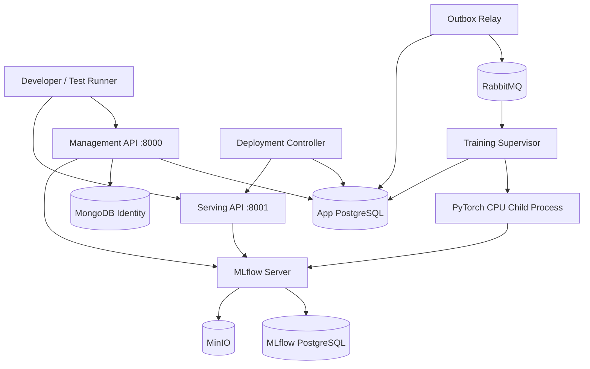

Local Compose 只是開發／整合測試支援。**不能以 Compose 跑通當成 HA、資安或生產容量的驗證。**

### 8.2 Production / Pilot（邏輯部署）

> **C4-style SVG view** — 可在 GitHub Markdown 中直接檢視，也可開啟 SVG 編輯元件與連線。圖為目標架構設計，非已部署證明。

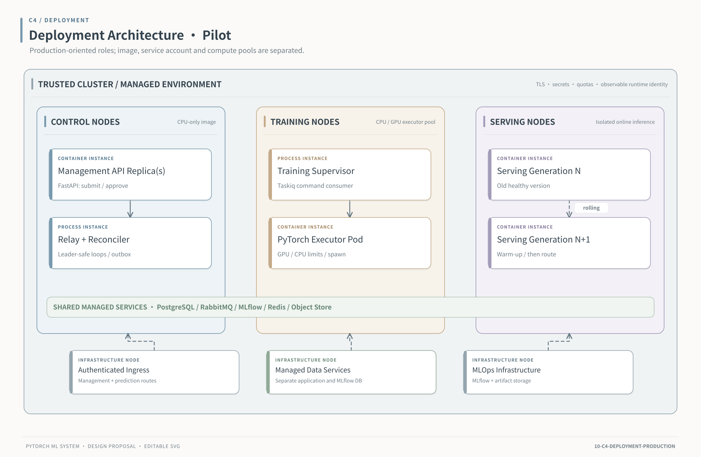

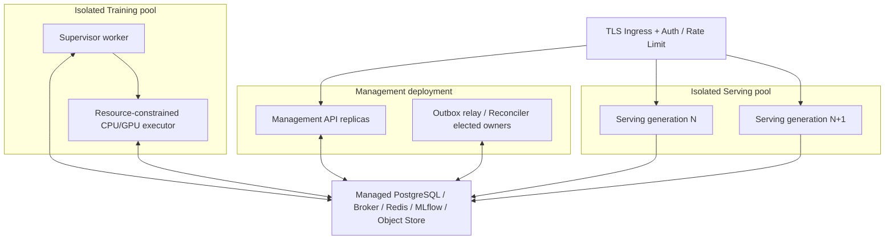

**實體資源規則**：Management API 映像不安裝完整 PyTorch stack；Training 與 Serving 使用獨立 Runtime Image／Service Account／Resource Limit。多 Uvicorn processes 將造成多份模型 RAM／VRAM 佔用，Serving 初版優先以單模型／單 Process／多 Replica 水平擴展。

### 8.3 CPU／GPU 執行 Profile

| Profile | 適用 | 重要規則 |
|---|---|---|
| `torch-cpu-v1`（MVP） | Linux CPU Training／Serving | 鎖 Python／torch／CPU 架構、native threads、RAM |
| `torch-mps-dev-v1`（後續） | macOS Apple Silicon Development | 僅開發驗證；不能等同 Linux Production |
| `torch-cuda-v1`（後續） | Linux NVIDIA GPU | 驗證 Torch＋CUDA＋Driver＋GPU 架構＋VRAM；避免 CUDA 初始化後 `fork` |
| `torch-ddp-v1`（PHASE-2+） | Multi-GPU／Multi-node | 另訂 Rank、World Size、Checkpoint、Failure／Retry Contract |

## 9. Security, Governance & Compliance

> **C4-style SVG view** — 可在 GitHub Markdown 中直接檢視，也可開啟 SVG 編輯元件與連線。圖為目標架構設計，非已部署證明。

1. 身份：沿用 Template JWT／Identity Adapter；所有 Management、Prediction 與內部指令均需經適當 Authentication／Authorization。
2. 授權：對 TrainingJob、Dataset、ModelVersion、Approval、Deployment 使用 Tenant、Owner、Environment、Role／Permission Scope；不能只在 HTTP 層檢查。
3. 模型完整性：Serving 只接收 approved、immutable model reference 和可信 producer 的 manifest；使用 Digest／Signature／Artifact Allowlist／Runtime Compatibility Gate。
4. 任意程式碼防護：禁止使用者傳任意 import path、pickle、Python 程式碼或下載 URI 直接進入 Training／Serving；插件由 Bootstrap 明確註冊。
5. 祕密管理：MLflow／DB／Object Store credential 分角色發放，禁止寫入 tags、logs、Dataset metadata 或 Model Artifact。
6. 網路隔離：Training／Serving 只取得必要 outbound access；不對外公開內部 DB、Broker 或 Registry 的管理介面。
7. 審計：保存誰在何時對哪個版本執行 approve、deploy、rollback、cancel，以及 action 的理由、舊／新 revision。
8. Supply chain：用受控 Runtime Image、digest-pinned dependencies、SBOM、Vulnerability／Secrets Scan；驗證成果才升級 Runtime Profile。

## 10. Reliability, Failure Model & Operations

### 10.1 Failure model

| Failure | 保證／處置 |
|---|---|
| API 接受後崩潰 | Job＋Outbox 在同一 DB 交易；Relay 復原後發布 |
| Publish 成功但 Confirm 遺失 | 重送相同 command_id；由 Job Claim 去重 |
| Worker Crash／Broker Redelivery | 新 Worker 依 DB owner／attempt 檢查；不可盲目重訓 |
| PyTorch OOM | 記錄資源錯誤，結束 execution，按 Policy 決定是否 Retry；不得無限重試 |
| MLflow 暫時離線 | 明確區分 train／log／register 階段；保留檢查點並安全補寫或對帳 |
| DB 已提交終態但 ACK 遺失 | Broker 重送時讀取終態，不重新執行 fit |
| Serving Warm-up 失敗 | 不標 Ready、不切流，保留既有健康版本 |
| Registry Alias 改變 | 不改已運行 fixed deployment 的模型；由管理流程重新審批 |
| GPU 主機遺失 | Reconciler 查證 execution／heartbeat／owner；不以 heartbeat 過期直接推斷實體已終止 |

### 10.2 Observability

- **Metrics**：提交／拒絕數、Queue Delay、Job Duration、Epoch Duration、Training Failure、OOM、Checkpoint Size、Artifact Upload Time、Prediction QPS／P50／P95／P99、In-flight、CPU／GPU Memory、Serving Model Load Duration、Deployment Success Ratio。
- **Trace**：`request_id`、`trace_id`、`job_id`、`attempt_id`、`command_id`、`mlflow_run_id`、`deployment_id`、`generation`；跨 Process／Message 傳遞 trace context，避免將敏感資料記錄在 attributes。
- **Logs**：結構化 JSON；角色、版本、tenant scope（遵守隱私政策）、resource profile、reason code；不記錄 token／raw features／完整模型內容。
- **Health**：Liveness 只判斷程序存活；Readiness 依角色判斷是否能服務；Serving Ready 必須模型載入／Schema／Warm-up 完成。
- **Alarms**：Outbox age、Stale Attempts、No Worker Heartbeat、Unexpected duplicate claim、Serving ready=0、Error budget burn、Artifact checksum failure。

## 11. Architecture Decisions (ADRs)

| ID | 決策 | 原因 | 主要代價／風險 |
|---|---|---|---|
| ADR-001 | 以現有 Template fork 成 ML 產品 | 重用 Layer／CI／Worker 基線 | 需維護上游差異 |
| ADR-002 | Control Plane 保持 Modular Monolith | 初期團隊一致、Port 可明確治理 | 不是獨立自治 Microservices |
| ADR-003 | Training／Serving 不共 Process | 資源、故障、版本隔離 | 部署角色與 Images 增加 |
| ADR-004 | PostgreSQL Job + Outbox | 避免 Redis TTL 與 Message／DB dual-write 問題 | 需 Migration、Relay、Reconciler |
| ADR-005 | 保留 Taskiq／RabbitMQ | 繼承現有 Broker 與工程工具 | 需實作 App DB ACK Evidence Barrier |
| ADR-006 | PyTorch CPU 首先完成 E2E | 避免 GPU／CUDA 增加首輪不確定性 | GPU Profile 尚需另行資格驗證 |
| ADR-007 | MLflow 管 Tracking／Registry，不管 Deployment Truth | 明確資料所有權與 Governance | 多個後端需對帳 |
| ADR-008 | Serving 固定 Model Version／Spec | 防止 Alias 漂移與不可預期切流 | Controller 與 rollout 較複雜 |
| ADR-009 | 角色專用 Runtime Image | 依賴衝突與權限／資源隔離 | CI／SBOM／Lock 管理成本 |
| ADR-010 | 第一版 Rolling Deployment，不做 In-process Hot Swap | 減少雙模型 VRAM、競爭與指標複雜度 | 需要 Routing／Replicas |
| ADR-011 | Environment-sensitive Runtime Qualification | 防止跨版本反序列化與加速器不相容 | Release Gate 變嚴格 |
| ADR-012 | 有界同步 MLflow SDK I/O | 防止阻塞 async API／Control Loops | Thread 無法硬中止，需 Timeouts 與限流 |

## 12. Delivery Plan, Milestones & Exit Gates

本節與 **ML-LLD-001 §17** 使用同一組 **M0～M7 正式里程碑代號**；日後不可由各文件獨立重新編號。**既有模板的 `docs/ml-system-design.md` v0.2 有獨立的 M0～M4 開發階段定義，屬舊版 ML 遷移提案，不應與本 PyTorch 產品的 M0～M7 同名階段互換或據此判定進度。**M0 為架構與 Template 基線驗收；M1～M6 依次完成業務工作可靠性、PyTorch、MLflow、Serving、治理部署及 Pilot；M7 為選用擴充。

| Gate | 交付條件 | 不可宣稱完成的事項 |
|---|---|---|
| M0 — Contract & Baseline | 修復 Template CI／Container／Secret Scan；HLD/LLD、DTO、Ports、狀態轉換與 API Contract 通過審查 | ML 功能尚未驗證 |
| M1 — Durable Job | PostgreSQL Job/Attempt、Idempotency、Outbox、Relay、Atomic Claim、ACK evidence；真 DB／Broker 測試 | Fake Executor 的完成不等於已訓練 PyTorch |
| M2 — CPU PyTorch | 固定 DatasetVersion、ModelFactory、CPU NN、受控 Process、Checkpoint、Cancel、Evaluator | 未完成 MLflow Registry 的端到端模型發佈 |
| M3 — MLflow + Registry | Run/experiment、參數與指標、Artifact Manifest、Registry Binding 及跨服務對帳 | 模型尚未經正式流量部署 |
| M4 — Fixed Serving | 獨立 FastAPI Serving、固定模型版本、Verified Loader、Warm-up、Schema／Inference Contract | 不等於模型已獲核准切流或可回滾 |
| M5 — Governance / Rollout | 人工 Approval、Immutable DeploymentSpec、Controller、Routing CAS、Rolling／Rollback | 不等於 HA／容量與營運 SLO 已達標 |
| M6 — Pilot Hardening | 觀測、故障復原、Runbook、Backup／Restore、Security、數值化 SLO/SLI 與合格 CPU Runtime Profile | 不等於 Multi-GPU／DDP 可用 |
| M7 — Optional Expansion | 每個 GPU／CUDA／DDP／K8s Profile 有精確相容性、故障及效能證據 | 不借用 CPU qualification；需求成立才啟動 |

### 12.1 需先修復的 Template 基礎問題（截至本次審查記錄）

原 Repository 的歷史 GitHub Actions 曾出現 Python 3.13 thread capacity 競爭測試、MongoDB 容器對 CI Runner Kernel 不相容、Gitleaks 掃描發現需分辨的結果，導致 CI／Security／Container workflows 未全綠。這些屬於**先前執行快照**，不是對現在 HEAD 的即時判定；開始開發前必須重新檢查當前 Runs、建立保護規則並處理實際結果。參考 [Actions](https://github.com/PenHsuanWang/python-backend-server-template/actions)。

## 13. Open Decisions & Risks

| ID | 需決策項目 | 建議預設／Owner |
|---|---|---|
| HLD-OD-01 | 第一個 Model／Dataset fixture | CPU MLP + 固定合成／公開測試資料；DS + Backend |
| HLD-OD-02 | MLflow 版本、Artifact Access Mode | 由 Runtime Qualification 固定；Platform |
| HLD-OD-03 | Torch Weight Serializer 與 Trusted Type Policy | 優先受控 state_dict + JSON Manifest；ML Engineer + Security |
| HLD-OD-04 | Model input／output schema 表達方式 | 強型別、版本化 JSON Schema 與 dtype／shape；Backend + DS |
| HLD-OD-05 | Training Maximum Runtime、取消寬限、Job Retention | 以容量測試批准；Platform |
| HLD-OD-06 | Production GPU Hardware、CUDA／Driver | 不在 CPU MVP 假設；Platform |
| HLD-OD-07 | MLflow Model Stage／Alias 管理權限 | Approval 只能在 App DB；MLflow Alias 為 projection；ML Owner |
| HLD-OD-08 | Tenant Scope 與 PII Data Classification | 資料政策及模型權限由 Security／Product 審核 |
| HLD-OD-09 | Database HA／Backup RPO／RTO | 依目標環境 SLO 訂定；SRE |

**主要風險**：工作重送造成重訓、MLflow 和 App DB 的跨服務部分成功、Torch／CUDA 版本不相容、未驗模型格式造成任意程式執行、GPU OOM／資源搶占，以及不受控的模型熱切換。這些都有對應的 LLD Contract、測試與 Runbook，不應僅靠 README 約定。

## 14. Traceability & Related Documents

| HLD 主題 | 對應 LLD |
|---|---|
| FR-01~03、提交／可靠性 | §2、§3、§4、§5、§6、§15 |
| FR-04~07、PyTorch／MLflow | §3.5、§7、§8、§9 |
| FR-08~10、Deployment／Serving | §9、§10、§11 |
| FR-11~12、取消／資源 | §6.4、§7.4、§12.4、§15 |
| Auth／Security／Observability | §13、§14 |
| CI／Deployment／Operations | §12、§15、§16、§17 |

**配套文件**：[Detailed Design](pytorch-ml-system-lld.md)｜[Existing ML Design v0.2](https://github.com/PenHsuanWang/python-backend-server-template/blob/main/docs/ml-system-design.md)。正式實作時須產出版本化 OpenAPI、Migration、Runtime Lock/SBOM、E2E 證據及 ADR 修訂紀錄；本 HLD 不代替可執行程式。

## 15. Reference Material

- [Repository — Module Specification](https://github.com/PenHsuanWang/python-backend-server-template/blob/main/docs/module-spec.md)
- [Repository — ML System Design v0.2](https://github.com/PenHsuanWang/python-backend-server-template/blob/main/docs/ml-system-design.md)
- [FastAPI — Lifespan Events](https://fastapi.tiangolo.com/advanced/events/)
- [PyTorch — Multiprocessing Best Practices](https://docs.pytorch.org/docs/stable/notes/multiprocessing.html)
- [MLflow — Experiment Tracking](https://mlflow.org/docs/latest/ml/tracking/)
- [MLflow — Model Registry](https://mlflow.org/docs/latest/model-registry/)
- [Taskiq — CLI and ACK Semantics](https://taskiq-python.github.io/guide/cli.html)

> **Architecture Review Gate**：本文件是實作藍圖；功能可用性、Production Readiness、SLO 與安全符合性都必須由相應版本的測試、故障注入、容量量測及簽核證據證明。
