# PyTorch ML System — Low-Level Design (LLD)

> **文件編號**：ML-LLD-001  
> **版本**：1.3（Implementation Baseline — Draft；不代表 Production 核准）
> **修訂日期**：2026-10-29（第二輪架構審查提案，尚待核准）  
> **日期**：2026-10-28（Asia/Taipei）  
> **狀態**：**目標詳細設計；非已實作、已測試或已達 Production Ready 的宣稱**  
> **High-Level Design**：[PyTorch ML System — HLD](pytorch-ml-system-hld.md)  
> **來源模板**：[PenHsuanWang/python-backend-server-template](https://github.com/PenHsuanWang/python-backend-server-template)  
> **規格來源**：[ML system design v0.2](https://github.com/PenHsuanWang/python-backend-server-template/blob/main/docs/ml-system-design.md)、[Module specification](https://github.com/PenHsuanWang/python-backend-server-template/blob/main/docs/module-spec.md)、[Runtime compatibility](https://github.com/PenHsuanWang/python-backend-server-template/blob/main/docs/ml-runtime-compatibility.md)

---

> **本版變更依據**：[初次審查](architecture-review-2026-10-29.md)、[v1.2 複查](architecture-review-2026-10-29-v1.2.md) 與 [ADR-014](adr/014-implementation-baseline.md)。使用者已要求開始 Python 實作；本版收斂必要的技術契約，產品留存／SLO 與正式驗收仍維持待核准。
> **Source of Truth**：衍生 ML System 的候選文件位於 `docs/pytorch-ml-system-*.md`；根目錄 v1.0 為歷史副本。實作範圍及實測證據另見 [Implementation Status](implementation-status.md)，不得由設計文字推定已交付功能。

## 0. 文件契約與設計邊界

### 0.1 目標

定義由現有 FastAPI Template 衍生 PyTorch Neural Network ML System 的**可實作、可測試、可操作**細節。涵蓋模組、Python Port、REST API、資料表、狀態機、Outbox／Taskiq、Trainer、MLflow、Serving、部署、故障復原及驗收案例。

- **BASELINE**：既有 `server.py`／`worker.py`、`bootstrap`、`src/api`／`application`／`domain`／`infrastructure`／`plugins`、`ModuleCatalog`、Taskiq／RabbitMQ、Redis 技術快照、MongoDB Identity 等通用能力。
- **TARGET / MUST**：本文新增的 PostgreSQL ML App DB、PyTorch Runner、MLflow Adapters、Outbox、claim／ACK gate、受控部署及 Model Serving；目前**未由模板完整實作**。
- **MVP**：CPU 單機 NN 模型，固定 DatasetVersion，單一 Training Attempt Executor，固定模型版本的單 endpoint Serving。
- **PHASE-2+**：CUDA GPU、多模型動態批次、Kubernetes executor、DDP、多 GPU、HPO／DAG；需要獨立驗證及 ADR。

本文件列出的 JSON、SQL、Python Protocol、環境變數與 CLI 均為**規範或示意**，必須經實作、版本鎖定及契約測試後才能使用；假設的 SLO 值不代表已量測結果。

### 0.2 驗收原則

| 規範等級 | 定義 |
|---|---|
| MUST | 進入受控 Pilot 前必須實作與測試 |
| SHOULD | 建議預設；不採用時記錄替代方案及量測 |
| MAY | 依負載與營運需求增加 |

## 1. Codebase 與模組邊界

### 1.1 Directory blueprint

下列為**增量新增**目錄，不應誤認為目前 Repository 已存在。保留 Template 九個 `src` 頂層 package；不建立相互平行的第二套 `ml_core/` 分層。

```text
bootstrap/
  ml_config.py                # 組合 APP_ 與 ML_ 設定
  ml_wiring.py                # role-specific ModuleCatalog / DI
  ml_api.py                   # management FastAPI factory
  ml_worker.py                # Taskiq supervisor broker/handlers
  ml_training_runner.py       # 僅由 TrainingExecutor 啟動的子程序
  ml_control_loop.py          # outbox/reconciliation/deployment controller
  ml_serving.py               # independent prediction FastAPI factory
src/
  api/
    training/routers.py,schemas.py,dependencies.py
    datasets/routers.py,schemas.py
    model_registry/routers.py,schemas.py
    deployments/routers.py,schemas.py
    prediction/routers.py,schemas.py
  application/
    training/ports.py,service.py,commands.py,reconciliation.py
    datasets/ports.py,service.py
    evaluation/ports.py,service.py
    model_registry/ports.py,service.py
    deployments/ports.py,service.py,reconciliation.py
    prediction/ports.py,service.py,loading.py
  domain/
    training/models.py,policy.py,errors.py
    datasets/models.py,policy.py
    evaluation/models.py,policy.py
    model_registry/models.py,policy.py
    deployments/models.py,policy.py
    prediction/models.py,policy.py
  plugins/
    training/pytorch_trainer.py
    models/mlp.py,lstm.py,cnn.py
    evaluation/classification.py,regression.py
  infrastructure/
    persistence/postgres/units.py,repositories.py,migrations/
    messaging/ml_outbox.py,training_commands.py,ack_gate.py
    execution/local_process.py
    mlflow/tracking.py,registry.py,artifacts.py
    datasets/versioned_sources.py
    serving/deployment_spec.py,model_artifact.py,pytorch_runtime.py
    deployment/rollout.py,routing.py,observations.py
  config/ml.py
runtime/
  training/                 # image / runner contract, not src layer
  serving/
compose.ml.yaml
Dockerfile.ml-api
Dockerfile.ml-training
Dockerfile.ml-serving
Dockerfile.mlflow
tests/ml/{unit,contract,integration,e2e,performance}/
```

### 1.2 Import dependency matrix

| Importer | 可以 import | 不可以 import |
|---|---|---|
| `domain/*` | stdlib、Domain DTO／純政策 | FastAPI、Pydantic、SQLAlchemy、Taskiq、torch、mlflow |
| `application/*` | Domain、application-level Protocol | HTTP schema、SDK、bootstrap、DB implementation |
| `api/*` | Application facade、Transport schema | Trainer、MLflow implementation、SQL 直接操作 |
| `plugins/training/*` | torch、受控 Domain DTO | HTTP、資料庫 repo、MLflow network adapter |
| `infrastructure/*` | Domain DTO、第三方 SDK | Application implementation、Bootstrap、Plugin 實作 |
| `bootstrap/*` | 全部受控實作，用於組裝 | 從外部請求任意載入 import path |

Port 歸**消費它的 Application capability**，採 Python `Protocol` structural typing。`bootstrap` 可組裝具體類別，但依賴方向維持向內。修改既有 `scripts/check_boundaries.py` 增加 ML SDK 規則，並增加 capability-to-capability 禁止跨私有模組的檢查。

### 1.3 Runtime role 與 ModuleCatalog


> **C4-style SVG view** — 可在 GitHub Markdown 中直接檢視，也可開啟 SVG 編輯元件與連線。圖為目標架構設計，非已部署證明。

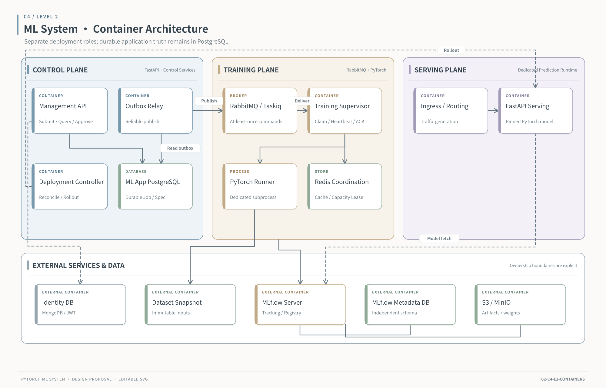


| Runtime Role | 共用核心 | 不應持有 |
|---|---|---|
| management API | JWT、ML DB、Training／Approval／Deployment service | torch、GPU context、模型 weight |
| outbox relay | ML DB、RabbitMQ publisher | PyTorch、Serving model |
| training supervisor | RabbitMQ consumer、App DB、resource admission、executor | 長時間在 event loop 中執行 `fit()` |
| training child | approved model factory、torch、data adapter、MLflow tracking | FastAPI、RabbitMQ consumer |
| reconciler/controller | DB、external execution reader、deployment & router adapters | user-supplied code execution |
| prediction serving | fixed DeploymentSpec、verified model handle、JWT | trainer、Taskiq worker、Registry mutation |

BASELINE `ModuleContext.role` 僅 `api`／`worker`；不要直接塞進新值而破壞現有契約。第一階段用 role-specific factory、catalog 與 `ML_DEPLOYMENT_ROLE` 區分，若更動既有 Literal，須先做兼容性與生命週期測試。現有 Module 名稱決定 `/api/v1/{definition.name}` 路由前綴；API 的公開路徑須由契約測試核對實際 router mount。

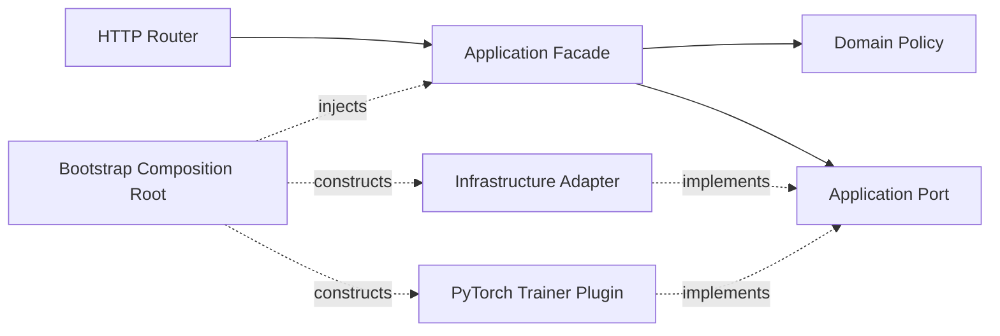

## 2. Domain Data Contracts 與識別

### 2.1 不可互換的識別碼

| 名稱 | 職責 |
|---|---|
| `training_job_id` | 使用者的一次邏輯訓練；同一 idempotency key 指向同一 job |
| `attempt_id` | 同一 job 的一次實體訓練嘗試，重試才增加 |
| `command_id` | 可重送但 ID 永遠相同的 Outbox 事件／Queue Command |
| `execution_id` | OS Process／Container／Kubernetes Job 身分 |
| `mlflow_run_id` | 單一 attempt 的 MLflow Run binding |
| `dataset_id` + `dataset_version` | 固定、受權限限制的資料快照 |
| `recipe_id` + `recipe_version` | 受核准的 NN 訓練配方 |
| `registered_model` + `model_version` | MLflow Registry 的不可變模型版本參照 |
| `deployment_id` + `generation` | 不可變部署與路由世代；roll-back 建新 generation |
| `endpoint_id` | 長存的邏輯預測端點 |

禁止把 `transport_job_id`、MLflow Run、TrainingJob、Model Version 當成相同 ID。不同 namespace 的版本與識別應分別驗證。

### 2.2 Immutable TrainingSpec v1

`TrainingSpec` 經驗證後序列化、計算 fingerprint 並固定，不因任何模型或設定更新而偷偷改變。Hyperparameters 不是任意字串轉 Python class，而是受核准 Recipe 的 allowlist schema。

```json
{
  "schema_version": "1",
  "recipe": {"id": "nn_classifier", "version": "1.0.0"},
  "dataset": {"id": "dataset-demo", "version": "2026-10-28-v1"},
  "feature_schema_version": "1",
  "model": {"architecture": "mlp_v1", "config": {"hidden_units": [64, 32]}},
  "training": {
    "epochs": 30,
    "batch_size": 64,
    "learning_rate": 0.001,
    "optimizer": "adam",
    "loss": "cross_entropy",
    "seed": 42,
    "precision": "fp32"
  },
  "split": {"strategy": "fixed_indices", "split_id": "split-20261028-v1"},
  "resource_profile_id": "cpu-small-v1",
  "code_revision": "pinned-git-sha",
  "training_image_digest": "sha256:qualified-image-digest",
  "output_contract_version": "1"
}
```

Schema 規則：`epochs > 0`、`batch_size > 0`、合理 learning rate、未知 optimizer/loss/model key 拒絕；資料與模型 schema 必須匹配；禁止自由輸入 `pickle_uri`、任意 Python import、宿主 GPU ID 或 Shell。`tenant_id`、`owner_id`、`actor_id` 由驗證後的身份上下文注入，不信任 request 自報的同名欄位。

### 2.3 TrainingJob 狀態機


> **C4-style SVG view** — 可在 GitHub Markdown 中直接檢視，也可開啟 SVG 編輯元件與連線。圖為目標架構設計，非已部署證明。

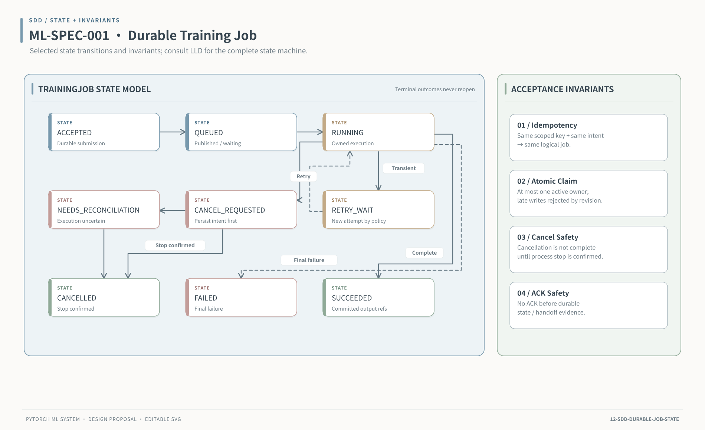


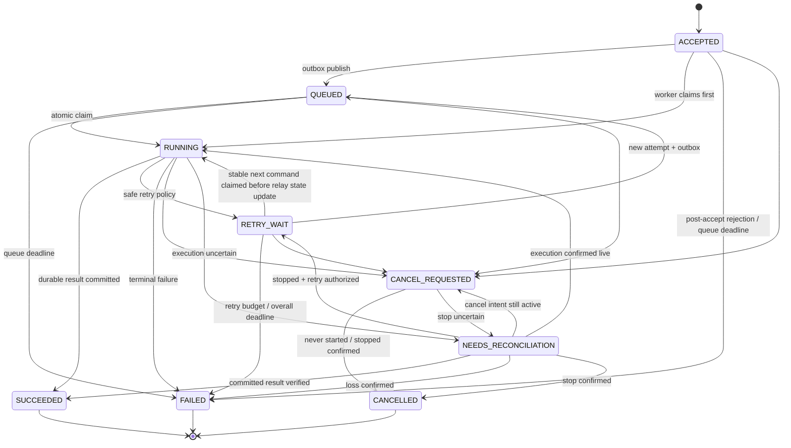

Invariants：

1. 一個 `TrainingJob` 同時間至多一個有效 `TrainingAttempt` owner；重送不得新增 Attempt。
2. 終態 `SUCCEEDED`／`FAILED`／`CANCELLED` 不可直接 reopen；使用者重試終態需建立新 job 並記錄 `retry_of_job_id`。
3. `CANCEL_REQUESTED` 是持久意圖，只有停止證據才可標 `CANCELLED`；thread/coroutine 被取消不等於 PyTorch process 已停止。
4. `NEEDS_RECONCILIATION` 不是可盲目重試狀態；先驗 execution identity、OS process、checkpoint 與外部副作用。
5. 每次寫入比較 `expected_revision`、`attempt_id`、`owner_token`；過期 owner 不能覆寫終態。
6. **正式業務語意不隨開發階段放寬**：`TrainingJob.SUCCEEDED` 指訓練 Output Manifest、EvaluationResult 與 Registry Binding 已在 App DB 確認；品質未過屬 `EvaluationResult.REJECTED`，不等於 fit crash。**M1／ML-SPEC-001** 無真實 PyTorch／MLflow 時，僅可用受控 Fake Evaluator／Fake Registry 產出 *test-only* 的同型態證據以測完整 Job 終態，或只確認 `TrainingAttempt`／執行子流程完成而使 Job 保持非終態；不得把僅有 Output Manifest 的正式 Job 判為 `SUCCEEDED`。

**狀態轉換先決條件**：`ACCEPTED → FAILED` 限於接受後期限屆滿或執行資格遭撤銷；請求欄位／未核准 Recipe 應在接受前拒絕，不可把提交驗證錯誤當成正常已接受工作。`RETRY_WAIT → RUNNING` 僅在下一個 Attempt 已持久建立、同一穩定 Command 已安全發布且完成原子 Claim、Relay 狀態更新較慢時成立。取消意圖持久保留並優先於一般恢復到 RUNNING 的動作；任何到達 `CANCELLED` 的轉換均須有確認停止證據。以上轉換與 `ML-SPEC-001 §4` 保持一致。

### 2.4 Attempt 與 Deployment 狀態機

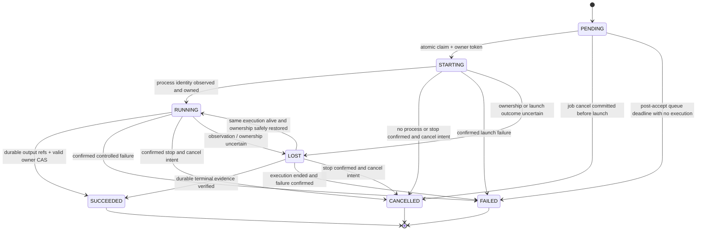

**Attempt 狀態契約（P1-01）**：`LOST` 代表「目前無法確認執行／所有權」，是**非終態、待對帳**，不是「確認實體工作已死亡」。當原執行仍存活時，只有在對同一 `execution_id`、process identity、generation、owner fencing、Job/Attempt revision 全部核對並安全取得／恢復執行權後，才允許 `LOST → RUNNING`；不能只靠 heartbeat 或 PID 字串恢復。已確認實體停止且仍需重試時，**建立新的 Attempt**，不可把原 Attempt 由 `FAILED`／`CANCELLED` 回到 `PENDING`。

`PENDING → CANCELLED` 要與 Job 的 `CANCEL_REQUESTED` 同一受保護交易、阻擋新 Claim；若 `STARTING` 可能已啟動但尚未保存 execution ref，則先進 `LOST`／Job `NEEDS_RECONCILIATION`，不能聲稱已取消。對 `LOST → SUCCEEDED/FAILED/CANCELLED` 的每個出口，都要求可核對的實體結果與 DB CAS 證據。

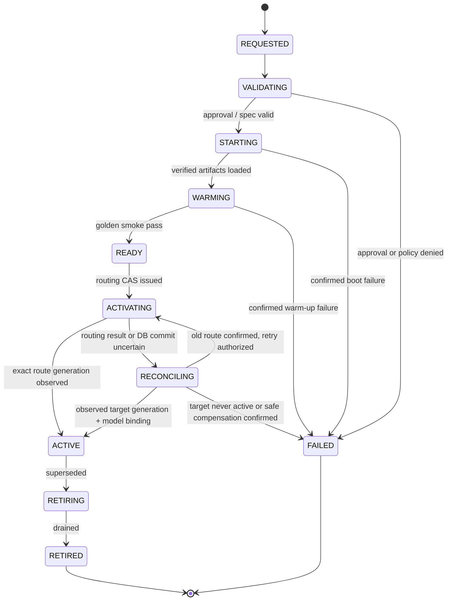

**Deployment Activation 契約（P1-02）**：`RECONCILING` 是**非終態**。Router 的 CAS response 遺失、Controller crash、DB `ACTIVE` commit 失敗時，一律不得直接 `FAILED`／假報 rollback。Reconciler 必須比對 Router 權威的 `endpoint_id`／`generation`／`deployment_id`／`model_version` 和受控 Serving Observation；若新 generation 實際接管且健康，經 revision/owner CAS 後轉 `ACTIVE`；只有已證明切換未生效，或補償切回舊版本已完成並驗證，才允許 `FAILED`。若路由仍不確定，保留 `RECONCILING`、有限退避與告警，不可錯誤地釋放或清除仍接流量的 Runtime。

`Promotion APPROVED`、`TrainingJob SUCCEEDED`、`Deployment ACTIVE` 是三個分別驗證的決策，不可以合併成同一成功旗標。MVP 的 Activation 必須先取得健康 Ready 證據，再更新 routing；若 routing 與 DB observed state 不一致則進入 reconciliation 而非憑 DB 自稱 ACTIVE。

## 3. Persistence Design：ML Application PostgreSQL

### 3.1 Source of truth


> **C4-style SVG view** — 可在 GitHub Markdown 中直接檢視，也可開啟 SVG 編輯元件與連線。圖為目標架構設計，非已部署證明。

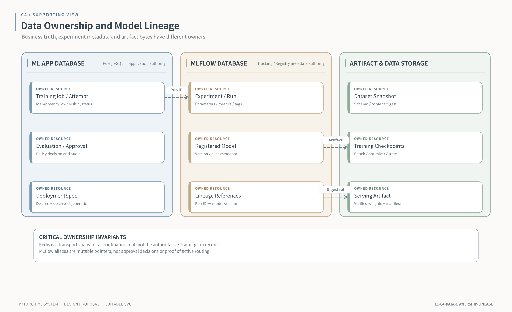


| 系統 | 權威資料 | 禁止用途 |
|---|---|---|
| ML App PostgreSQL | Job/Attempt/Outbox/Idempotency、Evaluation 決策、Approval、Deployment Desired & Observed | 不直接讀寫 MLflow 私有 SQL schema |
| MLflow metadata DB | Experiments、Runs、Registry Versions、Tracking metadata | 不充當 Job queue 或 business approval |
| MinIO/S3 | Versioned Dataset、Checkpoint、Model Artifact、Manifest、Evaluation Report | 不靠 object key 自動推導核准權限 |
| RabbitMQ | 持久命令的 delivery／redelivery | 不當成 TrainingJob 永久歷史 |
| Redis | 技術快照／短期容量與 lease | 不單獨決定訓練成功／取消／是否可以重跑 |
| MongoDB | 既有 Identity user/session 基線 | 不強制與 ML Job 共用 DB transaction |

建議 ML App DB 和 MLflow backend 分開 database、credential、migration、backup；同一 PostgreSQL cluster 仍要邏輯隔離。初期保留 MongoDB Identity，避免不必要的跨系統重構。

### 3.2 Relational model

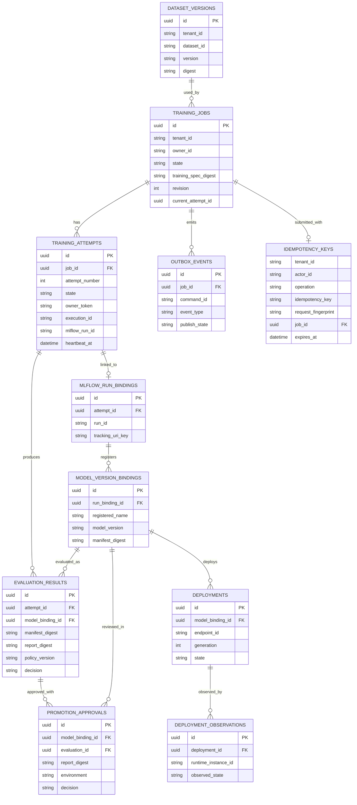

建議 Schema（最小約束）：

| 表 | 必要欄位／限制 | 核心索引 |
|---|---|---|
| `dataset_versions` | tenant、dataset key、version、content digest、feature schema、snapshot URI、ACL | `UNIQUE(tenant_id,dataset_key,version)` |
| `training_recipes` | id、version、approved architecture、hyperparameter schema、code digest | `UNIQUE(recipe_id,recipe_version)` |
| `training_jobs` | UUID PK、tenant、owner、training_spec_digest、immutable spec JSONB、state、phase、revision、current_attempt_id、deadline、timestamps | `(tenant_id,created_at)`；`(state,deadline)` |
| `training_attempts` | UUID、job FK、attempt_no、owner_token、execution_ref、heartbeat、phase checkpoint、run ref、revision | `UNIQUE(job_id,attempt_no)`；live ownership condition |
| `idempotency_keys` | tenant、actor、operation、key、request_fingerprint、job_id、expires_at | `UNIQUE(tenant_id,actor_id,operation,key)` |
| `outbox_events` | event_id／command_id、aggregate ID、event payload/version、publish_state、lease、tries、next_retry_at | `UNIQUE(command_id)`；`(publish_state,next_retry_at)` |
| `mlflow_run_bindings` | attempt FK、run_id、experiment scope、tracking ref | `UNIQUE(attempt_id)`；受控 run_id 去重 |
| `evaluation_results` | attempt、model binding FK、artifact manifest digest、dataset digest、Evaluator/Policy version、report digest、metrics、decision；新增而非覆寫 | `(model_binding_id,policy_version)` |
| `model_version_bindings` | registry scope、name、version、run ref、artifact manifest digest、compatibility ID | `UNIQUE(registry_scope,name,version)` |
| `promotion_approvals` | model binding FK、evaluation FK、report digest、binding digest、environment、policy version、reviewer、decision、audit | `(model_binding_id,environment,created_at)` |
| `deployments` | endpoint、generation、model binding、immutable spec digest、desired state、observed state | `UNIQUE(tenant_id,endpoint_id,generation)` |
| `deployment_observations` | deployment、runtime instance、health、loaded model ref、image digest、timestamp | `(deployment_id,observed_at)` |
| `audit_events` | actor、tenant、action、resource、correlation ID、safe payload、time | `(tenant_id,created_at)` |

使用資料庫條件唯一性保證「最多一個有效 owner」：單靠應用記憶體的 lock 或 Redis lease 不足。`outbox_events` 及 `training_jobs` 建議透過 migration 管理，不允許在啟動時自動 `create_all` 取代正式 migration。

### 3.3 Training submit 交易與冪等

同一 `Idempotency-Key` 在 `tenant + actor + operation` scope 內：相同**使用者提交意圖指紋**（`request_fingerprint`）於有效保留期間回傳相同 Job ID；不同指紋回應 `409 CONFLICT`。有效期按初次成功接受時開始計算，重送不延長期限；過期後重送不保證指向舊 Job。

使用兩個不可混用的 Digest：

1. **`request_fingerprint`（API 冪等）**：對已通過型別驗證的 *public request intent* 做 canonicalization（固定的 schema version、欄位白名單、穩定預設值展開、鍵排序、標準 JSON 數值語意、UTF-8 Canonical JSON），再使用 SHA-256 計算；應在後端解析可能隨部署演進的 Recipe／Dataset 衍生欄位、image digest **之前**計算。前端必須使用明確、不可變的 Recipe／Dataset version；禁止把浮動 `latest` 當成穩定冪等語意。首筆接受保存原請求指紋與原 Job ID；重送時先比對既有指紋，再於當前授權政策下返回原 Job，不重跑最新訓練配方解析。違反現有授權的重送不得洩漏 Job。
2. **`training_spec_digest`（可重現執行）**：首筆接受時解析及核准完整不可變 `TrainingSpec`（包含固定 Recipe／Dataset、split、code/image digest、feature schema 等），對完整規格的版本化 canonical form 計算 SHA-256，與 Job／Outbox 同交易持久化。後端版本更新不得修改原 Job 已保存的完整規格；再次請求即使目前導出的 runtime 不同，也不得因此對原冪等鍵誤回 409。

**提案值、尚待核准**：`ML_IDEMPOTENCY_RETENTION_SECONDS=86400`（24 小時）。正式系統的可承諾期間由 Product／Platform 在 Pilot 前確認；App DB 的 Job／Audit 留存週期獨立於冪等鍵期限。逾期再次提交可能成為新 Job，Client 應保留 `job_id` 作長期查詢，不可依靠已過期 Key 取得舊工作。

```sql
-- 示意交易：以資料庫唯一約束實作雙重提交競爭仲裁
BEGIN;
-- 先 INSERT idempotency_keys(scope, key, request_fingerprint, job_id, expires_at)；
-- 發生 unique key 競爭時須 rollback／讀取既有 request_fingerprint 與 job_id。
INSERT INTO training_jobs
  (id, tenant_id, owner_id, state, revision, training_spec_digest, spec_json)
VALUES
  (:job_id, :tenant_id, :actor_id, 'ACCEPTED', 0, :training_spec_digest, :spec_json);
INSERT INTO training_attempts
  (id, job_id, attempt_number, state, revision)
VALUES
  (:attempt_id, :job_id, 1, 'PENDING', 0);
INSERT INTO outbox_events
  (id, command_id, job_id, event_type, publish_state, payload_json)
VALUES
  (:event_id, :command_id, :job_id, 'StartTraining.v1', 'PENDING', :command);
COMMIT;
```

上述 SQL **省略 idempotency 插入及 constraints DDL**；實作必須在同一交易先佔用 idempotency key，並於唯一約束競爭時 rollback／讀回原提交，不能先無條件產生兩筆 Job。`Idempotency-Key` 與 Request Body 大小限制由 API／Service 雙層控制。

### 3.4 Claim、CAS、Outbox relay

```sql
-- 示意：確保取得的 Attempt 仍屬該 Job 的 PENDING attempt
UPDATE training_attempts
SET state='STARTING', owner_token=:owner_token,
    heartbeat_at=NOW(), revision=revision+1
WHERE id=:attempt_id AND job_id=:job_id
  AND state='PENDING' AND revision=:expected_revision
RETURNING id, revision;
```

Worker 必須在**同一資料庫交易**確認相應 Job 非終態、未取消、Attempt 綁定正確且符合 deadline，並更新 Job／Attempt 的有效 ownership。單獨執行上面 SQL 尚不足以滿足全部不變條件，必須持有 Job row lock 或採完整 CAS 條件及有證據的 lock ordering。

Outbox Relay 以 `SELECT ... FOR UPDATE SKIP LOCKED` 取得有界 batch，設定 lease；發布同一 `command_id`。Relay 即使晚於 Worker 更新 `RUNNING` 才收到發布確認，也不能將 Job 狀態改回 `QUEUED`。

**Outbox `PUBLISHED` 成立條件（P1-03）**必須**同時**滿足：

1. 使用已驗證的 Exchange／Binding／目標 Queue Topology；對需保證不遺失的 Training Command 使用**受管 Durable Queue**（Pilot 建議 Quorum Queue），並將 Message 設為 **persistent**；鎖定 RabbitMQ／Taskiq／aio-pika 的實際版本與宣告選項。
2. 發布時使用 `mandatory=true`，建立可對應 `command_id`／delivery sequence 的 **unroutable return** 處理；若收到 `basic.return`，即使隨後收到 `basic.ack` Publisher Confirm，仍視為**未成功發布**。若使用 Alternate Exchange，必須額外證明訊息送達符合目標契約的 Queue，不能只靠沒有 Return 判定成功。
3. 確認收到 Publisher Confirm ACK、沒有相應 Return／NACK 或 Channel Error，且 Connector 實作確實以該訊息的確認結果回報；如果 Taskiq 的 Publisher API 無法暴露必要證據，Relay MUST 使用受測的具備對應能力的 Publisher Adapter，不可假裝 `kiq()` 返回等於可靠發布。
4. 只有上述確認證據已取得後才將 Outbox 標為 `PUBLISHED`。確認逾時、Return、網路中斷、channel 關閉或狀態不明，均保留可重試 Outbox 與**相同 `command_id`**；Worker 的原子 Claim／既有終態查詢負責業務去重。

Publisher Confirm 不等於 Consumer ACK，也不等於「某次訓練已成功」。RabbitMQ 可能對**無法路由**的訊息先送 `basic.return` 後送 `basic.ack`，不得將後者單獨視為發送成功。參考 [RabbitMQ Confirms](https://www.rabbitmq.com/docs/confirms#when-will-published-messages-be-confirmed-by-the-broker)、[Publishers](https://www.rabbitmq.com/docs/publishers)。

重試採 exponential backoff + jitter、有界最大嘗試、poison command 隔離；失敗超限由 Reconciler／Runbook 處置而非無限重播。App DB committed 結果與外部 MLflow／Object Store 操作不是同一個原子 SQL transaction，需透過 durable phase checkpoint + reconciliation 處理不確定窗口。

### 3.5 資料版本與可重現性

資料來源 Adapter 先驗 tenant ACL、snapshot digest、feature schema、label 與 split manifest；訓練只能讀取固定的版本與路徑，不允許 job 執行時悄悄切換「latest dataset」。`preprocess.fit` 只能針對 training split；validation/test 使用同一已保存前處理參數，時間序列採 point-in-time、walk-forward 等無洩漏切分。MVP 保留 `split_id` 與 split indices digest；測試資料不能回流至調參迴圈。

## 4. REST API / Transport Contracts

### 4.1 API 路徑與職責

下列路徑為**目標契約**；應配合現有 `/api/v1/{module_name}` router 規則，由測試鎖定實際掛載路徑。Management API 與 Serving API 是**不同服務位址／Process**。

| Method | API path | 權限 | 成功狀態／回應 |
|---|---|---|---|
| POST | `/api/v1/training/jobs` | `ml:train` | `202` Job ID／status URI |
| GET | `/api/v1/training/jobs/{job_id}` | owner／tenant read | `200` Job／Attempt／phase／safe refs |
| POST | `/api/v1/training/jobs/{job_id}/cancel` | owner／authorized operator | `202` Cancel intent accepted |
| GET | `/api/v1/training/jobs/{job_id}/attempts` | scoped read | `200` attempts＋safe logs summary |
| GET | `/api/v1/datasets/versions/{id}` | dataset read | `200` version／schema／digest |
| GET | `/api/v1/model_registry/models/{name}/versions` | `ml:model:read` | `200` registry versions／evaluations |
| POST | `/api/v1/model_registry/models/{name}/versions/{version}/approvals` | `ml:model:approve` | `201` approval audit ref |
| POST | `/api/v1/deployments` | `ml:deploy` | `202` immutable deployment ID |
| GET | `/api/v1/deployments/{deployment_id}` | scoped read | `200` desired／observed／generation |
| POST | `/api/v1/deployments/{deployment_id}/rollback` | `ml:deploy` | `202` **new** deployment/generation |
| POST | `/api/v1/prediction/predict` | `ml:predict` | `200` outputs＋serving provenance |
| GET | `/health/live`／`/health/ready` | platform check | `200`／`503`, role-aware |

這些 API **不**允許在 URL 或 JSON payload 指定任意模型下載 URI、Shell command、Python import string 或任意 filesystem path。管理操作只接受服務端核准的 Recipe、Dataset、Resource Profile、Model Binding 及 Endpoint IDs。

### 4.2 Training submit example

```http
POST /api/v1/training/jobs HTTP/1.1
Authorization: Bearer <token>
Idempotency-Key: 9e37d2bb-8e62-4758-9fb2-726e1453b294
Content-Type: application/json
```

```json
{
  "spec": {
    "schema_version": "1",
    "recipe": {"id": "nn_classifier", "version": "1.0.0"},
    "dataset": {"id": "dataset-demo", "version": "2026-10-28-v1"},
    "model": {"architecture": "mlp_v1", "config": {"hidden_units": [64, 32]}},
    "training": {"epochs": 30, "batch_size": 64, "learning_rate": 0.001, "seed": 42},
    "resource_profile_id": "cpu-small-v1"
  }
}
```

HTTP DTO 上的 `spec` 是**精簡使用者意圖**：先完成 public request 的版本化 schema 驗證與 canonicalization，計算 `request_fingerprint` 供既有冪等鍵比對；**僅首筆接受**從固定 Recipe／Dataset Registry 補上 split、schema、code/image digests 等欄位，產生完整不可變 `TrainingSpec` 與獨立的 `training_spec_digest`。不得在重送比對時用重新解析的 backend runtime digest 取代 request fingerprint。禁止 Client 自行聲稱官方 image digest 或已批准 spec。`202` body：

```json
{
  "job_id": "6e657dfb-442a-457e-a385-4b6b51574670",
  "state": "ACCEPTED",
  "status_url": "/api/v1/training/jobs/6e657dfb-442a-457e-a385-4b6b51574670"
}
```

### 4.3 Prediction input/output contract

```json
{
  "schema_version": "1",
  "endpoint_id": "quality-classifier",
  "instances": [
    {"features": {"sensor_a": 0.25, "sensor_b": 1.31}}
  ]
}
```

```json
{
  "predictions": [{"class_id": 1, "score": 0.93}],
  "provenance": {
    "endpoint_id": "quality-classifier",
    "deployment_id": "61f2f4a0-8416-4732-8edc-76c080c1d2a6",
    "generation": 3,
    "registered_model": "quality-nn",
    "model_version": "7",
    "input_schema_version": "1"
  },
  "request_id": "9faf14e8d0c84b4a"
}
```

`score` 只有模型明確定義為校準後機率時才能標示 probability；分類 logits 或非校準分數不得假稱信賴機率。支援 feature 名稱、型別、shape、range、缺值、最大 batch、body size 的嚴格驗證。不支援的 schema version 或特徵／model signature 不相容統一回 `422 SCHEMA_MISMATCH`（`409` 僅表示冪等鍵衝突或資源修訂競爭）；超額回 `429`／`503` 與可選 `Retry-After`。

### 4.4 Error model

| HTTP | Domain code | 語意 |
|---|---|---|
| 400 | `INVALID_REQUEST` | 格式與業務欄位無效 |
| 401 / 403 | `UNAUTHENTICATED` / `FORBIDDEN` | 缺乏身份／權限 |
| 404 | `NOT_FOUND` | scoped resource 不存在或不可揭露 |
| 409 | `IDEMPOTENCY_CONFLICT`, `STALE_REVISION` | 相同 key 不同 payload／並行修改 |
| 413 | `PAYLOAD_TOO_LARGE` | 超過允許 request 大小 |
| 422 | `SCHEMA_MISMATCH` | 特徵／model signature 不相容 |
| 429 | `CAPACITY_EXCEEDED` | 配額或 bounded admission 阻擋 |
| 503 | `MODEL_UNAVAILABLE`, `DEPENDENCY_UNAVAILABLE` | 沒有 Ready 模型或必要服務不可用 |
| 504 | `PREDICTION_DEADLINE` | 執行期限已到，實體運算需持續安全清理 |

統一問題回應至少包含 `code`、`message`、`request_id`、`retryable`；外部回應不能包含 stack trace、credential、完整模型 artifact path、其他 tenant 的資料或 raw sensitive input。Log 中只能記錄允許的 safe summary。

## 5. Application Ports 與 Dependency Injection

### 5.1 Protocol ownership

| Port | Owning module | Concrete implementation |
|---|---|---|
| `TrainingUnitOfWork`, `TrainingRepository` | `application/training/ports.py` | PostgreSQL UnitOfWork／Repository |
| `TrainingCommandPublisher`, `CommandAckGate` | `application/training/ports.py` | RabbitMQ stable publisher／DB evidence gate |
| `TrainingExecutor` | `application/training/ports.py` | Supervised `LocalProcessExecutor` |
| `Trainer`, `ExperimentTracker` | `application/training/ports.py` | PyTorch Plugin、MLflow Tracking Adapter |
| `DatasetRepository` | `application/datasets/ports.py` | PostgreSQL＋Object Store Adapter |
| `Evaluator`, `EvaluationRepository` | `application/evaluation/ports.py` | Metrics Plugin、SQL Repository |
| `ModelRegistry` | `application/model_registry/ports.py` | MLflow Registry Adapter |
| `DeploymentRepository`, `DeploymentExecutor`, `RuntimeObservationReader` | `application/deployments/ports.py` | SQL、Compose/K8s launcher、routing probe |
| `DeploymentSpecReader`, `ModelArtifactRetriever`, `ArtifactVerifier` | `application/prediction/ports.py` | Signed/pinned spec、MLflow artifact、digest checker |
| `PredictionRuntimeFactory`, `PredictionRuntime` | `application/prediction/ports.py` | PyTorch Serving Adapter |

Ports 暴露**純 DTO 與明確錯誤語意**，不可讓 `torch.nn.Module`、`mlflow.entities.Run`、`SQLAlchemy Session`、`pandas.DataFrame` 穿透至 Domain／Application 邊界。Trainer Plugin 例外地在自身實作內擁有 Torch 物件，但與上層交換 `TrainingResult`、Manifest／Metrics Ref。

### 5.2 Port 範例（非可直接執行的完整實作）

```python
from typing import Protocol, Mapping
from dataclasses import dataclass

@dataclass(frozen=True)
class TrainingCommand:
    schema_version: str
    command_id: str
    job_id: str
    attempt_id: str
    spec_digest: str

@dataclass(frozen=True)
class ExecutionHandle:
    execution_id: str
    attempt_id: str
    owner_token: str

@dataclass(frozen=True)
class TrainingResult:
    manifest_digest: str
    checkpoint_uri_ref: str
    metric_summary: Mapping[str, float]

class TrainingCommandPublisher(Protocol):
    async def publish(self, command: TrainingCommand) -> None: ...

class TrainingExecutor(Protocol):
    async def start(self, command: TrainingCommand, owner_token: str) -> ExecutionHandle: ...
    async def request_stop(self, handle: ExecutionHandle, grace_seconds: int) -> None: ...
    async def inspect(self, handle: ExecutionHandle) -> str: ...

class ExperimentTracker(Protocol):
    def start_attempt_run(self, attempt_id: str, tags: Mapping[str, str]) -> str: ...
    def record_metrics(self, run_id: str, metrics: Mapping[str, float], step: int) -> None: ...
    def finalize_run(self, run_id: str, status: str) -> None: ...

class ModelRegistry(Protocol):
    def register(self, artifact_ref: str, name: str, provenance: Mapping[str, str]) -> str: ...
    def resolve_fixed_version(self, name: str, version: str) -> str: ...

class PredictionRuntime(Protocol):
    def predict(self, validated_batch: object) -> object: ...
    def close(self) -> None: ...
```

上面的 `Mapping` 是參考介面；正式專案應使用型別更精確的 immutable DTO 並避免無結構 `object` 進入公開契約。ExperimentTracker 同步 I/O 應在**獨立 Runner** 內呼叫，管理 API 若要查詢 SDK 同步介面，應由有界執行器承擔，不阻塞 FastAPI Event Loop。

### 5.3 DI Composition Root


> **C4-style SVG view** — 可在 GitHub Markdown 中直接檢視，也可開啟 SVG 編輯元件與連線。圖為目標架構設計，非已部署證明。

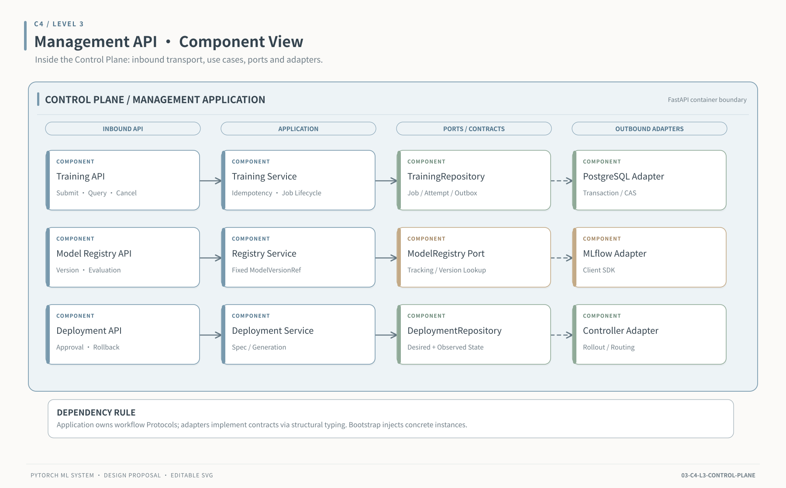
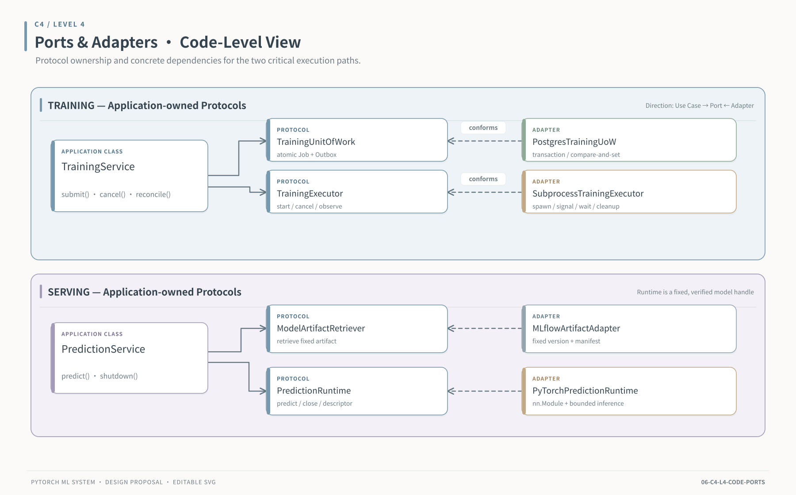


Bootstrap 定義允許的 Model Architecture、Trainer、Evaluator、Data Adapter、Model Loader Registry；不接受 Caller 直接傳送 `module.path.ClassName`。同一 Application Service 在測試可注入 InMemory Fake，在 production 注入 PostgreSQL／MLflow／Process Adapter。

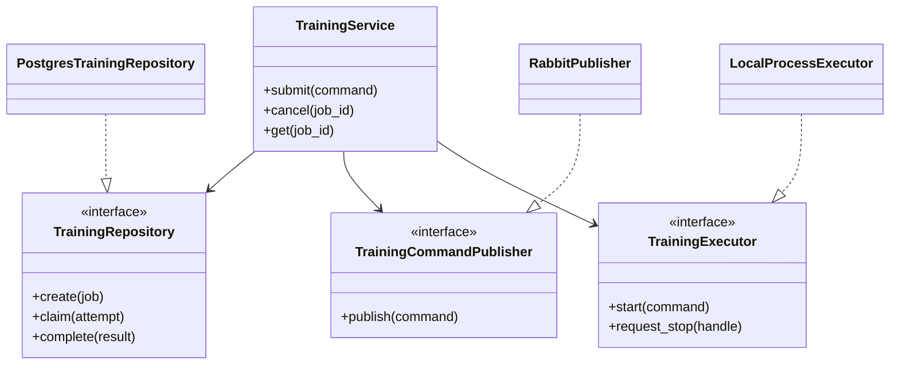

## 6. Training Command / Outbox / ACK Detailed Flow

### 6.1 Submit sequence


> **C4-style SVG view** — 可在 GitHub Markdown 中直接檢視，也可開啟 SVG 編輯元件與連線。圖為目標架構設計，非已部署證明。

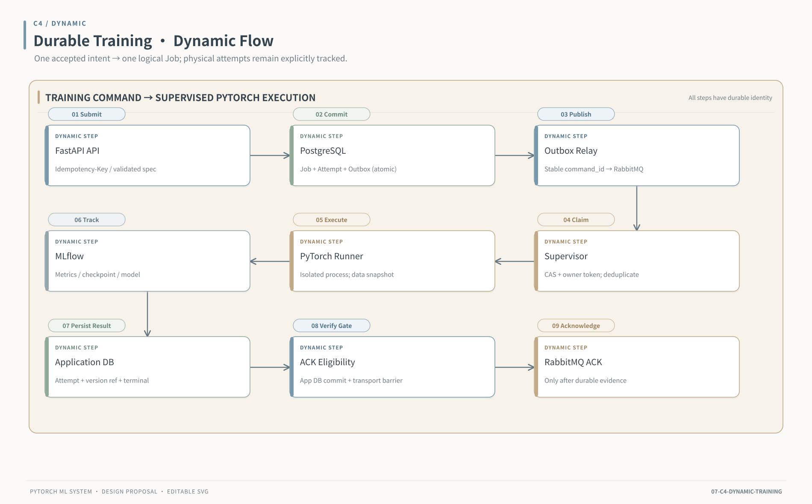


```mermaid
sequenceDiagram
  autonumber
  actor User
  participant API as FastAPI Management
  participant S as TrainingService
  participant DB as App PostgreSQL
  participant R as Outbox Relay
  participant Q as RabbitMQ
  User->>API: POST /training/jobs + Idempotency-Key
  API->>S: submit(scoped actor, validated request)
  S->>DB: BEGIN; unique idempotency + job + attempt + outbox
  DB-->>S: COMMIT job_id, command_id
  S-->>API: accepted(job_id)
  API-->>User: 202 Accepted
  loop bounded relay batch
    R->>DB: claim pending outbox event
    DB-->>R: stable command_id
    R->>Q: publish(confirm required)
    alt publish confirmed
      R->>DB: mark event PUBLISHED (CAS)
    else uncertain or error
      R->>DB: release/renew retry with same ID
    end
  end
```

API 對 RabbitMQ 的短暫失敗不必直接 5xx，只要 Job + Outbox 的 PostgreSQL 交易已持久 commit 且有有界 backlog admission；反過來若 DB commit 失敗必須拒絕接受，不可只 publish command。`ACCEPTED` 狀態不是已進入 Worker 的證據。

### 6.2 Consumer claim and process execution

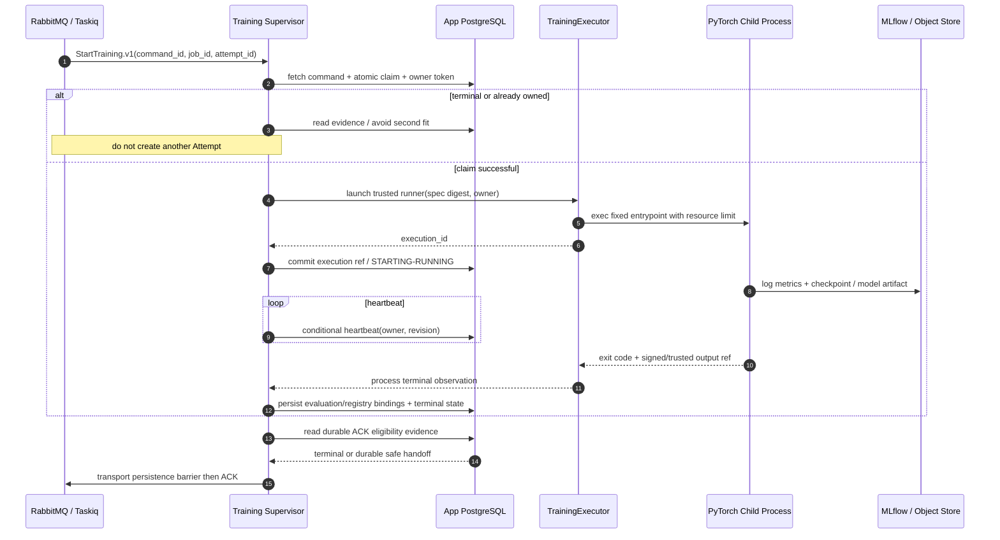

`STARTING`／`RUNNING` 更新及 process launch 位於不同故障域：啟動可能成功但 DB 更新失敗。Executor 需要穩定 execution key，Reconciler 能確認子程序是否存活；如果無法確認，不能直接再啟動第二份訓練。Queue consumer 預設一個有效 training work unit；它管理子程序，不自行使用 Torch fit。

### 6.3 ACK Gate 與 delivery semantics

RabbitMQ／Taskiq 不是 exactly-once。即使 Taskiq 使用 `when_saved`，也只代表其 result backend 條件，**不代表 PostgreSQL App DB 已成功持久化 TrainingJob**。MUST 在受測的 Receiver 路徑建立 `CommandAckGate`：

- **Supervised Local**：TrainingJob terminal + output refs durable commit，或安全的 retry handoff 同交易 commit，才可進入 transport result/snapshot persistence → ACK。
- **External Submitted (PHASE-2+)**：若外部 Kubernetes Job 等已持久提交、stable execution ref 和 reconciliation record 同交易 commit，可 ACK「提交 command」，但 TrainingJob 仍是 RUNNING；不得當成已訓練成功。
- **DB commit 失敗**：禁止 ACK；Generic handler 不得把「App DB exception」轉換成 transport `FAILED` JSON 再正常 ACK。
- **重送發現 terminal**：重建 transport result/ACK，絕不重新 fit。
- **另一 owner 仍在跑**：不能不加驗證就 ACK 並讓原 attempt 無後續可靠恢復。依已測試的 retry/hold/externally durable handoff 策略處理。

實作必須以**指定 Taskiq Receiver 版本**執行真 Receiver callback／ACK integration tests；不能只測假的 message handler 就認定 broker 語意正確。`SnapshotPersistenceMiddleware` / `RedisJobStore` 是 transport 技術快照，不是 App DB Commit Barrier。

#### 6.3.1 Long-running training / Broker acknowledgement timeout (P1-04)

**M1 的受控本機 Process 模式**預設保留「App DB 終態或安全 retry handoff 成功後才 ACK」語意，但只允許**有界** Training Command：Broker 實際生效的 Delivery ACK Timeout 必須大於從取件到 ACK 的最大可能期限（包含 process launch、運算 deadline、checkpoint／registry／DB 收斂、取消寬限、transport persistence、shutdown／network margin）。**由於 DB/外部服務可能無限期中斷，單純拉長 Timeout 不能保證永不重送**；發生 timeout／channel closure 時仍須以 DB Claim、owner fencing 與 Reconciler 安全處理 redelivery，且不得並行重新 `fit()`。

第一個 CPU MLP MVP 應鎖定短且可測的運算與 ACK policy：每個 Training Supervisor 的有效在途數有界，`prefetch` 與 process concurrency 均受 Resource Profile 管理；明確記錄部署生效的 RabbitMQ Version、Queue Type、`consumer_timeout`／queue `consumer-timeout`／`x-consumer-timeout`、Taskiq ACK mode、最大任務運算／結束／取消期限，並在 Test Broker 上故意設較短期限驗證 channel 關閉、redelivery 與不重複 fit。**RabbitMQ 官方 4.4 文件指出自 4.3 起 ACK Timeout 強制機制適用於 Quorum Queue**；不得跨版本與 Queue Type 假設相同行為。

**長達數小時或期限不可預測的訓練**不應靠持有同一條 unacked delivery 完成。當引入可持久查證的外部 Executor（例如 Kubernetes Job）時，改採 §6.3 的 `External Submitted`：僅在 App DB 同一交易持久保存 `execution_key/ref`、`spec_digest`、owner/revision 和**可重新領取的 Reconciliation Work**，才 ACK「外部執行已提交」；TrainingJob 持續 `RUNNING` 並由 Reconciler 追蹤實際終態。單純 fork 一個沒有獨立持久監督及查證能力的 local child，不能冒充這個早期 ACK 保證。

**必備驗收**：實際 RabbitMQ／Taskiq Receiver 的正常長工作、ACK timeout、channel 關閉、consumer restart、redelivery、DB 暫停、重複 delivery、結果持久化後 ACK 遺失、外部 executor 建立後 supervisor crash。參考 [RabbitMQ Consumers — Delivery Acknowledgement Timeout](https://www.rabbitmq.com/docs/consumers#delivery-acknowledgement-timeout)。

### 6.4 Retry、Deadline、Cancel

| 類型 | 預設行為 |
|---|---|
| validation/schema/permission | 不重試，拒絕／FAILED 並留下 safe reason |
| transient DB/MLflow network | 有界 backoff；判斷是否已發生外部副作用 |
| fit 成功、registration 失敗 | 若 Checkpoint/Artifact 已持久，優先重試 registration 階段 |
| CUDA OOM／資源不足 | 不相同配置無限重試；依 policy 人工調整新 attempt |
| unknown process owner | NEEDS_RECONCILIATION，確認舊 executor 實體停止後才 restart |
| explicit cancel | 保存 Cancel intent，SIGTERM/Grace → group kill → confirm exit → CANCELLED |
| hard deadline | 由外部 Supervisor 監督，不能只 `asyncio.wait_for(fit())` |

Deadline 至少分 `HTTP I/O`、`queue wait`、`max training`、`MLflow/object store I/O`、`cancel grace`、`shutdown grace`。監督器不能因 coroutine 取消就釋放仍占用的 GPU/CPU 配額。

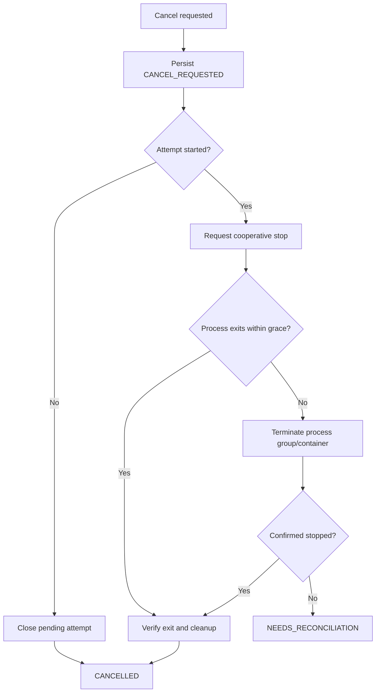

## 7. PyTorch Neural Network Training Runtime

### 7.1 Approved training entrypoint and ModelFactory


> **C4-style SVG view** — 可在 GitHub Markdown 中直接檢視，也可開啟 SVG 編輯元件與連線。圖為目標架構設計，非已部署證明。

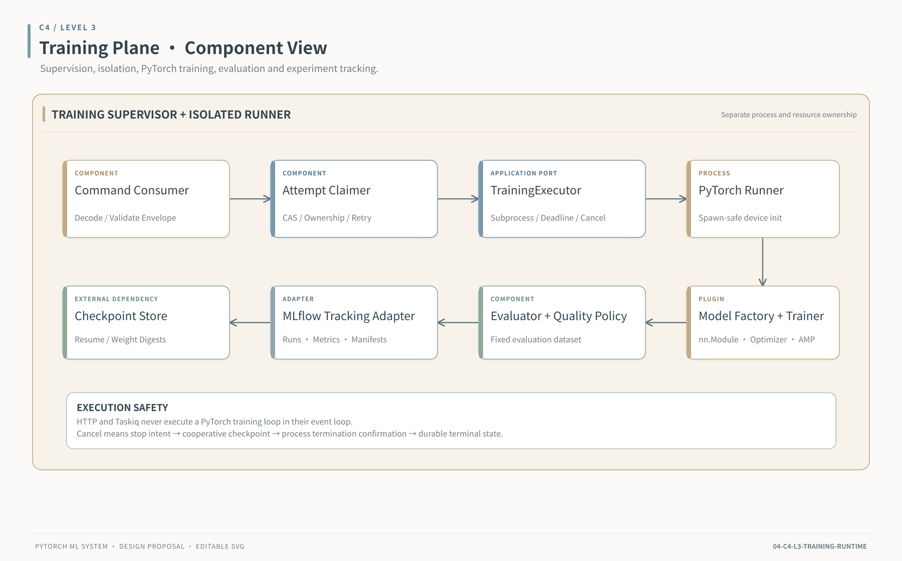


初版使用 `CPU PyTorch MLP` 驗證整條鏈路，`LSTM`／`CNN` 作為 Plugin 擴充。正式訓練子程序只讀取可信 TrainingSpec digest、Dataset Version refs、受控 ModelFactory key 與 Resource Profile；不允許 API 接受未核准 Python 任意 code。`ModelFactory` 由 Bootstrap 的 registry 綁定批准的架構與版本，可按 recipe 選擇。Trainer 不負責建立 SQL transaction 或控制 HTTP。

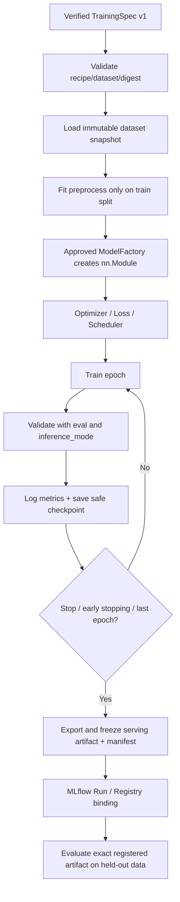

### 7.2 Trainer lifecycle：框架級規範

1. **Initialize**：驗 spec digest、driver/CPU compatibility、dataset provenance；設定 NumPy/Python/Torch seed；建立 approved model class、optimizer、scheduler、criterion；確定 `torch.device`。
2. **Load Data**：固定 split、fit preprocessing only on training，`DataLoader` 設定 batch size、workers、shuffle 與有界 memory；檢查空資料、Nan、dtype、shape。
3. **Fit**：`model.train()`；前向、loss、`zero_grad(set_to_none=True)`、`backward()`、可選 gradient clipping、`optimizer.step()`、scheduler update；只記錄允許的 metrics。
4. **Validation**：`model.eval()` + `torch.inference_mode()`；保持 validation 只讀，不進行梯度更新；early stopping 以已固定規則進行。
5. **Checkpoint**：按時間／epoch 保存 atomic checkpoint，內容至少包括 `model.state_dict()`、optimizer/scheduler state、global step/epoch、RNG state、recipe/dataset/spec digest，且存取路徑限受控 staging。
6. **Export / Register Candidate**：先封存最小權重、架構配置、已擬合前處理、input/output contract 與 golden fixture，再註冊候選版本。Registry version 放在外部 ModelVersionBinding，不反寫已封存的內容 Manifest；註冊不授予部署資格。
7. **Evaluation**：獨立 Evaluator 載入上述固定 Bundle，使用固定 held-out benchmark 與 EvaluationPolicy；報告綁定其 model binding、manifest/dataset/report digest。評估錯誤與品質拒絕分開，禁止核准不同內容。
8. **Cleanup**：flush metrics／artifact metadata、結束 Run、關閉 DataLoader workers、釋放受控資源；例外需留下可追溯結果，不吞掉原始錯誤。

CPU 初版 dtype 預設 FP32。GPU AMP、`autocast`、`GradScaler`、gradient accumulation 與 performance tuning 需依 qualified profile 增加，不能在 CPU 示例中假設已可用。使用 Seed 可提高可重現性但不保證 GPU 的 bitwise determinism；所有 run 記錄 torch/CUDA/driver/image digest 及 determinism policy。

### 7.3 Training algorithm pseudocode

```python
# 示意：實際 TrainingRunner 還要驗證 spec/source/manifest 與取消狀態
model = approved_model_factory.create(model_spec).to(device)
optimizer = build_approved_optimizer(model.parameters(), train_spec)
criterion = build_approved_loss(train_spec)

for epoch in range(train_spec.epochs):
    check_cooperative_stop()
    model.train()
    for x, y in train_loader:
        check_cooperative_stop()
        x, y = x.to(device), y.to(device)
        optimizer.zero_grad(set_to_none=True)
        logits = model(x)
        loss = criterion(logits, y)
        loss.backward()
        optimizer.step()

    model.eval()
    with torch.inference_mode():
        metrics = evaluate_validation(model, val_loader, device)
    tracker.record_metrics(run_id, metrics, step=epoch)
    checkpoint_if_required(epoch, model, optimizer, metrics)
```

上例只解釋計算責任；`check_cooperative_stop()` 必須由監督器可達的 IPC/Signal 或受控狀態提供，並非 PyTorch 內建函式；`evaluate_validation` 與 `checkpoint_if_required` 也屬待實作 helper。對於非合作式阻塞運算，仍由外部 Process Supervisor 執行 hard termination。

### 7.4 Process / GPU execution controls

- **初期**：`TrainingExecutor` 以固定子程序入口（例如 `python -m bootstrap.ml_training_runner`）啟動；不用 `shell=True`，不把用戶輸入拼成命令列；傳入 trusted spec file/ref 和 execution ID。
- **CPU**：OS/container 配置 CPU quota、memory、process limit、thread count；PyTorch、OpenMP／MKL 參數防止 nested oversubscription。
- **GPU PHASE-2+**：獨立 GPU Runner image/profile；設定 approved `CUDA_VISIBLE_DEVICES`、VRAM 預留／admission、device affinity。CUDA 初始化後不可不加控制地 `fork`；使用安全的 `spawn`／`forkserver` 或經資格驗證的新的 exec 子程序。
- **Concurrency**：每個初期 Training Supervisor 一個 active child；計算 CPU/GPU 配額不是用 Worker Num 自動推算。Redis lease 能協調可用資源，但不能憑 lease 直接控制實際 GPU memory 或保證外部副作用 fencing。
- **Isolation**：使用 per-attempt filesystem staging 與 least-privilege service identity；Checkpoint 由 approved Runner 寫入受控 Object Store；對 OS signal 的權限限制於自己的 execution group。

### 7.5 Checkpoint recovery contract

| Checkpoint element | Purpose |
|---|---|
| model `state_dict` | 繼續 NN 權重更新 |
| optimizer/scheduler states | 保留下一次 update 的動量與學習率步數 |
| epoch/global_step | 避免重頭重跑或重複記錄 |
| RNG states／sampler state | 控制資料批次與隨機性（非絕對 bitwise 保證） |
| dataset/recipe/spec digests | 拒絕不同資料／架構的錯誤 resume |
| framework/runtime qualification ID | 防止跨不相容 PyTorch/Python/image 恢復 |
| manifest + checksum | 確認檔案完整、來源受控 |

訓練 Checkpoint 可能使用 Python/Pickle 生態系格式，**只能接受受信任產生者與已核准格式**。推論 Artifact 優先使用最小權重與可信 image 內的 architecture code；對需要 `torch.load` 的受控 state_dict 採 `weights_only=True`（依鎖定的 PyTorch 版本資格驗證），並仍做路徑、大小、Digest 與授權檢查。任何 format 都不應被視為能單靠副檔名保證安全。

## 8. MLflow Integration / Artifact Governance

### 8.1 Component contract


> **C4-style SVG view** — 可在 GitHub Markdown 中直接檢視，也可開啟 SVG 編輯元件與連線。圖為目標架構設計，非已部署證明。

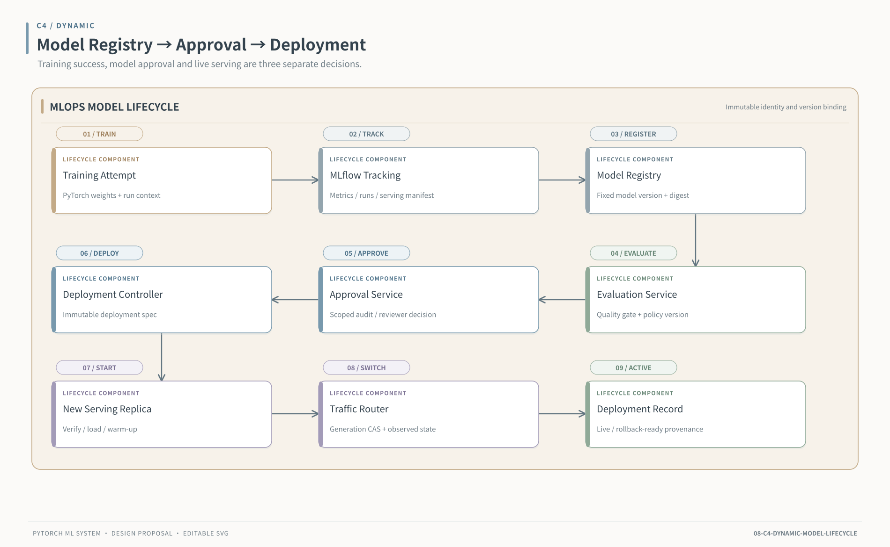


| Adapter | External interface | Required behavior |
|---|---|---|
| `MLflowTrackingAdapter` | `MlflowClient` Tracking APIs | 建立 Run、記錄固定 Params/Metrics/Tags、保存 artifact refs，失敗可對帳 |
| `MLflowRegistryAdapter` | `MlflowClient` Model Registry | 綁定 run/model version、讀固定版本、受控 alias 投影 |
| `MLflowArtifactAdapter` | MLflow artifact API／受權限 Object Store | 取得已固定 run/model version 參照的 artifacts，不從 request 任意下載 |
| `ArtifactVerifier` | digest manifest、trust policy、qualified image list | 驗來源、文件清單、大小、schema、digests、runtime compatibility |
| `EvaluationResultRepository` | ML App PostgreSQL | 保存品質 policy/approval 的權威決策與 immutable refs |

`MlflowClient` 可管理 Tracking／Registry；MVP 由受信任 Runner 產生 Run 與 Artifact，Application 僅保存 run/version/binding references。不可用 Fluent API 的 process-wide implicit active run 來跨併行 job 共享 context；使用明確 `run_id`，必要時為每個獨立 child 建立專屬 Client。

### 8.2 Tracking record and lineage

建議每筆 Run 記錄允許的 tags：`training_job_id`、`attempt_id`、`dataset_version`／`dataset_digest`、`recipe_version`、`git_sha`、`image_digest`、`compatibility_id`、`evaluation_policy_version`。不得存 API token、個資、raw user input、環境 secret 或 tenant 敏感資料。MLflow metrics 如 loss、accuracy、MAE 等必須帶 step 與合理 finite value 驗證。

```mermaid
sequenceDiagram
  autonumber
  participant T as PyTorch Runner
  participant C as MLflow Tracking Adapter
  participant O as Artifact Store
  participant R as MLflow Model Registry
  participant D as ML App PostgreSQL
  T->>C: create run (attempt_id, provenance)
  C-->>T: fixed run_id
  T->>D: record Attempt-to-run binding
  loop epochs
    T->>C: metrics(run_id, epoch)
  end
  T->>O: upload trusted checkpoint + model manifest
  O-->>T: fixed artifact ref + checksums
  T->>R: register approved model artifact origin
  R-->>T: registered model + numeric version
  T->>D: commit model version binding + EvaluationResult
  Note over T,D: reconcile on uncertain external success; never blind double register
```

`register` 操作若成功但 response lost，應以受控 origin/run/attempt marker 及 registry query 對帳，選定 canonical version，不能重試時默默生出多個可部署版本。MLflow Server 的 Metadata DB與 Application DB 分離，不以跨系統 SQL 交易保證原子性。

### 8.3 Model artifact manifest

```json
{
  "manifest_version": "2",
  "producer": {"job_id": "job-ref", "attempt_id": "attempt-ref"},
  "artifact": {
    "format": "trusted_pytorch_state_dict",
    "files": [
      {"path": "weights.pt", "sha256": "<64-hex-sha256>", "size_bytes": 123456},
      {"path": "preprocessing.json", "sha256": "<64-hex-sha256>", "size_bytes": 4096},
      {"path": "feature_schema.json", "sha256": "<64-hex-sha256>", "size_bytes": 2048},
      {"path": "output_mapping.json", "sha256": "<64-hex-sha256>", "size_bytes": 512},
      {"path": "golden_io.json", "sha256": "<64-hex-sha256>", "size_bytes": 1024}
    ]
  },
  "model": {
    "architecture_key": "approved_mlp_v1",
    "architecture_version": "1",
    "constructor_config": {"input_dim": 32, "hidden_dims": [64, 32], "output_dim": 3, "activation": "relu"},
    "trusted_code_digest": "sha256:<approved-source-digest>"
  },
  "preprocessing": {
    "transform_key": "standardize_v1",
    "fitted_state_file": "preprocessing.json",
    "feature_schema_file": "feature_schema.json",
    "fit_dataset_digest": "sha256:<training-split-digest>"
  },
  "postprocessing": {
    "task_type": "classification",
    "output_mapping_file": "output_mapping.json",
    "probabilities": "softmax",
    "calibration_ref": null
  },
  "contract": {
    "input_schema_version": "1",
    "output_schema_version": "1",
    "golden_io_file": "golden_io.json"
  },
  "runtime": {"compatibility_id": "torch-cpu-v1", "image_digest": "sha256:<approved-serving-image-digest>"},
  "producer_attestation_ref": "trusted-producer-metadata-ref"
}
```

**可完整重建推論路徑的 Artifact Contract（P1-05）**：

- `model.constructor_config` 必須保存輸入維度、Hidden Layer、輸出維度、Activation 等全部**影響模型建構的受控參數**；`architecture_key` 僅能解析到 Serving image 內的 Approved Architecture Registry，`trusted_code_digest` 與 qualified runtime 必須匹配。禁止從 Artifact 讀任意 Python import path／callable。
- Registry 分配的 version 位於外部 ModelVersionBinding，不屬於內容 Manifest。流程固定為 fit → export/freeze → register candidate → evaluate exact bundle → approve → deploy，避免註冊回填改變已評估的 Manifest digest。
- `preprocessing.fitted_state_file` 必須包含 fit 後所有必要的 mean/std、類別 vocabulary、缺值策略、欄位排序、單位與資料型別等受控特徵轉換狀態；**不得在 Serving 上重新 fit**，也不得用 Training 原始資料推導。圖示檔只是範例；真實格式需鎖定 Serializer／Schema 版本與限制大小。
- `postprocessing`／`output_mapping` 必須保存分類 label ID→名稱（或迴歸反正規化）、threshold／calibration（若適用）及輸出結構；使用與訓練評估相同的不可變映射。
- `golden_io` 保存脫敏、非敏感、固定形狀的已知輸入／預期輸出及數值容差，乾淨 Serving image 必須完成 **instantiate → load weights → fitted preprocessing → inference → output mapping** 的端到端測試，才可 Ready。
- 所有檔案的 size/hash 及整份 manifest digest 必須被 App DB 的 Registry Binding／Approval／DeploymentSpec 中的**受信任外部參照**錨定；自報 hash 不建立信任鏈。`manifest_version=2` 屬提案中的新 schema 版本，正式推出前必須補 JSON Schema、migration/compatibility policy 與真實模型 fixture。

上例的 digest 值是 schema 示意，不代表真實可驗 SHA-256。正式 manifest 必須使用真正的 64 hex digest、受控 canonicalization、trusted provenance/approval binding；**讓 Artifact 自報 digest 不建立信任鏈**。模型格式可以改用已驗證的 MLflow PyTorch Flavor，但必須把其模型載入方式、程式碼與 serialization policy 納入 Compatibility Record，不能不加驗證地反序列化任意 pickle。

`ArtifactVerifier` 必須保護 Path Traversal、Zip Bomb、Symlink Escape、超大檔案與 Memory Bomb。Serving 不能根據 artifact 裡 `requirements.txt` 自行 `pip install`；Image／依賴事前 build 與 qualified。

### 8.4 Artifact source permissions

預設**MLflow Artifact Proxy** 模式，只有 MLflow Server 的受控身分對 Object Store 持有寫入權，其他角色經授權 MLflow API 存取。若選用 client 直連 S3／MinIO，必須明確分離 service account、bucket/prefix ACL，驗 tenant scope／cache key／registry binding；兩種模式不得混用未驗證的安全假設。

MLflow 的 Registry Alias 是可變指標；Application 只將它視為管理投影。服務部署時**解析一次**成不可變模型版本，DeploymentSpec 必須帶固定 version/digest，而不是 `latest`、`champion` 可變 alias。

## 9. Evaluation, Approval & Promotion

### 9.1 Separated Evaluator

`Trainer.fit()` 的職責是產生模型與 training/validation metrics；`Evaluator.evaluate()` 消費固定 artifact、受控 benchmark dataset、EvaluatorVersion 與 QualityPolicy，產生 EvaluationReport／Decision。與訓練同個 Runner 執行也須維持**程式介面與決策分離**，以便未來重新評估同一模型版本而不重新 fit。

| Evaluation state | 意義 | 是否可核准 |
|---|---|---|
| `PENDING` | 尚未對固定 artifact 執行測試 | 否 |
| `RUNNING` | Evaluation 正在進行 | 否 |
| `APPROVED_BY_POLICY` | 達成指定 quality/robustness policy | 可進入人工核准流程 |
| `REJECTED_BY_POLICY` | 訓練成功，但評估品質不達標 | 否，保留報告 |
| `ERROR` | 評估執行／資料失敗 | 否，可由有界重試／人工補救 |

MVP 先由被核准者人工核准部署；後續才考慮加上自動 promotion。Approver 與 Runner 權限分離，所有更改留下 audit event。

**Evaluation／Approval immutable binding（P2-01）**：每份 `EvaluationResult` 必須不可變地綁定 **ModelVersionRef、Model Artifact／Manifest Digest、Evaluated Dataset Snapshot Digest、Feature／Output Contract Version、Evaluator Code／Runtime Version、Evaluation Policy Version、EvaluationReport Digest** 及執行時間；`APPROVED` 則必須引用該 `evaluation_id`／`evaluation_report_digest`、核准的**相同** `model_binding_digest`、目標環境、Approver、時間與 Approval Policy Version。模型 byte／資料／報告／政策任一變動，既有 Approval **不得自動沿用**；重新評估應建立新的 Evaluation Result，重新核准且可稽核。Controller 啟動前必須檢查 Approval 和 DeploymentSpec 的固定參照完全一致。

### 9.2 Approval / Deployment sequence

```mermaid
sequenceDiagram
  autonumber
  actor Reviewer
  participant API as Management API
  participant DB as ML App DB
  participant ML as MLflow Registry
  participant C as Deployment Controller
  participant S as Serving Runtime
  participant RT as Router / Gateway
  Reviewer->>API: approve fixed model ref + environment
  API->>DB: verify evaluation/actor/policy; persist approval
  Reviewer->>API: create deployment(endpoint, model binding)
  API->>DB: persist desired deployment/generation/spec ref
  C->>DB: claim desired deployment
  C->>ML: resolve/check immutable model version binding
  C->>S: launch fixed DeploymentSpec + expected digest
  S->>S: validate trust, download, load, warm-up
  S-->>C: ready + loaded version + instance identity
  C->>RT: activate expected generation (CAS)
  RT-->>C: observed route generation
  C->>DB: persist ACTIVE observed state + audit
  C->>ML: best-effort controlled alias projection
```

API 被允許批准，不代表模型已在線上；只有 Routing/Serving observation 與 `generation` 一致才能標記 `ACTIVE`。同環境多個 endpoint／region 可各自有不同 Active version，不能用單一全域 Alias 宣稱所有流量已切換。

## 10. Immutable DeploymentSpec / Rollout / Rollback

### 10.1 DeploymentSpec v1

```json
{
  "schema_version": "1",
  "deployment_id": "61f2f4a0-8416-4732-8edc-76c080c1d2a6",
  "tenant_scope_ref": "approved-tenant-scope",
  "endpoint_id": "quality-classifier",
  "generation": 3,
  "approval_id": "fixed-approval-ref",
  "evaluation_id": "fixed-evaluation-ref",
  "model": {
    "registered_name": "quality-nn",
    "version": "7",
    "run_id": "fixed-run-ref",
    "artifact_ref": "fixed-model-artifact-ref",
    "manifest_digest": "sha256:trusted-manifest-digest"
  },
  "runtime": {
    "compatibility_id": "torch-cpu-v1",
    "serving_image_digest": "sha256:qualified-serving-image",
    "device_profile": "cpu-small-v1"
  },
  "contract": {"input_schema_version": "1", "output_schema_version": "1"},
  "expected_warmup_fixture_digest": "sha256:trusted-fixture-digest"
}
```

`DeploymentSpec` **不可修改**，由 Controller 從受控 DB Model Binding／Approval 建立，作為版本化文件傳入 Serving。期望的 canonical spec digest 必須由**外部受信任啟動設定／controller channel**交付；spec 在自身內容寫 `digest=...` 不算信任證明。JSON Schema、canonicalization、digest、model/ref、runtime image、tenant/endpoint 與 generation 必須同時核對。

### 10.2 ModelLoader composition


> **C4-style SVG view** — 可在 GitHub Markdown 中直接檢視，也可開啟 SVG 編輯元件與連線。圖為目標架構設計，非已部署證明。

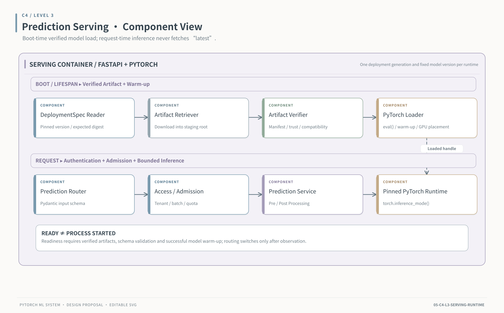


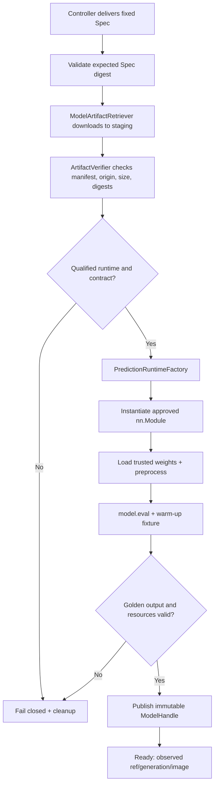

`ModelArtifactRetriever` 不反序列化；`ArtifactVerifier` 不啟動 Model；`PredictionRuntimeFactory` 不改變 DeploymentSpec；`ModelLoader` 負責協調及中途失敗 cleanup。Serving 使用每次部署固定的 ModelHandle，不能每次 request 解析 alias/registry。

### 10.3 Rolling deployment / rollback


> **C4-style SVG view** — 可在 GitHub Markdown 中直接檢視，也可開啟 SVG 編輯元件與連線。圖為目標架構設計，非已部署證明。

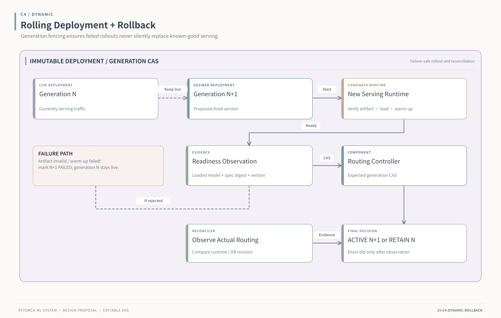


- Controller 發布新 Generation（N+1）並啟動**新的** Serving runtime；舊 Generation N 持續處理請求。
- N+1 只有完成 artifact verification、model load、warm-up、schema smoke test 才 Ready。
- Router 同時驗證獨立的 `expected_route_revision` 與固定目標 deployment/generation。Reference local/VM Router 以 App DB 的 endpoint_routes 為權威，每次切流或作廢未知操作都推進 route revision；模型 generation 與 routing revision 不可混用。只有受控 Router 確認後才記錄 ACTIVE。
- 舊 Runtime 等待 in-flight drain 後退休；不可先關舊模型再檢驗新模型。
- 若新版本在尚未切流前已確認失敗，維持 N 之既有健康路由；若 routing 狀態不確定，**設為 `RECONCILING`（非終態）**，先對帳實際 Route 的 generation／deployment／model binding，再決定 `ACTIVE` 或在補償完成後 `FAILED`。不可直接自稱已 rollback。
- **Rollback 也是新 Deployment/Generation**，但固定指向原本已核准且仍可取得的模型／runtime image。修改 Registry Alias 不等於 Rollback。
- Artifact Retention 必須至少涵蓋 ACTIVE、前一可回滾版本及核准中模型；GC 先做參照檢查。
- 「目前仍觀察到 N」不能單獨證明舊切流請求永遠不會生效。FAILED／清理之前必須先完成 Router-side fencing，使原 expected revision 必定失效，並確認候選不再被引用；未取得此證據繼續 RECONCILING。外部 Router Adapter 必須提供等效協定。

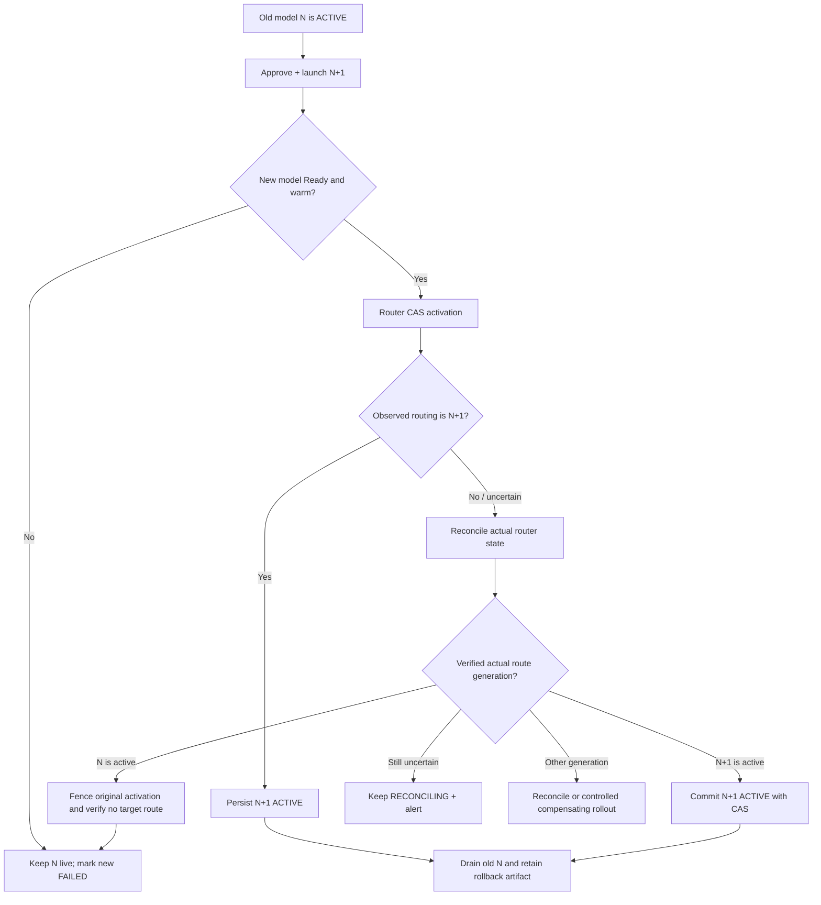

## 11. FastAPI Prediction Serving Runtime

### 11.1 Lifespan / readiness

Serving `bootstrap.ml_serving:create_app` 使用獨立 Role Catalog（`APP_TASK_BACKEND=disabled`），在 FastAPI lifespan 起始階段只載入**一個固定 DeploymentSpec / Model Version**；`ModelLoader` 完成後透過 immutable Handle 發布給 `PredictionService`，結束時先 drain request 再釋放模型／client。不同 Uvicorn Processes 通常各自持有模型與 GPU context，不以 CPU core 數直接設定 worker count。

- `/health/live`：程序本身可回應；不需要每次對外 DB／MLflow 查詢。
- `/health/ready`：模型已驗證與 warm-up、容量允許、配置 generation 正確；若新 Runtime 無有效模型應回 `503`。
- MLflow 暫時不可用時，**已載入的固定模型**仍可預測，前提是身份/permission、其他必要依賴與模型本身仍符合 serving policy；不應因 registry transient outage 自動讓已健康模型卸載。
- 每個 response 帶 `model_version`、`deployment_id`、`generation`、`input_schema_version`、`request_id`，支援追溯。

### 11.2 Inference execution


> **C4-style SVG view** — 可在 GitHub Markdown 中直接檢視，也可開啟 SVG 編輯元件與連線。圖為目標架構設計，非已部署證明。

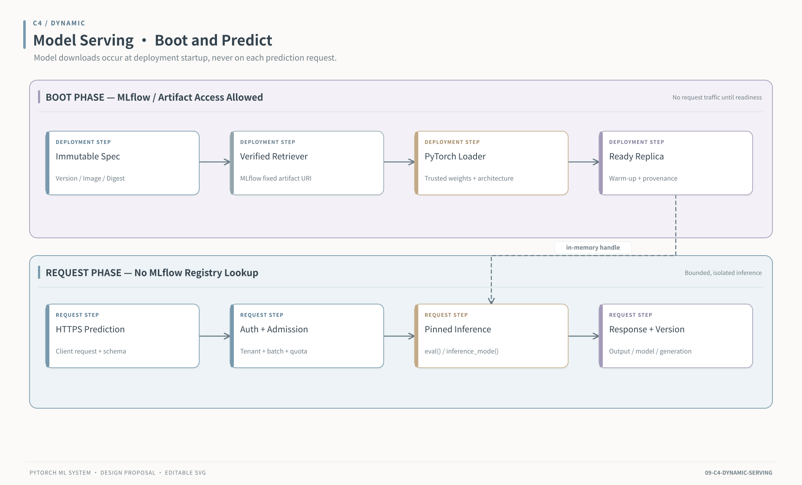


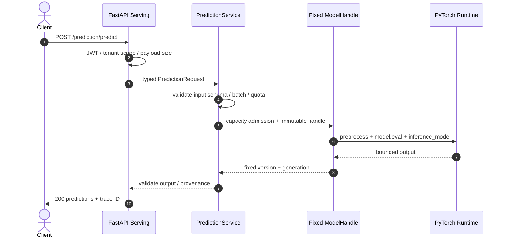

`torch.inference_mode()` 不等於 `model.eval()`；必須兩者同時使用。CPU 上同步 `predict()` 不直接在 event loop 執行，採有界 ThreadPool/Process Adapter；GPU 模式優先採專用進程、有界請求佇列，根據實測再加 microbatching。Thread cancellation/timeout 不等於中止底層 Torch kernel，容量只在實體 operation 完成／被確認終止後釋放。

### 11.3 Admission control & memory

MVP 至少要有 `MAX_BATCH_SIZE`、`MAX_REQUEST_BYTES`、`MAX_INFLIGHT`、`PREDICTION_TIMEOUT`、每 tenant rate/quota、隊列等待上限。超出可回 429/503，不允許 OOM 導致整個 server 大量 500。若模型一次佔 2 GiB，四個 Uvicorn Workers 通常不會「只載入一次」，尤其 GPU 需以實際 VRAM 計算 replica/worker 容量。

`PredictionRuntime` thread safety 為模型與 preprocessing 具體實作的 **qualified capability**，不可由 PyTorch Framework 名稱推斷。需要模型同時 hot-reload 時，採預先載入 N+1、原子發布新 handle、in-flight pin 舊 handle、drain 後 cleanup，並量測雙模型 RAM/VRAM；首版預設**不做 in-process hot switch**。

## 12. Runtime Settings, Dependencies & Deployment

### 12.1 設定鍵與驗證

`APP_*` 屬既有通用 Template 設定，`ML_*` 屬產品衍生設定。值由 `bootstrap/ml_config.py` 驗證並轉成狹窄設定 DTO；不得把整份 `Settings` 傳進 Domain／Trainer。

| ML 設定 | 使用角色 | 規範 |
|---|---|---|
| `ML_ENABLED` | 全部 | 預設 false；不污染通用模板預設啟動 |
| `ML_DEPLOYMENT_ROLE` | 全部 | management/relay/supervisor/runner/control/serving |
| `ML_DATABASE_URL` | management/relay/supervisor/control | 按角色限制 DML／DDL 權限；憑證禁止 log |
| `ML_TRACKING_URI`／`ML_REGISTRY_URI` | runner/control/selected API | 指向受信任 MLflow endpoint |
| `ML_EXECUTOR_BACKEND` | supervisor | MVP `local_process`；Kubernetes 另行 qualified |
| `ML_RESOURCE_PROFILES` | management/supervisor | server-controlled profile map，不信任 client 任意資源 |
| `ML_TRAINING_TIMEOUT_SECONDS` | supervisor | 業務總訓練期限，不沿用平台 generic 60s |
| `ML_QUEUE_TIMEOUT_SECONDS` | management/supervisor | 接受之後最長等待時間 |
| `ML_IDEMPOTENCY_RETENTION_SECONDS` | management | 有效期從初次接受時計算，預設提案 `86400` 秒；正式環境須經 Product／Platform 核准，並保留過期與併發重送測試 |
| `ML_HEARTBEAT_SECONDS`／`ML_STALE_AFTER_SECONDS` | supervisor/reconciler | heartbeat 判斷門檻不等於死亡證據 |
| `ML_CANCEL_GRACE_SECONDS` | supervisor | 實體停止寬限，之後 escalate |
| `ML_OUTBOX_BATCH_SIZE`／`ML_MAX_PENDING_JOBS_PER_TENANT` | relay/management | 防止 durable backlog 無限膨脹 |
| `ML_DEPLOYMENT_SPEC_PATH` | serving | Controller 受控傳遞，path 由 image/launch spec 指定 |
| `ML_DEPLOYMENT_SPEC_DIGEST` | serving | 外部可信 expected digest |
| `ML_RUNTIME_INSTANCE_ID` | serving/controller | 單次啟動唯一 ID 與 generation |
| `ML_PREDICTION_MAX_BATCH_SIZE`／`ML_PREDICTION_TIMEOUT_SECONDS` | serving | bounded input/admission |
| `ML_MODEL_ENVIRONMENT` | management/control | dev/staging/prod 模型治理環境，與 `APP_ENVIRONMENT` 分離 |

環境 secret 使用 Secrets Manager／Kubernetes Secret／受管憑證，避免 raw `.env` 進 Git。設定載入驗 URL、TLS、必需 role、正整數界限、取捨組合；Serving 不需要拿到 training/promotion-admin token，Trainer 不需要 DB migration/admin credentials。

### 12.2 Image separation

| Image | Python dependencies | 必要限制 |
|---|---|---|
| `ml-api` | FastAPI、App DB driver、API/registry metadata client | 不安裝 PyTorch／GPU driver |
| `ml-training-cpu` | pin PyTorch CPU、NumPy、data adapters、MLflow client | 固定 dataset/architecture，process/thread limits |
| `ml-serving-cpu` | pin PyTorch CPU、verified preprocessing、minimal API | 只讀已核准模型與 spec |
| `ml-training-gpu`（後續） | qualified torch+CUDA/native libs | GPU allocation、driver/runtime matrix |
| `ml-serving-gpu`（後續） | qualified torch+CUDA/native libs | per-device model VRAM budget |
| `mlflow` | MLflow server、metadata DB driver、S3 client | scoped Artifact Proxy credentials |

增補 `pyproject.toml` 的 role extras／獨立 lock input，由**同一受控 lock pipeline**管理，不要複製出無法對帳的 requirements。Build 產生 image digests、SBOM、依賴漏洞報告、Provenance。Training 與 Serving 可以使用不同 Python／torch runtime，但相容性必須由具體 qualified Model Artifact 載入／預測測試確認；不可只靠 SemVer。

### 12.3 Local Compose target topology


> **C4-style SVG view** — 可在 GitHub Markdown 中直接檢視，也可開啟 SVG 編輯元件與連線。圖為目標架構設計，非已部署證明。

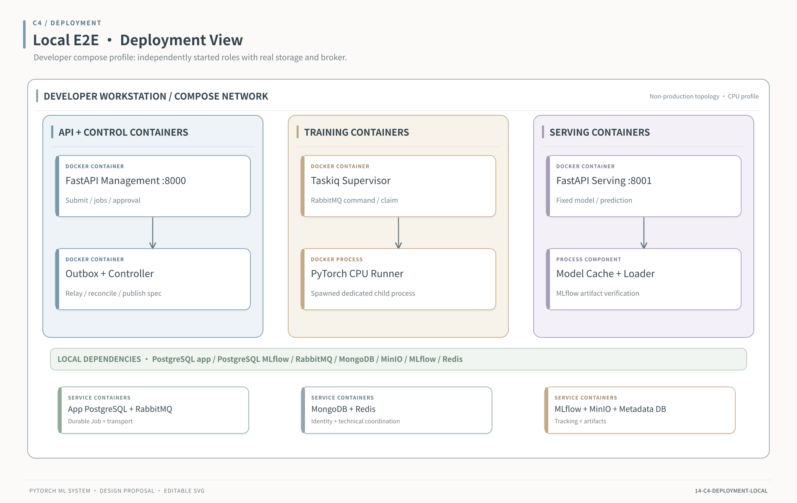


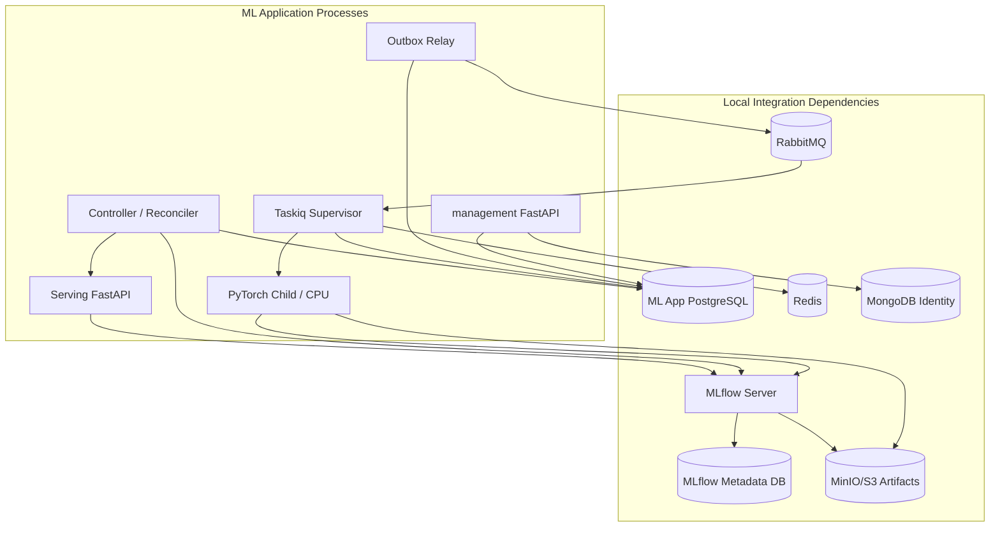

`compose.ml.yaml` 已提供 CPU MVP 參考整合環境，實際 image build／多角色整合資格驗證狀態見 [implementation status](implementation-status.md)。ML App／MLflow Metadata 使用不同 Database/Role。MLflow Artifact 路徑由 proxy 處理；若改為 Runner 直連 MinIO，該連線代表**另一種需獨立驗證的 access mode**。

Production 使用 TLS、NetworkPolicy／防火牆、最小權限、獨立密鑰、資料庫備份、HA（若 SLO 要求）、External Secret Management 與 immutable images。Kubernetes 不是初版必要條件；正式切換前驗證部署 rollback/restore、resource hard limits 與相關平台政策。

### 12.4 Runtime Compatibility Qualification

| 欄位 | 必填證據 |
|---|---|
| Runtime ID | immutable compatibility identifier，approved by owner |
| Python／OS／Architecture | 精確版本、glibc、CPU instruction、arm64/x86_64 |
| PyTorch | `torch` 精確版本、編譯方式、native dependencies |
| GPU（如有） | CUDA/driver/device/compute capability/MPS qualification |
| MLflow | client 和 server 分別固定版本 |
| Serialization | model file format、safe load policy、approved architecture keys |
| Model | manifest digest、preprocess/schema、golden input/output |
| Image | Training／Serving OCI digests + source revision + SBOM |
| Tests | load, predict, schema reject, cleanup, cold start, resume, rollback |
| Status | `proposed`／`testing`／`qualified`／`retired` |

第一個 `torch-cpu-v1` 不能因寫進文件就成為 qualified；必須真實 build、執行 tests、保存 evidence，才可更動狀態。`ml-runtime-compatibility.md` 的既有 sklearn sample 不可挪作 PyTorch 的證據。

## 13. Security, Trust Boundaries & Authorization

### 13.1 Roles and privileges

| Actor | Allowed | Explicitly forbidden |
|---|---|---|
| Data Scientist | scoped training submit/query/cancel、metrics query | 自行 promotion、指定任意 Python code |
| Reviewer | scoped model evaluation review/approval | 直接改 SQL、無治理 evidence 切流 |
| Deployment Operator | approved model rollout/rollback | 部署未核准版本或不相容 image |
| Prediction Client | scoped endpoint prediction | 切模型版本、任意 artifact URL、Registry mutation |
| Training Runner service identity | 只讀已授權資料／寫自己 attempt artifact | 讀別的 tenant／取得 serving admin credentials |
| Serving service identity | 只讀固定 deployment artifacts | 上傳訓練權重、更新 Registry/Approval |
| MLflow Server identity | scoped artifact backend | 管理 App DB Job/Approval |

既有 Mongo JWT／tenant owner 保留，但 ML 權限與模型/資料隔離需**新增 Application 授權檢查**；不能只因 route 有 JWT 就假設所有模型資源已受保護。跨 tenant 無權者可採一致 404 策略以避免 resource enumeration；所有 query 和 object ref 檢查 tenant／owner／environment scope。

### 13.2 Threat model


> **C4-style SVG view** — 可在 GitHub Markdown 中直接檢視，也可開啟 SVG 編輯元件與連線。圖為目標架構設計，非已部署證明。

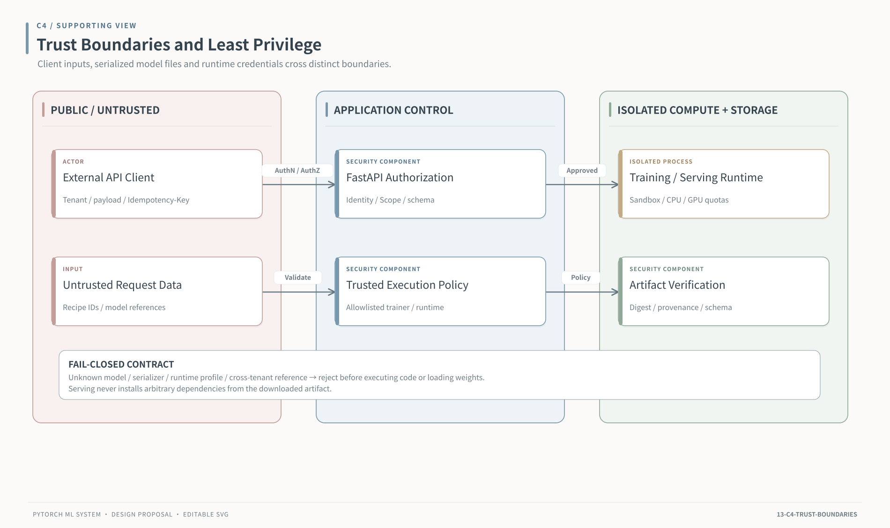


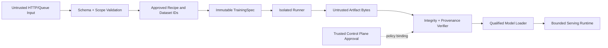

主要威脅與防護：HTTP SSRF／任意 URL 下載、Path Traversal、Pickle Code Execution、Zip Bomb、模型供應鏈污染、Tenant Data Leakage、Job 重送、Worker Ownership Race、GPU 資源耗盡、MLflow Admin/Artifact Secret 橫向存取。MUST 使用 allowlist URI、外部 URL egress policy、artifact content/digest、Docker non-root、Resource Limits、JWT scope、audit、TLS；嚴禁 untrusted callable/`eval()` 或未批准的 dynamic import。

### 13.3 Production gating

Secret 機密不放 Trace／MLflow Tags／Error Response；Artifact/Source 視為敏感資料；模型刪除必須尊重法規／資料保留與正在 Serving 的引用。當 Provider 中斷時，不能因 fallback 而略過授權或載入不受信任 cache。供應鏈檢查包含 Git 歷史 Secret Scan、Dependency Audit、Container Scanner、SBOM、Provenance。受控開發仍需處理 Template 目前的 CI／security 阻塞，不以歷史 local pytest 成功取代 main 最新流程。

## 14. Observability, SLO & Operational Readiness

### 14.1 Telemetry field contract

端到端綁定 `request_id`、`correlation_id`、`job_id`、`attempt_id`、`command_id`、`execution_id`、`mlflow_run_id`、`model_version`、`deployment_id`、`generation`；這些 Identifier 的 tenant 欄位需遵守觀測資料隱私政策。使用 OpenTelemetry trace/context propagation 與 structured log；不得採用 raw Dataset/Feature Values 作為高基數 Metrics Labels。

| Category | Examples |
|---|---|
| API | request rate、P50/P95/P99 latency、4xx/5xx、auth denied |
| Training queue | accepted backlog、outbox age、publish retries、oldest queue age |
| Training execution | running attempts、epoch duration、train loss、checkpoint interval、cancel duration、stale owner |
| Resource | CPU cores、RSS、GPU memory allocated/peak、OOM events、threads |
| MLflow | tracking errors、artifact upload/download time、Registry operation failure |
| Serving | cold load/warm-up time、inference P95/P99、batch size、capacity rejects、OOM、throughput |
| Deployment | ready replicas、desired vs observed generation、activation delay、rollback success |
| Reliability | unacked command age、reconciliation backlog、duplicate delivery、dead-letter count |

### 14.2 SLO/SLA policy

MVP 首先建立可量測 SLI 和 acceptance profile，不在無真實負載數據前憑空宣稱「P99 100ms」。數值 SLO 自 M4（Fixed Serving 可量測）起，由產品／平台根據代表性資料、模型大小、設備／同時使用量、穩態與 cold start 測試結果提出與驗證，並必須於 M6（Pilot Hardening）退出前簽核，包含測量窗口、失敗預算、期限與告警 Action。

| Objective | MVP acceptance evidence |
|---|---|
| Training durability | API commit 後 Broker outage 不丟任務；Outbox 恢復重送無第二次 fit |
| Serving correctness | 固定 input schema／golden fixture 輸出與 offline reference 在 tolerance 內 |
| Deployment safety | 壞模型新版本不影響現有健康流量；回滾有證據 |
| Worker isolation | 一個 PyTorch Crash/OOM 不阻塞 Management API 與健康 Serving |
| Tenant security | 未授權不能讀 Job/Model/Artifacts/Prediction scope |
| Operations | 錯誤可透過 trace ID、run ID、attempt ID、deployment ID 追查 |

### 14.3 Health probes and runbooks

Management readiness 應反映 App DB／Identity 等關鍵依賴；Outbox queue 暫時不可用時可選 backlog admission policy，而不是盲目讓全部 API unavailable。Supervisor readiness 需檢查 Broker consumer、App DB 與 heartbeat；Serving readiness 需檢查已載入 model/generation、warm-up、容量，不要求每次即時問 MLflow。Reconciler/Controller 則輸出進度與 stale item 告警。

操作 Runbooks 至少包括：卡住的 TrainingJob、Worker lost but process alive、Failed Checkpoint/Artifact Upload、Registry success response lost、Cancel stop unconfirmed、Serving bad deploy、Routing CAS conflict、Artifact Missing、DB Restore／Replay 與 Cross-tenant access incident。

## 15. Failure Matrix / Reconciliation Logic

| 故障窗口 | 可觀察風險 | 必要處置與驗證 |
|---|---|---|
| App DB commit 前 API crash | job 是否存在不確定 | 相同 idempotency key 查 DB；無 commit 不發布 |
| Commit 後 HTTP response lost | client 可能重送 | 原 key+fingerprint 回同 Job |
| Outbox publish confirm lost | command 可能已在 queue | 重送相同 command_id，worker 去重 |
| Duplicate RabbitMQ delivery | 重複 fit | DB atomic claim／ownership，只有一個有效 attempt |
| Supervisor crash after child launch | child 仍在跑 | stable execution identity + reconciliation；禁止 blind relaunch |
| Runner crash during training | partial artifact／stale state | process exit proof、checkpoint policy、new attempt if allowed |
| Runner fit success but MLflow down | registration pending | 保存 durable checkpoint/ref，有限重試該階段 |
| Registry commit success but response lost | duplicated model versions | 以 run/attempt/origin markers 對帳並選定 canonical version |
| DB terminal commit but ACK lost | duplicate delivery | 重送見 terminal，補 transport ACK，不再 fit |
| Cancel signal ignored | resource occupied | SIGTERM grace→kill group→confirm; uncertainty = reconcile |
| New serving load failure | dead deployment | 保留舊 route；新 instance unready and cleanup |
| Routing switches but DB update fails | observed/desired divergence | query actual router+generation，CAS 恢復 |
| MLflow unavailable during steady serving | registry cannot query | 固定已載模型持續服務，維持 auth/scope 不變 |
| PostgreSQL disaster/recovery | durable state risk | tested backup/restore + Outbox/reconciler scan before replay |
| Expired Redis lease | misleading free capacity | require physical process stop evidence and fencing before new work |

### 15.1 Reconciliation state machine

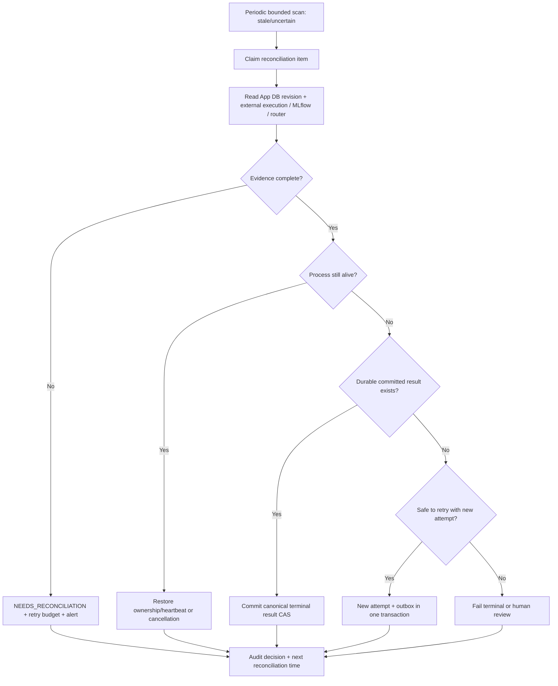

每一筆對帳紀錄包含 evidence refs、expected state revision、owner、action/result，逾次進入人工處置；禁止直接改 SQL 把不明工作標成成功。External side effect 用不可變命名／attempt binding，防止過期 worker 寫入最新模型版本引用。

## 16. Testing Strategy, CI/CD Gates & Acceptance

### 16.1 Test pyramid

| Level | Target | Required examples |
|---|---|---|
| Unit | Domain policies, DTO, state machine, Trainer math, admission | illegal transition、spec bounds、seed、fit/validation gradients |
| Port contract | 全部 Application Ports 的 Fake/Real Adapter 共同行為 | schema/exception/cancel semantics、idempotent registration、cleanup |
| DB integration | 真 PostgreSQL migration / transaction | key race、Outbox atomicity、`SKIP LOCKED`、owner CAS、terminal no-overwrite |
| Messaging integration | 真 RabbitMQ／Taskiq Receiver + Redis | redelivery、pre-ACK DB gate、result persistence failure、bounded retries |
| MLflow integration | 真 MLflow server、backend DB、Object Store | Run logs、artifact manifest、Registry versions、auth／network errors |
| CPU NN training | trusted fixed dataset + approved PyTorch MLP | gradients update、checkpoint/resume、metrics、evaluation、device cpu |
| Serving contract | fixed spec + trained artifact | load, `.eval`, `inference_mode`, golden outputs, schema rejects, cleanup |
| End-to-end | Real compose roles | submit→train→track→evaluate→approve→deploy→predict→rollback |
| Fault injection | 突發 kill／timeout／服務中斷 | API/worker/MLflow/DB/Router failure matrix |
| Security | scope/artefact/secret | JWT tenant bypass、SSRF、path traversal、untrusted loader, secrets in logs |
| Capacity | representative model + device | QPS/latency/RSS/VRAM、peak concurrent fit、admission saturation |

### 16.2 Critical contract cases

| Test ID | Test scenario | Pass criteria |
|---|---|---|
| `ML-T01` | same idempotency key + same spec | exactly one Job, same response ID |
| `ML-T02` | same key + different spec | HTTP 409, no second Job |
| `ML-T03` | PostgreSQL commit but broker down | accepted Job remains durable; relay resumes |
| `ML-T04` | broker duplicate command | one effective Attempt owner; one fit |
| `ML-T05` | worker crash before App DB terminal commit | no premature ACK, safe replay/reconciliation |
| `ML-T06` | terminal commit but broker ACK lost | no re-fit; transport result repaired |
| `ML-T07` | cancel during blocking Torch operation | process actually stopped/confirmed or reconciling; quota not prematurely freed |
| `ML-T08` | checkpoint resume | preserved optimizer/global step and data/spec identity |
| `ML-T09` | training successful but Evaluation fails | truthful Evaluation ERROR; no promotion |
| `ML-T10` | quality policy rejects model | fit success retained; deployment forbidden |
| `ML-T11` | MLflow registration response lost | no ungoverned duplicate active model; canonical ref reconciled |
| `ML-T12` | unqualified PyTorch artifact | loader fail closed; not Ready |
| `ML-T13` | model artifact digest/path mismatch | reject before deserialization / model construction |
| `ML-T14` | incompatible feature schema | HTTP 422 and no partial inference |
| `ML-T15` | bad new deployment warm-up | old N remains healthy and routed |
| `ML-T16` | routing CAS conflict/old controller | stale generation rejected |
| `ML-T17` | rollback | new generation points to previously approved immutable version |
| `ML-T18` | cross-tenant dataset/job/model | data and artifact access denied with no sensitive detail |
| `ML-T19` | MLflow temporarily unavailable during live prediction | fixed loaded model remains usable subject to auth policy |
| `ML-T20` | failing model repeated predictions | bounded capacity, failures observable, cleanup correct |
| `ML-T21` | CPU/GPU qualified profile | exact image+framework+device combination load/predict/resume verified |
| `ML-T22` | DB/MLflow/Object Store full recovery | restore and Reconciler rebuild consistent desired state |

**第二輪審查補強測試（新 ID，避免與現有 ML-T 混淆）**：

| Review test | Scenario | Acceptance |
|---|---|---|
| `ML-RV2-01` | Cancel PENDING Attempt before process start | PENDING→CANCELLED；沒有執行與資源洩漏 |
| `ML-RV2-02` | LOST owner but same child alive | 恢復同 execution identity／CAS；不啟第二個 fit |
| `ML-RV2-03` | LOST child truly dead | 不恢復 RUNNING；confirmed terminal 或建立全新 Attempt |
| `ML-RV2-04` | Router CAS success but response/DB commit lost | 保留 RECONCILING，觀察到 N+1 後合法轉 ACTIVE |
| `ML-RV2-05` | Mandatory unroutable publish receives basic.return then confirm ACK | Outbox 仍未 PUBLISHED，原 command_id 重試 |
| `ML-RV2-06` | Durable topology/persistent publish missing or confirm ambiguous | Fail closed 或保留待重試；不得認定已發布 |
| `ML-RV2-07` | Long local training exceeds consumer ACK timeout | Channel closure/redelivery 可觀察；無重複 fit；所有權可收斂 |
| `ML-RV2-08` | Durable external execution handoff then ACK | execution ref + reconciler 同交易完成後才 ACK；Job 仍 RUNNING |
| `ML-RV2-09` | Clean Serving image restores weights + preprocessing + output mapping | golden inference 數值／分類 label 與固定 offline reference 一致 |
| `ML-RV2-10` | Evaluation report/model artifact digest changed after approval | Deployment blocked，需新 Evaluation／Approval |

所有測試 ID 是**本文件自訂的詳細設計驗收 ID**，不代表 Repository 既有 `ML-T01` 等名稱涵義完全相同；導入 Repository 時需做規格編號對照與避免碰撞。CI 的 green 不能只看 unit tests；必要整合服務必須使用真實 image、密鑰替身、清楚報告範圍。

### 16.3 Required CI gate

```mermaid
flowchart LR
  A[PR / Source Commit] --> B[Static Architecture + Ruff/Mypy]
  B --> C[Unit + Port Contract Tests]
  C --> D[Postgres + Broker + MLflow Integration]
  D --> E[CPU NN End-to-End]
  E --> F[Build Role-specific Images]
  F --> G[SBOM / Vulnerability / Secret Scan]
  G --> H[Artifact + Runtime Compatibility Gate]
  H --> I[Staging Deployment + Rollback Smoke]
  I --> J[Approval / Release]
```

必要 Gate 採 fail-closed：如某服務起不來，不得因後續測試 `always()` 仍執行而把整個 Validation 報告宣稱通過；Failure 類型要區分原始失敗與 cascading error。Role image 要用 digest、lock、source manifest 追溯。

### 16.4 Existing Template blockers (pre-ML gate)

根據前述 Repository 審查時的最近 GitHub Actions 結果，將以下事項設為工程 P0；**它們是當時發現的待追蹤項，不代表目前 HEAD 仍必然失敗，導入前需重新查最新 runs**：

1. Python 3.13 的 `BoundedThreadExecutor` 在 failing future 之後立刻重用容量出現競爭（`test_thread_function_failure_does_not_leak_capacity`）；須修正未完成 callback 對 `inflight` 的計數語意，避免加 sleep 掩蓋。
2. Integration／Container 服務的 `mongo:8` 曾遇 GitHub Runner kernel 相容性問題；改採經 Runner 驗證的 fixed compatible image/digest 並重跑測試。
3. Gitleaks 歷史掃描報出兩筆待 triage findings；檢查來源及誤報性質，若屬實需撤銷／輪替憑證，不可任意全域 allowlist。
4. CI／Security／Container 工作流程必須恢復可驗的最新 green；設定受保護的合併規則、owners 與必要 Checks。

相關 GitHub Actions 參考： [CI](https://github.com/PenHsuanWang/python-backend-server-template/actions/runs/40358476486)、[Security](https://github.com/PenHsuanWang/python-backend-server-template/actions/runs/40358476480)、[Container](https://github.com/PenHsuanWang/python-backend-server-template/actions/runs/40358476657)。

## 17. Implementation Work Packages & Milestones

| Stage | Deliverables | Exit criterion |
|---|---|---|
| M0 — Contract & Baseline | HLD/LLD、DTO/Ports、state transitions、API schema、migrations plan、Template P0 fixes | Architecture import checks/CI baseline restored；Review/ADR approved |
| M1 — Durable Job | Job/Attempt UoW、idempotency、Outbox、Relay、atomic claim、ACK evidence | `ML-T01`～`ML-T06` 真 DB/Broker tests |
| M2 — CPU PyTorch | ModelFactory, Trainer, Evaluator, supervised process、checkpoint、versioned dataset | CPU NN loss/training/resume/evaluation + stop tests |
| M3 — MLflow + Registry | experiment/run, Model Artifact, approved binding, verification | stable run ID、artifact digest and version provenance tests |
| M4 — Fixed Serving | prediction FastAPI, verified loader, warm-up, schema, bounded admission | trained model E2E predict + rejection tests |
| M5 — Governance / Rollout | manual approval, DeploymentSpec, Controller, routing, rollback | no traffic regression on bad deploy; CAS/rollback tests |
| M6 — Pilot Hardening | metrics/traces, runbooks, backup/restore, security, capacity, compatibility profile | signed-off SLO/SLI, qualified CPU image, staging fault injection |
| M7 — Optional Expansion | GPU/CUDA, multiple model runtimes, Kubernetes/GPU capacity | new exact compatibility row + separate acceptance suite |

### 17.1 First three implementation PRs

- **PR-01 — Pure Contracts / Schema**：Domain Job/Attempt、TrainingSpec v1、API DTO、permission policy、DB migration、UoW fake contract；確認 Generic Template 的既有模組在 `ML_ENABLED=false` 不受影響。
- **PR-02 — Durable Transport**：PostgreSQL transaction、Outbox relay、stable command、atomic claim、Receiver-level ACK gate、duplicate delivery／crash integration tests。
- **PR-03 — Isolated PyTorch**：受控 `LocalProcessExecutor`、CPU MLP Trainer、固定 DatasetVersion、cancel/deadline、checkpoint/recovery、獨立 Runner 測試；接著擴充 MLflow/Registry、Serving。

這個拆法讓「可靠工作接受／重送」早於實際長時間 NN fit 驗收，防止 demo 可以訓練但遇到 Worker 重啟後重複訓練。

## 18. HLD↔LLD Requirements Traceability

| HLD Concern | LLD Section | Principal test/evidence |
|---|---|---|
| Separation Control/Training/Serving | §1, §7, §11, §12 | role image smoke / isolation tests |
| Clean Architecture / OCP | §1, §5 | import checker + adapter contract tests |
| Durable Job / Outbox / Idempotency | §2–3, §6 | `ML-T01`～`ML-T06` |
| PyTorch NN Lifecycle | §7 | `ML-T07`～`ML-T09`, `ML-T21` |
| MLflow / Registry / Artifacts | §8 | `ML-T11`～`ML-T13` |
| Evaluation / Approval | §9 | `ML-T09`～`ML-T10` |
| Fixed Serving & Reproducibility | §10–11 | `ML-T12`～`ML-T17` |
| Security / Multi-tenancy | §13 | `ML-T18` |
| Observability / Fault Recovery | §14–15 | `ML-T19`, `ML-T22` |
| Runtime qualification & CI | §12, §16 | qualified profile + latest PR gates |

## 19. Open Decisions (design-review checklist)

決定前不可用猜測數值取代真實驗收證據。

| ID | 未決事項 | Decision owner | Required input |
|---|---|---|---|
| `LLD-OD-01` | 首個正式 PyTorch / Python / MLflow / CPU image version set | ML + Platform | exact lock / image E2E compatibility |
| `LLD-OD-02` | 具體 Dataset type、shape、temporal split / feature schema | DS + DE | production representative dataset contract |
| `LLD-OD-03` | 服務端 NN Architecture / hyperparameter allowlist | ML Engineer | approved recipe definitions |
| `LLD-OD-04` | Evaluation thresholds and separate held-out policy | DS + Reviewer | metrics baseline & risk profile |
| `LLD-OD-05` | Model artifact serialization flavor | ML + Security | load safety, rollback & license review |
| `LLD-OD-06` | Artifact Proxy or direct S3 credentials | Platform + Security | network, IAM, tenancy threat model |
| `LLD-OD-07` | CPU quotas / prediction concurrency & numeric SLO | Platform + Product | measured representative workload |
| `LLD-OD-08` | Deployment Controller target (Compose/VM vs K8s) | Platform | staging topology, routing CAS API |
| `LLD-OD-09` | Exact cancel/shutdown/ACK persistence strategy | Backend + Platform | real Taskiq Receiver behavior tests |
| `LLD-OD-10` | Data/model retention and audit period | Product + Security | organizational policy / restore goals |
| `LLD-OD-11` | GPU profile and device matrix | ML + Platform | hardware/driver/CUDA test evidence |

## 20. Related Architecture References

- [High-Level Design (HLD)](pytorch-ml-system-hld.md) — 架構背景、C4、決策、可靠性、里程碑。
- [Existing ML System Design v0.2](https://github.com/PenHsuanWang/python-backend-server-template/blob/main/docs/ml-system-design.md) — 現有 Template 的 ML 長期設計基線（初版為 sklearn CPU，需要此文件的 PyTorch 差異修訂）。
- [Template Module Spec](https://github.com/PenHsuanWang/python-backend-server-template/blob/main/docs/module-spec.md) — 既有模組職責與 import 規則。
- [Runtime Compatibility Matrix](https://github.com/PenHsuanWang/python-backend-server-template/blob/main/docs/ml-runtime-compatibility.md) — qualified profile 欄位和證據規則。
- [Repository Architecture Guide](https://github.com/PenHsuanWang/python-backend-server-template/blob/main/docs/architecture.md) — 現存 App Factory、ModuleCatalog、Port/Adapter 基礎。
- [PyTorch model saving/loading](https://pytorch.org/tutorials/beginner/saving_loading_models.html)；[PyTorch multiprocessing best practices](https://docs.pytorch.org/docs/stable/notes/multiprocessing.html)。
- [FastAPI Lifespan](https://fastapi.tiangolo.com/advanced/events/)；[MLflow Tracking APIs](https://mlflow.org/docs/latest/python_api/mlflow.client.html)；[MLflow Registry workflows](https://mlflow.org/docs/latest/ml/model-registry/workflow/)。

---

**實作狀態聲明**：本 LLD 是衍生 PyTorch ML System 的可評審技術規格。除明確標註的 Template BASELINE 外，本文指定的程式、資料表、API、Docker Compose、ACK Gate、MLflow、PyTorch Runner、Deployment Controller 與 Serving Runtime 均須後續實作、版本化、在真實目標環境驗證。完整實作、Production Readiness 與 SLO Achievement 不能只憑本設計文件判定。
