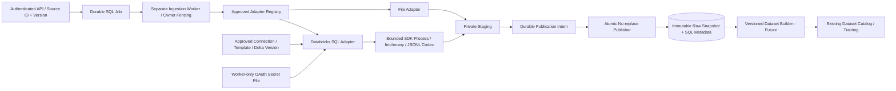

# Data Ingestion 穩定化與 Databricks Batch 交付

日期：2026-11-08。基準：`master@8903098`。
分支：`feature/ingestion-stabilization-databricks-batch`。
狀態：**實作與自動化測試已交付；PR 維持 Draft，尚未通過合併驗收。**
使用者確認目前沒有核准的真實 Databricks 環境；未將替身或 skipped tests 視為遠端成功。

2026-11-09 後續：CI cache 權限、EBM JSON depth 與 typing 已修復；本頁保留交付當日
的驗證結果。最新結果與未完成驗收見 [後續修復紀錄](ci-ebm-fixes-2026-11-09.md)。

## 實作範圍

沿既有九層 package／Application Ports／SQL Job／Raw Snapshot 契約擴充，
不改 Training／Serving 科學行為，不新增平行 framework 或 provider-specific
Service branches。Raw Snapshot 與核准 ML DatasetVersion 保持分離。

## 修復與擴充對照

| ID | 交付內容 | 主要驗證 |
| --- | --- | --- |
| FIX-01 | 合法 readiness response registration；不靠修改共享 router／private lazy-route 結構替換 readiness | 正式 factory ON/OFF、依賴 healthy/unhealthy、generic default contract |
| FIX-02 | lookup 區分實際觀察到 identity 與 namespace 建立競態 | deterministic concurrent publisher、同內容冪等、不同內容拒絕 |
| FIX-03 | blocking I/O 續租、publication/finish checkpoints、SQL owner fencing | slow prepare/lookup/publish、takeover、heartbeat failure、child cleanup |
| FIX-04 | 依 owner／terminal／intent 分流；pre-intent 不進入無效對帳 | generic/SnapshotConflict、finish commit 後回應遺失、真實 SQL trigger recovery |
| FIX-05 | 每次 bounded scan 的 Linux directory-cookie checkpoint／lock | >5,000 protected jobs、final history、publication copies、重啟後前進 |
| FIX-06 | Settings／Repository 共用 limits；拒絕 bool/NaN/Infinity/非法 roots | 上下界／錯誤型別／duplicate config keys／啟動前拒絕 |
| FIX-07 | 真正 production factory tests、獨立 worker image/Compose/CI、typed gate、metrics、health | 實際 Compose model、container + PostgreSQL、權限／低基數 metrics |
| DBX-01/02/04 | Proposed ADR、approved source validator、fingerprint、fixed Delta SQL／bound predicates | 58 contract/security/codec cases；template drift fail closed |
| DBX-03/05/06 | 官方 Connector 4.2.6／OAuth M2M、bounded `fetchmany`／JSONL、process lifecycle、Adapter | SQL metadata 型別、private credentials、deadline/cancel/partial frame、close/reap |
| DBX-07/08/10 | Bootstrap ON/OFF、worker-only secret、CI／monitoring／runbook | source registration + normal workflow、獨立 worker、failure injection、操作 CLI |
| DBX-09 | 可執行的真實 Warehouse + isolated PostgreSQL E2E gate | **NOT VERIFIED**：無核准環境／fixture，PR 必須 Draft |

額外發現並修正：partial IPC frame 原本可能讓 `recv_bytes` 阻塞而跳過 deadline；
現在以 bounded receiver queue 分離接收，終止 child 後回收 reader。未知 SQL type
即使全為 Null 也不再繞過 schema approval。Operator Source JSON 改為 FD regular-file
與 bounded read，FIFO／symlink／oversize／malformed 輸入安全拒絕。

## 程式位置與提交

| 範圍 | 責任 |
| --- | --- |
| `server.py`, `src/api/routers.py`, `bootstrap/ml_api.py` | 明確 readiness 組裝、保留 generic default、Management metrics |
| `src/domain/ingestion/runtime_limits.py` | 共用 bounded runtime settings invariants |
| `src/application/ingestion/supervisor.py` | 來源無關 keepalive、fencing、phase-aware recovery |
| `src/infrastructure/ingestion/storage/` | publication race fix、可恢復 cleanup progress |
| `src/infrastructure/ingestion/adapters/databricks_contract.py` | 核准配置／query／schema／serialization contract |
| `databricks_client.py`, `databricks_sql.py` | SDK／OAuth／process／bounded acquisition／既有 Stager 整合 |
| `bootstrap/ingestion_wiring.py`, `ingestion_cli.py` | concrete registration、feature flags、approved files、operator／health commands |
| `src/infrastructure/ingestion/persistence/` | 共用 limit validation、safe aggregate metrics |
| `Dockerfile.ml`, `compose.ml.*.yaml`, `.env.ml.ingestion.example` | optional worker deployment、readonly config／worker-only secret |
| `scripts/check_ingestion.py`, `.github/workflows/ml-ci.yml` | strict scoped gates、independent image/PG gate、protected manual live gate |
| `tests/ml/ingestion/` | contracts、security、real processes、recovery、API、deployment、live fixtures |

依 C1～C9 拆成獨立修復／功能／測試／文件提交，每個功能提交帶相應 tests。
Notebook 與既有未追蹤 Workload／OCP／ADR-015 提案保留，不納入本 PR；ADR-016
仍是 Proposed。沒有合併，也沒有停用或降低既有 typing／CI gates。

## 實際驗證與基線區分

完整機器結果、套件版本、source digests 與 baseline logs 見
[qualification evidence](../evidence/ingestion-delivery-2026-11-08/result.json)。

- 新增 Ingress 的 scoped Ruff／format／strict Mypy（36 source files）、Pyflakes、
  architecture boundaries 通過。
- 在 Python 3.12.16、官方 Connector 4.2.6、Torch 2.6.0 CPU 的環境執行回歸。
  Host 的 ASGI 測試使用既有 external selector workaround，沒有改 production event loop。
- 實際 build／執行 worker image，搭配全新 PostgreSQL 17 container，使用正常 event loop。
  最終 Ingress tests 為 **372 passed、零 skipped**；scope 排除需要 Docker CLI 的 Compose
  parser cases與無環境的真 Warehouse case。Migration、worker health 與 CLI cases 亦通過。
  所有 test-owned PostgreSQL containers 已移除，未使用或修改既有服務資料庫。
- 既有 ML／plugin／module 回歸的最終完整結果為 **909 passed、1 failed、4 skipped**。
  唯一失敗是 EBM artifact JSON depth case；在原始 `8903098`、相同 Python 3.12
  與依賴下也重現 **4 passed、1 failed**，並非本次 Ingress 所引入。
- `scripts/check_ebm_typing.py` 在基準與目前均有**相同 7 errors／5 files**。
  沒有刪除 assertions、增加 suppression 或更改規則來掩蓋它們。
- 真實 Warehouse／OAuth／Delta retention／fixture SHA gate、既有 live Backend／
  RabbitMQ 路徑與 Tech Lead sign-off 尚未完成。CI 執行狀態以 Draft PR checks 為準，
  workflow 定義存在不代表已通過遠端 CI。

新增 image/PG CI job 不依賴既有 EBM contracts job 成功才執行；baseline 失敗仍保留
為合併阻擋，不會因新增 Ingress gate 綠燈而自動忽略。

## 合併前尚待完成

1. 提供核准 SQL Warehouse、最小權限 M2M SP、固定 Delta fixture、獨立 expected count／SHA，
   執行 `test_databricks_live.py` 與 protected manual CI gate，要求零 skipped。
2. 針對既有 EBM 7 個 typing errors 及 Python 3.12 JSON-depth baseline failure 另行修復／驗收；
   完整 CI／既有 real-service gates 通過後才可解除 Draft。
3. 完成跨主機 lease／DB timeout／網路隔離、production load／retention／backup-restore
   與 storage durability 資格驗證，並取得 Tech Lead review。

Kafka、incremental extraction、Parquet、多 part publisher、Spark orchestration、
Dataset Builders 與 Raw-to-Feature／Training orchestration 不在此 MVP。
