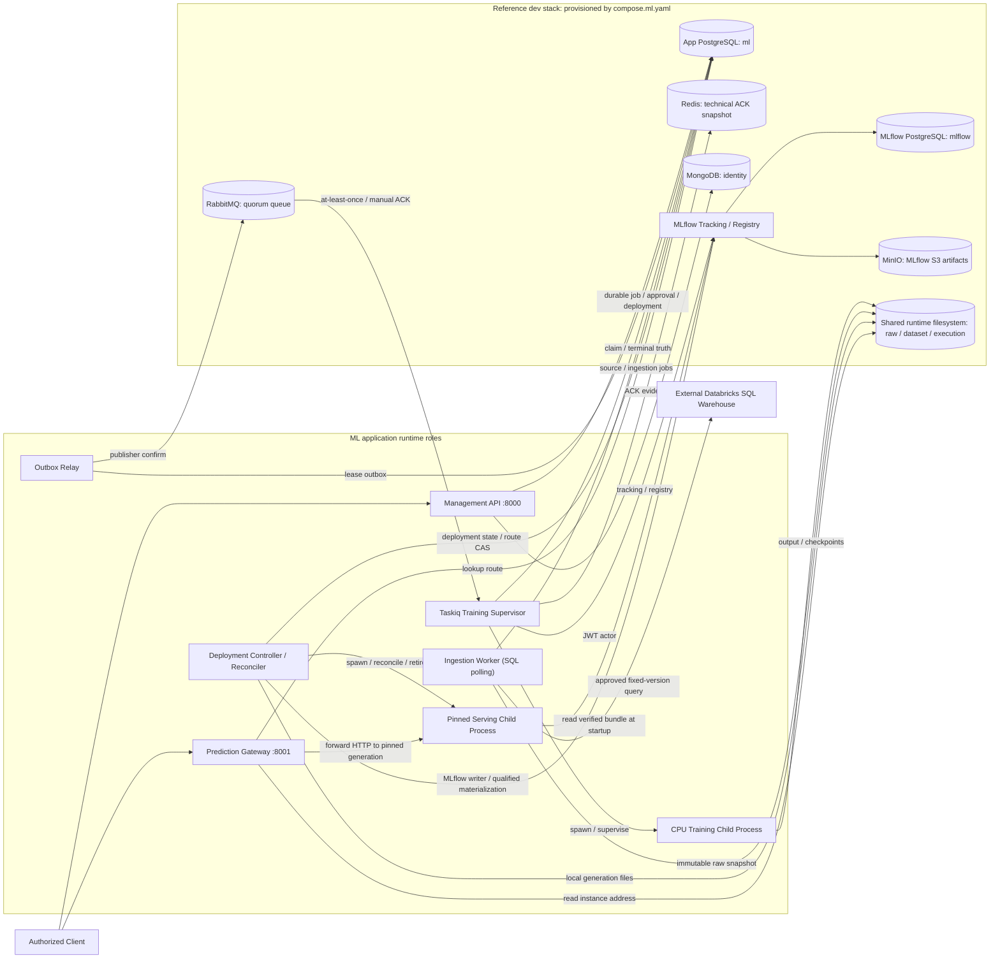

# ML System — 子系統、部署角色與資料所有權（現行實作）

> **Scope / source of truth:** 依 `master` 的 `ce81327fd8bf2908dc0d3dec2c0efb67e04b1612`（2026-11-16 審閱）整理，含已合併的 [PR #5](https://github.com/PenHsuanWang/ml-system-prod/pull/5)。本頁是**現行 CPU MVP 的元件導覽**，不是 production 已通過驗收的證明。變更部署設定後，應優先重新核對本頁與原始程式碼。
>
> **Canonical configuration:** [開發參考堆疊](../compose.ml.yaml)／[Ingestion 疊加檔](../compose.ml.ingestion.yaml)／[Databricks 疊加檔](../compose.ml.databricks.yaml)／[外部基礎設施正式部署候選檔](../compose.ml.external-mlflow.yaml)。一般 Python Backend Template 的 [compose.yaml](../compose.yaml) 是**另一套基線**，不可當作 ML 系統部署圖。
>
> **Status authority:** [Implementation status](implementation-status.md) 記錄測試證據與未完成事項；[Day-1 runbook](deployment/day1-deployment-runbook.md) 定義外部服務資格驗證與 Go/No-Go；[HLD](pytorch-ml-system-hld.md)／[LLD](pytorch-ml-system-lld.md) 與 [C4 圖](diagrams/ml-system-c4/) 為較完整設計視角，圖上標示的 *design proposal* 不可直接當作正在執行的 topology。

## 1. 平台定位與部署邊界

這是一套由相同 Python codebase／distribution 組裝的**多個獨立執行程序與部署角色**。它使用 Domain、Application、Infrastructure 與 Bootstrap/Plugins 邊界，**並非每個邏輯模組都有自己獨立的資料庫、發布生命週期或自治 microservice**。ML Application PostgreSQL 是多個角色共用的業務權威來源。

- **Control plane:** Management API、Outbox Relay、Controller／Reconciler、Prediction Gateway。
- **Training plane:** RabbitMQ + Taskiq Supervisor + 隔離的 CPU PyTorch training child process。核准 workload 的 Recipe→Handler mapping 是靜態、受信任的註冊，不是動態第三方 plugin loading。
- **Data ingress:** 獨立 Ingestion Worker，以 SQL Job polling 執行 File Batch／Databricks SQL Warehouse Batch，發布不可變 RawSnapshot；不使用 Training RabbitMQ queue 代替其 SQL Job。
- **Serving plane:** Controller 依受審核的 DeploymentSpec 啟動獨立 Serving **子程序**；Gateway 按權威 route 與本機 instance 資訊轉發，不在每次請求解析 MLflow latest/alias。

## 2. 現行元件拓撲（邏輯依賴，不代表生產站台已建置）

**讀圖限制：** 本圖同時展示開發用自帶 dependencies 與 application runtime 的相依關係。**外部正式部署候選模式不建立右側 PostgreSQL、RabbitMQ、Redis、MongoDB、MLflow、MinIO 容器**，而是透過核准的外部端點與角色設定接入。DatasetBuilder 為明確 operator action，不是 Ingestion Worker 到 Training Supervisor 的自動箭頭。

## 3. Runtime roles／可部署程序

| Role / 入口 | 類型與主要責任 | 主要依賴 / 讀寫 |
| --- | --- | --- |
| `management` — `bootstrap.ml_api:create_app` | 長駐 FastAPI；Job 提交／查詢、Dataset、Registry、Evaluation／Approval、Deployment、Ingestion APIs；身份授權 | App PostgreSQL、Mongo Identity；Ingestion source configuration |
| `relay` — `bootstrap.ml_cli relay` | 長駐 Outbox Relay；原子 Job+Outbox 提交之後，lease、重試並 publish command | App PostgreSQL → RabbitMQ |
| `supervisor` — `bootstrap.ml_worker:broker` | 長駐 Taskiq Receiver；SQL claim/ownership、啟動／監督 Training Child、回寫 terminal evidence，滿足 ACK 前提 | RabbitMQ、App PostgreSQL、Redis、MLflow、shared runtime |
| `control` — `bootstrap.ml_cli control` | 長駐 Controller/Reconciler；過期 execution、Deployment desired/observed state、啟動／退休 Serving generation、路由 fencing | App PostgreSQL、MLflow、shared runtime / process identity |
| `gateway` — `bootstrap.ml_gateway:create_app` | 長駐 Prediction ingress；JWT、租戶/endpoint route lookup、查找 controller-owned local address、HTTP proxy | Mongo Identity、App PostgreSQL、shared runtime、Serving process |
| `ingestion-worker` — `bootstrap.ingestion_cli work` | 長駐 SQL-polling worker；受控 Batch source 執行、RawSnapshot immutable publication／recovery | App PostgreSQL、shared raw storage、File source 或 Databricks |
| `migrate` — `bootstrap.ml_cli migrate` | **一次性** Alembic migration；成功退出不應視為服務缺失 | App PostgreSQL |
| `operator` — `bootstrap.deployment_cli` / `bootstrap.ingestion_cli` | **按需／ops profile**；preflight、外部 MLflow qualification、source registration 等受授權操作 | 依操作項目而定，不是第七個長駐服務 |
| Training Child — `bootstrap.ml_training_runner` | Supervisor 啟動之隔離 CPU process；依靜態批准 Workload Handler 執行 MLP/EBM training | 固定 DatasetVersion／shared runtime；結果由 Supervisor 收斂 |
| Serving Child — `bootstrap.ml_serving` | Controller 啟動之獨立版本固定 process；啟動時核驗 spec/image/model bundle；獨立處理 inference | Verified artifact、受信任的 DeploymentSpec、JWT identity |

**關鍵區分：** Production candidate 有 **6 個長駐 Compose role**（含 Ingestion），另有 `migrate` 與 `operator` 一次性角色；Training 與 Serving Child 不應誤標成固定的 Compose service。開發參考堆疊預設沒有 Ingestion，需加 [overlay](../compose.ml.ingestion.yaml) 與 `--profile ingestion`。

## 4. 基礎設施／資料庫／訊息的權威來源

| 元件（dev service） | 所有權與用途 | 明確不可假設 |
| --- | --- | --- |
| `postgres` / `ml` DB | **應用業務真相**：TrainingJob、Attempt、Idempotency Key、Outbox、DatasetVersion metadata、Evaluation、Approval、Deployment、Routes、Ingestion Source/Job metadata 等；Alembic 管理 | MLflow Registry 和 Redis 不取代 Job / Approval / route truth |
| `mlflow-db` / `mlflow` DB | **MLflow 自有 backend metadata**：experiments、runs、registered models；由 MLflow 自行管理其 schema | 不由 application 直接查改 MLflow 私有 SQL tables；與 App DB 分開備份及 migration ownership |
| `rabbitmq` | Training Command broker；Taskiq quorum durable queue、publisher confirm、mandatory return、manual consumer ACK、at-least-once redelivery | **不是 exactly-once**；目前 [queue topology](../src/infrastructure/messaging/ml_topology.py) 未配置 Dead Letter Exchange / DLQ binding；Outbox 的 `DEAD` 狀態不等於 RabbitMQ DLQ |
| `redis` | Training ACK 技術證據／部分通用 Backend snapshot/lease adapter；短期 technical state | 不是永久 Job history 或 App DB。Dev Compose 啟用 AOF，但未為 Redis 配獨立 named volume；不能視為已完成 DR/持久性保證 |
| `mongo` | 既有 Identity 帳號、JWT actor lookup、權限／身份管理 | 不是 ML Job、Model 或 Route 的權威儲存 |
| `mlflow` | Experiment tracking、Registry、model versions 與 artifact access；與 Application approval binding 分工 | 已註冊 ≠ 已批准或 ACTIVE；推論不在每個 request 查詢 latest model |
| `minio` | **開發參考**的 S3-compatible MLflow artifact store，保存 weights/manifests 等 MLflow artifacts | 外部正式部署 profile **不會**啟動 MinIO；用外部 MLflow Artifact Proxy，需驗證 reader/writer 權限 |
| `./var` / `ML_RUNTIME_ROOT` shared filesystem | 不可變 dataset snapshots、RawSnapshots、execution/checkpoint/Serving generation local evidence | 與 MLflow metadata、S3 artifact bytes 不同；需要共同備份、權限、原子性與 restore 驗證 |

重要程式依據：[SQL schema](../src/infrastructure/persistence/ml_database.py)、[Outbox](../src/infrastructure/persistence/ml_outbox.py)、[Queue Topology](../src/infrastructure/messaging/ml_topology.py)、[RabbitMQ Publisher](../src/infrastructure/messaging/ml_rabbitmq.py)、[Taskiq Receiver](../bootstrap/ml_worker.py)、[Mongo Identity](../src/infrastructure/ml_identity.py)、[Deployment Routes](../src/infrastructure/persistence/ml_deployments.py)、[MLflow Adapter](../src/infrastructure/mlflow/tracking.py)、[RawSnapshot Store](../src/infrastructure/ingestion/storage/raw_snapshot_writer.py)。

## 5. 五條實際操作流程

### A. Durable Training

1. Client → Management `POST /api/v1/training/jobs`（JWT、tenant、recipe/dataset、`Idempotency-Key`）。
2. Management → App DB：在 transaction 內建立 Job/Attempt、idempotency 與 Outbox；**不是直接以 HTTP 提交後盲送 RabbitMQ**。
3. Relay → App DB lease outbox → RabbitMQ confirmed publish；失敗有 bounded retry，可能重複發布。
4. Taskiq Supervisor ← RabbitMQ → App DB atomic claim／ownership → 啟動 CPU Training Child。PR #5 的 `workload_for_spec()` + `TRAINING_HANDLERS` 僅允許核准 Recipe/Workload，未註冊即 fail closed。
5. Supervisor 協調 tracking／registry、持久 terminal Job evidence → Redis ACK technical snapshot → RabbitMQ manual ACK。失敗與 lost execution 透過 Controller 的 bounded reconciliation 處理。

### B. Raw acquisition → explicit EBM DatasetBuilder

1. 已核准 SourceDefinition／Batch Job 經 Management 或 operator 入口寫入 App DB。
2. Ingestion Worker SQL polling／claim；執行 File Batch 或固定版本 Databricks SQL Warehouse Batch。
3. 寫入 staging → 驗證 digest 與 manifest → immutable RawSnapshot publication → SQL `PUBLISHED`。
4. **明確 operator 動作**：以指定 `raw_snapshot_id + manifest_digest` 的 FDC／Wafer Snapshot Set 呼叫 [EBM DatasetBuilder](../src/application/datasets/builder.py)，產出 Feature Snapshot／DatasetVersion；之後才提交 Training。
5. **不存在**自動 `Ingestion PUBLISHED → DatasetBuilder → Training` orchestration；也沒有 Kafka Streaming Adapter。

詳見 [Data Ingress implementation](data-ingress-implementation.md)、[Databricks runbook](databricks-ingestion-runbook.md)、[EBM implementation status](ebm-implementation-status.md)。

### C. Evaluation / human approval

Training 產生 immutable model bundle 與 MLflow metadata；Evaluator 對**相同 bundle**進行評估，將結果持久化於 App DB。必須由具權限人員對指定 evaluation／model binding 執行 manual approval。MLflow registry 或 alias 不能替代 approval；缺乏經核定的 EBM quality policy 時不應宣稱可批准正式 model。

### D. Deployment / rollback

Management 建立指向已批准 model 的固定 Deployment；Controller 對帳準備程序、artifact digest、readiness 與路由 revision。成功後 App DB route 的 CAS 決定 ACTIVE generation；失敗時需保護既有健康路由。Rollback 建立新的 Deployment/Generation，不能只覆寫 mutable alias。Serving Slot 是容量保留，不是路由鍵；Gateway 使用的是 Deployment ID。

### E. Online inference

Client → Gateway `POST /api/v1/prediction/predict`（JWT）→ Mongo 驗證 actor → App DB 以 `tenant_id + endpoint_id` 取得 route/`deployment_id` → Gateway 從 Controller 管理的 shared execution 目錄取得該 deployment local address → HTTP forward → 固定 Serving 子程序（已載入並核驗模型）→ 回應含 provenance。Dev/VM profile 的 Gateway 與 Controller 共享 network namespace，因此能存取本機 generation 位置；**此關係不可不經改造直接套用到多機/Kubernetes**。

程式入口：[Gateway](../bootstrap/ml_gateway.py)、[Controller](../bootstrap/ml_cli.py)、[LocalServingExecutor](../src/infrastructure/deployment/local_serving.py)、[Serving](../bootstrap/ml_serving.py)。

## 6. 部署情境不可混用

| 情境 | Source / Composition | Infrastructure | 對外入口 |
| --- | --- | --- | --- |
| Local fixture demo | `bootstrap.ml_cli demo` / `demo-ebm` | SQLite、local development tracker、synthetic data | CLI，不等同正式環境 |
| Dev reference | [`compose.ml.yaml`](../compose.ml.yaml) | 自建 PostgreSQL App/MLflow DB、RabbitMQ、Redis、MongoDB、MLflow、MinIO；預設五個長駐 ML roles | Loopback `127.0.0.1:8000` Management；`127.0.0.1:8001` Prediction |
| Dev + Batch Ingestion | Dev + [Ingestion overlay](../compose.ml.ingestion.yaml) + [Databricks overlay](../compose.ml.databricks.yaml)（或 [Token alternative](../compose.ml.databricks-token.yaml)） | 增加 `ingestion-worker`，核准 host source / Databricks config | 同上；Databricks 外部連線另行驗證 |
| External-services production **candidate** | [`compose.ml.external-mlflow.yaml`](../compose.ml.external-mlflow.yaml) **獨立運行，不和 dev Compose 合併** | operator-managed PostgreSQL、Mongo、RabbitMQ、Redis、HTTPS MLflow/Artifact Proxy、approved secrets，單一 host/VM shared runtime | Host loopback 管理／預測埠，外部 TLS ingress 由部署團隊另外管理 |

**重要限制：** 目前 local/VM Controller 透過本機受控 process 與 shared execution filesystem 維持 Serving；不是 Kubernetes Deployment/Service、也不是多 host runtime。正式部署需核准 image digest、schema migration、RBAC、TLS、MLflow reader/writer、Databricks live fixture、backup/restore、容量及 SLO/RPO/RTO。開發 CI 綠燈不是 production Go。

## 7. 程式碼與設計文件索引

| 讀者要確認什麼 | 最適合入口 |
| --- | --- |
| 整體設計與完整 C4 L1～L4 / Dynamic / Deployment 圖 | [HLD](pytorch-ml-system-hld.md)、[C4 L2](diagrams/ml-system-c4/02-c4-l2-containers.svg)、[LLD](pytorch-ml-system-lld.md) |
| Domain 與應用服務分層 / DI | [src/domain](../src/domain)、[src/application](../src/application)、[bootstrap/ml_wiring.py](../bootstrap/ml_wiring.py)、[Boundary checker](../scripts/check_boundaries.py) |
| Training broker / Outbox / Idempotency | [RabbitMQ topology](../src/infrastructure/messaging/ml_topology.py)、[Outbox Relay](../src/application/training/outbox.py)、[Supervisor](../src/application/training/supervisor.py) |
| 新增 ML workload | [Workload Extension Contract](workload-extension-contract.md)、[Approved Contracts](../src/domain/training/workloads.py)、[Training handlers](../bootstrap/ml_training_runner.py) |
| Dataset / Ingestion / Databricks / Builder | [Data Ingress](data-ingress-implementation.md)、[Databricks Runbook](databricks-ingestion-runbook.md)、[EBM Build](ebm-implementation-status.md) |
| Rollout, Serving 與 source-verified routing | [Deployment service](../src/application/deployments/service.py)、[Routes](../src/infrastructure/persistence/ml_deployments.py)、[Gateway](../bootstrap/ml_gateway.py) |
| 現行測試基線、未完成工作與生產驗收 | [Implementation status](implementation-status.md)、[Day-1 runbook](deployment/day1-deployment-runbook.md)、[Day-2 runbook](ml-runbook.md)、[CI](../.github/workflows/ml-ci.yml) |

## 8. 明確未完成／尚未驗證

- **未實作範圍：** Kafka Streaming Adapter、automatic ingestion→DatasetBuilder→Training、Databricks Remote Executor、CalibrationSnapshot / calibrated Energy-RUL、Batch Report Store、rolling-origin/as-of qualification；GPU／DDP／HPO／Kubernetes 與 multi-host runtime 不在 CPU MVP。
- **已實作但尚未完成外部站台資格驗證：** 真實受保護 Databricks SQL Warehouse、外部 MLflow 的 TLS/RBAC/Artifact Proxy、站台 RabbitMQ/DB/Storage、實際模型品質、load/capacity、運維備份與 restore。
- **現行 transport 邊界：** RabbitMQ quorum queue 已建立，但不能把 Outbox DEAD retry status 說成 broker DLQ；若需要 broker-level dead-letter policy，須另行設計、設定與測試。
- **驗收證據具有版本性：** [Implementation status](implementation-status.md) 中的 2026-11-10 合格測試數字屬於指定 SHA，不應無條件套用到較新的 PR #5 或真實 production release。PR #5 的 workload dispatch 測試結果與 CI 記錄應分開追溯。

**文件維護規則：** 新增或刪除部署角色、storage authority、queue topology、Workload Handler、Compose overlay 或 rollout routing 時，需在同一個 PR 更新本表、README 入口、相關 runbook 與 C4 圖，並明示是 `IMPLEMENTED`、`PROPOSED` 還是 `QUALIFICATION PENDING`。
