# Feature Specification: Durable Training Jobs

> **Spec ID**：ML-SPEC-001  
> **版本**：0.2（Review Reconciliation）
> **修訂日期**：2026-10-29  
> **狀態**：Draft — 待需求、API 契約及驗收者審查；尚未實作／未驗證  
> **日期**：2026-10-28  
> **Owner（建議）**：Backend / ML Platform  
> **架構依據**：PyTorch ML System HLD §5–10；LLD §2–6、§15（PyTorch Runner 為 ML-SPEC-003 範圍）  
> **相依 Spec**：無（可使用受控 stub executor 驗證 Job Lifecycle）  
> **後續相關 Spec**：ML-SPEC-002 Dataset & Recipe；ML-SPEC-003 PyTorch Runtime

## 1. Problem Statement

### 1.1 問題

Data Scientist 需要透過 API 提交長時間模型訓練工作，不能因 HTTP 斷線、使用者重送請求、訊息重送或 Worker 異常而失去 Job 記錄、啟動多次同一訓練，或將尚未完成的工作顯示為成功。現有通用 Backend Template 提供 HTTP 與背景 Job 基礎，但不等於已具備持久的 ML TrainingJob 業務生命週期。

### 1.2 Intended Outcome

使用者能以可追溯、具授權與冪等保證的方式提交、查詢、取消一項 Train Job；即使處理程序異常，系統依可驗證的執行證據保持狀態正確，且對重複請求不產生重複工作。

### 1.3 In Scope

- 受權限保護的 Train Job submit/query/cancel/attempt history。
- 固定 TrainingSpec 的識別、完整性與不可變承諾。
- Job、Attempt、Command 的識別與狀態機。
- 冪等提交、同時提交競爭、持久工作接受及安全發布。
- 至多一個有效 Execution Owner、重送與終態防覆寫。
- 取消意圖、確認停止、未知狀態對帳與安全失敗表示。
- Tenant/Owner 授權與可稽核的狀態查詢。

### 1.4 Out of Scope

- 真正的 PyTorch NN 建構、Training Loop 與 GPU 排程（ML-SPEC-003）。
- Dataset/Recipe 的具體產生與訓練資料切分（ML-SPEC-002）；本 feature 使用已核准、固定的參照。
- MLflow Tracking、Artifact、Model Registry（ML-SPEC-004/005）。
- 模型 Promotion、Deployment 與 Inference（ML-SPEC-005～007）。
- 自動 HPO、多階段 DAG、分散式 Training、跨叢集的 Autoscaling。

## 2. Actors and User Scenarios

### US-001 — 安全提交一筆訓練工作（P1）

作為具有 Training 權限的 Data Scientist，我希望提交版本化訓練意圖並立刻取得工作識別，從而能在訓練執行期間持續使用 API 而不等待 Training Loop 完成。

**Independent Test**：使用核准的 Dataset／Recipe stub 與受控 Job Consumer 替身，即可驗證 API 與持久化契約。

**Acceptance Scenarios**：

1. **AS-001A**：Given 已驗證且具有 `ml:train` 權限的使用者、核准的 Recipe/Dataset/Resource Profile，When 提交合法且帶有效 Idempotency-Key 的訓練意圖，Then 系統回應 `202 Accepted`、不可變 `job_id` 及可查詢的 `status_url`，並持久記錄工作及至少一個待執行 Attempt。
2. **AS-001B**：Given 訓練意圖含未核准的 Recipe、任意程式路徑或無效 hyperparameter，When 提交，Then 系統拒絕且不接受新 Job，也不調派運算。
3. **AS-001C**：Given 工作接受完成但 Broker 暫時不可用，When API 提交完成，Then 已接受 Job 不遺失，並仍可查詢到尚未完成發布的狀態；不虛報已開始訓練。
4. **AS-001D**：Given 應用的權威持久儲存無法確認提交結果，When API 收到提交，Then 不宣稱 Job 已成功接受；使用者可以沿用同一冪等鍵安全重試或查詢。

### US-002 — 重試與並行提交不重複工作（P1）

作為提交端，我希望在 HTTP timeout 後重送相同 Request，不會因重送造成第二次訓練或產生不同的 Job ID。

**Independent Test**：同時啟動兩個提交端、模擬回應遺失與訊息重複傳送。

**Acceptance Scenarios**：

1. **AS-002A**：Given 相同 Tenant、Actor、Operation 與 Idempotency-Key，When 重送語意相同的請求且仍在有效保留期間內，Then 返回原先的 `job_id`，且只有一筆邏輯 Job。
2. **AS-002B**：Given 相同 scope 與 Idempotency-Key，When 第二次提交不同的有效訓練意圖，Then 拒絕並回傳衝突語意（HTTP `409`），不得修改原 Job。
3. **AS-002C**：Given 兩個並行請求使用相同 key／相同 payload，When 同時提交，Then 最終只有一個已接受的 Job、單一初始 Attempt 和對應的穩定發布意圖。
4. **AS-002D**：Given 原 Job 已接受但 API 回應在網路中遺失，When Client 重送相同請求，Then 能重新取得同一 Job 身份，而不是重新訓練。

### US-003 — 查詢 Job 與 Attempt 的真實狀態（P1）

作為工作擁有者，我希望查詢工作的狀態、階段、執行次數、錯誤與結果參照，而不是收到只能代表 Broker 投遞的暫時性快照。

**Acceptance Scenarios**：

1. **AS-003A**：Given 既有 Job，When 授權 Actor 查詢，Then 返回 Job ID、狀態、目前 Attempt、phase、必要時間戳及安全的結果參照。
2. **AS-003B**：Given 同一 Tenant 但非擁有者、且沒有被授權讀取該 Job 的 Actor，When 查詢，Then 不得揭露 Job 內容或其存在細節（已認證但無法存取此特定 Job 時固定回應 `404 Not Found`，不揭露資源是否存在）。
3. **AS-003C**：Given Job 的運算進度尚未確定，When 查詢，Then 只呈現已持久化／可對帳的狀態，不假報完成、取消或模型已註冊。
4. **AS-003D**：Given 某 Job 曾安全進行多次 Attempt，When 授權 Actor 查詢 Attempt History，Then 按序可見每一次 Attempt 的身份、狀態與安全摘要，而不是把所有 Attempt 合併為一筆。

### US-004 — 安全取消（P1）

作為授權操作人員，我希望在工作尚未啟動或已執行時請求取消，且系統只在真實停止後宣稱已取消。

**Acceptance Scenarios**：

1. **AS-004A**：Given Job 尚未啟動，When 授權 Actor 請求取消，Then 系統持久保存取消意圖並阻擋其被新 Worker 領取，於確認無執行活動後進入 `CANCELLED`。
2. **AS-004B**：Given Job 正在執行，When 發出取消請求，Then 先顯示 `CANCEL_REQUESTED`；只有運算確實停止、資源清理得到確認後才顯示 `CANCELLED`。
3. **AS-004C**：Given 停止執行的結果不確定，When Cancel Process 完成其等待／確認階段，Then 工作保持可對帳的不確定狀態，不假稱資源已釋放或進入 `CANCELLED`。
4. **AS-004D**：Given Job 已是不可逆終態，When 取消到達，Then 不得將該終態覆寫；依公開契約回傳已終結狀態／衝突語意。

### US-005 — 訊息重送與 Worker 異常仍保持一致（P1）

作為平台維運人員，我希望 Broker 重送與 Worker crash 不會造成同一 Attempt 同時由多個有效執行者運作，或導致終態遭覆寫。

**Acceptance Scenarios**：

1. **AS-005A**：Given 相同的穩定 Command 重複被投遞，When 多個 Worker 競爭執行，Then 最多一個有效 Owner 得到執行資格；其餘不得執行相同 Attempt 的副作用。
2. **AS-005B**：Given Job 已提交為 `SUCCEEDED`、`FAILED` 或 `CANCELLED`，When 過期 Worker／重送 Command 回報舊狀態，Then 原終態維持不變。
3. **AS-005C**：Given Worker 異常消失但其外部執行程序可能仍活著，When Ownership 超過觀測期限，Then 系統進入需對帳狀態，而非直接啟動新運算或宣稱舊運算已停止。
4. **AS-005D**：Given 工作結果已持久完成而確認訊息失敗，When Command 重新投遞，Then Consumer 根據已提交的業務結果安全收斂，不重新啟動相同 Attempt。

## 3. Functional Requirements

| ID | Priority | Normative requirement | Acceptance coverage |
| --- | --- | --- | --- |
| FR-001 | MUST | 僅授權且具 `ml:train` 能力的使用者能接受新 Training Job | AS-001A, AS-003B |
| FR-002 | MUST | 接受 Job 時產生固定 `job_id` 與可讀取狀態的參照，不等待 NN 運算完成 | AS-001A |
| FR-003 | MUST | 同 scope、同冪等鍵及同一語意請求在保留期間內指向單一 Job | AS-002A, AS-002C, AS-002D |
| FR-004 | MUST | 同 scope／key 不同語意請求回報衝突，不更改原 Job | AS-002B |
| FR-005 | MUST | 每個已接受 Job 必須有已持久保存的不可變訓練規格、初始 Attempt 與可恢復的發布意圖 | AS-001A, AS-001C, AS-001D |
| FR-006 | MUST | 新 Job 不得接受任意程式碼、未核准資源或非法訓練意圖 | AS-001B |
| FR-007 | MUST | Job、Attempt、取消意圖及執行狀態可由持久的權威資料查詢，不能僅依暫時快取推斷 | AS-003A, AS-003C, AS-003D |
| FR-008 | MUST | 查詢、取消、Attempt 查詢需驗證租戶／擁有者／必要權限；拒絕跨租戶資料洩漏 | AS-003B, AS-004A |
| FR-009 | MUST | 同一 Job／Attempt 同時最多一個有效運算 Owner，重送不自動增加 Attempt | AS-005A, AS-005C |
| FR-010 | MUST | 取消先保存意圖，未驗證運算停止不得報 `CANCELLED` | AS-004A, AS-004B, AS-004C |
| FR-011 | MUST | `SUCCEEDED`、`FAILED`、`CANCELLED` 是不可被晚到更新覆寫的終態 | AS-004D, AS-005B |
| FR-012 | MUST | 外部狀態不確定時保留可對帳資訊，不盲目重啟運算或宣稱成功 | AS-005C, AS-005D |
| FR-013 | MUST | API／Broker 部分失敗後能安全恢復；不得因發布訊息不確定而建立第二份邏輯工作 | AS-001C, AS-002D, AS-005D |
| FR-014 | MUST | Actor 可查詢每個 Attempt 的獨立身份、階段與安全結果摘要 | AS-003D |
| FR-015 | MUST | 只有有證據證明業務狀態已持久化及後續安全恢復契約成立，才能將該命令標記為已安全完成 | AS-005B, AS-005D |

## 4. Domain State Model

> SVG 為重點轉換示意；下方 Mermaid 與狀態／事件契約才是完整的權威定義。

```mermaid
stateDiagram-v2
  [*] --> ACCEPTED
  ACCEPTED --> QUEUED: publish acknowledged
  ACCEPTED --> RUNNING: worker claimed before relay update
  ACCEPTED --> FAILED: post-accept rejection / queue deadline
  QUEUED --> RUNNING: active owner acquired
  QUEUED --> FAILED: queue deadline
  RUNNING --> SUCCEEDED: durable output commit
  RUNNING --> FAILED: confirmed final failure
  RUNNING --> RETRY_WAIT: retryable failure and old owner closed
  RETRY_WAIT --> QUEUED: safe next attempt published
  RETRY_WAIT --> RUNNING: next attempt claimed
  RETRY_WAIT --> FAILED: final deadline or retries exhausted
  ACCEPTED --> CANCEL_REQUESTED
  QUEUED --> CANCEL_REQUESTED
  RUNNING --> CANCEL_REQUESTED
  RETRY_WAIT --> CANCEL_REQUESTED
  CANCEL_REQUESTED --> CANCELLED: execution stopped / never started
  RUNNING --> NEEDS_RECONCILIATION: ownership or output uncertain
  CANCEL_REQUESTED --> NEEDS_RECONCILIATION: stop unconfirmed
  NEEDS_RECONCILIATION --> RUNNING: execution confirmed active
  NEEDS_RECONCILIATION --> CANCEL_REQUESTED: cancel intent still active
  NEEDS_RECONCILIATION --> RETRY_WAIT: old execution stopped; retry safe
  NEEDS_RECONCILIATION --> SUCCEEDED: output commit confirmed
  NEEDS_RECONCILIATION --> FAILED: final failure confirmed
  NEEDS_RECONCILIATION --> CANCELLED: stop confirmed
  SUCCEEDED --> [*]
  FAILED --> [*]
  CANCELLED --> [*]
```

此圖是外部可觀察與跨角色狀態契約；每一轉換的實作方法由 LLD／Plan 定義。`ACCEPTED → FAILED` 僅代表接受後期限／執行資格失效，不代表原始無效請求可先被接受。`RETRY_WAIT → RUNNING` 須具備安全建立下一個 Attempt 與取得有效 ownership 的證據。`CANCELLED` 必須有真實停止證據。

**M1 測試與正式成功語意**：本 Feature 可使用受控 Fake Executor，並以 test-only Fake Evaluator／Registry 的同型態結果驗證完整 `TrainingJob.SUCCEEDED` 不變量；若尚未提供完整證據，則只能確認 `TrainingAttempt`／中間運算階段完成，不能將正式 Job 標成 `SUCCEEDED`。這不代表此 Spec 要實作真實 MLflow。

### 4.1 Invariants

| ID | Invariant | Verification |
| --- | --- | --- |
| INV-001 | 同一有效冪等 Scope/Key 只對應一個 Job | 持久權威儲存的併行競爭、API 重送測試 |
| INV-002 | 已接受 Job 的 TrainingSpec 永遠不被使用者提交或背景更新覆寫 | Schema/Domain 契約測試 |
| INV-003 | 同一 Job 最多一個有效 Attempt Owner | 兩 Consumer 並行測試 |
| INV-004 | 同一 Attempt 的 Command 重送不會建立新 Attempt | Broker redelivery integration |
| INV-005 | 終態不可返回非終態；任何過期 revision/owner 更新被拒絕 | Race/late result tests |
| INV-006 | 未確認停止時不能標 `CANCELLED`、釋放假資源或重新啟動同一 Attempt | Cancel/Lost executor tests |
| INV-007 | MLflow Run、Broker Job、TrainingJob、Attempt ID 不可混用 | Domain/schema validation |
| INV-008 | 在無明確 durable recovery evidence 前，不得將含外部副作用的工作誤認為安全完成 | Worker ACK gate integration |

## 5. Public API Contract (externally observable)

> Base path 以下依目前 LLD 定義；正式實作仍須使用 OpenAPI／Contract Test 鎖定 Route Prefix。Manager API 不等於 Model Serving API。

| Operation | Path | Success | Error classes | Authorization |
| --- | --- | --- | --- | --- |
| Submit | `POST /api/v1/training/jobs` | `202` + job identity/status URI | `400/422` invalid intent；`401/403` no access；`409` idempotency conflict；`503` accept durability unavailable | `ml:train` |
| Query | `GET /api/v1/training/jobs/{job_id}` | `200` job/attempt/phase/safe refs | `401` 未認證；已認證但無權讀特定 Job 或跨租戶均回 `404` | scoped read |
| Attempts | `GET /api/v1/training/jobs/{job_id}/attempts` | `200` attempt history | `401` 未認證；已認證但不可見的 Job 回 `404` | scoped read |
| Cancel | `POST /api/v1/training/jobs/{job_id}/cancel` | `202` cancel intent accepted | `401` 未認證；跨租戶／不可見 Job 回 `404`；可見但無取消權限回 `403`；具權限但狀態衝突回 `409` | owner / operator |

**Submit** 必須帶有效 `Idempotency-Key`；`spec` 是使用者意圖（受控 Recipe、Dataset、Architecture、Hyperparameters、Resource Profile）而不是任意 Python 物件。成功時以 `job_id`、`status_url` 及當下已持久可確認的 `state` 回應。

### 5.1 Idempotency policy

- Scope：`tenant_id + actor_id + operation + idempotency_key`；此 Scope 不可跨使用者或跨租戶共用。
- **Request Fingerprint（可觀察語意）**：將已通過型別檢查的**使用者公開訓練意圖**依固定版本的欄位定義進行正規化（鍵值順序、規格版本、已定義的預設值與等價數值表示），並排除 Server 後續產生且可能變動的執行環境欄位。相同的正式意圖必須有相同結果，使用者不得用會浮動的 `latest` 取代明確 Recipe／Dataset 版本。
- 同一 scope/Key／同一 canonical request fingerprint：有效保留期間返回同一 `job_id`；既有 Job 的固定執行規格不因新部署或 Recipe 設定改變而變更。
- 同一 scope/Key／不同 request fingerprint：`409 Conflict`，原 Job 不變。
- **Execution Spec Digest（不同用途）**：首筆接受時綁定經核准且已解析的完整、不可變訓練規格；它供可重現性／執行一致性使用，**不可用它取代 API 冪等指紋比對**。
- Key Retention 以**初次成功接受時間**開始計算，重送不延長保留期。**24 小時為待核准的預設提案，並非正式承諾**；過期後沿用相同 Key 可能建立新 Job，應使用原 `job_id` 查詢歷史工作。實際保留期與過期行為須在受控 Pilot 前由 Product／Platform 核准並測試。
- 認證／授權狀態變動時，重送不得繞過當下的存取檢查；拒絕請求不得意外產生尚未承諾的 Job；網路回應遺失不得造成雙重接受。

## 6. Key Entities

| Entity | Identity | Important semantics |
| --- | --- | --- |
| TrainingJob | `job_id` | 一次邏輯提交，保存不可變 TrainingSpec、權限、狀態及修訂 |
| TrainingAttempt | `attempt_id` | 一次真實執行嘗試，固定 Job 所屬、owner、進度和終結證據 |
| TrainingSpec | schema version + execution spec digest | 已確認的資料／recipe／資源意圖與固定後端版本參照，不可變；與提交請求指紋分離 |
| Idempotency Record | tenant + actor + operation + key | Scope、request fingerprint、原始 Job mapping、保留期限 |
| Training Command | stable `command_id` | 一次可重送的交付意圖，不等於新的 Job/Attempt |
| Execution Ownership | attempt + owner generation | 決定誰可以回報狀態與提交結果；過期 owner 不可覆寫 |
| Job Audit Event | event identity | 記錄 actor、action、subject、可安全展示的狀態差異 |

## 7. Non-functional Requirements

### 7.1 Security & isolation

- **NFR-SEC-001**：所有操作都必須執行 Actor/Tenant/Permission Scope；不得因知道 ID 便查到他人 Job。
- **NFR-SEC-002**：對外錯誤／Audit／Log 不含 Secret、完整 Token、不可信任的 raw model payload 或他人資料。
- **NFR-SEC-003**：外部 Request 不可指定任意可執行程式、Host Path、GPU Device ID 或非核准的 Recipe/Resource Profile。

### 7.2 Reliability

- **NFR-REL-001**：API Response 丟失、重送、Broker 發布未知、重複 delivery、worker crash、cancel/complete race 均有可重現驗證情境。
- **NFR-REL-002**：持久記錄可在程序重新啟動後讀取；暫時快取遺失不得抹去已完成的 Job 事實。
- **NFR-REL-003**：只允許有證據的重試與狀態收斂；不宣稱 Exactly-Once Message Delivery。

### 7.3 Performance & operational gating

- **NFR-PERF-001**：提交 API 不同步等待訓練完成；為 Queue/Job Admission 定義有界積壓和拒絕語意。
- **NFR-PERF-002**：在進入受控 Pilot 前，Platform/PO 必須核准提交與查詢延遲分位數、最大 backlog、Idempotency Key 保留期、Recovery SLA、Job 排隊期限和容忍的重試上限，並提供真實環境量測。
- **NFR-OBS-001**：Job/Attempt/Command correlation 可從安全的 API 操作與受控維運記錄追溯；不對一般呼叫方暴露內部程式路徑或憑證。

## 8. Success Criteria

- **SC-001**：相同 Scope／Key／請求在有效期內連續或併行重送，結果恆為 **1** 個 Job；不同 fingerprint 的重送恆被拒絕。
- **SC-002**：兩個獨立 Worker 對同一 Attempt 競爭時，**有效 Owner 數 ≤ 1**，不會執行第二份相同 Attempt 的運算副作用。
- **SC-003**：提交後立即可查詢已接受 Job 的持久紀錄；在 Broker 暫時失效情境仍能觀測待發布狀態。
- **SC-004**：在已提交終態後執行 100 次重送與晚到更新的測試，**0 次**終態回退或被舊結果覆寫。
- **SC-005**：取消確認前 **0 次**錯誤宣稱 `CANCELLED`；若真實停止結果不明，記錄可對帳狀態。
- **SC-006**：跨租戶或未授權者讀取／取消他人工作，在角色與租戶矩陣涵蓋的所有測試中，**0 次**敏感資訊洩露或未授權狀態變更。
- **SC-007 (Release Gate)**：處理吞吐、Latency p95/p99、最大 backlog、Recovery SLA、Idempotency Retention 閾值在開始受控 Pilot 前被核准並以環境量測滿足。**目前尚未核定數值，不應視為已達標**。

## 9. Assumptions and Dependencies

- 現有 Template 仍被視為通用 Backend Foundation，ML 能力須由新應用明確選入。
- 訓練執行與 HTTP 管理面是不同 Runtime；本 feature 可先由受控 Fake Executor 驗證後，再交由 PyTorch Runtime Spec 接入。
- 產品會提供具權威性的持久 Job Repository、可靠發布與 Consumer 的測試環境；具體技術由 LLD 決定。
- 具體 Timeout、Retention、Retry 和 SLO 數值尚待產品／維運核准；在 Pilot 前屬 **blocking release gates**，不是留白即可忽略。
- 此 Spec 不代表現有 Repository 已完成持久 TrainingJob、Outbox、Atomic Claim 或 PyTorch Execution。

## 10. Requirement-to-Scenario Traceability

| Requirement | Acceptance scenarios | Required test type | Evidence state |
| --- | --- | --- | --- |
| FR-001, FR-002, FR-006 | AS-001A, AS-001B | API contract + domain policy | Pending |
| FR-003, FR-004 | AS-002A, AS-002B, AS-002C, AS-002D | API + durable DB concurrency | Pending |
| FR-005, FR-013 | AS-001C, AS-001D, AS-005D | Transaction + broker failure | Pending |
| FR-007, FR-014 | AS-003A, AS-003C, AS-003D | API + restart persistence | Pending |
| FR-008 | AS-003B, AS-004A | Security / tenant matrix | Pending |
| FR-009, FR-012 | AS-005A, AS-005C | Two-worker + lost execution | Pending |
| FR-010 | AS-004A, AS-004B, AS-004C | Cancel + process observation | Pending |
| FR-011 | AS-004D, AS-005B | Terminal state CAS + late message | Pending |
| FR-015 | AS-005B, AS-005D | Receiver/ACK integration | Pending |

## 11. Review Gate

此文件是 Draft。進入 Plan/Implementation 前，至少要完成：需求與狀態表審查、Idempotency 保留期限決策、錯誤／權限可見性確認、API Schema 定稿、所有 MUST 到測試的追溯、與 HLD/LLD 矛盾檢查，並核對目前 GitHub Actions 基線可作為可信任交付 Gate。
