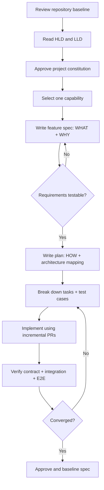

# PyTorch ML System — SDD Starter Kit

> 版本：0.2 · 2026-10-29 · 狀態：**Draft / Proposed（Review Reconciliation）**  
> 參照基線：[`pytorch-ml-system-hld.md`](../docs/pytorch-ml-system-hld.md)、[`pytorch-ml-system-lld.md`](../docs/pytorch-ml-system-lld.md)  
> 程式基線：[`python-backend-server-template`](https://github.com/PenHsuanWang/python-backend-server-template)  
> 注意：本套件為**依 Spec Kit 概念手工撰寫的 Markdown 起始文件**，並非已由 `specify` CLI 初始化、驗證或執行，也不宣稱任何 ML 元件已實作。

## 1. 目的與範圍

SDD 的規格應成為**實作前可審查、實作後可驗收**的行為契約。既有 HLD/LLD 不必被取代：

| 產物 | 用途 | 回答的問題 |
| --- | --- | --- |
| HLD | 平台範圍、角色、元件、資料流、決策 | 系統長什麼樣、各角色負責什麼？ |
| LLD | 分層、模組、Port、資料表、API、實現限制 | 技術上如何建？ |
| `constitution.md` | 所有 feature 必須遵守的全域原則 | 哪些規則不得違反？ |
| `spec.md` | 一個 capability 的行為、需求、邊界與驗收 | 使用者或其他服務應看到什麼？ |
| `plan.md`（下一步才建立） | spec 到 HLD/LLD 的技術實作映射 | 選用何種實作方案？ |
| `tasks.md`（下一步才建立） | 可拆分的程式與測試工作 | 誰需要完成哪些可驗證任務？ |
| `checklists/requirements.md` | Spec 品質閘門 | 規格是否可實作、可測試？ |

**重要：** `spec.md` 要描述 observable behavior、security、reliability、state invariants，而不是 class、database SQL、SDK function。確定的外部 API 協定可以放在 Spec；API 內部實作放在 Plan/LLD。

## 2. 推薦文件配置

```text
repo/
├── docs/
│   ├── ml-system-design.md
│   ├── pytorch-ml-system-hld.md       # 若要導入 repo，請自行移入 docs/
│   └── pytorch-ml-system-lld.md
└── specs/                              # 手動管理；或由 Spec Kit CLI 建立
    ├── constitution.md
    ├── templates/
    │   └── feature-spec-template.md
    ├── 001-durable-training-jobs/
    │   ├── spec.md
    │   ├── plan.md                    # 規格核准後產生
    │   ├── tasks.md                   # plan 核准後產生
    │   └── checklists/requirements.md
    ├── 002-datasets-and-recipes/
    ├── 003-pytorch-training-runtime/
    ├── 004-mlflow-tracking/
    ├── 005-evaluation-and-registry/
    ├── 006-model-deployment/
    ├── 007-model-serving/
    └── 008-reliability-observability/
```

此結構是**團隊自定義示例**，不是宣稱 GitHub Spec Kit 預設一定會使用 `specs/constitution.md`。若正式採用 Spec Kit，請以其 `specify init` 所生成的 `.specify/memory/constitution.md` 和 `specs/<feature>/` 結構為準；不要為了漂亮目錄結構和 CLI 自動管理的路徑衝突。

## 3. 文件撰寫順序



## 4. 八份 Feature Spec 的建議先後

| ID | Capability | 起步驗收 | 依賴 |
| --- | --- | --- | --- |
| ML-SPEC-001 | Durable Training Jobs | 提交、查詢、取消、冪等、單一 execution owner | 既有 Auth / Job API 基線 |
| ML-SPEC-002 | Dataset & Training Recipe | 只接受核准 dataset/recipe，確保不可變來源與無資料洩漏 | 001 的工作識別 |
| ML-SPEC-003 | PyTorch Training Runtime | 獨立進程、checkpoint、cancel、timeout、進度與恢復 | 001、002 |
| ML-SPEC-004 | MLflow Tracking & Artifact | Attempt 的參數／metrics／artifact 可追溯，失敗可對帳 | 003 |
| ML-SPEC-005 | Evaluation & Registry | 固定結果／模型版本、可審查、不得自動發布未核准版本 | 002～004 |
| ML-SPEC-006 | Deployment & Rollback | 固定版本、readiness、切流、保留健康舊版 | 005 |
| ML-SPEC-007 | Prediction Serving | 固定版本、輸入驗證、推論 provenance、資源容量 | 005、006 |
| ML-SPEC-008 | Runtime Reliability | 可觀測、故障收斂、容量與維運驗收 | 橫向支持其他 specs |

第 001 規格可以先以**不執行真 PyTorch**的受控測試替身驗證 durable job 行為；第 003～005 再加入真訓練與 MLflow。這是增量交付，不是降低第 001 對可靠性的要求。

## 5. Acceptance Contract 與 Traceability

每項需求至少具備：唯一 ID、可被理解的 MUST 行為、正常與失敗 scenario、測試方法；涉及跨模組行為時，plan 明確對到 LLD 章節。示意：

| Requirement | 可觀察行為 | Spec scenario | Plan | Test |
| --- | --- | --- | --- | --- |
| FR-003 | 重送相同 key + 相同內容回同一 Job | AS-002A, AS-002C, AS-002D | UoW/Idempotency Adapter，對應 LLD §3.3 | Unit + PostgreSQL concurrency |
| FR-004 | 相同 key + 不同內容拒絕 | AS-002B | Request fingerprint + constraint | API + DB |
| FR-009 | 重複 delivery 不啟動第二個有效 Attempt | AS-005A, AS-005C | Claim/CAS，對應 LLD §3.4 | 2-worker integration |
| FR-011 | 終態不可被晚到結果覆寫 | AS-004D, AS-005B | Expected revision + reconciliation | Race/contract |

若 performance／SLO 閾值尚未由需求方核定，應列為**受控 Pilot 前的未決驗收閘門**，不要虛構 99.9% 或固定毫秒數為已批准標準。

## 6. SDD Review Gate

1. Spec 不包含不必要的具體 Python class、DB SQL、程式碼路徑。
2. Actor、範圍、主流程、錯誤情境、權限、狀態不變量均有定義。
3. 每個 MUST 可以由 API、整合或 E2E 測試證明。
4. 與 HLD／LLD／既有 Template 不矛盾；矛盾時記錄 ADR 再變更規格。
5. 未完成、待驗證、待定值明確標註；沒有把設計當作已完成部署證據。
6. PR 含需求到測試的追溯；不能只勾 tasks 而不交測試證據。

## 7. 官方參考

- GitHub Spec Kit：<https://github.github.com/spec-kit/>
- GitHub Spec Kit Quickstart：<https://github.github.com/spec-kit/quickstart>
- GitHub Spec Kit Feature Spec Template：<https://github.com/github/spec-kit/blob/main/templates/spec-template.md>
- OpenSpec 官方 default spec-driven workflow：<https://openspec.dev/docs/schemas/spec-driven>

GitHub Spec Kit 與 OpenSpec 是**不同工具與目錄約定**，請擇一採用其官方 CLI 生成的路徑，不要混用。這套示範偏向 Spec Kit 的 User Stories／Requirements／Success Criteria 寫法。
