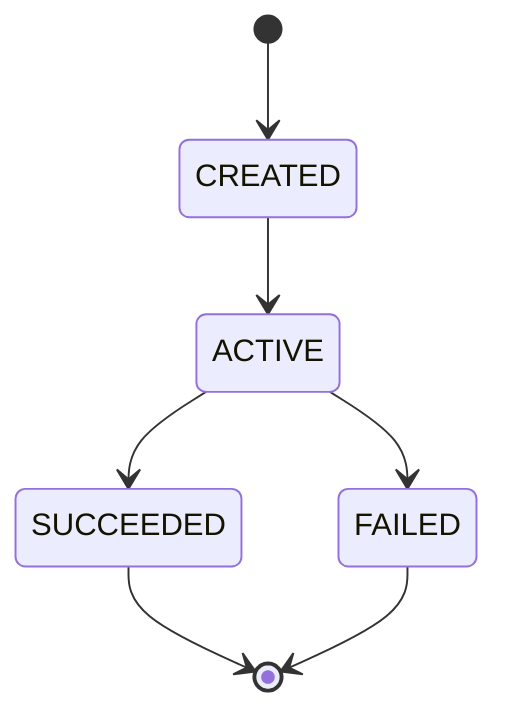

# Feature Specification: <Capability Name>

> **Spec ID**：ML-SPEC-XXX  
> **Status**：Draft / In Review / Approved / Implemented / Verified  
> **Version**：0.1  
> **Owner**：<Role, team>  
> **Created / Last reviewed**：<ISO date>  
> **Architecture links**：<HLD/LLD sections>  
> **Dependencies**：<other specs>  
> **Implementation status**：Not implemented unless supported by evidence

## 1. Problem and Outcome

**Problem**：<Who has which problem?>  
**Value**：<Why does it matter?>  
**Scope**：<Specific capability boundary>  
**Out of Scope**：<Explicit exclusions>

## 2. Actors and User Stories

### US-001 — <Feature from actor's viewpoint> (P1)

As a **<actor>**, I want **<observable capability>**, so that **<value>**.

**Why this priority**：<reason>  
**Independent test**：<how to verify without implementing unrelated features>

**Acceptance scenarios**：

1. **AS-001A — Happy path**：Given <state>, When <action>, Then <observable result>.
2. **AS-001B — Error**：Given <invalid state>, When <action>, Then <explicit rejection and no unintended side effect>.
3. **AS-001C — Concurrency**：Given <race state>, When <simultaneous actions>, Then <deterministic invariant>.

## 3. Functional Requirements

- **FR-001 (MUST)**：<Single testable behavior>；驗收：AS-001A。
- **FR-002 (MUST)**：<Security/retry/cancellation behavior>；驗收：AS-001B。

## 4. State Model and Invariants (if applicable)

- **INV-001**：<must always be true>。
- **INV-002**：<must never happen>。

## 5. External Contracts

| Operation | Input | Success | Rejection | Idempotency |
| --- | --- | --- | --- | --- |
| <Operation> | <Public, technology-agnostic intent> | <Observable response> | <Explicit error> | <Scope + retained duration policy> |

## 6. Key Entities

- **Entity A**：<meaning, identity, immutable facts, lifecycle>。

## 7. Non-Functional Requirements

- **Security**：<permission & tenant>。
- **Reliability**：<crash, retry, duplicate>。
- **Performance**：<measurable target; if not approved, state release gate and owner>。
- **Observability**：<required correlation and diagnostics>。

## 8. Success Criteria

- **SC-001**：<numeric/verifiable end-user outcome>。
- **SC-002**：<error and recovery outcome>。
- **SC-003**：<explicit Pilot acceptance threshold or pending gate>。

## 9. Assumptions, Dependencies, Open Decisions

- **Assumptions**：<do not present assumptions as verified>。
- **Dependencies**：<other capabilities / external system availability>。
- **Blocking decisions**：<must resolve before plan>。

## 10. Traceability

| Requirement | Acceptance scenario | Test type | Evidence link |
| --- | --- | --- | --- |
| FR-001 | AS-001A | Contract | Pending |

## 11. Review Checklist

- [ ] All requirements are unambiguous and individually testable.
- [ ] Happy, rejection, concurrency and recovery scenarios included.
- [ ] Tenant/authorization boundaries included.
- [ ] State invariants have matching tests.
- [ ] HLD/LLD links and assumptions confirmed.
- [ ] No internal class names, SQL, SDK calls or file paths embedded as requirements.
- [ ] Success criteria have agreed acceptance policy.
- [ ] Spec approved before generating plan/tasks.
